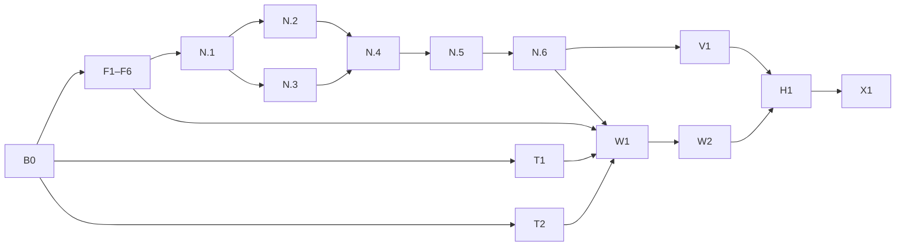

# PLAN-M0：地基

[ROADMAP.md](ROADMAP.md) M0 的执行计划。目标：让后续每个改动都有自动回归，修掉已知缺陷，并让 npm 用户不克隆本仓库就能构建原生平台。

范围对应 ROADMAP 的 M0.1–M0.7。任务编号与 ROADMAP 条目的对应关系：

| ROADMAP | 本计划任务 |
| --- | --- |
| M0.3 已确认缺陷 | F1–F6 |
| M0.4 npm 自包含 | N.1–N.6（编号沿用 [ROADMAP 附录](ROADMAP.md#附npm-自包含方案)） |
| M0.7 测试夹具 | T1、T2 |
| M0.5 版本与兼容规则 | V1 |
| M0.1 PR 流水线 | W1 |
| M0.2 夜间流水线 | W2 |
| M0.6 仓库卫生 | H1 |
| 收尾 | X1 |

## 执行规则

沿用 [PLAN.md 的执行规则](PLAN.md#执行规则) 1–10，以下几处不同：

1. **基线**：产物比对的基线是本计划 B0 记录的 `/tmp/weft-m0/`，不是 PLAN.md 的 `/tmp/weft-baseline/`。C-apps 指 `/tmp/weft-m0/check-apps.sh`。
2. **行为变化**：F1–F4 是缺陷修复，按任务写明的方式改变行为。每个缺陷先写测试，确认它在修复前失败，再修复；提交正文写明失败的现象。
3. **新增快照**：T1、T2 可以用 `WEFT_UPDATE_SNAPSHOTS` 生成**新**夹具的快照和黄金文件；已有快照和黄金文件必须不变。
4. **共享资源串行**：Windows 虚拟机、Linux 容器、`native/core/build`、`example/apps` 同一时间只能被一个任务使用。并行执行的任务在运行这些检查时加锁：`source /tmp/weft-m0/lock.sh; weft_lock <win|linux|core|apps|apple>`（macOS 没有 `flock`，`lock.sh` 用 `mkdir` 实现，进程退出时释放）。B0 写好的检查脚本 `/tmp/weft-m0/c-*.sh` 已经自带锁。
5. **对外操作**：推送分支、修改仓库设置（必过检查）、`npm publish` 需要维护者确认，不在任务里自动执行。任务能在本地完成的部分照常完成；需要确认的步骤记入进度表备注。

## 环境

同 [PLAN.md 的环境](PLAN.md#环境)。Windows 虚拟机脚本 `/tmp/weft-win.sh`、`/tmp/win-sync.ps1`、`/tmp/win-check.ps1`、`/tmp/win-ui.ps1` 见 [PLAN.md 附录](PLAN.md#附录windows-虚拟机脚本)。

N.1 之后，`native/{apple,android,windows,linux}` 是 workspace 包，会有自己的 `node_modules`。Linux 容器给每个包的 `node_modules` 单独挂卷（`compose.yaml` 已有同样的做法），否则 Mac 上安装的符号链接会指向容器里不存在的路径。

## 检查命令

沿用 [PLAN.md 的检查命令](PLAN.md#检查命令)，以下几项替换或新增。

| 代号 | 命令 | 通过条件 |
| --- | --- | --- |
| C-apps | `/tmp/weft-m0/check-apps.sh`（B0 写好，内容同 PLAN.md 的脚本，基线目录换成 `/tmp/weft-m0/apps`） | 无差异输出，退出码 0 |
| C-linux | PLAN.md 的命令（N1 之后已包含 `pnpm_config_store_dir` 与 `CI=true`，由 `compose.yaml` 提供） | 全部通过 |
| C-pack | N.6 写好的 `/tmp/weft-m0/check-pack.sh`：打包全部发布包 → 在仓库外的临时目录新建 Vite 项目 → 用 tarball 安装 → 在去掉 `cargo`、`cmake`、`ninja` 的 `PATH` 下构建 Android 和 iOS | 退出码 0 |
| C-ci | `docker run --rm -v "$PWD:/repo" -w /repo rhysd/actionlint:latest -color` | 无输出，退出码 0 |

## 依赖图

- F1–F6 彼此可以并行（F2、F4 都改 Linux 壳，但文件不同；跑 C-linux 时按规则 4 加锁）。
- T1、T2 与 F、N 可以并行。
- N.2 与 N.3 可以并行。

---

## B0 基线（不提交）

- **步骤**：
  1. `pnpm install && pnpm build`；确认 `native/apple/build/WeftCore.xcframework`、`native/android/build/jniLibs` 存在。
  2. 运行 C-rust、C-ts，记下 clippy 警告数和每个包的 tsc 错误数，写入 `/tmp/weft-m0/clippy.txt`、`/tmp/weft-m0/tsc.txt`。
  3. 7 个平台依次 `WEFT_NATIVE=0 pnpm --filter example build:
`，把产物复制到 `/tmp/weft-m0/apps/`（目录结构同 PLAN.md P0.1），写好 `/tmp/weft-m0/check-apps.sh` 并运行一次，确认无差异。
  4. 运行 C-core、C-apple、C-android、C-windows、C-linux。
- **验收**：步骤 2–4 全部通过。基线本身有失败时，记入[执行中发现](#执行中发现)并停止。

---

## F 已确认缺陷（M0.3）

### F1 `setInterval(fn, 0)` 只触发一次

- **原因**：`native/core/src/runtime.cpp` 的 `arm` 用 `period == 0` 表示一次性定时器，delay 为 0 的 interval 也落进这个分支，`weft_runtime_tick` 执行一次后就删除了它。
- **改动**：
  - `Timer` 增加 `bool repeat`，`weft_runtime_tick` 以 `repeat` 判断是否重新排期，不再用 `period` 判断。
  - 重新排期仍然取 `seq = ++rt->seq`，所以 delay 为 0 的 interval 每个 tick 只执行一次，不会在同一个 tick 里死循环。
  - `native/core/tests/js/timers.js` 和 `kernel_test.cpp` 的 `timers`：新增一个 `setInterval(fn, 0)`，执行 3 次后 `clearInterval`，断言恰好执行 3 次、且第 2 次在后一个 tick 才执行。
- **验收**：新断言在修复前失败；C-core 通过；C-windows 通过（Windows 的定时器粒度最粗）。
- **提交**：`fix(core): keep repeating setInterval with a zero delay`

### F2 Apple 和 Linux 整批解码后再应用

- **原因**：`native/apple/Sources/WeftKit/Session.swift` 的 `commit` 和 `native/linux/src/session.cpp` 的 `Session::commit` 边解码边应用，批次后部出错时已经应用了前缀，违反 SPEC「Decoding errors」的「整批不应用」。Android 和 Windows 已在 PLAN.md N2 修复，做法是 `readAll`。
- **改动**：
  - Swift：`OpReader` 新增 `static func readAll(_ bytes:) throws(OpError) -> [Op]`；`Session.commit` 先 `readAll`，成功后再逐个 `apply`。`CorpusTests` 改为通过 `readAll` 解码（与 Android、Windows 一致），共享样例 `unknown-opcode-after-create` 因此覆盖这条路径。
  - C++：`native/core/include/weft/ops.hpp` 新增 `std::vector<Op> read_all(const uint8_t *data, size_t len)`，注释写明 `rows` 指向输入缓冲区，结果只在缓冲区存活期间有效。内核的 `corpus` 测试改为通过 `read_all` 解码。Linux `Session::commit` 先 `read_all`，成功后再应用。
  - 能在不启动界面的前提下构造 Session 的宿主（至少 Apple），加一个会话级测试：提交 `unknown-opcode-after-create` 的字节后，没有创建任何 scope。
- **验收**：会话级测试在修复前失败；C-core、C-apple、C-linux、C-windows 通过；C-ui 的 macOS、iOS、Linux 三项通过。
- **提交**：`fix(shells): decode the whole batch before applying ops on Apple and Linux`

### F3 格式化器遇到二元运算数之间的注释报内部错误

- **改动**：`crates/formatter` 保留二元运算数之间（运算符前后）的块注释和行注释，输出可再格式化且结果不变（幂等）。`crates/formatter/tests/format.rs` 的 `reports_syntax_and_unsupported_comment_positions` 中对 `Text(x /* between operands */ + y)` 的内部错误断言**替换**为黄金用例，另加行注释和运算符之后的注释各一例。`FormatError::Internal` 如果因此再无产生方，一并删除。
- **验收**：新黄金用例在修复前失败；C-rust 通过。
- **提交**：`fix(formatter): keep comments between binary operands`

### F4 Linux 图片纹理缓存没有淘汰策略

- **改动**：
  - 把 `native/linux/src/elements.cpp` 里的 `textures()` 换成一个按字节数计的 LRU 缓存（新文件 `src/texture_cache.hpp`、`src/texture_cache.cpp`，命名空间 `weft`）：键是图片地址，值持有 `GdkTexture` 的引用；按 `宽 × 高 × 4` 估算字节数，总量上限 64 MiB；命中时更新最近使用顺序；超过上限时淘汰最久未用的项（释放缓存的引用，正在显示的 `GtkPicture` 仍持有自己的引用）。单张超过上限的图片不进缓存。
  - `native/linux/tests` 新增 `texture_cache_test.cpp`，用 `gdk_memory_texture_new` 构造纹理，覆盖：超限淘汰最旧项、命中后不被淘汰、超大图片不缓存。注册为 `linux.textures`。
- **验收**：C-linux 通过且包含 `linux.textures`；C-ui 的 Linux 一项通过。
- **提交**：`fix(linux): bound the image texture cache`

### F5 中文文档侧边栏的规范链接指向英文版

- **改动**：Starlight 的侧边栏链接不能按语言区分。新增路由中间件 `docs/src/routeData.ts`（`defineRouteMiddleware`），在 `zh` 语言的页面把侧边栏里指向 `GRAMMAR.md`、`SPEC.md` 的链接改成 `GRAMMAR.zh-CN.md`、`SPEC.zh-CN.md`；`astro.config.mjs` 用 `routeMiddleware` 注册。
- **验收**：`pnpm --filter docs build` 成功；`docs/dist/zh/` 下的页面含 `SPEC.zh-CN.md` 和 `GRAMMAR.zh-CN.md` 的链接，英文页面不含。
- **提交**：`docs: link the Chinese sidebar to the Chinese specifications`

### F6 compiler 包注释仍说原生视图后端不存在

- **改动**：`packages/compiler/src/index.ts` 中 `compileApp` 的文档注释改为如实描述原生平台的产物（remote 模式逻辑、`layout.json` 以及各后端生成的视图源码），以 `crates/transformer` 的实际输出为准。
- **验收**：C-ts 通过。
- **提交**：`docs(compiler): describe the native view outputs`

---

## N npm 自包含（M0.4）

方案见 [ROADMAP 附录](ROADMAP.md#附npm-自包含方案)。本节补充执行细节。

### N.1 native 包

- **改动**：
  - `native/{apple,android,windows,linux}/package.json`：`name` 为 `@weft-ui/native-<target>`，版本 `0.1.0`，`license`、`homepage`、`repository`（含 `directory`）、`publishConfig.access` 与其他 `@weft-ui/*` 包一致；`files` 白名单：
    - apple：`Package.swift`、`Sources`、`build/WeftCore.xcframework`；
    - android：`build.gradle.kts`、`consumer-rules.pro`、`src/main`、`build/jniLibs`；
    - windows：`Weft.WinUI.targets`、`Weft.WinUI`（排除 `bin`、`obj`）、`build/win-x64/weft_core.dll`、`build/win-arm64/weft_core.dll`；
    - linux：`CMakeLists.txt`、`include`、`src`、`build/linux-x64/libweft_core.so`、`build/linux-arm64/libweft_core.so`、`build/linux-arm64/bin/hermesc`（N.2 再加 `core`）。
  - 包里不带测试。SwiftPM 和 Gradle 必须能在没有 `Tests/`、`src/test` 的目录里解析：`Package.swift` 只在 `Tests/WeftKitTests` 存在时声明测试目标；Gradle 的测试配置不能因为缺少测试目录而失败。
  - `pnpm-workspace.yaml` 加入 4 个目录；`native/linux/docker/compose.yaml` 为 4 个包的 `node_modules` 加卷。
- **验收**：
  - 4 个包的 `pnpm pack --dry-run` 文件清单符合上面的白名单，不含中间产物、测试、`docker/`、构建脚本（`build-core.*`、`CMakeLists.txt` 之于 android、`cmake/`）。本机没有的预编译内核（Windows、Linux x64）不出现在清单里是预期的，由 N.6 的检查拦截发布。
  - C-apple、C-android 通过；C-apps 无差异。
- **提交**：`build(native): package the native shells with their prebuilt kernels`

### N.2 Linux 壳内置 core 副本

- **改动**：
  - 新增 `native/pack.mjs`，供 4 个包的 `prepack` 和 `postpack` 调用（`node ../pack.mjs prepack <target>`）。Linux 的 `prepack` 把 `native/core/include` 和 `native/core/src/ops.cpp` 复制到 `native/linux/core/`，`postpack` 删除，避免仓库内开发时用到过期副本；`native/linux/.gitignore` 忽略 `core/`。
  - `native/linux/CMakeLists.txt`：`core/include` 存在时使用包内副本，否则回退到 `../core`。
  - `files` 加入 `core`。
- **验收**：`pnpm pack` 后工作区没有残留的 `native/linux/core/`；从 tarball 解压出的目录在容器里能独立完成 CMake 配置和构建（解压到 `/tmp`，`cmake -S <解压目录> -B … && cmake --build …`）；C-linux 通过。
- **提交**：`build(linux): ship the kernel headers and op reader inside the shell package`

### N.3 用模块解析定位原生壳

- **改动**：
  - `packages/vite/src/shells.ts`：不传 `native` 时，用 `createRequire(import.meta.url).resolve("@weft-ui/native-<target>/package.json")` 定位壳；找不到时抛错：`weft: building for <platform> needs the native shell; install it with \`pnpm add -D @weft-ui/native-<target>\``。传了 `native` 时行为不变。
  - `@weft-ui/vite` 的 `peerDependencies` 加入 4 个 native 包（`peerDependenciesMeta` 全部 `optional`），`devDependencies` 加入它们的 `workspace:*`；example 的 `devDependencies` 加入 4 个 native 包。
  - 测试：缺包时的错误信息含安装命令（`packages/vite` 的单测）。
- **验收**：`rg -n '\.\./\.\./\.\./native' packages/vite/src` 没有输出；C-ts 通过；C-apps 无差异。
- **提交**：`build(vite): resolve the native shells as packages`

### N.4 hermesc 随 native 包分发

- **改动**：
  - `hermes-compiler` 从 `@weft-ui/vite` 的 `dependencies` 移到 4 个 native 包的 `dependencies`，版本不变。
  - `packages/vite/src/native.ts` 的 `hermesc` 从壳目录出发解析：`createRequire(join(shell, "package.json")).resolve("hermes-compiler/package.json")`；Linux arm64 用壳内的 `build/linux-arm64/bin/hermesc`。`WEFT_HERMESC` 仍然优先。错误信息改为指向 native 包，不再提及从源码构建。
  - `tests/conformance` 等其他用到 hermesc 的地方同步。
- **验收**：在仓库外新建只装 `@weft-ui/vite` tarball 的项目，`node_modules` 里没有 `hermes-compiler`（`find node_modules -name hermes-compiler` 没有输出）；C-ts 通过；C-apps 无差异；C-core 通过（conformance 用到 hermesc）。
- **提交**：`build(vite): take hermesc from the native shell package`

### N.5 协议版本一致性检查

- **改动**：
  - native 包的 `package.json` 增加 `"weft": { "protocol": <n> }`。`protocol/generate.ts` 写入这个字段，`--check` 校验它与 `weft.protocol.json` 一致。
  - `@weft-ui/vite` 在原生构建前读取壳的 `package.json`，与 `@weft-ui/runtime` 的协议版本比较；不一致时报错，信息里给出两边的版本和包名。
  - 测试：`packages/vite` 单测覆盖不一致时的报错。
- **验收**：把 `native/android/package.json` 的协议版本临时改错后，`WEFT_NATIVE=0 pnpm --filter example build:android` 报错并给出两边的版本；C-gen 能发现改错的版本；C-ts 通过。
- **提交**：`build(vite): check that the native shell speaks the compiler's protocol`

### N.6 发布检查与仓库外验证

- **改动**：
  - `native/pack.mjs` 增加 `prepublishOnly <target>`：检查该目标的全部预编译内核都存在（apple：xcframework 的 macOS、iOS 真机、iOS 模拟器三个切片；android：4 个 ABI；windows：x64、arm64；linux：x64、arm64 及 arm64 的 hermesc），缺任何一个都失败并列出缺项。4 个包的 `prepublishOnly` 调用它。
  - Hermes 的 MIT 许可证：提交 `native/core/LICENSE-hermes`（取自内核构建所用的 Hermes 源码），`prepack` 复制到每个包，`postpack` 删除；`files` 加入它。
  - 写好 `/tmp/weft-m0/check-pack.sh`（C-pack，不提交）。
  - README 和文档（`docs/.../guides/platforms.md` 中英文）改为：原生平台先 `pnpm add -D @weft-ui/native-<target>`；从源码构建内核只在仓库内开发时需要。
- **不做**：真正的 `npm publish`（需要 Windows x64 和 Linux x64 的内核，并由维护者确认）；Release 工作流（ROADMAP 写明在首个版本之后）。两者记入[后续计划项](#后续计划项)。
- **验收**：C-pack 通过；删掉一个 ABI 的内核后，`pnpm --filter @weft-ui/native-android run prepublishOnly` 失败并列出缺项；`pnpm --filter docs build` 成功。
- **提交**：`build(native): verify prebuilt kernels before publishing and ship the Hermes license`

---

## T 测试夹具（M0.7）

### T1 快照夹具

- **改动**：
  - 新增 `crates/transformer/tests/fixtures/Gallery.weft`：覆盖全部 7 个元素（含 Checkbox、Image）、全部 8 个样式属性（每个至少一处字面量、一处绑定）、带 Children 插槽的自定义组件及其调用、`if` 和 `for`。
  - `snapshots.rs` 改为对每个夹具生成快照（`tests/snapshots/<Fixture>/<platform>`）；用 `WEFT_UPDATE_SNAPSHOTS=1` 生成 Gallery 的快照。
  - `crates/parser/tests/fixtures.rs` 和 `packages/tree-sitter/test/fixtures.sh` 自动包含它（它们列出全部被跟踪的 `.weft`）。
- **验收**：`git status` 显示 `TodoList` 快照无改动；C-rust 通过。
- **提交**：`test(transformer): snapshot a fixture with every element, style and slot`

### T2 conformance 夹具

- **改动**：
  - 新增 `tests/fixtures/gallery/`（`.weft` 与 `script.ts`），覆盖同 T1；脚本的步骤包括：切换 Checkbox、改 Image 的 `src`、改变绑定的样式值、改变插槽内容、触发自定义组件里的按钮。
  - `tests/conformance/conformance.test.ts` 注册它；`WEFT_UPDATE_SNAPSHOTS=1` 生成 `golden/gallery.ops`。原生内核的 conformance 自动包含它（`native/build.ts` 遍历全部夹具）。
- **验收**：`board.ops`、`todo.ops` 无改动；C-ts 通过；C-core 和 C-windows 通过且 conformance 包含 gallery。
- **提交**：`test(conformance): add a fixture with every element, style and slot`

---

## V1 版本与兼容规则（M0.5）

- **改动**：
  - 根目录加入 `@changesets/cli`；`.changeset/config.json`：`baseBranch: master`、`access: public`、全部发布包（5 个 TS 包与 4 个 native 包）放进一个 `fixed` 组、私有包不参与版本和标签；根 `package.json` 加 `changeset` 和 `version-packages` 脚本。
  - 每个发布包新增 `CHANGELOG.md`，记录 0.1.0（native 包记为首个版本，写明随 0.1.0 一起发布）。
  - `protocol/SPEC.md` 和中文版新增小节「Versioning」：协议版本是 `weft.protocol.json` 里的整数，任何不兼容的线路格式变化都要加一；native 包在 `package.json` 里记录所实现的协议版本，`@weft-ui/vite` 构建前比对（N.5）；1.0 之前包版本的 minor 可以包含破坏性变更，协议版本变化必然伴随包的 minor 升级；1.0 之后的兼容承诺见 ROADMAP M6.6。
  - `.changeset/README.md` 说明「每个用户可见的改动附带一个 changeset」；README 和 CONTRIBUTING 的说明由 H1 补上。
- **验收**：`pnpm changeset status` 正常运行；在仓库的临时副本里加一个只改 `@weft-ui/runtime` 的 changeset 后 `pnpm changeset version`，9 个发布包版本一起升级、私有包不变；`pnpm --filter docs build` 成功。
- **提交**：`build: version every package together with changesets`

---

## W 持续集成（M0.1、M0.2）

### W1 PR 流水线

- **改动**：新增 `.github/workflows/ci.yml`，`pull_request` 和 `push`（master）触发，同一分支新提交取消旧运行。作业：

  | 作业 | 运行器 | 内容 |
  | --- | --- | --- |
  | rust | `ubuntu-24.04` | C-rust，clippy 用 `-D warnings`（基线为 0） |
  | ts | `ubuntu-24.04` | `pnpm build:wasm`、C-ts（含 C-gen），tsc 错误数不超过 B0 的基线（超出即失败）；`pnpm --filter docs build` |
  | core | `ubuntu-24.04` | C-core，含 conformance |
  | linux | `ubuntu-24.04` | C-linux（容器） |
  | apple | `macos-26` | `WEFT_APPLE_SDKS=macosx native/apple/build-core.sh`、C-apple |
  | android | `ubuntu-24.04` | `WEFT_ANDROID_ABIS=x86_64 native/android/build-core.sh`、C-android |
  | windows | `windows-2025` | `build-core.ps1 -Arch x64`，内核测试与 conformance（`WEFT_CORE_SHARED=ON`），`dotnet test native\windows\Weft.WinUI.Tests` |

  - 缓存：cargo（`Swatinem/rust-cache`）、pnpm store（`setup-node` 的 `cache: pnpm`）、Hermes 构建目录（键含 `native/core/CMakeLists.txt` 与 Hermes 版本的哈希）。
  - Android 单测放在 Ubuntu 而不是 ROADMAP 写的 macOS：Android 单测与宿主无关，Ubuntu 的运行器更快、计费更低；Apple 作业只跑 C-apple。
  - 每个作业所需的工具链版本（Rust、Node、pnpm、JDK、NDK、.NET、Xcode）写在工作流里，与 CONTRIBUTING 一致。
- **验收**：C-ci 通过；推送到临时分支后全部作业在 GitHub 上通过（需要维护者确认推送，见规则 5）。
- **提交**：`ci: check every pull request on every platform`

### W2 夜间流水线

- **改动**：新增 `.github/workflows/nightly.yml`，`schedule`（每天一次）和 `workflow_dispatch` 触发：
  - android-ui（`ubuntu-24.04`，启用 KVM）：`reactivecircus/android-emulator-runner` 启动 x86_64 模拟器，构建 `x86_64` 内核后跑 `pnpm --filter example test:android`；
  - ios-ui（`macos-26`）：构建 iOS 模拟器内核后跑 `pnpm --filter example test:ios`。
  - 工作流顶部注释写明：Windows（FlaUI，需要交互式桌面）和 Linux（容器内 VNC 桌面）的 UI 测试暂时只在本地运行，命令见 CONTRIBUTING。
- **验收**：C-ci 通过；手动触发一次后两项作业在 GitHub 上通过（需要维护者确认）。
- **提交**：`ci: run the Android and iOS UI flows nightly`

---

## H1 仓库卫生（M0.6）

- **改动**：
  - `CONTRIBUTING.md`：环境准备（各平台工具链与版本，和 CI 一致）、一次性构建步骤、检查命令（PLAN.md 的代号与命令）、Windows 与 Linux 的本地 UI 测试、提交规范（Conventional Commits，一次提交一件事）、changeset 要求、生成文件规则（`pnpm gen:protocol`）。
  - `SECURITY.md`：支持的版本（1.0 之前只支持最新 minor）、私下报告的渠道（GitHub 私有漏洞报告）。
  - `.github/ISSUE_TEMPLATE/bug_report.yml`、`feature_request.yml`、`config.yml`（关闭空白 issue，安全问题指向 SECURITY）；`.github/pull_request_template.md`（改动、检查、changeset、文档中英文同步）。
  - README 链接 CONTRIBUTING。
- **验收**：C-ci 通过（issue 模板不在 actionlint 范围，`yq` 能解析即可）；所有相对链接指向存在的文件。
- **提交**：`docs: contributing guide, security policy and issue templates`

---

## X1 收尾

- **改动**：
  - 本文件：进度表全部完成；[执行中发现](#执行中发现)每项都有结论。
  - ROADMAP.md 第 2 节「已确认的缺陷」改为指向本计划，表格保留并标注已修复；「分发」「CI」「测试」三行的现状更新。
- **验收**：`pnpm --filter docs build` 成功；C-rust、C-ts、C-apps 通过。
- **提交**：`docs: close out the M0 plan`

---

## 后续计划项

由[执行中发现](#执行中发现)转出，或本计划明确不做、留给下一份计划的项。

| 编号 | 内容 | 来源 |
| --- | --- | --- |
| R1 | 首次 `npm publish` native 包：汇总 Windows x64/arm64、Linux x64/arm64 的内核，由维护者确认后发布 | N.6 |
| R2 | Release 工作流：按矩阵（macOS、Windows、`ubuntu-24.04`、`ubuntu-24.04-arm`）构建全部内核，汇总后一次发布 | N.6 |

R1、R2 在 M0 收尾后接着做（下一节）。

---

## R 发布（R1、R2）

维护者的决定：Linux 内核不再依赖系统 ICU，改用 ICU4X；npm 发布不用 token，走可信发布（OIDC）加暂存发布（`npm stage publish`），由维护者在 npmjs.com 用 2FA 批准；首个包含 native 包的版本是 0.2.0。

### U1 Linux 内核的 Unicode 后端改用 ICU4X

- **问题**：Linux 上 Hermes 动态链接系统 ICU，预编译的 `libweft_core.so` 依赖 `libicuuc.so.78`，只能在 ICU 版本完全相同的发行版上加载。
- **改动**：新增 Rust staticlib `crates/unicode`（ICU4X 2.x，内置全部 locale 数据），用 C ABI 提供比较、大小写、规范化和日期格式化；`native/core/src` 的 C++ 胶水实现 Hermes 的 4 个 `hermes::platform_unicode` 函数。仅在 Linux 上，CMake 把 `HERMES_PLATFORM_UNICODE` 设为 Hermes 没有实现的值，并跳过 Hermes 的 ICU 查找。构建环境与文档去掉 `libicu-dev`，Linux 内核构建改为需要 Rust。
- **验收**：新内核测试 `core.unicode`（大小写、规范化、孤立代理项、`localeCompare`、`toLocaleString`）在 macOS、Windows、Linux 都通过；crate 的单元测试通过；Linux 上 `libweft_core.so` 和 `hermesc` 的 `NEEDED` 里没有 libicu，导出的符号仍然只有内核的 C ABI；C-linux、C-core、C-windows、C-rust 通过。
- **提交**：`feat(core): ICU4X Unicode backend for the Linux kernel`

**后续调整**：Linux 内核改用 ICU4X 官方 C++ 绑定，链接 2.4.0 的预构建归档，移除 `crates/unicode`。内核构建不再需要 Rust 工具链，仍不依赖系统 ICU；编译器和 WASM 构建不变。

### R2 Release 工作流

- **改动**：新增 `.github/workflows/release.yml`，手动触发，`stage` 默认关闭。分平台构建内核：macOS 构建 Apple 和 Android，`windows-2025` 构建 x64，`windows-11-arm` 构建 arm64，`ubuntu-24.04` 构建 Linux x64，`ubuntu-24.04-arm` 构建 Linux arm64；Linux 直接在运行器上构建，用的是 Ubuntu 24.04 的 glibc。汇总后跑每个 native 包的 `prepublishOnly` 检查，`pnpm -r pack` 打包全部发布包并上传为 artifact，对 npm 上还没有的版本执行 `npm stage publish`；不勾 `stage`，或者不在 master 上运行时，加 `--dry-run`。发布构建不用缓存。CONTRIBUTING 增加「Releasing」一节：发布步骤、可信发布配置，以及新包的首次暂存。
- **验收**：C-ci 通过；在 GitHub 上以 dry run 方式跑完整个工作流（m0 分支临时加 push 触发，不进 master）：全部内核构建成功，4 个 `prepublishOnly` 检查通过，9 个 tarball 上传成功，`npm stage publish --dry-run` 对每个未发布的版本都成功。
- **提交**：`ci: release workflow staging every package on npm`

### R1 0.2.0

- **改动**：为 M0 加一个 minor changeset，运行 `pnpm version-packages`，9 个发布包一起升到 0.2.0，CHANGELOG 随之更新。
- **验收**：`.changeset/` 里没有待处理的 changeset；9 个发布包都是 0.2.0，私有包的版本不变；`pnpm -r pack` 得到的 `@weft-ui/vite` 的 peerDependencies 是 `^0.2.0`。
- **提交**：`chore: version packages 0.2.0`
- **之后由维护者完成**：merge 到 master，以 dry run 运行 Release，下载 `packages` artifact，在本机暂存 4 个 native 包并批准；然后给 9 个包配置可信发布，以后的版本都由工作流暂存。

## 进度表

状态取值同 PLAN.md：`☐` 未开始，`◐` 进行中，`☑` 完成，`⏸` 已提交但等待验证（写明缺哪项）。

| 任务 | 状态 | 备注 |
| --- | --- | --- |
| B0 基线 | ☑ | clippy 0；tsc：vite 16、tests 59，其余 0；C-apps 基线已存；C-core、C-apple、C-android、C-windows（`net10.0`）、C-linux 通过 |
| F1 `setInterval(fn, 0)` | ☑ | 修复前 `count("zero") == 3` 失败（只执行 1 次）；C-core、C-windows 通过 |
| F2 Apple、Linux 整批解码 | ☑ | 回归测试修复前创建了 scope 3、修复后未创建；C-core、C-apple、C-linux、C-windows 及 macOS、iOS、Linux 点击流程通过 |
| F3 格式化器注释 | ☑ | 5 个黄金用例在修复前均报内部错误；修复后通过并验证幂等，C-rust 通过（clippy 0） |
| F4 Linux 纹理缓存 | ☑ | 淘汰测试修复前失败；C-linux（含 `linux.textures`）、C-ui Linux 通过 |
| F5 中文侧边栏链接 | ☑ | 文档构建通过；6 个中文侧边栏均链接中文版，英文页面无中文版链接 |
| F6 compiler 注释 | ☑ | 只改注释；compiler 包构建与 tsc 通过 |
| N.1 native 包 | ☑ | 4 个 pack 清单符合白名单；SwiftPM 可解析无测试的包；C-apple、C-android、C-apps 通过 |
| N.2 Linux 壳内置 core | ☑ | Linux tarball 解压到容器 `/tmp` 后独立配置、构建成功；打包后无 `core/` 残留；C-linux 通过 |
| N.3 模块解析定位壳 | ☑ | 无源码相对路径；工作区解析为原 `native/<target>` 路径，缺包提示含安装命令；C-ts、C-apps 通过 |
| N.4 hermesc 随 native 包 | ☑ | 仓库外仅安装 Vite tarball 不含 `hermes-compiler`；C-ts、C-apps、C-core（含 3 个 conformance 夹具）通过 |
| N.5 协议版本检查 | ☑ | 将 Android 壳版本改为 99 时 `WEFT_NATIVE=0` 构建报告 99 与 1，C-gen 检出该清单；恢复后 C-gen、C-ts 通过 |
| N.6 发布检查与仓库外验证 | ☑ | C-pack 仓库外构建 Android APK 与 iOS 模拟器应用；4 个壳包包含 Hermes 许可证；缺 x86 ABI 时拒绝发布，文档构建通过 |
| T1 快照夹具 | ☑ | Gallery 覆盖 7 个元素、8 个字面量和绑定样式属性及插槽；TodoList 快照无改动；C-rust 通过（clippy 0） |
| T2 conformance 夹具 | ☑ | `board.ops`、`todo.ops` 无改动；C-ts 通过（tests 56，与启用 mapper 的基线一致）；C-core 和 C-windows 均通过 `conformance.gallery` |
| V1 版本规则 | ☑ | `changeset status` 正常运行；临时副本里只给 runtime 加 minor changeset，9 个发布包一起升到 0.2.0，私有包不变；发布包的 `files` 加入 `CHANGELOG.md`（pnpm pack 默认不带）；`pnpm version` 是 pnpm 内置命令，脚本名用 `version-packages` |
| W1 PR 流水线 | ☑ | C-ci 通过；draft PR #1 首次运行 core、windows 失败，修复后（见执行中发现）在全部 M0 提交上 8 个作业全部通过（run 44506078689）。设为必过检查由维护者在仓库设置里完成 |
| W2 夜间流水线 | ☑ | C-ci 通过；在 m0 分支临时加 push 触发（未进入 master），android-ui、ios-ui 在全部 M0 提交上通过（run 44506071160） |
| H1 仓库卫生 | ☑ | C-ci 通过；issue 模板 YAML 可解析；CONTRIBUTING、SECURITY、README 的相对链接都指向存在的文件。GitHub 私有漏洞报告需要在仓库设置里开启 |
| X1 收尾 | ☑ | docs 构建、C-rust（clippy 0）、C-ts（tsc 不超基线）、C-apps 通过；ROADMAP 第 2 节已更新 |
| U1 ICU4X Unicode 后端 | ☑ | `core.unicode` 在 macOS、Windows、Linux 通过，crate 7 个单元测试通过；C-rust（clippy 0）、C-core、C-windows、C-linux 通过。Release 构建的 Linux x64、arm64 内核和 arm64 `hermesc` 都不依赖 libicu，需要 glibc 2.38；`libweft_core.so` 只导出 6 个 C ABI 符号；arm64 剥离后的体积从 3.3 MB 增加到 5.9 MB |
| R2 Release 工作流 | ☑ | C-ci 通过；m0 分支临时加 push 触发（未进 master），两次 dry run 全部作业通过（run 44516606264、44520242849），`windows-11-arm` 可以构建 arm64 内核。第二次包含 U1 和 0.2.0，9 个包都通过 `npm stage publish --dry-run`；native 包解压后的体积：Apple 29.5 MB、Linux 18.4 MB、Android 10.1 MB、Windows 4.9 MB |
| R1 0.2.0 | ⏸ | 9 个发布包为 0.2.0，私有包不变；打包后 `@weft-ui/vite` 的 peerDependencies 为 `^0.2.0`。等维护者暂存并批准（见 R1「之后由维护者完成」） |

## 执行中发现

（执行时追加。格式：`- [任务号] 发现内容；结论：转为新计划项 / 不处理（原因）`）

- [F2] Linux 增量构建时 Ninja 在 C++ 模块依赖扫描（`RefreshDyndepDependents`）触发断言，仅在容器的本地内核构建缓存关闭 `CMAKE_CXX_SCAN_FOR_MODULES` 后 C-linux 通过；结论：不处理（本地构建工具问题，未修改仓库配置）
- [F2] Windows 虚拟机的 `prlctl exec --current-user` 一度报 `PrlJob_GetRetCode: Invalid argument`，随后原样重跑 C-windows 通过；结论：不处理（Parallels 瞬时故障）

- [F4] Linux 内核增量构建再次触发 PLAN.md P0.1 记录的 Ninja dyndep 断言，删除内核构建目录中的 `CMakeFiles/weft_core.dir` 后 C-linux 通过；结论：不处理（本地构建目录状态问题）

- [F5] 中文「工具链」指南的页底「下一页」仍链接英文语法；结论：已修复（路由中间件同样改写 `pagination.prev`/`next`，提交 `docs: localize the specification links of the Chinese pagination`）。
- [F5] 文档构建在修复前后均提示 `i18n` 集合缺失或为空、`404` 文档条目缺失；结论：不处理（已有警告，不影响构建及侧边栏验收）。
- [N.2] 重建 Linux 容器后，内核 CMake 缓存指向的 `/hermes-src` 不再存在；重新指向工作区中已有的 Hermes 源码后 C-linux 通过；结论：不处理（同 PLAN.md P0.1，仅限本地缓存）。
- [T2] B0 的 `tests` tsc 基线为 59，但未传 `--runExternalCode`，TypeScript 不会加载 `.weft` content mapper；C-ts 仅对 `tests` 启用该参数后，既有错误 56 个、Gallery 新增 0 个。剩余错误来自既有 fixture 和 native driver 的类型导入路径；结论：不处理这些既有错误，C-ts 与 W1 按启用 mapper 后的 56 个错误作基线。
- [N.6] 仓库外的 pnpm 项目若只间接依赖 `@weft-ui/runtime`，Vite 无法从应用生成的模块解析 `@weft-ui/runtime/remote`；结论：不处理（应用直接依赖运行时，C-pack 与使用文档均明确声明）。后续调整：已修复，Vite 插件把构建中所有 `@weft-ui/runtime` 导入解析到插件自身依赖的运行时，应用不再直接依赖它。
- [W1] CI 首次在 Linux（GCC）上跑内核测试，`core.corpus` 段错误。原因是 P1.4 起就有的悬垂引用：`for (auto &c : read_corpus("ops.json")["cases"].array())` 中 `read_corpus` 返回的临时文档在循环开始前就析构了（C++23 之前范围 for 不延长中间临时对象的生命周期），Clang 和 MSVC 恰好没有崩。结论：已修复（文档存进局部变量，提交 `test(core): keep the corpus documents alive in the kernel test`；容器内 GCC 跑内核测试 14 项通过）。
- [W1] Windows 运行器检出时 `core.autocrlf` 把黄金文件转成 CRLF，`conformance.board`、`conformance.todo` 在第 1 行就不一致；虚拟机用 robocopy 同步 Mac 的工作区，所以本地从未出现。结论：已修复（`.gitattributes` 固定 `*.ops` 为 LF，提交 `test(conformance): keep the goldens LF on Windows checkouts`）。
- [W1] 容器的 `node_modules` 卷在 N.1 之后需要重新 `pnpm install` 才有 native 包的链接，否则内核 conformance 报「needs the native shell」。结论：不处理（C-linux 命令本身先跑 `pnpm install`；只影响手动在旧容器里跑内核测试）。
- [W1] 缓存未命中时 windows 作业要 24 分钟：`build-core.ps1` 和内核测试各编译一次 Hermes（11 分钟、10.5 分钟），而 `Weft.WinUI.Tests` 并不加载 `weft_core.dll`。结论：已修复（去掉 `build-core.ps1`，内核测试按它的参数构建 DLL，提交 `ci: build Hermes once in the Windows job`；冷缓存 11 分钟，热缓存约 2 分钟）。
- [R2] Linux 上 Hermes 动态链接系统 ICU，预编译内核只能在 ICU 版本完全一致（`libicuuc.so.78`）的发行版上加载。Unicode Lite 会让非 ASCII 字符的大小写转换失效，`toLocaleString` 也只返回固定文本；静态链接 ICU 每个架构要多约 30 MB。结论：已修复（维护者选用 ICU4X，任务 U1）。
- [R1] npm 的 2FA-bypass token 将在 2027 年 1 月失去直接发布的权限。结论：发布改用可信发布（OIDC）加暂存发布，不配置 token（任务 R2）。
- [R2] PR #2 的每个内核作业都从头编译 Hermes：缓存按分支隔离，PR 只能读到自己的和 master 的缓存，而合并后 master 上的 CI 被取消，没有留下任何内核缓存；缓存键还包含 Weft 自己的 CMake 文件。结论：已修复（Hermes 选项移到 `native/core/hermes.cmake`，缓存键只取 Hermes 标签、这个文件和平台构建脚本，提交 `ci: key the kernel caches on the Hermes options only`）。master 上的 CI 需要跑完才能为后续 PR 预热缓存。评估过 Hermes 的 C ABI（`API/hermes_abi`）：README 标注为实验性，`queueMicrotask` 未实现，`make_hermes_runtime` 会忽略配置，不能承载内核；独立仓库发布预编译 Hermes 暂不做。
- [X1] `pnpm pack --dry-run` 执行 `prepack` 但不执行 `postpack`，会在 native 包目录留下 `LICENSE-hermes`（Linux 还有 `core/`，已被忽略）。结论：已修复（4 个包的 `.gitignore` 忽略 `/LICENSE-hermes`）。
