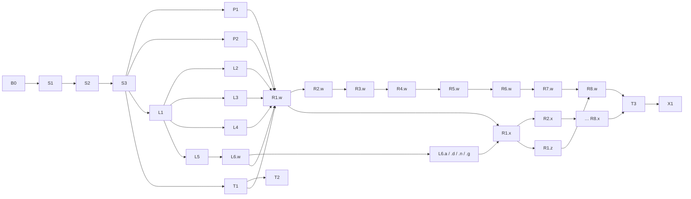

# PLAN-M1：界面表达力

[ROADMAP.md](ROADMAP.md) M1 的执行计划。目标：参考应用 `showcase/` 的每一个静态页面都能用 `.weft` 精确写出来，并在 7 个平台上一致地渲染；截图回归守住第一梯队。

执行第一步（任务 B0 之前）：把本文件原样保存为仓库根目录的 `PLAN-M1.md`，随 S1 一起提交；之后每完成一个任务更新其中的进度表。

范围对应 ROADMAP 的 M1.1–M1.13，以及 D1、D2 的定稿：

| ROADMAP | 本计划任务 |
| --- | --- |
| M1.1 元素定义单一来源（D1） | S1、S2 |
| M1.2 平台支持矩阵 | S3 |
| M1.3 截图回归 | T1、T2（showcase 页面见 T3） |
| M1.4 布局 | R1 |
| M1.5 外观 | R2 |
| M1.6 文本 | R3 |
| M1.7 新元素 | R1（Scroll）、R4（其余） |
| M1.8 输入增强 | R5 |
| M1.9 任意元素可点击 | R6 |
| M1.10 样式复用与主题（D2） | L5、L6 |
| M1.11 资源管线 | R7 |
| M1.12 安全区与屏幕信息 | P2、R8 |
| M1.13 语言补强 | L1–L4 |
| 协议升级（Picker 的字符串数组、环境推送） | P1、P2 |
| 参考应用静态页面（退出标准） | T3 |
| 收尾 | X1 |

## 维护者的决定

- **平台范围**：M1 的全部新能力在 7 个平台（web、wechat、ios、macos、android、windows、linux）都实现。支持矩阵（S3）最终只剩一类条目：`Input.returnKey` 在 macOS、Windows、Linux 上标「忽略」。分阶段落地期间，矩阵临时把尚未实现的平台标成「不支持」，保证每次提交都能构建、能通过检查。
- **枚举**：字符串字面量联合（`"text" | "image"`）加 `type Name = ...` 别名；内置属性写 `align = "center"`。
- **主题**：在 .weft 顶层写 `theme { ... }`，颜色 token 可以带深色值，尺寸 token 只有一个值；使用处写 `theme.primary`。
- **截图回归**：夜间 CI 跑 Web（Playwright）、iOS 模拟器、Android 模拟器；小程序截图是本地脚本；macOS、Windows、Linux 只做本地截图供人工查看，不比对。
- **参考应用**：M1 建立 `showcase/`，写出全部页面的静态版本，进入截图回归；「设计稿」以维护者首次批准的截图基线为准。

## 执行规则

沿用 [PLAN.md 的执行规则](PLAN.md#执行规则) 1–10 和 [PLAN-M0.md](PLAN-M0.md#执行规则) 的规则 4（共享资源加锁）、规则 5（对外操作需维护者确认），以下几处不同：

1. **基线**：产物比对的基线是 B0 记录的 `/tmp/weft-m1/`。C-apps 指 `/tmp/weft-m1/check-apps.sh`。锁脚本是 `/tmp/weft-m1/lock.sh`（内容同 M0 的 `lock.sh`）。
2. **产物变化**：S1、S3 必须产物不变（快照、conformance 黄金文件、C-apps 逐字节一致）；S2 只允许小程序产物变化。其余任务每个任务的「预期变化」写明允许变化的快照和黄金文件；只有这些可以用 `WEFT_UPDATE_SNAPSHOTS=1` 重新生成，生成后逐个检查差异确实只来自本任务。C-apps 的基线在每个允许 example 产物变化的任务提交后重新录制（运行 B0 的步骤 3）。
3. **分阶段落地**：R 系列每个能力分 5 个子任务：`.w`（schema、语义检查、Web、小程序、测试）先做，然后 `.a`（SwiftUI，iOS 与 macOS）、`.d`（Compose）、`.n`（WinUI）、`.g`（GTK）。`.w` 在 schema 里把 5 个原生平台标为 `"no"`；原生子任务实现后把自己的平台改成 `"yes"`（删除该条目）。4 个原生子任务互不依赖，可以并行；同一平台族的子任务按编号串行（它们改同一批文件）。L6 用同样方式分子任务。
4. **截图基线**：新增或变化的截图基线由执行者用 `WEFT_UPDATE_SNAPSHOTS=1` 生成，逐张打开查看，确认符合本计划[规范](#规范m1-的语言与元素)的语义后提交，并在进度表备注「截图待维护者确认」。等待确认不阻塞后续任务；维护者要求修改时，修改记入[执行中发现](#执行中发现)并在下一个相关任务里完成。
5. **文档**：每个任务同步更新中英文文档。元素参考页由 S3 的生成器产出，不手改；手写的指南（`docs/src/content/docs/guides/` 与 `zh/guides/`）和 `crates/parser/GRAMMAR.md`、`GRAMMAR.zh-CN.md`、`protocol/SPEC.md`、`SPEC.zh-CN.md` 由任务按需修改。每个任务附带一个 changeset（`pnpm changeset`，minor）。
6. **生成文件**：带「Generated from protocol/weft.elements.json」文件头的文件与 protocol 生成文件同等对待：禁止手改，改 schema 后运行 `pnpm gen:protocol`。
7. **分阶段期间的测试夹具**：`.w` 子任务的新功能在原生平台上会因 `"no"` 而编译失败，所以：
   - 快照：S3 给 `crates/transformer/tests/snapshots.rs` 的 `Fixture` 增加字段 `natives: &'static [Platform]`（现有夹具为全部 5 个原生平台），`check_native` 只检查列出的平台。`.w` 新增的夹具写 `natives: &[]`；每个原生子任务把自己的平台加进去并生成该平台的快照目录。
   - 原生内核一致性测试（`tests/conformance/native/build.ts` 用 Linux 平台编译每个 conformance 夹具）：S3 新增 `tests/conformance/native/pending.json`（夹具名数组，初始为 `[]`），`build.ts` 跳过其中的夹具，CTest 的夹具列表同样跳过（`native/core/tests/CMakeLists.txt` 读取同一文件）。`.w` 新增的 conformance 夹具加入该列表；对应的 `.g` 子任务移除。
   - showcase：页面的 `pending` 字段（T1）。
   - 这三个过渡机制在 X1 删除（届时它们都已为空）。

## 环境

同 [PLAN.md 的环境](PLAN.md#环境) 与 [PLAN-M0.md 的环境](PLAN-M0.md#环境)。另需：

- Playwright：T1 把 `playwright` 加为 `showcase` 的 devDependency；本机与 CI 先运行 `pnpm --filter showcase exec playwright install chromium`。
- 微信开发者工具（本地截图用，T1）：已安装、已登录，「设置 → 安全设置 → 服务端口」已开启；命令行工具路径通过环境变量 `WEFT_WECHAT_CLI` 提供（macOS 默认 `/Applications/wechatwebdevtools.app/Contents/MacOS/cli`）。
- Linux 容器：R7 往 `native/linux/docker/Dockerfile` 加 `librsvg2-common`（gdk-pixbuf 的 SVG 加载器）和 `libfontconfig-dev`，并在 CI 与 CONTRIBUTING 同步。

## 检查命令

沿用 [PLAN.md](PLAN.md#检查命令) 与 [PLAN-M0.md](PLAN-M0.md#检查命令) 的检查命令，以下几项替换或新增。

| 代号 | 命令 | 通过条件 |
| --- | --- | --- |
| C-apps | `/tmp/weft-m1/check-apps.sh`（B0 写好，内容同 PLAN.md 的脚本，基线目录换成 `/tmp/weft-m1/apps`） | 无差异输出 |
| C-shot | `pnpm --filter showcase shot:web && pnpm --filter showcase shot:ios && pnpm --filter showcase shot:android`（T1 写好；Android 需要已启动的模拟器，iOS 需要 `iPhone 17` 模拟器） | 退出码 0：每张截图与基线的差异像素比例不超过 0.1% |
| C-shot-local | `pnpm --filter showcase shot:wechat`、`shot:macos`、`shot:windows`（经 `/tmp/weft-win.sh`）、`shot:linux`（容器内） | 截图全部生成；小程序与基线比对通过；macOS、Windows、Linux 由执行者逐张查看，确认无渲染缺失 |
| C-docs | `pnpm --filter docs build` | 成功 |

## 依赖图



- `x` 代表一个原生平台族（`.a`、`.d`、`.n`、`.g`）。原生子任务 `Rk.x` 依赖 `Rk.w` 与同一平台族的上一个子任务（`L6.x` 或 `R(k-1).x`）；不同平台族之间互不依赖，可以并行。
- L2、L3、L4 彼此可以并行；L5 依赖 L1（样式值可以是字面量联合）；L6 依赖 L5（样式值可以是主题 token）。
- P1、P2、L1、T1 彼此可以并行。

---

## 规范：M1 的语言与元素

本节是 M1 结束时的目标状态，各任务按它实现，并把相应内容写进 GRAMMAR.md（语言与布局语义）、SPEC.md（协议与内核）和 schema 生成的元素参考页。任务里写「按规范 §n」即指本节。

### §1 元素 schema（D1）

单一来源是新文件 `protocol/weft.elements.json`。生成器 `protocol/elements.ts`（由 `protocol/generate.ts` 导入并调用，`pnpm gen:protocol` 与 `--check` 同时覆盖两份 schema）。格式（字段缺省时取括号里的默认值）：

```jsonc
{
  "unions": { "CrossAlign": ["start", "center", "end", "stretch"] },   // 字面量联合，名字是 PascalCase
  "groups": { "layout": [Member] },                                     // 可复用的成员组
  "features": { "theme": { "doc": Doc, "support": Support } },          // 非元素能力（§1.3）
  "elements": [Element]
}
```

- `Member` 是 `Prop` 或 `Event`（带 `"event": true`）。属性与事件放在**同一个有序数组**里：成员顺序决定 IR 属性顺序，而 IR 属性下标进入小程序的数据键 `n{N}_{i}`，所以顺序是产物的一部分。
- `Element`：`name`；`doc`；`groups`（`[]`，按顺序展开在自身 `members` 之前）；`members`（`[]`）；`children`（`"none"`）：`"any"`、`"none"` 或元素名数组（只允许直接写出的这些元素，不允许 `if`、`for`、组件调用、插槽）；`parents`（无）：该元素只能是这些元素的**直接**子元素（同一模板内静态可见）；`content`（无）：一个位置属性名，该属性在没有子元素时必填、有子元素时禁止；`support`（全部支持）；`memberSupport`（`{}`）：成员名 → `Support`，对该元素**替换**组里定义的成员支持情况（例如组成员在某平台为 `no`，但这个元素早已支持它）。
- `Prop`：`name`；`type`：`Int`、`Float`、`Bool`、`String`、`Color`、`Strings`（字符串数组）或 `unions` 里的名字；`positional`（`false`）、`required`（`false`）；`constant`（`false`）：值不能依赖 model、state 或循环变量；`controlledBy`（无）：受控属性，值为控制它的事件名（总是分配值槽，见 S2）；`default`（无，仅用于文档，JSON 值）；`css`（无，Web 与小程序的映射，§1.2）；`doc`；`support`。
- `Event`：`name`；`event: true`；`payload`（`null`）：`Int`、`Float`、`Bool`、`String` 或 `null`；`doc`；`support`。
- `Doc`：`{ "en": "...", "zh": "..." }`，一句话。
- `Support`：`{ "<平台名>": "no" | "ignored" }`，未列出的平台为支持。`no`：使用即编译错误；`ignored`：接受但没有效果，不报诊断，文档注明。
- 所有元素隐式接受 `onMount`、`onUnmount`（现有 `LIFECYCLE`）和 `style`（L5），它们不写进 schema。

生成目标（全部带文件头 `// Generated from protocol/weft.elements.json by protocol/elements.ts; do not edit.`，Markdown 用 `<!-- ... -->` 形式）：

| 文件 | 内容 | 引入任务 |
| --- | --- | --- |
| `crates/transformer/src/elements/catalog.rs` | `pub enum Element`（`Debug, Clone, Copy, PartialEq, Eq, Hash`）、`Union` 常量表、`ELEMENTS: [ElementSpec; N]`、`CSS_PROPS`（§1.2） | S1 |
| `packages/runtime/src/elements.ts` | `ELEMENTS`（名字、位置属性、子元素规则）、各联合的字符串字面量类型、`CSS_PROPS` 与基础样式表 `CSS`（§1.2） | S1（CSS 部分 R1.w） |
| `docs/src/content/docs/reference/elements.md`、`docs/src/content/docs/zh/reference/elements.md` | 元素参考页：每个元素一节，含说明、属性表（名字、类型、默认值、说明）、事件表、子元素规则、平台说明（`no` 与 `ignored`） | S3 |
| `crates/parser/GRAMMAR.md`、`GRAMMAR.zh-CN.md` 中 `<!-- elements:begin -->` 与 `<!-- elements:end -->` 之间 | 元素摘要表（元素、位置属性、事件、子元素）与指向参考页的链接 | S3 |
| `native/apple/Sources/WeftKit/Elements.swift`、`native/android/src/main/kotlin/net/mioyi/weftui/Elements.kt`、`native/windows/Weft.WinUI/Elements.Generated.cs`、`native/linux/include/weft/elements.hpp` | 每个联合一个枚举与「字符串 → 枚举」的解析函数（§2.4） | R1.w |

`Element` 从 `crates/transformer/src/ir.rs` 移到 `catalog.rs`；`crates/transformer/src/elements.rs` 改为目录 `elements/mod.rs`（手写的 `PropType`、`PropKind`、`PropSpec`、`ElementSpec`、查询函数）加 `elements/catalog.rs`（生成）。`lib.rs` 改为 `pub mod elements;`，`mod.rs` 里 `pub use catalog::Element;`。全部 `crate::ir::Element` 与 `weft_ui_transformer::ir::Element` 的引用改成 `crate::elements::Element`（`rg -n 'ir::\{?[^}]*\bElement\b|ir::Element' crates` 列出全部调用点）。

#### §1.2 Web 与小程序的 CSS 映射

`Prop.css` 的形式（R1.w 起全部启用；S1 只有前三种单位）：

| 形式 | 含义 |
| --- | --- |
| `{ "property": "gap", "unit": "px" }` | `gap:<v>px` |
| `{ "property": "font-size", "unit": "px" }` 等，`unit` 取 `px`、`number`、`color`、`percent` | `px`：`<v>px`；`number`：原样数字；`color`：`#rrggbbaa` 原样，`@name` 换成 `var(--weft-name)`，非法值换成 `transparent`；`percent`：`<v*100>%` |
| `{ "properties": ["padding-left", "padding-right"], "unit": "px" }` | 同一个值写多个属性 |
| `{ "property": "justify-content", "unit": "keyword", "keywords": { "start": "flex-start" } }` | 联合值按表换成 CSS 关键字；表里没有的值原样输出。`Bool` 属性也可以用关键字表，键为 `"true"`、`"false"`；表里缺少的键输出空 |
| `{ "unit": "custom", "custom": "<name>" }` | 手写转换，名字取 `hidden`、`maxLines`、`shadow`、`grow`、`fill`、`border`、`spacer`；Rust（`crates/transformer/src/style.rs`，用于静态值内联）与 TS（`packages/runtime/src/css.ts`，用于动态值）各实现一份，输出必须逐字相同。共享样例 `protocol/corpus/css.json`：`{"cases": [{"css": <css 对象>, "value": <值>, "out": "<声明串>"}]}`，每种单位与每个自定义转换至少 2 例（含输出为空的情况）；Rust 在 `style.rs` 的单元测试里用 `include_str!` 读取并校验，TS 由新文件 `tests/protocol/css.test.ts` 校验 |
| 附加 `"target": "inner"` | 作用在元素生成的内部节点上（只用于 `Progress` 的 `value`、`color`） |

自定义转换的输出（`v` 是值；输出为一组以 `;` 连接的声明，空串表示不输出）：

| 名字 | 输出 |
| --- | --- |
| `hidden` | `true` → `display:none`；`false` → 空 |
| `maxLines` | `v > 0` → `display:-webkit-box;-webkit-box-orient:vertical;-webkit-line-clamp:<v>;overflow:hidden`；否则空 |
| `shadow` | `none` → `box-shadow:none`；`small` → `box-shadow:0 1px 3px #0000001f`；`medium` → `box-shadow:0 4px 12px #00000026`；`large` → `box-shadow:0 12px 32px #0000002e` |
| `grow` | `v > 0` → `flex:<v> 1 0px;min-width:0;min-height:0`；否则 `flex:0 1 auto`（覆盖 `Scroll` 类里的隐式 `grow`） |
| `fill` | `true` → `align-self:stretch;justify-self:stretch`；`false` → `align-self:auto;justify-self:auto` |
| `border` | `v > 0` → `border-style:solid;border-width:<v>px`；否则 `border-style:none` |
| `spacer` | `flex:0 0 <v>px` |

声明顺序：一个元素的全部声明按 schema 中属性的展开顺序输出（组内顺序即优先级顺序：`padding`、`paddingX`、`paddingY`、`paddingTop`、`paddingBottom`、`paddingStart`、`paddingEnd`，`margin` 同理），所以更具体的属性写在后面、覆盖前面。小程序的 `style` 属性每次 `setData` 都整体重算，顺序天然成立。Web 的动态更新用 `style.setProperty`，简写属性会重置长属性，所以 DOM 后端对 `padding`、`margin` 一族改为只写四个长属性：编译期按该元素实际写了哪些属性，算出每条边由哪个属性决定（`crates/transformer/src/style.rs` 新增 `pub(crate) fn edges(present: impl Fn(&str) -> bool, family: Edge) -> [&'static str; 4]`，顺序为 top、right、bottom、left，返回每条边的来源属性名），每个来源属性只写它决定的边。

小程序的值槽单位码（现在的 `wechatUnits`）换成「`CSS_PROPS` 下标」：`CSS_PROPS` 是 schema 里全部不同的 `css` 对象去重后、按首次出现顺序排列的数组（同名属性在不同元素上可以有不同映射，例如 `Column.align` 与 `Text.align`），每个 `PropSpec` 记录自己的下标，Rust 与 TS 两份按同一顺序生成；小程序布局表的值条目从 `[key, unit]` 改为 `[key, index]`，`WechatSink.set` 用 `css.ts` 的 `declarations(CSS_PROPS[index], value)` 得到声明串，WXML 里动态样式写成 `style="{{n3_0}};{{n3_1}}"`。`protocol/weft.protocol.json` 删除 `wechatUnits`，`crates/transformer/src/protocol.rs` 的 `wechat_unit`、`packages/runtime/src/protocol.ts` 的 `WechatUnit` 随之删除（R1.w）。

基础样式表：新文件 `protocol/weft.css`（手写 CSS），生成器把它原样写进 `elements.ts` 的 `CSS` 常量与 `catalog.rs` 的 `pub(crate) const CSS: &str`。元素的基础样式从行内样式改为类名（`w-column`、`w-row`、`w-stack`、`w-scroll-v`、`w-scroll-h`、`w-text`、`w-span`、`w-button`、`w-input`、`w-textarea`、`w-checkbox`、`w-switch`、`w-slider`、`w-picker`、`w-image`、`w-spacer`、`w-spinner`、`w-progress`、`w-progress-bar`、`w-divider`、`w-divider-v`、`w-tap`），这样 `hidden` 去掉 `display:none` 后能回到类里的 `display`。Web 由 runtime 在首次 `App.mount` 时插入 `<style data-weft>`；小程序由生成的 `weft/view.wxss` 包含它。

#### §1.3 非元素能力

`features` 有两项：`theme`（使用任何 `theme.x` 颜色 token 或 `theme` 声明）与 `assets`（任何以 `asset:` 开头的字符串字面量出现在 `src` 属性，或任何 `font` 属性）。它们和元素一样带 `support`，由 S3 的检查处理。

### §2 元素与属性（M1 结束时）

#### §2.1 联合

| 名字 | 值（第一个是默认值） |
| --- | --- |
| `CrossAlign` | `start` `center` `end` `stretch` |
| `Justify` | `start` `center` `end` `spaceBetween` `spaceAround` `spaceEvenly` |
| `Alignment` | `topStart` `top` `topEnd` `start` `center` `end` `bottomStart` `bottom` `bottomEnd` |
| `Axis` | `vertical` `horizontal` |
| `Shadow` | `none` `small` `medium` `large` |
| `Weight` | `regular` `light` `medium` `semibold` `bold`（对应 400、300、500、600、700） |
| `TextAlign` | `start` `center` `end` |
| `Decoration` | `none` `underline` `lineThrough` |
| `InputType` | `text` `password` `number` `email` `phone` |
| `ReturnKey` | `done` `go` `next` `search` `send` |
| `ImageFit` | `cover` `contain` `fill` |

#### §2.2 属性组

| 组 | 属性（类型，默认值） | 引入任务 |
| --- | --- | --- |
| `layout` | `width` `height` `minWidth` `maxWidth` `minHeight` `maxHeight`（Int）；`grow`（Float，0）；`fill`（Bool，false）；`aspectRatio`（Float）；`margin` `marginX` `marginY` `marginTop` `marginBottom` `marginStart` `marginEnd`（Int，0） | R1 |
| `padding` | `padding` `paddingX` `paddingY` `paddingTop` `paddingBottom` `paddingStart` `paddingEnd`（Int，0） | R1 |
| `visibility` | `opacity`（Float，1）；`hidden`（Bool，false） | R2 |
| `decoration` | `background`（Color）；`radius`（Int，0）；`border`（Int，0）；`borderColor`（Color，`#0000001f`）；`shadow`（Shadow）；`clip`（Bool，false） | R2 |
| `text` | `color`（Color，平台文字色）；`size`（Int，平台默认字号）；`weight`（Weight）；`italic`（Bool，false）；`decoration`（Decoration）；`font`（String，系统字体） | R3（`font` 在 R7） |
| `tap` | 事件 `onTap`（无 payload） | R6 |

`Start`/`End` 在 M1 等同于左/右（M1 只支持从左到右的布局；M5 的 RTL 会让它们随方向翻转，名字不变）。

#### §2.3 元素

| 元素 | 组 | 自有属性（位置属性加粗） | 事件 | 子元素 | 引入 |
| --- | --- | --- | --- | --- | --- |
| `Column`、`Row` | layout、visibility、padding、decoration、tap | `gap`（Int，0）、`align`（CrossAlign）、`justify`（Justify） | — | any | 现有；组与 `align`、`justify` 在 R1 |
| `Stack` | layout、visibility、padding、decoration、tap | `alignment`（Alignment，`topStart`） | — | any | R1 |
| `Scroll` | layout、visibility、padding、decoration | `direction`（Axis，constant）、`gap`、`align`（CrossAlign）、`indicators`（Bool，true） | — | any | R1 |
| `Spacer` | — | `size`（Int） | — | none；`parents`：Column、Row、Scroll | R1 |
| `Text` | layout、visibility、padding、decoration、text、tap | **`value`**（String，`content`）、`align`（TextAlign）、`maxLines`（Int，0 表示不限）、`lineHeight`（Int） | — | `["Span"]` | 现有 |
| `Span` | text | **`value`**（String，必填） | — | none；`parents`：Text | R3 |
| `Button` | layout、visibility | `disabled`（Bool） | `onClick` | any | 现有 |
| `Input` | layout、visibility | **`value`**（String，`controlledBy: onChange`）、`placeholder`、`disabled`、`type`（InputType）、`returnKey`（ReturnKey；macos、windows、linux 为 `ignored`）、`maxLength`（Int）、`focused`（Bool） | `onChange(String)`、`onSubmit`、`onFocusChange(Bool)` | none | 现有；新属性在 R5 |
| `TextArea` | layout、visibility | **`value`**（String，`controlledBy: onChange`）、`placeholder`、`disabled`、`maxLength`、`focused` | `onChange(String)`、`onFocusChange(Bool)` | none | R4（`maxLength`、`focused`、`onFocusChange` 在 R5） |
| `Checkbox`、`Switch` | layout、visibility | **`checked`**（Bool，`controlledBy: onChange`）、`disabled` | `onChange(Bool)` | none | Checkbox 现有；Switch 在 R4 |
| `Slider` | layout、visibility | **`value`**（Int，`controlledBy: onChange`）、`min`（Int，0）、`max`（Int，100）、`step`（Int，1）、`disabled` | `onChange(Int)` | none | R4 |
| `Picker` | layout、visibility | **`selected`**（Int，`controlledBy: onChange`；越界表示未选）、`options`（Strings，必填，具名）、`placeholder`（String）、`disabled` | `onChange(Int)` | none | R4 |
| `Image` | layout、visibility、decoration、tap | **`src`**（String）、`fit`（ImageFit）、`placeholder`（Color） | — | none | 现有；`fit`、`placeholder` 在 R7 |
| `Spinner` | layout、visibility | `color`（Color） | — | none | R4 |
| `Progress` | layout、visibility | **`value`**（Float，必填，0–1）、`color`（Color） | — | none | R4 |
| `Divider` | layout、visibility | `vertical`（Bool，false，constant）、`color`（Color） | — | none | R4 |

- 现有的 `Text.bold` 在 R3 删除，由 `weight` 取代（迁移 fixture、example、文档）。现有 `Image` 的 `width`、`height` 并入 `layout` 组（名字不变）。
- `Slider` 用 `Int`：小程序的 `slider` 只支持整数步长，整数在 7 个平台上行为一致。
- `maxLength` 按 UTF-16 码元计数（与 JS 的 `String.length`、HTML 的 `maxlength` 一致）。

#### §2.4 原生类型映射

生成的原生视图代码按下表把属性值传给壳；壳的辅助函数（Swift 修饰符、Compose 可组合函数参数、WinUI 包装类属性、GTK 包装类 setter）的参数名或属性名**与 schema 属性名相同**（WinUI 用 PascalCase，GTK 用 `set_<snake_case>`，与现在的约定一致）。

| schema 类型 | Swift | Kotlin | C# | C++ |
| --- | --- | --- | --- | --- |
| `Int`、`Float` | `CGFloat` | `Float` | `double` | `double` |
| `Bool` | `Bool` | `Boolean` | `bool` | `bool` |
| `String` | `String` | `String` | `string` | `std::string_view` |
| `Color` | `WeftColor` | `WeftColor` | `WeftColor` | `weft::Color` |
| `Strings` | `[String]` | `List<String>` | `IReadOnlyList<string>` | `std::vector<std::string>` |
| 联合 `U` | `WeftU`（生成的 `enum WeftU: String`，`init(weft: String)`，非法值取第一个值并在调试构建记录警告） | `WeftU`（生成的 `enum class`，`WeftU.parse(String)`） | `WeftU`（生成的 `enum`，`WeftUnions.ParseU(string)`） | `weft::U`（生成的 `enum class`，`weft::parse_u(std::string_view)`） |

- 值槽里联合的值以 `String` 存放（与线路格式一致），生成代码在使用处调用解析函数；常量直接写成枚举值（Swift `.center`，Kotlin `WeftCrossAlign.CENTER`，C# `WeftCrossAlign.Center`，C++ `weft::CrossAlign::Center`）。WinUI、GTK 包装类的联合属性类型是枚举，`Apply` 里对字符串值调用解析函数。
- `WeftColor` 是「固定 RGBA」或「主题 token」二选一（§4）；常量 `#rrggbbaa` 写成固定值，`@name` 写成 token。

### §3 布局语义

写进 GRAMMAR.md「Built-in elements and layout」，替换现有的 `Column` / `Row` 与 `width` / `height` 两条。

- **盒模型**：`width`、`height`、`min*`、`max*` 约束内容盒；外面依次是 `padding`、`border`、`margin`。`background` 画在 padding 盒（含边框下方）；`radius` 是边框盒的圆角，同时裁剪背景与边框；`shadow` 画在边框盒外；`clip = true` 时子元素按 padding 盒加圆角裁剪；`opacity` 作用于整个元素及其子元素；`hidden = true` 时元素不参与布局也不显示。
- **四边**：`padding` 设置四边；`paddingX` 设置左右、`paddingY` 设置上下；`paddingTop` 等设置单边；更具体的覆盖更一般的。`margin` 同理。
- **`Column` / `Row`**：子元素沿主轴（`Column` 纵向、`Row` 横向）依次排列，相邻子元素之间有 `gap`；子元素的 `margin` 另外计入。`justify` 分配主轴上的剩余空间（容器主轴尺寸大于内容时才有剩余，例如固定尺寸、`grow` 或 `fill`）；`align` 决定子元素在交叉轴上的位置，`stretch` 让没有固定交叉轴尺寸的子元素撑满容器的交叉轴内容尺寸。
- **`grow`**：父元素是 `Column`、`Row` 或 `Scroll` 时，主轴剩余空间按 `grow` 的比例分给 `grow > 0` 的子元素，这些子元素在主轴上的自身内容尺寸不计（相当于 CSS 的 `flex-basis: 0`）；其他父元素里没有效果。
- **`fill`**：在父 `Column`、`Row`、`Scroll` 里撑满交叉轴（与父元素 `align = "stretch"` 对单个子元素的效果相同）；在 `Stack` 里撑满两个方向；在根上撑满窗口宽度。固定的 `width` / `height` 优先于 `fill`。主轴方向的「撑满剩余空间」用 `grow`。
- **`aspectRatio`**：宽度已确定（固定、`fill`、`stretch` 或主轴为横向的 `grow`）而高度没有固定时，高度为宽度 ÷ `aspectRatio`；否则高度已确定时，宽度为高度 × `aspectRatio`；宽高都固定时忽略。
- **`Spacer`**：在父元素主轴上，有 `size` 时占固定长度，否则相当于 `grow = 1`；交叉轴尺寸为 0。只能是 `Column`、`Row`、`Scroll` 的直接子元素。
- **`Stack`**：子元素按顺序叠放，后面的在上层；内容尺寸是不带 `fill` 的子元素尺寸的最大值（或固定尺寸）；`alignment` 决定子元素在内容盒里的位置；带 `fill` 的子元素占满内容盒。
- **`Scroll`**：没有显式设置 `grow`、`fill` 时按 `grow = 1`、`fill = true` 处理；内容按 `direction` 像 `Column`（纵向）或 `Row`（横向）一样排列，支持 `gap`、`align`；内容在滚动方向上可以超出，交叉轴方向受 `Scroll` 的尺寸约束、不滚动。`indicators = false` 隐藏滚动条。
- **根**：根组件的顶层节点像一个 `Column` 的子元素一样排列，这个 `Column` 的内容盒是窗口减去安全区（R8 可以关闭安全区）。根**不滚动**；需要滚动时用 `Scroll`。
- **溢出**：子元素自然尺寸之和超过主轴空间时，结果由平台决定（可能被压缩或溢出），不要依赖；需要确定的行为时用 `grow`、`maxWidth` 或 `maxLines`。
- **`Text`**：在可用宽度内自动换行；`maxLines > 0` 时最多显示这么多行，末尾截断加省略号；`lineHeight` 是以逻辑像素计的行高；`align` 是多行文字在 `Text` 宽度内的对齐。

### §4 主题、颜色与深色模式（D2）

- **语法**：顶层声明 `theme { Entry* }`，`Entry = IDENT "=" ThemeValue ","?`；`ThemeValue` 是颜色字面量（可跟 `dark` 加第二个颜色字面量）、整数或浮点数字面量（可带负号）。整个导入闭包里最多一个 `theme`，否则报错 `duplicate theme declaration`。
- **引用**：`theme.<name>` 在表达式里引用 token，只有直接 `import` 了声明 `theme` 的文件才能引用（与其他声明的可见性规则一致）。`theme` 成为保留名：参数、`state`、`let`、循环变量、lambda 参数不能叫 `theme`（报错 `` `theme` is reserved ``）。未知 token 报错 `` unknown theme token `x` ``。
- **类型**：整数 token 的类型是 `Int`，浮点 token 是 `Float`，二者在编译期折叠成常量。颜色 token 的类型是新增的内置类型 `Color`。`Color` 也是用户可写的类型名（组件参数、model 字段、`type` 别名都可以用）。赋值规则：`Color` → `Color`；`String` → `Color`（运行时按十六进制颜色解析，字面量在编译期校验）；`Color` 不能赋给 `String`，不能插值，不能比较。元素的 `Color` 属性接受 `Color` 与 `String`。
- **运行时表示**：`Color` 值是字符串：十六进制颜色，或 `@<token>`（例如 `@primary`）。`theme.primary` 在 JS 里生成字符串字面量 `"@primary"`；静态属性里的 token 进入布局常量 `Constant::Token(name)`，JSON 写成 `"@primary"`。
- **主题表**：布局 JSON 新增顶层字段 `"theme": {"primary": ["#0a84ffff", "#409cffff"]}`（只含颜色 token；没有 `dark` 时两个值相同），参与哈希。Web 生成的声明 `theme` 的模块在顶层调用 `$.theme({...})`，runtime 插入 `:root{--weft-primary:...}` 与 `@media (prefers-color-scheme: dark){:root{...}}`；引用了 token 的 DOM 模块 `import` 声明主题的模块（保证 `$.theme` 已执行）。小程序生成的 `weft/view.wxss` 在 `:host` 上定义同样的变量与深色媒体查询，模板 `app.json` 增加 `"darkmode": true`。原生后端生成主题表注册（Swift `WeftTheme.register([...])`，Kotlin `WeftTheme.register(mapOf(...))`，C# `WeftTheme.Register(...)`，C++ `weft::theme::set(...)`），在会话启动前调用。
- **解析与切换**：`@name` 按当前深浅色取值，未知 token 视为透明并在调试构建警告。系统深浅色变化时界面自动更新：SwiftUI 用动态 `UIColor` / `NSColor`；Compose 在组合中读 `isSystemInDarkTheme()`；WinUI 在根元素 `ActualThemeChanged` 时让包装类重新应用颜色；GTK 通过 XDG 桌面门户（`org.freedesktop.portal.Settings` 的 `org.freedesktop.appearance` / `color-scheme`，GDBus，监听 `SettingChanged`）得知深浅色，门户不可用时按浅色处理；Web 与小程序用 CSS 变量和媒体查询。M1 只跟随系统，不提供应用内强制深浅色（小程序无法实现）。
- **默认颜色跟随深浅色**：没有设置颜色的文字、控件、分隔线、窗口背景使用平台的自适应默认值。Web 的基础样式表设置 `:root{color-scheme:light dark}`；小程序的 `weft/index.wxss` 设置深色下的页面背景与文字颜色。

### §5 环境（M1.12）

- **数据**：环境是一个 JSON 对象：`{"colorScheme": "light" | "dark", "screen": {"width": n, "height": n, "scale": n}, "safeArea": {"top": n, "bottom": n, "start": n, "end": n}, "orientation": "portrait" | "landscape"}`。`screen` 是应用窗口的内容尺寸（逻辑像素；手机上即屏幕尺寸），`scale` 是像素密度；`safeArea` 是窗口边缘被系统界面占用的内边距（逻辑像素，桌面为 0）；`orientation` 由 `screen` 的宽高比较得出（宽 > 高为 `landscape`）。
- **内核 ABI**（P2）：`weft_host` 新增字段 `const char *environment`（UTF-8 JSON，以 NUL 结尾，`weft_runtime_new` 期间读取，与 `version` 相同）；新增函数 `void weft_runtime_environment(weft_runtime *rt, const char *json, size_t len)`：替换 `__weft.environment` 并调用 `__weft.listen` 注册的回调，然后清空微任务队列。`__weft` 新增成员 `environment`（当前 JSON 字符串）与 `listen(callback)`（注册唯一的回调；再次调用替换前一个）。壳在环境任一字段变化时调用 `weft_runtime_environment`，内容相同的变化不调用。
- **平台 API**（`@weft-ui/platform`）：

  ```ts
  export interface Screen { readonly width: number; readonly height: number; readonly scale: number }
  export interface Insets { readonly top: number; readonly bottom: number; readonly start: number; readonly end: number }
  export type ColorScheme = "light" | "dark";
  export const platform: {
    readonly os: Platform;
    readonly version: string;
    readonly colorScheme: ColorScheme;
    readonly screen: Screen;
    readonly safeArea: Insets;
    readonly orientation: "portrait" | "landscape";
    /** Calls `listener` after any environment value changes; returns a function that removes it. */
    onChange(listener: () => void): () => void;
  };
  ```

  Web：`matchMedia("(prefers-color-scheme: dark)")`、`window.innerWidth/innerHeight/devicePixelRatio`、安全区读取根元素上 `env(safe-area-inset-*)` 的计算值（runtime 在根元素上设置 `--weft-safe-top: env(safe-area-inset-top)` 等再用 `getComputedStyle` 读取），监听 `change` 与 `resize`。小程序：`wx.getWindowInfo()`（`windowWidth`、`windowHeight`、`pixelRatio`、`safeArea`）与 `wx.getAppBaseInfo().theme`，监听 `wx.onThemeChange`、`wx.onWindowResize`。

### §6 资源（M1.11）

- **目录**：Vite 插件新选项 `assets?: string`（默认 `"assets"`，相对 Vite `root`；目录不存在时没有资源）。约定：`assets/images/<name>.<png|jpg|jpeg|webp>`，可带 `<name>@2x.<ext>`、`<name>@3x.<ext>` 变体（无后缀为 1x，可以缺少）；`assets/icons/<name>.svg`；`assets/fonts/<file>.<ttf|otf>`。`<name>` 只能含 `[a-z0-9_]`（Android 资源名限制），否则构建报错 `` weft: asset name `X` may only contain a-z, 0-9 and _ ``；图片与图标重名报错 `` weft: asset `X` is both an image and an icon ``。
- **引用**：`Image` 的 `src` 写 `"asset:<name>"`。没有编译期存在性检查；运行时找不到资源时显示 `placeholder` 颜色并在调试构建警告。
- **字体**：字体文件名形如 `<任意>-<Weight>[Italic].<ext>`，`Weight` 取 `Light`、`Regular`、`Medium`、`SemiBold`、`Bold`（对应 300–700）；文件名不符合时构建报错。字体族名从字体文件的 `name` 表读取（nameID 16，没有时用 nameID 1；平台 3 编码 1 的 UTF-16BE，没有时用平台 1 的 Mac Roman），插件内置一个约 80 行的 sfnt 读取函数（`packages/vite/src/assets/font.ts`），不加依赖。`.weft` 里用 `font = "<族名>"`，`weight`、`italic` 选择字面。
- **各平台产物**：

  | 平台 | 图片 | SVG 图标 | 字体 |
  | --- | --- | --- | --- |
  | iOS、macOS | `weft/Assets.xcassets/<name>.imageset`（`Contents.json` 列出 1x/2x/3x）；`weft/Package.swift` 的 `resources` 加 `.process("Assets.xcassets")`；壳用 `Image(name, bundle:)` 加载，bundle 由生成代码传入 | 同一目录的 imageset，`Contents.json` 带 `"preserves-vector-representation": true` | `weft/fonts/` 加 `resources: [.copy("fonts")]`；会话启动时用 `CTFontManagerRegisterFontsForURL` 注册（进程范围） |
  | Android | `weft/src/main/res/drawable-mdpi|xhdpi|xxhdpi/weft_<name>.<ext>`（1x/2x/3x）；壳用 `resources.getIdentifier("weft_<name>", "drawable", packageName)` | `weft/src/main/res/drawable/weft_<name>.xml`，由 `svg2vectordrawable`（npm，加为 `@weft-ui/vite` 依赖；unverified — 先确认它能转换 showcase 的图标）转换 | `weft/src/main/res/font/weft_<family>_<weight>[_italic].<ext>` 与族定义 `weft_<family>.xml`（`<family>` 为族名转小写、非 `[a-z0-9]` 换成 `_`）；壳用 `getIdentifier("weft_<family>", "font", …)` |
  | Windows | `weft/assets/<name>.scale-100|200|300.<ext>`，`Weft.targets` 用 `Content` 复制到输出目录 `weft\assets\`；壳按 `XamlRoot.RasterizationScale` 取最接近且不小于的变体 | `weft/assets/<name>.svg`，`SvgImageSource` | `weft/assets/fonts/`；`FontFamily("ms-appx:///weft/assets/fonts/<file>#<族名>")`（unverified — 若未打包应用不支持 `ms-appx`，改用 `file:///<输出目录>/weft/assets/fonts/<file>#<族名>`） |
  | Linux | `weft/assets/<name>[@2x|@3x].<ext>`，`weft_views` 增加第三个参数（资源目录）并复制到 `build/weft/assets/`；壳按 `gtk_widget_get_scale_factor` 取变体 | `weft/assets/<name>.svg`，`gdk_pixbuf_new_from_file_at_scale` 按目标像素尺寸渲染 | `weft/assets/fonts/`；`Session::start` 在创建第一个控件前调用 `FcConfigAppFontAddDir(nullptr, <目录>)`（链接 `fontconfig`） |
  | Web | `this.emitFile` 输出到 `weft-assets/<name>[@2x|@3x].<ext>`；runtime 把 `asset:<name>` 换成 `src` 加 `srcset`（遵守 Vite `base`），清单由虚拟模块 `virtual:weft/assets` 提供 | `weft-assets/<name>.svg` | `weft-assets/fonts/<file>`，runtime 首次挂载时插入 `@font-face` |
  | 小程序 | `weft/assets/<name>[@2x|@3x].<ext>`；sink 按 `wx.getWindowInfo().pixelRatio` 取变体，换成 `/weft/assets/...`；清单写进生成的 `weft/assets.js` | `weft/assets/<name>.svg` | `weft/index.wxss` 写 `@font-face`，`src` 为 base64 Data URL；字体总大小超过 512 KiB 时构建警告 `weft: fonts add <n> KiB to the mini program main package`（unverified — 若页面 wxss 里的 `@font-face` 对自定义组件 `weft/view` 不生效，改为在 `weft/index.js` 的 `onLoad` 里对每个字体调用 `wx.loadFontFace({ global: true, family, source: 'url("data:…")' })`） |

- `Image.fit`：`cover`（默认，等比缩放填满并裁剪）、`contain`（等比缩放完整显示）、`fill`（拉伸）。宽高都不确定时按图片的固有尺寸（像素 ÷ 资源倍数；网络图片按像素当逻辑像素）；只确定一边时另一边按固有宽高比。
- `Image.placeholder`：加载中或失败时显示的背景色。

### §7 语言补充（M1.13、D2）

写进 GRAMMAR.md 的 Grammar 与 Semantic constraints。

```text
Item        = Model | Event | Component | TypeAlias | Style | Theme ;
TypeAlias   = "type" IDENT "=" Type ;
Style       = "style" IDENT "{" ( StyleEntry ","? )* "}" ;
StyleEntry  = IDENT "=" ConstValue ;
Theme       = "theme" "{" ( ThemeEntry ","? )* "}" ;
ThemeEntry  = IDENT "=" ( COLOR_STRING ( "dark" COLOR_STRING )? | "-"? INT | "-"? FLOAT ) ;
ConstValue  = STRING | "-"? INT | "-"? FLOAT | "true" | "false" | "theme" "." IDENT ;   (* STRING 不能含插值 *)

Type        = UnionType | IDENT TypeArgs? TypeSuffix* ;
UnionType   = STRING ( "|" STRING )+ ;          (* 只用于 type 别名、字段、参数、state 的类型位置 *)
TypeArgs    = "<" Type ">" ;                     (* 只用于 Event<T> *)

Component   = "component" IDENT "(" ParamList? ")" "{" StateDecl* LetDecl* Node* "}" ;
LetDecl     = "let" IDENT ( ":" Type )? "=" Expr ;
Block       = "{" LetDecl* Node* "}" ;           (* if 与 for 的块；组件调用的子块也允许 *)
Node        = ElementNode | IfNode | ForNode | SlotFill ;
SlotFill    = IDENT ":" Block ;                   (* 只允许直接写在组件调用的子块里 *)

Lambda      = "{" ( IDENT "->" )? ( Stmt ";"? )* "}" ;
Stmt        = Assign | Call ;
Call        = IDENT "(" ArgList? ")" ;            (* 调用回调参数或发出事件 *)
```

- 新增上下文关键字：`type`、`style`、`theme`（顶层，后跟标识符或 `{`）；`let`（块开头，后跟标识符）；`dark`（只在 `ThemeEntry` 内）。`|` 是新符号。
- **字面量联合**：`"a" | "b"` 至少两个成员，成员不能重复（报错 `` duplicate member `"a"` in union ``）。`type Kind = "text" | "image"`；别名可以指向任意类型；别名不能直接或间接引用自身（报错 `` type alias `X` refers to itself ``）。别名与 model、event、component、style 共用一个命名空间。赋值规则：字符串字面量 → 包含它的联合；联合 A → 联合 B 当 A 的成员全部属于 B；联合 → `String`；`String` 变量 → 联合是错误。上下文类型：期望类型为联合时，字符串字面量、`if` 表达式的两个分支、`??` 的右侧按期望类型检查，不在联合里的字面量报错 `` `"x"` is not a member of `"a" | "b"` ``。联合与字符串字面量用 `==` / `!=` 比较时，字面量必须是成员（同一报错）。TS 声明里联合写成 `"a" | "b"`。联合的值是 JS 字符串。
- **`let`**：在组件体（所有 `state` 之后）和 `if`、`for`、组件调用子块、插槽填充块的开头声明，作用域是声明之后的同一块（含嵌套块与 lambda）。`let` 是不可变的别名：语义检查时把它的表达式内联到每个使用处（依赖分析因此照常工作，生成代码里没有 `let`），不能赋值（报错 `` cannot assign to `x`: only `state` can be assigned ``，沿用现有措辞）。名字查找顺序变为：lambda 参数 → `let`（由内向外）→ `for` 变量 → `state` → 组件参数；同样不允许遮蔽。
- **回调参数**：组件参数类型可以是 `Event`（无 payload）或 `Event<T>`（`T` 为 `Int`、`Float`、`Bool`、`String`、`Color` 或联合）。回调参数总是可选的，不能有默认值（报错 `` callback parameter `x` cannot have a default value ``）。调用方传入的值与元素事件相同：事件名（payload 个数须匹配）、`Event(args)`、lambda、外层组件的回调参数名（payload 类型须可赋值）。组件内部，回调参数可以作为元素或子组件的事件值（同样四种形式之一：直接写名字，或 `onSelect(args)` 在渲染时绑定参数），也可以在 lambda 里用 `Call` 语句调用；调用未传入的回调没有效果。lambda 的 `Call` 语句也可以发出事件：`{ draft = ""; Add(draft) }`。语句按顺序执行。调用方的 `Emit` 处理器即使经回调传给子组件，也计入调用方组件的 `emits`（宿主注册所需）。
- **具名插槽**：一个组件可以有多个 `Children` 参数。调用时，子块里的 `name: { ... }` 填充同名的 `Children` 参数；子块里其余节点填充**第一个** `Children` 参数。错误：未知插槽名（`` `Card` has no slot `x` ``）、同一插槽填了两次（`` slot `x` is filled twice ``）、`SlotFill` 不在组件调用子块里（`` slot fill `x:` is only allowed directly inside a component call ``）、组件没有 `Children` 参数却有子块（现有报错）。
- **`style`**：`style Card { padding = 12, radius = 8, background = theme.surface }`。条目名必须是某个内置元素的值属性（不是位置属性、不是事件），否则报错 `` unknown style property `x` ``；值必须是 `ConstValue`。内置元素可以写 `style = Card`（只接受样式名；值是其他东西报错 `` `style` expects a style name ``）。样式的每个条目必须被该元素接受，否则在 `style = Card` 处报错 `` style `Card` sets `gap`, which `Text` does not accept ``；然后条目按「显式参数优先」并入参数，类型检查与显式写出的相同。对组件调用：`style` 不允许（报错 `` `style` only applies to built-in elements ``）。`style` 只能写一个样式名，样式不能引用其他样式。

---

## B0 基线（不提交）

- **步骤**：与 [PLAN-M0 B0](PLAN-M0.md#b0-基线不提交) 相同，目录换成 `/tmp/weft-m1/`：`pnpm install && pnpm build`；运行 C-rust、C-ts 并记录 clippy 警告数（应为 0）与各包 tsc 错误数（`/tmp/weft-m1/tsc.txt`，CI 预算为 runtime 0、platform 0、vite 16、content-mapper 0、tests 56）；7 个平台 `WEFT_NATIVE=0 pnpm --filter example build:<p>`，复制到 `/tmp/weft-m1/apps/`，写好 `/tmp/weft-m1/check-apps.sh` 并运行一次；复制 M0 的 `lock.sh` 到 `/tmp/weft-m1/lock.sh`；运行 C-core、C-apple、C-android、C-windows、C-linux。
- **验收**：全部通过。基线失败时记入[执行中发现](#执行中发现)并停止。

---

## S 元素 schema（M1.1、M1.2）

### S1 元素 schema 与生成器

- **改动**：
  - 新增 `protocol/weft.elements.json`，按规范 §1 的格式写出现有 7 个元素，成员与顺序和 `crates/transformer/src/elements.rs` 现在完全一致：组 `box` = `padding`、`gap`、`width`、`height`（Int，css px）、`background`（Color，css color），供 Column、Row 使用；Text = `value`（String，positional，required）、`color`（Color，css `color`/color）、`size`（Int，css `font-size`/px）、`bold`（Bool，css `font-weight`/`bold` 单位）；Button = 事件 `onClick`、`disabled`；Input = `value`（positional、required、`controlledBy: "onChange"`）、事件 `onChange(String)`、`placeholder`、`disabled`；Checkbox = `checked`（positional、required、`controlledBy: "onChange"`）、事件 `onChange(Bool)`、`disabled`；Image = `src`（positional、required）、`width`、`height`（Int，css px）。`children`：Column、Row、Button 为 `"any"`，其余 `"none"`。每个元素、成员都写中英文 `doc`（取自现有 `docs/.../guides/views.md` 的说明）。S1 中 `css.unit` 只允许 `px`、`color`、`bold`。
  - 新增 `protocol/elements.ts`，导出 `generateElements(): Record<string, string>`（路径 → 内容）与 schema 校验（重复名字、未知类型或联合、`controlledBy` 指向不存在的事件、`content` 不是位置属性、`parents` 指向未知元素时抛错并给出 JSON 路径）。`protocol/generate.ts` 把它的输出并入 `outputs`，`--check` 一并检查。
  - 生成 `crates/transformer/src/elements/catalog.rs`：`Element` 枚举（变体顺序同 schema）、`impl Element { pub fn name(self) -> &'static str }`、`pub(crate) const ELEMENTS: [ElementSpec; 7]`。手写的 `elements/mod.rs` 保留 `PropType`、`PropKind`、`PropSpec`、`ElementSpec`、`LIFECYCLE`、`element()`、`prop_type()`；`PropSpec` 新增 `pub css: Option<Css>`（`pub(crate) struct Css { pub property: &'static str, pub unit: CssUnit }`）与 `pub controlled_by: Option<&'static str>`；`ElementSpec` 新增 `pub children: Children`（`pub(crate) enum Children { Any, None, Only(&'static [Element]) }`，替换现在的 `children: bool`）。删除 `ir::Element` 与 `elements.rs` 里的 `impl Element`，按规范 §1 迁移调用点。
  - `crates/transformer/src/style.rs` 的 `css()` 删除，调用方改为读 `PropSpec.css`（`web/dom.rs` 的 `target`、`wechat/elements.rs` 的 `target`；它们按 `(element, prop)` 查 `ELEMENTS`）。`CssUnit` 移入 `elements/mod.rs`。
  - `crates/transformer/src/view/build.rs` 删除 `controlled_prop` 与 `EDIT_EVENT`，改为读 `PropSpec.controlled_by`。
  - 生成 `packages/runtime/src/elements.ts`：`export const ELEMENTS: Record<string, { main: string | null; children: "any" | "none" | readonly string[] }>`（`main` 为位置属性名）。`tests/conformance/harness.ts` 的 `MAIN` 改为由它推导（`main` 非空的元素比较该属性）。`packages/runtime/package.json` 的 `exports` 增加 `"./elements"`。
- **验收**：快照、conformance 黄金文件无改动；C-apps 无差异；C-rust、C-ts（含 C-gen）通过；手工把 schema 里 `Text.size` 的类型改成 `Foo` 后 `node protocol/generate.ts` 报错并指出 `elements[2].members[2].type`（改回）。
- **提交**：`feat(elements): generate the element catalog from protocol/weft.elements.json`

### S2 一个元素多个事件槽

- **改动**：
  - `crates/transformer/src/view/mod.rs`：`Role::Element` 的 `event: Option<u32>` 改为 `events: Vec<Option<u32>>`（按 IR 属性下标，非事件属性为 `None`），另存 `edit: Option<u32>`（受控属性的控制事件槽，即使没有写处理器）。事件槽分配顺序：先受控元素的控制事件，再按 IR 顺序的其他处理器属性（不含 `onMount`、`onUnmount`），这与现在的单事件结果一致。`ViewLayout::event_slot(component, node)` 改为 `event_slot(component, node, prop: usize) -> Option<u32>`，新增 `edit_slot(component, node) -> Option<u32>`；`Template::event(node)` 改为 `Template::event(node, name: &str) -> Option<usize>` 与 `Template::events(node) -> impl Iterator<Item = (usize, &EventSlot)>`；`controlled(node)` 不变。
  - `bridge/remote.rs`：对每个有事件槽的处理器属性生成 `{var}.on({slot}, ({param}) => {...}, {controls})`，`param` 在事件有 payload 时为 `$a`；控制事件没有处理器时生成 `{var}.on({slot}, null, {controls})`。删除 `handler_prop`。
  - 四个原生后端与小程序后端改用新 API（`Button` 查 `event(node, "onClick")`）。小程序：一个元素的每个事件分别绑定：WXML 写 `bind<type>="$e" data-e<type>="{{e{N}_{k}}}"`（`<type>` 是小程序事件名，`k` 是该事件在元素事件中的序号，数据键 `e{N}_{k}`），`<type>` 全小写，所以 dataset 键是 `e<type>`（例如 `data-etap` → `dataset.etap`）；`WechatSink` 的 `$e` 用 `event.currentTarget.dataset["e" + event.type]` 查处理器 ID。事件类型与 payload：`tap` → 无；`input` → `detail.value`；`change` → `detail.value`。`SPEC.md` 与中文版「Mini program data layout」表把 `e{N}` 改为 `e{N}_{k}`。
  - `packages/runtime/src/testing.ts`：`click(element, event?: string)` 按事件名选槽，省略时取该节点的第一个事件；`edit` 取 `controls !== null` 的槽。`tests/conformance/harness.ts` 的 `Actions.click(type, index, event?)` 同步，三个驱动按事件名派发（WeChat 驱动按事件名映射到小程序事件类型）。`tests/src/miniprogram.ts` 的 `fire` 按事件类型找 `bind<type>` 与 `data-e<type>`。
- **预期变化**：小程序快照（WXML 与布局表的事件写法）与 example 小程序产物；其余快照、黄金文件不变。
- **验收**：C-rust、C-ts 通过；`crates/transformer/src/view/mod.rs` 的单元测试新增一例：同一元素上 `onClick` 之外再挂一个处理器属性时得到两个事件槽（用一个只在测试里构造的 `Template`，不依赖新元素）；C-apps 只有 wechat 有差异，并重新录制基线；C-core、C-apple、C-android、C-windows、C-linux 通过。
- **提交**：`refactor(view): allow several event slots per element`

### S3 平台支持矩阵与元素参考页

- **改动**：
  - schema 支持 `support`（元素、成员、`features`）。`PropSpec`、`ElementSpec` 新增 `pub support: &'static [(Platform, Level)]`（只列非支持项；`pub(crate) enum Level { No, Ignored }`），`features` 生成 `pub(crate) const FEATURES: [FeatureSpec; 2]`（`theme`、`assets`，此时都为全部支持）。
  - 新增 `crates/transformer/src/support.rs`：`pub(crate) fn check(program: &Program, platform: Platform) -> Vec<Diagnostic>`，遍历全部组件的元素节点：元素级 `No` 报错 `` `{Element}` is not supported on {platform} ``（位置为节点），成员级 `No` 报错 `` `{Element}.{prop}` is not supported on {platform} ``（位置为该属性）；`features` 的检查在 L6、R7 接入（它们各自在 `support.rs` 里加对 IR 的识别）。内部实现为 `fn check_with(program, platform, level: impl Fn(Element, Option<&str>) -> Option<Level>)`，`check` 传入读取目录的闭包；单元测试用自定义闭包覆盖元素级与成员级报错、`Ignored` 不报错。
  - 规则 7 的两个机制：`snapshots.rs` 的 `Fixture.natives`（`TODO_LIST`、`GALLERY` 列出 ios、macos、android、windows、linux）与 `tests/conformance/native/pending.json`（`[]`）加跳过逻辑。
  - `lib.rs` 的 `compile_app`：`check` 之后调用 `support::check`；有错误时与编译错误同样处理（诊断写入 `compilation.diagnostics`，不生成产物）。
  - 生成元素参考页（规范 §1 表中的 docs 两个文件）与 GRAMMAR 两份里的摘要表；`docs/astro.config.mjs` 侧边栏加入 `reference` 目录（中英文自动生成，与 `guides` 相同写法）；`guides/views.md` 与中文版中逐个元素的属性列表换成一句话加参考页链接；GRAMMAR 的「All platforms support the same set of built-in elements」一句改为说明支持矩阵与参考页。
- **预期变化**：无产物变化。
- **验收**：C-rust、C-ts、C-docs 通过；`docs/dist/reference/elements/index.html` 与 `docs/dist/zh/reference/elements/index.html` 存在且列出 7 个元素；改 schema 里 `Image` 的 `support` 为 `{"linux": "no"}` 后，`WEFT_PLATFORM=linux WEFT_NATIVE=0 pnpm --filter example build:linux` 失败并输出 `` `Image` is not supported on linux ``（改回）。
- **提交**：`feat(elements): platform support matrix with compile-time diagnostics`

---

## P 协议版本 2

P1、P2 都是不兼容的线路或内核变化，合起来只升一次版本：P1 把 `version` 从 1 改为 2，P2 不再改版本号。

### P1 字符串数组值

- **改动**：
  - `protocol/weft.protocol.json`：`version` 改为 `2`；`valueTags` 增加 `"strings": 4`。`pnpm gen:protocol` 更新各语言常量与 4 个 native 包 `package.json` 的 `weft.protocol`。
  - `SPEC.md` 与中文版：小节标题改为「Binary encoding (version 2)」；值标签 `4`：u32 个数，后跟这么多个字符串（每个是 u32 字节长度加 UTF-8）；「Text form」写明字符串数组按 JSON 数组书写；「Event payloads」写明事件 payload 不会是字符串数组。
  - 共享样例：`protocol/corpus/ops.json` 与 `values.json` 里全部用例的版本字节从 `01` 改为 `02`；`version-2` 改名 `version-3`（首字节 `03`，期望 `version`）；新增 ops 用例 `set-strings`（`set 3 0 ["a", "mïlk 🥛", ""]`）、`strings-count-overflow`（个数超出剩余字节，`truncated`）、`strings-utf8`（某个元素是 `c0 af`，`utf8`）；新增 values 用例 `[]` 与 `["a", "mïlk 🥛"]`。
  - 读取器与写入器：
    - TS `packages/runtime/src/ops.ts`：`Value` 加 `readonly string[]`；`OpWriter` 写标签 4；`decode` 读标签 4；`formatValue` 输出 JSON 数组。`packages/runtime/src/remote.ts` 的 `Value` 同步；`Block.set` 的去重对数组按元素逐个 `===` 比较（数组每次求值都是新对象）；`packages/runtime/src/wechat.ts` 的值比较同样处理。
    - C++ `native/core/include/weft/ops.hpp`：`Value` 变为 `std::variant<bool, double, std::string_view, StringList>`；`struct StringList { const uint8_t *data; uint32_t count; }` 指向批次字节（读取时已整体校验长度与 UTF-8），提供前向迭代器逐个产出 `std::string_view`；`read_value`、`encode_value`、`format_value` 支持它。
    - Swift `Value` 加 `case strings([String])`，Kotlin `WeftValue` 加 `Strings(val value: List<String>)`，C# `WeftValue` 加 `Strings` 种类与 `IReadOnlyList<string> Strings` 访问器；各自的 `OpReader` 读标签 4。宿主的事件 payload 编码器不变（不会发送字符串数组）。
  - 各宿主的共享样例测试自动覆盖新用例（它们遍历 `cases`）。
- **预期变化**：conformance 黄金文件与快照不变（文本形式不含版本字节）；C-apps 不变（版本常量在 runtime 包里，不在 example 产物里——若 `js/index.js` 内联了版本常量，则允许该常量的差异，并重新录制基线）。
- **验收**：C-ts（`tests/protocol/corpus.test.ts`）、C-core（`core.corpus`）、C-apple、C-android、C-windows、C-linux 通过；`native/linux` 用 core 的读取器，C-linux 覆盖 C++ 的新标签。
- **提交**：`feat(protocol): string list values (protocol version 2)`

### P2 环境推送

- **改动**：
  - 内核 ABI（`native/core/include/weft/runtime.h`、`native/core/src/runtime.cpp`）按规范 §5：`weft_host.environment` 字段（放在 `version` 之后；`weft_runtime_new` 复制，`NULL` 视为 `{}`）；`weft_runtime_environment(rt, json, len)`；`__weft.environment`（字符串属性）与 `__weft.listen(callback)`。回调抛出的异常按现有规则以 `WEFT_LOG_ERROR` 报告。
  - 内核测试：新增 `native/core/tests/js/environment.js`（启动时 `console.log(__weft.environment)`，注册回调，在回调里 `console.log` 新值）与 `kernel_test.cpp` 的 `core.environment`：以 `{"colorScheme":"light"}` 启动，断言第一条日志；调用 `weft_runtime_environment` 传 `{"colorScheme":"dark"}`，断言回调日志；`environment` 为 `NULL` 时日志为 `{}`。在 `native/core/tests/CMakeLists.txt` 注册。
  - SPEC 与中文版：「The `__weft` global」表加 `environment`、`listen`；新增小节「Environment」写明 JSON 格式（规范 §5）与更新时机（任一字段变化时，内容相同不推送）；「Event loop」把 `weft_runtime_environment` 列入会执行 JS 的入口。
  - `packages/runtime/src/native.ts` 的 `Kernel` 类型加 `environment: string` 与 `listen(callback: () => void): void`。
  - `@weft-ui/platform`：`index.d.ts` 按规范 §5 增加类型与 `platform` 成员；新增 `packages/platform/src/environment.ts`：`export class Environment { constructor(read: () => EnvironmentData) ...; get colorScheme/screen/safeArea/orientation; onChange(listener); notify() }`，缓存解析结果，`notify()` 清缓存并依次调用监听器（单个监听器抛错不影响其他监听器，错误交给 `console.error`）。`native.ts` 用 `JSON.parse(__weft.environment)` 并在 `__weft.listen` 里 `notify()`；`web.ts`、`wechat.ts` 按规范 §5 读取与监听。缺失的字段取默认值（`light`、`{width:0,height:0,scale:1}`、四边 0）。
  - 壳推送环境（各自新增一个计算当前环境并在变化时推送的组件；JSON 用各平台的 JSON 库生成，字段顺序固定为规范 §5 的顺序，便于比较）：
    - Apple：`WeftSession` 启动前用 `UIScreen.main`（iOS）/`NSScreen.main`（macOS）与当前 `UITraitCollection` / `NSApp.effectiveAppearance` 生成初值；`WeftRoot` 用 `GeometryReader` 读尺寸与 `safeAreaInsets`、用 `@Environment(\.colorScheme)` 读深浅色，`onChange` 时调用 `session.update(environment:)`。
    - Android：初值来自 `resources.configuration`（`uiMode` 的 night 位）与 `displayMetrics`；`WeftRoot` 用 `BoxWithConstraints`、`WindowInsets.safeDrawing`、`isSystemInDarkTheme()` 计算，`LaunchedEffect(env)` 推送。
    - Windows：初值来自 `Application.Current.RequestedTheme` 与主显示器工作区；根元素的 `SizeChanged`、`ActualThemeChanged` 与 `XamlRoot.Changed`（`RasterizationScale`）时推送；安全区为 0。
    - Linux：初值的深浅色同步读取门户（规范 §4，失败为 `light`），尺寸取根控件分配到的大小（首次分配前为 0）；根控件尺寸变化、`notify::scale-factor`、门户 `SettingChanged` 时推送；安全区为 0。
  - 文档：`guides/platform-api.md` 与中文版增加环境一节。
- **验收**：C-core 含 `core.environment` 通过；C-ts 通过，`packages/platform` 新增单测：`Environment` 的缓存、`notify` 与监听器异常隔离；C-apple、C-android、C-windows、C-linux 通过；example 的 `src/index.ts` 临时加 `console.log(JSON.stringify(platform.screen), platform.colorScheme)` 与 `platform.onChange(...)`，在 iOS 模拟器、Android 模拟器、Web 上运行并切换深浅色、旋转屏幕，日志随之变化（检查后删除临时代码）。
- **提交**：`feat(platform): color scheme, screen and safe area from the host`

---

## L 语言（M1.13、D2）

每个 L 任务都要同步：parser（`crates/parser`）、AST（`crates/ast`）、语义检查与 IR（`crates/transformer/src/sema`、`ir.rs`）、格式化器（`crates/formatter`，新增语法各一个黄金用例，验证幂等）、tree-sitter（`packages/tree-sitter/grammar.js`，`tree-sitter generate` 后提交生成文件，`test/corpus` 加用例）、语言服务（`crates/language-server/src/completion.rs` 的关键字列表；悬停与跳转通过 `ide.rs` 的记录器自动覆盖新符号）、GRAMMAR 中英文。诊断测试写在 `crates/transformer/tests/analysis.rs`，沿用 `diagnostics(&[...])` 的写法，断言完整的 `file:line:col: message`。

新增快照夹具 `crates/transformer/tests/fixtures/Language.weft` 与 conformance 夹具 `tests/fixtures/language/`（`Language.weft`、`script.ts`），由 L1 建立、L2–L6 各自扩充；在 `snapshots.rs` 注册 `LANGUAGE`（同 `GALLERY` 的写法）与测试 `language`，在 `conformance.test.ts` 注册 `language`。每个 L 任务允许重新生成 `Language` 的快照与 `language.ops`。

### L1 字面量联合与类型别名

- **改动**：
  - 词法：新符号 `|`（`||` 仍优先）。语法按规范 §7：`TypeAlias` 条目、`UnionType`。AST：`Item::TypeAlias(TypeAlias { name: Ident, ty: TypeExpr, span })`，`TypeExprKind::Union(Vec<(String, Span)>)`。
  - IR：`Type::Union(Vec<String>)`，成员按声明顺序保存；`TypeDisplay` 输出 `"a" | "b"`。赋值与上下文类型按规范 §7 实现在 `sema/lower/expr.rs` 的 `expr_as` 与现有的 `assignable` 中（联合之间按集合包含判断）。`DeclKind` 增加 `TypeAlias`；别名在类型解析时展开，循环引用按规范报错。
  - JS 声明：`bridge` 生成 TS 类型处把 `Type::Union` 写成字面量联合。
  - 夹具：`Language.weft` 声明 `type Kind = "text" | "image"`、model 字段 `kind: Kind`、组件参数 `mode: "compact" | "full" = "full"`，并用 `if (item.kind == "image")` 与 `Text(if (mode == "compact") "C" else "F")`；`script.ts` 切换 `kind` 与 `mode`。
- **验收**：C-rust、C-ts 通过；`analysis.rs` 新测试覆盖规范 §7 列出的 4 条联合报错与别名循环报错；生成的 `.d.ts` 中 `kind: "text" | "image"`。
- **提交**：`feat(lang): string literal unions and type aliases`

### L2 局部 `let`

- **改动**：
  - 语法：`LetDecl` 出现在组件体（`state` 之后）与块开头（规范 §7）。AST：`Component.lets: Vec<LetDecl>`，`Block.lets: Vec<LetDecl>`，`LetDecl { name: Ident, ty: Option<TypeExpr>, value: Expr, span }`。
  - 语义：`sema/lower/scope.rs` 的局部作用域加 `LocalKind::Let`，记录已降级的 `Expr`（带声明类型时先按 `expr_as` 检查）；标识符解析到 `let` 时返回该 `Expr` 的克隆，`span` 改为使用处的 `span`（诊断与依赖都按使用处计算）。查找顺序与遮蔽规则按规范 §7。对 `let` 赋值沿用现有「只能赋值 state」的报错。语言服务把 `let` 记录为局部符号（悬停显示类型，跳转到声明）。
  - 夹具：`Language.weft` 加 `let title = "${model.name} (${model.items.length})"` 与 `for` 块里的 `let label = item.name.uppercase()`；`script.ts` 修改 `model.name` 与某个 item 的 `name`。
- **验收**：C-rust、C-ts 通过；`analysis.rs` 覆盖：`let` 遮蔽 state 报错、给 `let` 赋值报错、块外使用报错（`unknown name`，沿用现有措辞）；快照里没有 `let` 的痕迹，依赖位与直接写表达式时相同（由 `language.ops` 与 Web 一致性测试覆盖）。
- **提交**：`feat(lang): local let bindings`

### L3 回调参数

- **改动**：
  - 语法：`TypeArgs`（规范 §7）；lambda 语句 `Call`。AST：`TypeExprKind::Named` 增加 `args: Vec<TypeExpr>`；`LambdaStmt::{Assign(Assign), Call(CallStmt)}`。
  - IR：`ParamKind::Callback { payload: Option<Type> }`；`Handler::Emit` 的 `event: EventId` 改为 `target: EmitTarget`（`enum EmitTarget { Event(EventId), Callback(ParamId) }`）；`Handler::Lambda` 的 `body: Vec<Assign>` 改为 `body: Vec<Stmt>`（`enum Stmt { Assign(Assign), Emit { target: EmitTarget, args: Vec<EmitArg> } }`）。全部匹配 `Handler::Emit`、`Handler::Lambda` 的地方迁移（`rg -n 'Handler::(Emit|Lambda)' crates` 列出）。
  - 语义：`signature` 接受 `Event`、`Event<T>` 参数类型（只在组件参数位置；别处报错 `` `Event` is only allowed as a component parameter type ``），默认值报错按规范；回调参数不占脏位（`deps::layout` 跳过）。组件调用的回调实参按 `sema/lower/handlers.rs` 的 `handler` 检查（payload 为回调的 `T`）。回调参数名作为处理器值时按事件同样的规则检查。`Emit` 指向事件的处理器无论出现在元素属性还是组件实参里，都计入当前组件的 `emits`。
  - JS（DOM 与 remote 共用 `bridge/blocks.rs`）：回调实参编译成函数放进参数数组对应位置（与值参数同一个数组；未传为 `null`）；实参依赖的绑定变化时通过现有的 `instance.arg(index, value)` 传入新函数（不触发子组件重渲染，子组件只保存最新函数）。处理器体：`EmitTarget::Callback(p)` 生成 `c.p[{index}]?.({payload})`（payload 为单个值或省略），`EmitTarget::Event` 保持 `c.app.$emit(...)`。lambda 的语句按顺序生成。
  - 夹具：`Language.weft` 加组件 `Rating(value: Int, onSelect: Event<Int>)`：3 个 `Button`，`onClick = onSelect(1)` 等；调用方 `Rating(model.rating, onSelect = Rated)` 与 `Rating(local, onSelect = { v -> local = v; Rated(v) })`（`Rated(value: Int)` 为事件）；`script.ts` 点击按钮，断言宿主事件日志。
- **验收**：C-rust、C-ts 通过（`language` 在三个驱动上一致，宿主事件日志含 `Rated`）；C-core 的 `conformance.language` 通过；`analysis.rs` 覆盖：回调默认值报错、`Event` 用在 model 字段报错、payload 类型不匹配报错。
- **提交**：`feat(lang): callback parameters and call statements in lambdas`

### L4 具名插槽

- **改动**：
  - 语法：`SlotFill`（规范 §7）。AST：`NodeKind::SlotFill(SlotFill { name: Ident, block: Block, span })`。
  - 语义：去掉「每个组件最多一个 `Children`」的限制；组件调用的子块按规范 §7 分配到各 `Children` 参数。IR：`NodeKind::Component` 的 `children: Vec<NodeId>` 改为 `slots: Vec<SlotFill>`（`pub struct SlotFill { pub param: ParamId, pub children: Vec<NodeId> }`，只含填了的插槽）。
  - 布局：`TemplateKind::SlotContent { node, param }`；每个填了的插槽一个模板。标签：填充组件第一个 `Children` 参数时保持 `{Comp}:slot{N}`，其他参数为 `{Comp}:slot{N}.{param名}`。
  - JS：`children` 实参改为数组，按被调组件的 `Children` 参数顺序放 `$.Slot` 或 `null`；被调组件的插槽节点读 `c.children[{i}]`。runtime 的 `Instance` 构造参数类型同步（`index.ts`、`remote.ts`）。
  - 小程序：插槽数据键与模板名对第一个参数保持 `y{N}`、`{Component}-s{N}`，其他参数为 `y{N}_{p}`、`{Component}-s{N}_{p}`（`p` 为参数下标）；SPEC 的「Mini program data layout」同步。
  - 原生后端：插槽挂载点本来按挂载点处理，不需要改动；确认四个后端快照只有标签变化（若有）。
  - 夹具：`Language.weft` 加 `component Card(body: Children, header: Children, footer: Children)`，调用写成 `Card { Text(model.body) header: { Text(model.title) } footer: { Text(model.footer) } }`（`Text(model.body)` 进入第一个参数 `body`）。`script.ts` 依次修改 `title`、`body`、`footer`。
- **预期变化**：`Gallery` 与 `TodoList` 的 web、wechat、原生 JS 快照（`children` 改为数组）；布局与 WXML 不变。
- **验收**：C-rust、C-ts、C-core（`conformance.language`）通过；`analysis.rs` 覆盖规范 §7 的 3 条插槽报错。
- **提交**：`feat(lang): named slots`

### L5 样式声明

- **改动**：
  - 语法：`Style` 条目与 `ConstValue`（规范 §7）。AST：`Item::Style(StyleDecl { name: Ident, entries: Vec<StyleEntry>, span })`，`StyleEntry { name: Ident, value: Expr, span }`（解析器只接受 `ConstValue` 形式，否则报错 `` style values must be literals or theme tokens ``）。
  - 语义：`DeclKind::Style`；条目名检查（遍历 `ELEMENTS` 的值属性名）；元素的隐式属性 `style`（同 `onMount` 的处理位置，`sema/lower/nodes.rs` 的 `CALL_HOOKS` 旁新增）只接受样式名标识符，按规范 §7 合并（显式参数优先；合并后的条目以 `style = X` 处的 span 报告类型错误）。组件调用写 `style` 报错。语言服务：样式名可补全、悬停显示条目、跳转到声明。
  - 夹具：`Language.weft` 加 `style Muted { color = "#6b7280", size = 12 }` 与 `Text("note", style = Muted, size = 14)`（结果 `size` 为 14）。
- **验收**：C-rust 通过（快照里 `Text` 的常量为 `color` `#6b7280ff`、`size` 14）；`analysis.rs` 覆盖规范 §7 的 4 条样式报错。
- **提交**：`feat(lang): reusable style declarations`

### L6 主题（D2）

分 `.w`、`.a`、`.d`、`.n`、`.g`（规则 3）。`.w` 把 `features.theme` 的 5 个原生平台标为 `"no"`。

#### L6.w 语法、语义、Web 与小程序

- **改动**：
  - 语法：`Theme` 条目（规范 §7），`dark` 为条目内的上下文关键字。AST：`Item::Theme(ThemeDecl { entries: Vec<ThemeEntry>, span })`，`ThemeEntry { name: Ident, value: ThemeValue, span }`，`enum ThemeValue { Color { light: (String, Span), dark: Option<(String, Span)> }, Int(i64), Float(f64) }`。颜色字面量在语义阶段用 `Color::parse` 校验（沿用现有报错措辞）。
  - 语义：规范 §4 的可见性、保留名、未知 token、重复声明；`Type::Color`（`TypeDisplay` 为 `Color`；类型名 `Color` 解析为它）；赋值规则按规范 §4。`theme.<color>` 降级为新的 `ExprKind::Theme(String)`（类型 `Color`）；`theme.<int|float>` 降级为 `ExprKind::Int` / `Float` 字面量。元素 `Color` 属性的期望类型从 `String` 改为「`Color` 或 `String`」（`PropType::Color` 的 `to_type` 返回 `Type::Color`，`assignable(String, Color)` 为真）；字面量校验对 `ExprKind::Theme` 跳过。
  - 布局：`Constant::Token(String)`（JSON `"@name"`）；`ValueType::Color` 不变；布局 JSON 增加 `theme` 字段（规范 §4），`ViewLayout` 新增 `pub fn theme(&self) -> &[(String, Color, Color)]`。
  - JS：`ExprKind::Theme(name)` 生成 `"@name"`；`.d.ts` 里 `Color` 写成 `string`。
  - Web：`style.rs` 的 `color` 单位对 `Constant::Token` 输出 `var(--weft-name)`；runtime `core.ts` 的 `color()` 对 `@name` 返回 `var(--weft-name)`；声明 `theme` 的模块生成 `$.theme({...})`（runtime `index.ts` 新增 `theme(tokens: Record<string, [string, string]>): void`，插入一次 `<style data-weft-theme>`）；引用 token 的模块 `import` 声明主题的模块。
  - 小程序：生成 `weft/view.wxss`（本任务只含主题变量：`:host{--weft-x:...}` 与 `@media (prefers-color-scheme: dark){:host{...}}`；没有 `theme` 时不生成），`view.json` 不需要改；`WechatSink` 的颜色转换对 `@name` 返回 `var(--weft-name)`。模板 `packages/vite/templates/wechat/app.json` 加 `"darkmode": true`；`tests/vite/platforms.test.ts` 中小程序目录清单的断言加入 `view.wxss`（仅在 fixture 有 theme 时；该测试的 fixture 不加 theme，断言不变）。
  - `support.rs`：程序中出现 `ExprKind::Theme` 时检查 `features.theme`，报错 `` theme tokens are not supported on {platform} ``（位置为第一个 token 表达式；每个组件最多报一次）。
  - 夹具（规则 7）：新增快照夹具 `Theme.weft`（`natives: &[]`）与 conformance 夹具 `tests/fixtures/theme/`（加入 `pending.json`）：`theme { accent = "#0a84ff" dark "#409cff", gap = 8 }`，`Column(gap = theme.gap)`、`Text("accent", color = theme.accent)`、动态 `Text("flag", color = if (model.flag) theme.accent else "#000000")` 与参数类型为 `Color` 的组件 `Badge(tint: Color)`；`script.ts` 切换 `flag`。
  - 文档：新增指南 `guides/styles-and-themes.md` 与中文版（样式声明、主题、深色模式、`Color` 类型）。
- **预期变化**：新增 `Theme` 的 web、wechat 快照与 `theme.ops`（`snapshots.rs` 注册 `THEME` 与测试 `theme`，`conformance.test.ts` 注册 `theme`）；`Language.weft` 不变。
- **验收**：C-rust、C-ts、C-docs 通过；`analysis.rs` 覆盖规范 §4 的 4 条报错与 `Color` 赋值规则（`Color` 赋给 `String` 报错、插值报错）；`pnpm --filter example build:ios` 对一个引用 token 的临时 `.weft` 报 `theme tokens are not supported on ios`（检查后删除）；Web 构建产物在浏览器切换深浅色时 `accent` 文字颜色变化（Playwright `emulateMedia({ colorScheme: "dark" })` 写成 `tests/vite` 的一个测试：构建 fixture、加载页面、读 `getComputedStyle` 的 `color`）。
- **提交**：`feat(lang): theme tokens and dark mode on the web and mini programs`

#### L6.a / L6.d / L6.n / L6.g 原生主题

每个子任务对自己的平台族完成以下改动，最后从 `features.theme.support` 删除自己的平台，把平台加入 `THEME.natives` 并生成该平台的快照。

- **共同改动**：
  - 壳新增 `WeftColor`（规范 §2.4）：固定 RGBA 或 token 名；`WeftColor.parse(String)` 接受 `#…` 与 `@name`，非法值为透明并在调试构建警告。Color 值槽的类型改为 `WeftColor`；生成代码的颜色常量：固定值保持现有字面量写法包一层（Swift `WeftColor.rgba(0x…)`，Kotlin `WeftColor.Fixed(Color(0x…L))`，C# `WeftColor.Rgba(0x…u)`，C++ `weft::Color::rgba(0x…u)`），token 写 `WeftColor.token("name")`（各语言同名工厂）。
  - 生成代码在会话启动前注册主题表（规范 §4，名字为各语言的 `WeftTheme.register` / `weft::theme::set`），参数来自 `ViewLayout::theme()`。
  - 颜色在渲染时按当前深浅色解析，系统切换时自动更新（规范 §4 的平台机制）；文字、控件、窗口背景的默认颜色使用平台自适应值。
- **各平台**：
  - `.a`（`native/apple`、`crates/transformer/src/swiftui`）：`WeftColor.resolved: Color` 返回 `Color(UIColor { traits in … })`（macOS 用 `NSColor(name:dynamicProvider:)`），因此 SwiftUI 自动跟随；现有 `Color(weftRGBA:)` 由 `WeftColor` 取代并删除。
  - `.d`（`native/android`、`crates/transformer/src/compose`）：`@Composable fun WeftColor.resolve(): Color` 读 `isSystemInDarkTheme()`；辅助函数参数类型从 `Color?` 改为 `WeftColor?`，在函数体内 `resolve()`。
  - `.n`（`native/windows`、`crates/transformer/src/winui`）：包装类的颜色属性类型改为 `WeftColor`，保存原值；`WeftSession` 在根元素 `ActualThemeChanged` 时遍历全部存活的包装类调用 `ReapplyColors()`（`WeftScope` 维护包装类列表）。
  - `.g`（`native/linux`、`crates/transformer/src/gtk`）：新增 `src/appearance.cpp`（门户读取与 `SettingChanged` 订阅，提供 `bool weft::dark()` 与变化回调注册）；`weft::Color` 同上；`Session` 在变化时让全部包装类重新应用颜色；同时调用 `g_object_set(gtk_settings_get_default(), "gtk-application-prefer-dark-theme", dark, nullptr)`，让 GTK 默认控件跟随。从 `pending.json` 移除 `theme`。
- **验收**（每个子任务）：C-rust（含该平台的 `Theme` 快照）通过；该平台的单测通过（C-apple / C-android / C-windows / C-linux）；C-ui 该平台通过；在模拟器或桌面上运行一个引用 token 的临时 example，切换系统深浅色，颜色随之变化（检查后删除临时代码）。`.g` 另需 C-core 的 `conformance.theme` 通过。
- **提交**：`feat(<apple|android|windows|linux>): theme tokens and dark mode`

---

## T 参考应用与截图回归（M1.3）

### T1 showcase 骨架与截图工具

- **改动**：
  - 新 workspace 包 `showcase/`（`pnpm-workspace.yaml` 加入；结构同 `example/`）：`package.json`（依赖与 `example` 相同，另加 devDependencies `playwright`、`pixelmatch`、`pngjs`、`miniprogram-automator`、`@types/pngjs`；scripts 有 7 个 `build:<p>` 与 `shot:web|ios|android|wechat|macos|windows|linux`）、`vite.config.ts`（同 example，`include: "src/**/*.weft"`）、`index.html`、`tsconfig.json`、`src/index.ts`（`run(createApp())`）、`apps/<p>/`（7 个平台首次 `build:<p>` 由插件模板生成后提交，与 example 相同）、`README.md`（如何运行、如何更新基线）。
  - 页面清单 `showcase/pages.json`：`[{ "id": "...", "title": "...", "dark": false, "pending": [] }]`。`dark: true` 的页面另截一张深色图；`pending` 列出该页面暂时不能编译的平台（规则 3 的分阶段期间，`.w` 新增页面写 5 个原生平台，原生子任务删除自己的平台）。T1 只有一项 `{"id": "hello", "title": "Hello"}`。页面组件放在 `src/pages/<Name>.weft`，组件名 `<Name>` 是 `id` 的 PascalCase。
  - 目录由脚本生成：`showcase/scripts/catalog.ts <platform>` 写出 `src/App.weft`（加入 `.gitignore`）：`import` 该平台未 pending 的页面文件，根组件 `Showcase` 有 `state page = ""`；`page == ""` 时显示目录：每个页面一个 `Button`，文字为 `page:<id>`，`onClick = { page = "<id>" }`；否则 `if (page == "<id>") <Name>()`。每个 `build:<p>` 脚本先运行 `node scripts/catalog.ts <p>` 再 `vite build`。截图驱动只截该平台未 pending 的页面。T1 的 `src/pages/Hello.weft` 是一个 `Column`，内含 `Text("Hello, Weft")` 与 `Image` 之外的现有元素各一个。
  - 截图驱动（`showcase/scripts/shot/`，Node 脚本，用 `node --experimental-strip-types` 运行，同仓库其他 TS 脚本）：共同流程是读 `pages.json`，对每个页面「全新启动应用 → 找到并点击文字为 `page:<id>` 的按钮（需要时先滚动到可见）→ 等待 1 秒 → 截图」，`dark` 页面在深色外观下再来一遍；输出 `showcase/screenshots/actual/<platform>/<id>[-dark].png`。然后比较：
    - `compare.ts`：`pixelmatch`（`threshold: 0.1`）比较 `actual` 与 `baseline/<platform>/` 下的同名文件；尺寸不同或差异像素超过 0.1% 视为失败，失败时写出 `diff/<platform>/<id>.png` 并以退出码 1 结束；`WEFT_UPDATE_SNAPSHOTS=1` 时把 `actual` 复制为基线；基线缺失视为失败并提示用 `WEFT_UPDATE_SNAPSHOTS=1` 生成。`actual/`、`diff/` 写入 `showcase/.gitignore`。
    - `web.ts`：`build:web`，`vite preview --port 4179 --strictPort`，Playwright Chromium，视口 390×844、`deviceScaleFactor: 2`，`colorScheme` 为 `light` / `dark`；每页面 `page.goto` 新开页面，`getByRole("button", { name: "page:<id>" }).click()`。
    - `ios.ts`：`build:ios`，启动模拟器 `iPhone 17`（`xcrun simctl boot`，已启动则忽略），`xcrun simctl status_bar booted override --time 9:41 --batteryState charged --batteryLevel 100 --cellularBars 4 --wifiBars 3`；运行 `xcodebuild test ... -only-testing:UITests/Screenshots/testPages`，环境变量 `TEST_RUNNER_WEFT_PAGES`（逗号分隔的 id）与 `TEST_RUNNER_WEFT_SHOT_DIR`（`actual/ios` 的绝对路径；模拟器进程可直接写宿主路径）。新增 `showcase/apps/ios/UITests/Screenshots.swift`：对每个 id `app.launch()`，向上滑动直到按钮可点击（最多 10 次），点击，`XCUIScreen.main.screenshot().pngRepresentation` 写入文件，`app.terminate()`。深色一轮前后执行 `xcrun simctl ui booted appearance dark|light`。
    - `android.ts`：`build:android`，`gradlew -p apps/android connectedDebugAndroidTest -Pandroid.testInstrumentationRunnerArguments.class=ScreenshotTest -Pandroid.testInstrumentationRunnerArguments.pages=<ids>`；新增 `showcase/apps/android/app/src/androidTest/kotlin/ScreenshotTest.kt`（`createEmptyComposeRule()`；每个 id `ActivityScenario.launch(MainActivity::class.java)`，`onNodeWithText("page:<id>").performScrollTo().performClick()`，`waitForIdle()`，`onRoot().captureToImage().asAndroidBitmap()` 写到 `targetContext.getExternalFilesDir("shots")`，`scenario.close()`），之后 `adb pull` 到 `actual/android`。深色一轮用 `adb shell cmd uimode night yes`，结束后 `night no`。为了每次 `ActivityScenario.launch` 都是全新会话，`native/android` 的 `WeftRoot` 改为在 `remember` 里创建会话、在 `DisposableEffect` 的 `onDispose` 里释放（若现状已如此则不改）。
    - `wechat.ts`：`build:wechat`，`miniprogram-automator` 的 `launch({ cliPath: process.env.WEFT_WECHAT_CLI, projectPath: "apps/wechat" })`；每个 id `miniProgram.reLaunch("/weft/index")`，在页面里找文字为 `page:<id>` 的 `button` 并 `tap()`，`miniProgram.screenshot({ path })`。小程序只截浅色。
    - `macos.ts`、`windows.ts`、`linux.ts`（本地，不比较，只输出到 `actual/` 供查看）：macOS 新增 `apps/macos/UITests/Screenshots.swift`（同 iOS，截 `app.windows.firstMatch.screenshot()`）；Windows 新增 `apps/windows/UITests/Screenshots.cs`（FlaUI，每页面启动、点击、`Capture.Element(window).ToFile(path)`，经 `/tmp/weft-win.sh` 在虚拟机里运行，再把图片拷回）；Linux 新增 `apps/linux/tests/screenshots.cpp`（同 example 的进程内测试写法，按 id 启动会话、点击按钮、`gtk_widget_snapshot` 后用 `gsk_renderer_render_texture` 与 `gdk_texture_save_to_png` 保存；在容器里运行）。
  - 基线：生成 `showcase/screenshots/baseline/{web,ios,android,wechat}/hello.png` 并提交（规则 4）。
  - 文档：`CONTRIBUTING.md` 新增「截图回归」一节（各平台命令、更新基线、本地平台的人工查看）。
- **验收**：C-shot 与 C-shot-local 通过；把 `Hello.weft` 的文字临时改为 `Hello, World` 后 `shot:web` 以退出码 1 失败并生成 diff 图（改回）。
- **提交**：`feat(showcase): reference app skeleton and screenshot regression`

### T2 夜间截图 CI

- **改动**：`.github/workflows/nightly.yml` 新增三个 job（依赖 `wasm`，结构照抄现有 `android-ui`、`ios-ui`）：`web-shots`（ubuntu-24.04，`pnpm --filter showcase exec playwright install --with-deps chromium`，`pnpm --filter showcase shot:web`）、`ios-shots`（macos-26，`shot:ios`）、`android-shots`（模拟器 API 36、x86_64、`google_apis`，`script: pnpm --filter showcase shot:android`）。失败时用 `actions/upload-artifact` 上传 `showcase/screenshots/actual` 与 `diff`（保留 7 天）。文件开头的说明注释补充截图回归。
- **验收**：维护者手动触发一次 nightly（规则：对外操作需确认），三个 job 通过；若 CI 渲染与本地基线有系统性差异（字体、抗锯齿），以 CI 的 `actual` 图为准更新基线（记入执行中发现）。
- **提交**：`ci: nightly screenshot regression for web, iOS and Android`

---

## R 元素能力（M1.4–M1.12）

每个 R 任务都包含：

- **`.w`**：schema（新联合、组、元素、成员，原生平台标 `"no"`）；语义检查（新类型、`constant`、`parents`、`children`、`content` 规则，报错见下）；Web DOM 后端与 runtime；小程序后端与 runtime；元素参考页与 GRAMMAR 摘要表重新生成；快照夹具（`natives: &[]`）；conformance 夹具（需要交互的能力；加入 `pending.json`）；showcase 页面（`pages.json` 加一项、`src/pages/` 加一个文件、目录加按钮），生成 web 与 wechat 的截图基线；指南更新；`CONTRIBUTING.md` 不变。
- **`.a` / `.d` / `.n` / `.g`**：该平台族的后端与壳；从 schema 删除自己平台的 `"no"`；夹具的 `natives` 加入自己的平台并生成快照；壳的单元测试；该平台的截图（`.a` 生成 ios 基线、`.d` 生成 android 基线，`.a` 的 macOS 与 `.n`、`.g` 运行 C-shot-local 人工查看）；`.g` 把本任务的 conformance 夹具移出 `pending.json`。
- R 任务新增的通用语义报错（S1 的 schema 字段在这里第一次用到，就在第一次用到的任务里实现）：
  - `constant`：`` `{Element}.{prop}` must be a constant ``（值依赖了参数、state、model 或循环变量）。
  - `parents`：`` `{Element}` must be a direct child of {列表} ``，列表写成 `` `Column`, `Row` or `Scroll` ``。
  - `children` 为数组：`` `{Element}` only accepts {列表} as children ``（含 `if`、`for`、组件调用、插槽时也报这一条）。
  - `content`：有子元素时写了位置属性报 `` `{Element}` takes either `{prop}` or children, not both ``；都没有报现有的缺少必填属性错误。

### R1 布局（M1.4、M1.7 的 Scroll）

#### §3.1 线性布局算法（原生壳共用，Web 由 CSS 实现同一语义）

R1 新增共享样例 `protocol/corpus/layout.json`，四个原生壳各写一个纯函数实现下面的算法，并在单元测试里逐个跑样例；Web 用同一组样例在浏览器里校验 CSS（见 R1.w 验收）。

测量接口：对子元素 `c` 提出建议尺寸 `(main, cross)`，每个分量是 `exact(v)`、`atMost(v)` 或 `unbounded`；子元素返回边框盒尺寸。`c` 的固定 `width`/`height` 总是优先于建议，结果再按 `min*`/`max*` 夹住。

`linear(axis, gap, align, justify, padding, proposal, children)`，`children` 已去掉 `hidden` 的子元素：

1. 内容可用尺寸 `M`、`C`：建议分量减去 padding 与 border（`unbounded` 保持）。
2. 对 `grow == 0` 的子元素按顺序测量：主轴 `unbounded`；交叉轴在「父 `align == stretch` 或子 `fill`，且子没有固定交叉尺寸，且 `C` 有界」时为 `exact(C - 子交叉 margin)`，否则 `C` 有界时为 `atMost(C - 子交叉 margin)`，无界时 `unbounded`。`Spacer` 没有 `size` 时按 `grow = 1` 处理，有 `size` 时主轴尺寸为 `size`、交叉轴为 0。
3. `used = Σ(主轴尺寸 + 主轴 margin) + gap × (n − 1)`（`n` 为子元素个数，`Spacer` 计入）。
4. `free = M 有界 ? max(0, M − used) : 0`。`grow > 0` 的子元素按 `grow` 比例分 `free`（最后一个吸收舍入误差），以主轴 `exact(份额)`、交叉轴同第 2 步测量；`M` 无界时它们的份额为 0 并按第 2 步测量（即退化为不增长）。
5. 容器内容尺寸：主轴为 `M`（建议是 `exact`）或 `min(内容总和, M)`（`atMost`）或内容总和（`unbounded`）；交叉轴同理，内容为 `max(子交叉尺寸 + 交叉 margin)`。
6. 主轴摆放：剩余 `r = 主轴内容尺寸 − 已用`；`start` 从 0 开始，`center` 从 `r/2`，`end` 从 `r`；`spaceBetween` 把 `r` 均分到 `n−1` 个间隔（`n = 1` 时同 `start`），`spaceAround` 每个子元素两侧各 `r/(2n)`，`spaceEvenly` 每个间隔（含两端）`r/(n+1)`；子元素之间另加 `gap`。
7. 交叉轴摆放：`fill` 或父 `stretch` 且已按 `exact` 测量的子元素从交叉起点开始；否则按 `align` 的 `start`、`center`、`end` 放置（`stretch` 下有固定交叉尺寸的子元素按 `start`）。
8. `aspectRatio`（子元素自身测量时）：宽度已由建议的 `exact` 或固定 `width` 确定且高度未固定时，高度 = 宽度 ÷ 比例；否则高度确定时，宽度 = 高度 × 比例。

`stack(alignment, padding, proposal, children)`：非 `fill` 子元素以两轴 `atMost(内容可用尺寸)` 测量；内容尺寸为其最大值（建议为 `exact` 时取建议）；`fill` 子元素以两轴 `exact(内容尺寸 − margin)` 测量；按 `alignment` 摆放。

样例文件格式：`{"cases": [{"name", "kind": "linear" | "stack", "axis", "gap", "align", "justify", "alignment", "padding": [t, r, b, l], "proposal": [main, cross], "children": [{"intrinsic": [w, h], "width"?, "height"?, "grow"?, "fill"?, "margin"?: [t, r, b, l], "aspectRatio"?, "spacer"?: true, "size"?}], "size": [w, h], "frames": [[x, y, w, h], ...]}]}`，建议分量写成 `{"exact": v}`、`{"atMost": v}` 或 `null`；`intrinsic` 是子元素在不受限时的固有尺寸（测试替身按「`atMost` 时取 `min(固有, 上限)`」返回）。至少包含这些样例：Column 默认、`gap`、每种 `justify`（固定高度容器）、每种 `align`、`stretch` 与固定宽度子元素、单个与两个 `grow`（2:1）、`grow` 在无界主轴、`fill`、margin 与 gap 叠加、padding、`Spacer` 有无 `size`、`aspectRatio` 两个方向、Row 交叉轴、Stack 的 9 种 `alignment` 中的 `topStart`、`center`、`bottomEnd` 与 `fill`。

#### R1.w schema、语义、Web 与小程序

- **改动**：
  - schema：联合 `CrossAlign`、`Justify`、`Alignment`、`Axis`；组 `layout`、`padding`（规范 §2.2，css 见下表）；`Column`、`Row` 改为 `groups: ["layout", "padding"]` 加自有 `background`（R2 移入 `decoration`）、`gap`、`align`、`justify`；`Text`、`Button`、`Input`、`Checkbox`、`Image` 加 `layout` 组（`Text` 另加 `padding`；`Image` 原有 `width`、`height` 由组提供）；新增 `Stack`、`Scroll`、`Spacer`（规范 §2.3）。原生平台已经支持的成员用 `memberSupport` 恢复为支持：`Column`、`Row` 的 `padding`、`width`、`height`，`Image` 的 `width`、`height`（写成 `{"padding": {}, ...}`）。实现 `memberSupport`（生成器展开时替换组成员的 `support`）。
  - `PropType` 增加 `Float` 与 `Union(&'static [&'static str])`（`to_type` 返回 `Type::Float`、`Type::Union`）；布局 JSON 的值类型增加 `Float`（`ValueType::Float`）；runtime `testing.ts` 的值类型同步。
  - css 映射（写进 schema 的 `css` 字段）：

    | 属性 | css |
    | --- | --- |
    | `width` `height` `minWidth` `maxWidth` `minHeight` `maxHeight` | 同名 CSS 属性（`min-width` 等），`px` |
    | `grow` / `fill` | custom `grow` / `fill` |
    | `aspectRatio` | `aspect-ratio`，`number` |
    | `margin` | `properties: [margin-top, margin-right, margin-bottom, margin-left]`，`px`；`marginX` → `[margin-left, margin-right]`；`marginY` → `[margin-top, margin-bottom]`；`marginTop` 等单边一个 |
    | `padding` 一族 | 同 `margin` |
    | `gap` | `gap`，`px` |
    | `align`（Column、Row、Scroll） | `align-items`，keyword `{start: flex-start, end: flex-end}` |
    | `justify` | `justify-content`，keyword `{start: flex-start, end: flex-end, spaceBetween: space-between, spaceAround: space-around, spaceEvenly: space-evenly}` |
    | `alignment` | `place-items`，keyword `{topStart: "start start", top: "start center", topEnd: "start end", start: "center start", center: "center center", end: "center end", bottomStart: "end start", bottom: "end center", bottomEnd: "end end"}` |
    | `indicators` | `scrollbar-width`，keyword `{"true": "auto", "false": "none"}`（Web；小程序见下） |
    | `Spacer.size` | custom `spacer` |
    | `direction` | 无（常量，决定类名） |

  - `protocol/weft.css`（规范 §1.2）R1 的内容：

    ```css
    .w-column{display:flex;flex-direction:column;align-items:flex-start}
    .w-row{display:flex;flex-direction:row;align-items:flex-start}
    .w-stack{display:grid;place-items:start start}
    .w-in-stack{grid-area:1/1}
    .w-scroll-v,.w-scroll-h{display:flex;align-items:flex-start;flex:1 1 0px;align-self:stretch;min-width:0;min-height:0}
    .w-scroll-v{flex-direction:column;overflow-x:hidden;overflow-y:auto}
    .w-scroll-h{flex-direction:row;overflow-x:auto;overflow-y:hidden}
    .w-in-scroll{flex-shrink:0}
    .w-spacer{flex:1 1 0px}
    ```

    子元素的 `w-in-stack`、`w-in-scroll` 由编译器按静态父元素加上（小程序组件样式不支持子选择器，所以不用 `>`）；`if`、`for`、插槽内容的根节点按它们所在的父元素加。
  - Web：`web/dom.rs` 的标签表加 `Stack` → `div.w-stack`、`Scroll` → `div.w-scroll-v|h`、`Spacer` → `div.w-spacer`；`Column`、`Row` 的行内基础样式（现在的 `display:flex;flex-direction:...;align-items:flex-start`）改为类名，`color_transform_and_unified_wechat_view` 测试里对 `align-items:flex-start` 的计数断言改为对类名的断言。runtime 首次挂载时插入 `<style data-weft>`（内容为 `CSS` 加 `:root{color-scheme:light dark}`）。
  - 小程序：`Stack` → `view.w-stack`；`Scroll` → `<scroll-view class="w-scroll-v" scroll-y enable-flex enhanced show-scrollbar="{{…}}">`（横向为 `scroll-x`；`indicators` 在小程序映射为属性 `show-scrollbar`，`wechat/elements.rs` 的属性表优先于 css）；`Spacer` → `view.w-spacer`。生成 `weft/view.wxss`（内容为 `CSS` 加 L6 的主题变量；从此总是生成）；`tests/vite/platforms.test.ts:152-161` 的小程序目录清单加入 `view.wxss`。按规范 §1.2 把值槽单位码换成 `CSS_PROPS` 下标，删除 `wechatUnits`。
  - DOM 后端的 `padding`、`margin` 只写长属性（规范 §1.2 的 `edges`）。
  - 快照夹具 `Layout.weft`：覆盖每个新属性的静态值与至少一个动态值（`gap`、`grow`、`align`、`hidden` 之外的每类各一个），含 `Stack`、横纵 `Scroll`、`Spacer`、嵌套 `Row` 内 `grow`。
  - showcase 页面 `layout`：上半部分是一个固定高度 200 的 `Column`，展示 `justify` 的 6 种取值（6 个小 `Row`，每个 3 个色块）；然后是 `grow` 2:1 的 `Row`、`fill` 与 `aspectRatio` 的图块、9 宫格 `Stack` 对齐、横向 `Scroll` 的色块条。
  - 报错测试（`analysis.rs`）：`Scroll(direction = model.x)` 的 `constant` 报错；`Text { Spacer() }` 与 `Stack { Spacer() }` 的 `parents` 报错；联合属性写非成员字面量（`align = "middle"`）的 L1 报错。
- **预期变化**：全部 web 与 wechat 快照（类名、`view.wxss`、`CSS_PROPS` 下标）；`TodoList`、`Gallery` 原生快照中 `Column`、`Row` 的属性顺序相关部分（若生成代码按 IR 顺序写属性）；example 的 web、wechat 产物。conformance 黄金文件不变（ops 不含样式）。
- **验收**：C-rust、C-ts、C-docs 通过；新增 `tests/layout/web.test.ts`（Playwright Chromium，在 `tests` 包里，复用 T1 安装的浏览器）：对 `layout.json` 的每个样例，用 `weft.css` 的类与 `css.ts` 生成的行内样式搭出 DOM（子元素是指定 `intrinsic` 尺寸的 `div`），断言 `getBoundingClientRect` 与 `frames` 相差 ≤ 0.5px——CSS 与原生算法由同一组样例约束；`shot:web` 与 `shot:wechat` 的 `layout` 基线生成并查看；C-shot（web）通过；C-apps 只有 web、wechat 有差异，重新录制基线。
- **提交**：`feat(layout): layout props, Stack, Scroll and Spacer on the web and mini programs`

#### R1.a / R1.d / R1.n / R1.g 原生布局

| | SwiftUI（`.a`） | Compose（`.d`） | WinUI（`.n`） | GTK（`.g`） |
| --- | --- | --- | --- | --- |
| 算法纯函数 | `WeftLayoutAlgorithm.linear/stack`（`Sources/WeftKit/Layout/Algorithm.swift`） | `weftLinear/weftStack`（`Layout.kt`） | `WeftLayoutAlgorithm.Linear/Stack`（`Layout/Algorithm.cs`） | `weft::layout::linear/stack`（`src/layout.cpp`、`include/weft/layout.hpp`） |
| Column / Row | `struct WeftLinear: Layout`（`sizeThatFits`、`placeSubviews` 调用算法；子元素数据经 `LayoutValueKey`：`WeftGrow`、`WeftFill`、`WeftMargin`、`WeftSpacer`） | `@Composable fun WeftLinear(...)` 用 `Layout`，子元素数据经 `ParentDataModifier`（`Modifier.weftChild(grow, fill, margin, spacer)`） | `WeftLinearPanel : Panel`（`MeasureOverride`/`ArrangeOverride` 调用算法；附加属性 `WeftLayout.Grow`、`Fill`、`IsSpacer`、`SpacerSize`；margin 用 `FrameworkElement.Margin`） | `WeftLinear`：自定义 `GtkWidget` 子类，布局管理器 `WeftLinearLayout`（`measure`/`allocate` 调用算法；子元素数据存在 `GtkLayoutChild` 子类里；margin 用 `gtk_widget_set_margin_*`） |
| Stack | `struct WeftStackLayout: Layout` | `WeftStack`（`Layout`） | `WeftStackPanel : Panel` | `WeftStackLayout` 布局管理器 |
| 尺寸约束 | 修饰符 `weftFrame(width:height:minWidth:maxWidth:minHeight:maxHeight:aspectRatio:)`，由父布局读取（`LayoutValueKey` `WeftSize`），不用 SwiftUI 的 `.frame` | `Modifier.weftSize(...)`（parent data） | `Width`/`Height`/`MinWidth`/`MaxWidth`/`MinHeight`/`MaxHeight`；`aspectRatio` 用附加属性 | 布局管理器读包装类上保存的约束（`WeftWidget` 基类的字段） |
| padding | `WeftLinear`/`WeftStackLayout` 的参数 | `WeftLinear`/`WeftStack` 的参数 | `WeftLinearPanel.Padding`、`WeftStackPanel.Padding` | 布局管理器字段 |
| Scroll | `ScrollView(axis, showsIndicators: indicators) { WeftLinear(...) }`，自身按 `grow=1`、`fill=true` 的布局值 | `Modifier.verticalScroll/horizontalScroll` 包 `WeftLinear`；`indicators = true` 时用 `Modifier.weftScrollbar(state, axis)` 画滚动条（3dp 宽、圆角、`onSurface` 40% 透明度，滚动停止 1 秒后淡出） | `ScrollViewer`（对应方向 `ScrollMode.Enabled`，另一方向 `Disabled`；`ScrollBarVisibility` 为 `Auto` 或 `Hidden`）包 `WeftLinearPanel` | `GtkScrolledWindow`（滚动方向策略 `AUTOMATIC`，另一方向 `NEVER`；`indicators = false` 时滚动方向为 `EXTERNAL`）包 `WeftLinear` |
| Spacer | `WeftSpacer` 视图（`Color.clear` 加 `WeftSpacer` 布局值） | `Spacer(Modifier.weftChild(spacer = true, size))` | 空 `FrameworkElement` 加附加属性 | 空 `WeftWidget` 加布局数据 |

- **改动**：按上表实现；后端（`swiftui/view.rs`、`compose/view.rs`、`winui/view.rs`、`gtk/view.rs`）为新属性与元素生成调用，参数名与 schema 一致（规范 §2.4）；联合值用生成的枚举（4 个原生 `Elements` 文件由 R1.w 的生成器产出；Swift 包、Kotlin 源集、SDK 风格的 csproj 自动编译目录下的文件，`.g` 需要把 `elements.hpp` 加进 `native/linux/CMakeLists.txt` 的头文件安装列表）。各壳的单元测试跑 `protocol/corpus/layout.json`（测试读取路径：Swift 用包资源复制、Kotlin 用 `src/test/resources` 的构建期复制、C# 与 C++ 用相对仓库根的路径，与现有 `protocol/corpus/ops.json` 的读取方式一致）。
- **验收**（每个子任务）：该平台单测（含 `layout.json` 全部样例）通过；C-rust（`Layout` 夹具该平台快照）通过；C-ui 该平台通过；`.a`：`shot:ios` 生成 `layout` 基线并查看，C-shot 通过；`.d`：`shot:android` 同上；`.a` 的 macOS、`.n`、`.g`：C-shot-local 查看 `layout` 页与 Web 截图在布局上一致（色块位置、尺寸比例）。
- **提交**：`feat(<apple|android|windows|linux>): layout props, Stack, Scroll and Spacer`

#### R1.z 根不再滚动

依赖 R1.w 与 4 个 R1.x（根的语义要在 7 个平台同时切换，否则 example 在不同平台上表现不同）。

- **改动**：
  - `protocol/weft.css` 加 `.w-root{display:flex;flex-direction:column;align-items:flex-start;box-sizing:border-box;width:100%;height:100%;overflow:hidden}`。Web：runtime 挂载时给挂载点加 `w-root`；`packages/vite/templates/web/index.html`、`example/apps/web/index.html`、`showcase/apps/web/index.html` 的 `#app` 加 `style="height:100dvh"`，`body` 加 `margin:0`。小程序：`weft/index.wxml` 的根节点加 `class="w-root"`，新生成 `weft/index.wxss` 写 `page{height:100%}`（`tests/vite/platforms.test.ts` 的清单加入 `index.wxss`）。
  - 原生根：Apple `WeftRoot` 去掉 `ScrollView`，改为 `WeftLinear(axis: .vertical)` 撑满安全区内的窗口；Android `WeftRoot` 去掉 `verticalScroll`，`WeftLinear` 加 `fillMaxSize().safeDrawingPadding()`；Windows 窗口内容由 `ScrollViewer` + `StackPanel` 改为 `WeftLinearPanel`；Linux 窗口子控件由 `GtkScrolledWindow` 改为 `WeftLinear`。
  - `example/src/App.weft` 的根内容包进 `Scroll { ... }`；showcase 目录生成器（T1 的 `scripts/catalog.ts`）把目录包进 `Scroll`。四个平台 C-ui 流程中依赖根滚动的查找改为在 `Scroll` 里查找（若有）。
  - GRAMMAR 中英文与 `guides/views.md` 写明根不滚动（规范 §3「根」）。
- **预期变化**：example 全部 7 个平台产物；全部 web、wechat 快照（`index.wxss` 与清单）。
- **验收**：C-rust、C-ts 通过；C-ui 全部平台通过；C-shot 与 C-shot-local 通过（目录页基线不截图；页面截图不变）；在 iOS 模拟器与 Web 上确认 example 可以滚动到底部，且滚动时没有外层二次滚动。
- **提交**：`feat(layout): the root no longer scrolls`

### R2 外观（M1.5）

#### R2.w

- **改动**：
  - schema：联合 `Shadow`；组 `visibility`、`decoration`（规范 §2.2）；`Column`、`Row`、`Stack`、`Scroll` 用 `groups: ["layout", "visibility", "padding", "decoration"]`（`Column`、`Row` 的自有 `background` 并入 `decoration`，`memberSupport` 把 `background` 恢复为支持）；`Text` 加 `visibility`、`decoration`；`Image` 加 `visibility`、`decoration`；`Button`、`Input`、`Checkbox` 加 `visibility`。
  - css：`opacity` → `opacity`/`number`；`hidden` → custom `hidden`；`background` → `background-color`/`color`；`radius` → `border-radius`/`px`；`border` → custom `border`；`borderColor` → `border-color`/`color`；`shadow` → custom `shadow`；`clip` → `overflow`，keyword `{"true": "hidden", "false": "visible"}`。`weft.css` 中带 `decoration` 组的类加 `border-color:#0000001f`（`borderColor` 的默认值），深色下由 `@media (prefers-color-scheme: dark)` 改为 `#ffffff26`。
  - showcase 页面 `appearance`：卡片网格（3 种阴影、圆角、边框、半透明、`clip` 裁剪一张大图的圆角卡片、`hidden` 切换按钮）；页面 `theme`（`dark: true`）：用 `theme { ... }` 定义 `surface`、`text`、`accent`、`border` 带深色值的 token，排一个设置页式的卡片列表。
  - 快照夹具 `Appearance.weft`；`analysis.rs` 无新报错。
- **预期变化**：全部 web、wechat 快照中 `Column`、`Row` 的成员顺序相关部分（小程序数据键下标）；原生快照中同样的顺序变化（若有）。
- **验收**：C-rust、C-ts、C-docs 通过；web、wechat 的 `appearance`、`theme`（含 `theme-dark`）基线生成并查看；C-shot（web）通过。
- **提交**：`feat(appearance): opacity, visibility, corners, borders and shadows on the web and mini programs`

#### R2.a / R2.d / R2.n / R2.g

| 属性 | SwiftUI | Compose | WinUI | GTK |
| --- | --- | --- | --- | --- |
| `opacity` | `.opacity(v)` | `Modifier.alpha(v)` | `UIElement.Opacity` | `gtk_widget_set_opacity` |
| `hidden` | 布局值 `WeftHidden`，`WeftLinear`/`WeftStackLayout` 不测量、不摆放、不计 gap，视图 `.opacity(0)` 且 `.allowsHitTesting(false)` | parent data `hidden`，布局不测量、不放置 | `Visibility.Collapsed`（面板跳过） | `gtk_widget_set_visible(false)`（布局管理器跳过） |
| `background`、`radius`、`border`、`borderColor` | `.background(RoundedRectangle(cornerRadius).fill(bg))` + `.overlay(RoundedRectangle(cornerRadius).strokeBorder(borderColor, lineWidth: border))` | `Modifier.background(bg, RoundedCornerShape(radius.dp)).border(border.dp, borderColor, shape)` | 带 `decoration` 组的包装类以 `Border` 为根（`Background`、`CornerRadius`、`BorderThickness`、`BorderBrush`；`padding` 也移到 `Border.Padding`） | 带 `decoration` 组的元素以 `WeftWidget` 为宿主，在 `snapshot` 里 `gtk_snapshot_push_rounded_clip` + `gtk_snapshot_append_color` 画背景、`gtk_snapshot_append_border` 画边框 |
| `shadow` | `.shadow(color:radius:x:y:)`，`radius = blur / 2` | `Modifier.dropShadow(shape) { radius; offset; color }`（compose-ui 1.9 起；unverified：先确认 1.12 的签名） | `Border` 外包一层 `Grid`，内放同尺寸 `Rectangle`（`RadiusX/Y = radius`，填充为不透明色）作遮罩，`ElementCompositionPreview.SetElementChildVisual` 挂 `SpriteVisual`，其 `Shadow` 为 `DropShadow { BlurRadius, Offset, Color, Mask = rectangle.GetAlphaMask() }`，尺寸随 `SizeChanged` 更新（unverified：若遮罩为空，改用 `CompositionRoundedRectangleGeometry` 的 `ShapeVisual` 投影） | `gtk_snapshot_append_outset_shadow`（在 `snapshot` 里先画） |
| `clip` | `.clipShape(RoundedRectangle(cornerRadius))` | `Modifier.clip(shape)` | `Border` 的子元素 `Clip` 设为圆角几何（`RectangleGeometry` 只支持直角；圆角用 `Border` 自带的内容裁剪——WinUI 3 的 `Border` 按 `CornerRadius` 裁剪子元素） | `gtk_snapshot_push_rounded_clip` 包住子元素的绘制 |

阴影参数按 `Shadow` 联合（规范 §1.2 `shadow` 的 y、blur、颜色）。修饰顺序：shadow → clip → background → border → padding（SwiftUI 与 Compose 中由外到内）。

- **验收**（每个子任务）：该平台单测、C-rust、C-ui 通过；`appearance`、`theme`、`theme-dark` 截图（`.a` ios、`.d` android 生成基线；其他人工查看）与 Web 视觉一致（圆角、边框粗细、阴影方向与大致强度）。
- **提交**：`feat(<apple|android|windows|linux>): opacity, visibility, corners, borders and shadows`

### R3 文本（M1.6）

#### R3.w

- **改动**：
  - schema：联合 `Weight`、`TextAlign`、`Decoration`；组 `text`（不含 `font`）；`Text` 改为 `groups: ["layout", "visibility", "padding", "decoration", "text"]` 加 `value`（`content: "value"`）、`align`、`maxLines`、`lineHeight`，`children: ["Span"]`；新增 `Span`。`Text` 的 `bold` 保留到 X1（原生壳在 R3.x 期间仍需要它）。`memberSupport` 恢复 `Text` 的 `color`、`size`。
  - 语义：`children` 数组规则与 `content` 规则（R 节开头的报错）。
  - css：`weight` → `font-weight`，keyword `{light: "300", regular: "400", medium: "500", semibold: "600", bold: "700"}`；`italic` → `font-style`，keyword `{"true": "italic", "false": "normal"}`；`decoration` → `text-decoration-line`，keyword `{lineThrough: "line-through"}`；`Text.align` → `text-align`，keyword 原样；`maxLines` → custom `maxLines`；`lineHeight` → `line-height`/`px`。`.w-text{white-space:pre-wrap;overflow-wrap:anywhere}`，`.w-span{}`。
  - Web：`Text` 有 `Span` 子元素时生成 `<span class="w-text">` 内含 `<span class="w-span">`（每个 `Span` 的值是文本节点）；小程序为 `<text class="w-text">` 内含 `<text class="w-span">`。
  - 布局：`Span` 是普通元素节点（有自己的值槽），原生后端在 R3.x 中把它并入父 `Text` 渲染。
  - showcase 页面 `text`：字号阶梯（12–34）、5 种字重、斜体、下划线与删除线、三种对齐的多行段落、`maxLines = 2` 截断、`lineHeight` 对比、一个带 3 个不同样式 `Span` 的句子。
  - 快照夹具 `Typography.weft`；`analysis.rs`：`Text { Text("x") }` 的 `children` 报错、`Text("a") { Span("b") }` 的 `content` 报错、`Span` 在 `Column` 里的 `parents` 报错。
- **验收**：C-rust、C-ts、C-docs 通过；web、wechat 的 `text` 基线生成并查看。
- **提交**：`feat(text): weight, style, alignment, line limits and spans on the web and mini programs`

#### R3.a / R3.d / R3.n / R3.g

| 属性 | SwiftUI | Compose | WinUI | GTK |
| --- | --- | --- | --- | --- |
| 文本与 Span | `Text(AttributedString)`：生成代码把 `value`（无 Span 时）或每个 `Span` 的值与属性拼成 `[WeftSpan]` 交给 `weftText(spans:...)`；`Span` 节点不生成视图 | `buildAnnotatedString` + `SpanStyle` | `TextBlock.Inlines` 中每个 `Span` 一个 `Run` | `GtkLabel` + `PangoAttrList`（每个 `Span` 一段属性范围） |
| `weight` | `.fontWeight(.light/.regular/.medium/.semibold/.bold)` | `FontWeight.W300…W700` | `FontWeights.Light…Bold` | `pango_attr_weight_new(PANGO_WEIGHT_LIGHT…BOLD)` |
| `italic` | `.italic()` | `FontStyle.Italic` | `FontStyle.Italic` | `pango_attr_style_new(PANGO_STYLE_ITALIC)` |
| `decoration` | `.underline()` / `.strikethrough()` | `TextDecoration.Underline` / `LineThrough` | `TextDecorations.Underline` / `Strikethrough` | `pango_attr_underline_new` / `pango_attr_strikethrough_new` |
| `align` | `.multilineTextAlignment(.leading/.center/.trailing)` | `TextAlign.Start/Center/End` | `TextAlignment.Left/Center/Right` | `gtk_label_set_justify` + `gtk_label_set_xalign(0/0.5/1)` |
| `maxLines` | `.lineLimit(n)` + `.truncationMode(.tail)` | `maxLines = n, overflow = TextOverflow.Ellipsis` | `MaxLines = n, TextTrimming = CharacterEllipsis` | `gtk_label_set_lines(n)` + `gtk_label_set_ellipsize(PANGO_ELLIPSIZE_END)` |
| `lineHeight` | `.lineSpacing(max(0, lineHeight − font.lineHeight))`（`font.lineHeight` 取 `UIFont`/`NSFont` 同字号的行高） | `TextStyle(lineHeight = lineHeight 换算成与 `size` 相同单位)` | `LineHeight = v, LineStackingStrategy = BlockLineHeight` | `pango_attr_line_height_new_absolute(v * PANGO_SCALE)` |
| 换行 | 默认换行 | 默认换行 | `TextWrapping = Wrap` | `gtk_label_set_wrap(TRUE)`、`PANGO_WRAP_WORD_CHAR` |

- **验收**（每个子任务）：该平台单测、C-rust、C-ui 通过；`text` 截图（`.a` ios、`.d` android 基线；其他人工查看）与 Web 一致（字重层次、截断位置、Span 样式）。
- **提交**：`feat(<apple|android|windows|linux>): weight, style, alignment, line limits and spans`

### R4 新控件（M1.7）

#### R4.w

- **改动**：
  - schema：`Switch`、`TextArea`（本任务只有 `value`、`placeholder`、`disabled`、`onChange`）、`Spinner`、`Progress`、`Divider`、`Slider`、`Picker`（规范 §2.3）；`PropType::Strings`（`to_type` 返回 `Type::Array(String)`）；布局 JSON 值类型增加 `Strings`（P1 的线路标签 4）；runtime `testing.ts` 值类型同步；conformance harness 的 `MAIN` 由 `elements.ts` 推导，自动覆盖新元素。
  - 各元素在 Web 与小程序上的结构：

    | 元素 | Web | 小程序 |
    | --- | --- | --- |
    | `Switch` | `<input type="checkbox" role="switch" class="w-switch">`，`weft.css` 用 `appearance:none` 画轨道与圆钮（51×31，选中为 `#34c759`） | `<switch>` |
    | `TextArea` | `<textarea class="w-textarea" rows="3">` | `<textarea class="w-textarea" maxlength="-1">` |
    | `Spinner` | `<div class="w-spinner">`（20×20 圆环，`border:2px solid currentColor;border-right-color:transparent;border-radius:50%;animation:w-spin .8s linear infinite`，`@keyframes w-spin` 写进 `weft.css`） | 同 Web 的 `view` |
    | `Progress` | `<div class="w-progress"><div class="w-progress-bar"></div></div>`（轨道高 4、圆角 2、颜色 `#0000001f`；条颜色默认 `#007aff`；`value`、`color` 的 css 带 `"target": "inner"`：`value` → `width`/`percent`，`color` → `background-color`/`color`） | 同 Web 的 `view` 结构 |
    | `Divider` | `<div class="w-divider">`（`align-self:stretch;height:1px;background:#0000001f`，深色 `#ffffff26`）；`vertical` 为 `w-divider-v`（宽 1px） | 同 Web |
    | `Slider` | `<input type="range" class="w-slider" min max step>`，`input` 事件 → `onChange` | `<slider min max step value bindchanging bindchange>`，两者都 → `onChange` |
    | `Picker` | `<select class="w-picker">`：第一个 `<option value="-1" disabled hidden>` 显示 `placeholder`，其后每个选项一个 `<option value="<i>">`；`change` → `onChange(Number(value))` | `<picker mode="selector" range="{{…}}" value="{{…}}" bindchange>` 包 `<view class="w-picker">`，文字为当前选项或 `placeholder`（由 sink 计算后写入数据键） |

    `Checkbox` 在 Web 不变；小程序保持 `<switch type="checkbox">`。
  - Web 与小程序 runtime 的受控恢复（`controls`）覆盖 `Switch`、`Slider`、`Picker`、`TextArea`（沿用 `Checkbox`、`Input` 的路径）。
  - conformance 夹具 `controls`：每个新控件一个，`script.ts` 对 `Switch`、`Slider`、`Picker`、`TextArea` 各触发一次变化，断言 ops 与宿主事件；含一次被拒绝的受控变化（处理器不改 state）。
  - showcase 页面 `controls`：设置页式列表（每行文字 + 控件）：Switch 开与关、Checkbox、Slider、Picker（有选中与 placeholder 各一）、TextArea、Spinner、Progress 0.3 与 0.8、横竖 Divider、禁用态各一。
  - 快照夹具 `Controls.weft`。
- **验收**：C-rust、C-ts（`controls` 在三个驱动上一致）、C-docs 通过；web、wechat 的 `controls` 基线生成并查看。
- **提交**：`feat(controls): Switch, TextArea, Slider, Picker, Spinner, Progress and Divider on the web and mini programs`

#### R4.a / R4.d / R4.n / R4.g

| 元素 | SwiftUI | Compose | WinUI | GTK |
| --- | --- | --- | --- | --- |
| `Switch` | `Toggle("", isOn:).labelsHidden().toggleStyle(.switch)` | material3 `Switch` | `ToggleSwitch`（`OnContent`、`OffContent` 为空） | `GtkSwitch` |
| `Checkbox`（改） | iOS：`Button` 显示 SF Symbol `checkmark.square.fill` / `square`（与现在的 `Toggle` 开关区分）；macOS：`Toggle(...).toggleStyle(.checkbox)` | 不变 | 不变 | 不变 |
| `TextArea` | `TextField("", text:, axis: .vertical).lineLimit(3, reservesSpace: true)` | `TextField(minLines = 3, maxLines = 3)` | `TextBox(AcceptsReturn = true, TextWrapping = Wrap)`，未设 `height` 时高度为 3 行（`FontSize × 1.4 × 3 + 上下内边距`） | `GtkScrolledWindow` 包 `GtkTextView`（`wrap-mode = WORD_CHAR`），`min-content-height` 为 3 行 |
| `Spinner` | `ProgressView().tint(color)` | `CircularProgressIndicator(Modifier.size(20.dp), color, strokeWidth = 2.dp)` | `ProgressRing(IsActive = true, Width = 20, Height = 20, Foreground)` | `WeftSpinner`：`WeftWidget` 子类，`snapshot` 画 270° 圆弧，`gtk_widget_add_tick_callback` 旋转 |
| `Progress` | `ProgressView(value:).tint(color)` | `LinearProgressIndicator(progress = { v }, color)` | `ProgressBar(Maximum = 1, Value, Foreground)` | `WeftProgress`：`WeftWidget` 子类，`snapshot` 画轨道与条（与 Web 同尺寸与默认颜色） |
| `Divider` | `Divider()`，有 `color` 时 `.overlay(color)` | `HorizontalDivider` / `VerticalDivider(color)` | `Rectangle`（高或宽 1，`Fill` 默认 `DividerStrokeColorDefaultBrush`） | `GtkSeparator`；有 `color` 时改用 `WeftWidget` 画 1px 色块 |
| `Slider` | `Slider(value: Binding<Double>, in: min...max, step:)`，回调里取整 | `Slider(value, onValueChange, valueRange = min..max, steps = (max − min) / step − 1)`，回调里取整 | `Slider(Minimum, Maximum, StepFrequency = step, SnapsTo = StepValues)` | `GtkScale`（`gtk_range_set_range`、`gtk_range_set_increments(step, step)`，`value-changed` 里按 step 取整） |
| `Picker` | `Menu { ForEach(options.indices) { Button(options[i]) { onChange(i) } } } label: { Text(当前选项或 placeholder) }` | material3 `ExposedDropdownMenuBox`（只读 `TextField` + `ExposedDropdownMenu`） | `ComboBox(ItemsSource = options, SelectedIndex, PlaceholderText = placeholder)` | `GtkMenuButton`，标签为当前选项或 `placeholder`，弹出 `GtkPopover`，内含每个选项一个扁平 `GtkButton` |

所有受控控件（`Switch`、`Slider`、`Picker`、`TextArea`）沿用 `Checkbox`、`Input` 的受控恢复路径（`weft_runtime_dispatch` 返回 false 时恢复为值槽的值）。iOS 的 C-ui 流程（`example/apps/ios/UITests`）里按 `switches` 查找 `Checkbox` 的地方改为按按钮查找。各壳单测覆盖 `Picker` 的 `Strings` 值槽与 `Slider` 的取整。

- **验收**（每个子任务）：该平台单测、C-rust、C-ui 通过；`controls` 截图（`.a` ios、`.d` android 基线；其他人工查看）；在该平台手动操作每个控件，受控拒绝（`script.ts` 同样的场景放进 showcase 页面的一个「锁定」开关）时控件回到原值。
- **提交**：`feat(<apple|android|windows|linux>): Switch, TextArea, Slider, Picker, Spinner, Progress and Divider`

### R5 输入增强（M1.8）

#### R5.w

- **改动**：
  - schema：联合 `InputType`、`ReturnKey`；`Input` 加 `type`、`returnKey`（`support` 永久含 `macos`、`windows`、`linux` 为 `ignored`）、`maxLength`、`focused`、事件 `onSubmit`、`onFocusChange(Bool)`；`TextArea` 加 `maxLength`、`focused`、`onFocusChange`。
  - `focused` 是普通值属性（不是 `controlledBy`）：值从 `false` 变 `true` 时请求焦点，从 `true` 变 `false` 时放弃焦点；用户造成的焦点变化只发 `onFocusChange`，不回写。
  - Web：`type` → `text`、`password`、`text` + `inputmode="numeric"`、`email`、`tel`；`returnKey` → `enterkeyhint`；`maxLength` → `maxlength`；`focused` → runtime 调 `focus()`/`blur()`；`onSubmit` → `keydown` 的 `Enter`（`isComposing` 为 false 时）；`onFocusChange` → `focus`/`blur`。
  - 小程序：`type` → `type="text"`/`password="{{true}}"`/`type="number"`/`type="text"`/`type="number"`；`returnKey` → `confirm-type`；`maxLength` → `maxlength`（未设为 `-1`）；`focused` → `focus`；`onSubmit` → `bindconfirm`；`onFocusChange` → `bindfocus`（payload `true`）与 `bindblur`（`false`），两个绑定的 dataset 指向同一个事件槽（S2 的写法：`data-efocus` 与 `data-eblur` 值相同）。
  - conformance 夹具 `inputs`：`onSubmit` 清空输入框、`focused` 由 state 驱动、`onFocusChange` 更新文字、`maxLength = 5` 时 `edit` 传入 7 个字符被截断（headless 驱动与 Web 驱动按 UTF-16 截断；SPEC「Event payloads」写明截断由宿主完成，内核收到的 payload 已截断）。
  - showcase 页面 `inputs`：5 种 `type`、带 `maxLength` 计数提示（`Text("${draft.length}/20")`）、`focused` 按钮。
- **验收**：C-rust、C-ts（`inputs` 一致）、C-docs 通过；web、wechat 的 `inputs` 基线；在 Chrome 设备模拟与微信开发者工具中确认 `number` 弹出数字键盘、回车键文字按 `returnKey` 变化（人工）。
- **提交**：`feat(input): input types, return key, max length, focus and submit on the web and mini programs`

#### R5.a / R5.d / R5.n / R5.g

| 属性 / 事件 | SwiftUI | Compose | WinUI | GTK |
| --- | --- | --- | --- | --- |
| `type` | `password` 用 `SecureField`；其余 `.keyboardType(.default/.numberPad/.emailAddress/.phonePad)`（macOS 只区分 `password`） | `KeyboardOptions(keyboardType = Text/Number/Email/Phone)`；`password` 用 `PasswordVisualTransformation()` 与 `KeyboardType.Password` | `password` 时包装类换用 `PasswordBox`；其余 `TextBox.InputScope`（`Number`、`EmailNameOrAddress`、`TelephoneNumber`） | `gtk_entry_set_visibility(FALSE)`（password）；`gtk_entry_set_input_purpose`（`NUMBER`、`EMAIL`、`PHONE`） |
| `returnKey` | `.submitLabel(.done/.go/.next/.search/.send)`（iOS） | `ImeAction.Done/Go/Next/Search/Send` | 忽略 | 忽略 |
| `maxLength` | 绑定的 setter 截断到 `maxLength` 个 UTF-16 码元（按 `utf16` 视图截取，不切断代理对） | `onValueChange` 同样截断 | `TextBox.MaxLength`（UTF-16 计数） | `changed` 处理器里按 `g_utf8_to_utf16` 的长度截断 |
| `focused` | `@FocusState`，值变化时同步 | `FocusRequester.requestFocus()` / `LocalFocusManager.clearFocus()` | `Focus(FocusState.Programmatic)`；放弃焦点时把焦点交给根面板 | `gtk_widget_grab_focus`；放弃焦点时 `gtk_root_set_focus(root, nullptr)` |
| `onSubmit` | `.onSubmit` | `KeyboardActions(onAny = …)` | `KeyDown` 的 `Enter` | `activate` 信号 |
| `onFocusChange` | `@FocusState` 的 `onChange` | `Modifier.onFocusChanged` | `GotFocus` / `LostFocus` | `GtkEventControllerFocus` 的 `enter` / `leave` |

`TextArea` 同样实现 `maxLength`、`focused`、`onFocusChange`。

- **验收**（每个子任务）：该平台单测、C-rust、C-ui 通过（example 的 C-ui 流程不变）；`inputs` 截图；手动确认 `onSubmit`、`focused` 与 `maxLength`（输入含 emoji 的文本，截断不产生乱码）。
- **提交**：`feat(<apple|android|windows|linux>): input types, return key, max length, focus and submit`

### R6 任意元素可点击（M1.9）

#### R6.w

- **改动**：
  - schema：组 `tap`（事件 `onTap`）加到 `Column`、`Row`、`Stack`、`Text`、`Image`（放在组列表最后）。
  - 按压反馈：按下期间整个元素透明度 0.6（与 `opacity` 相乘），松开恢复；无障碍角色为按钮。
  - Web：有 `onTap` 的元素加类 `w-tap`（`cursor:pointer;-webkit-tap-highlight-color:transparent`、`.w-tap:active{opacity:.6}`）、`role="button"`、`tabindex="0"`；`click` 与键盘 `Enter`、`Space` 都触发 `onTap`。
  - 小程序：带 `onTap` 的节点加 `hover-class="w-pressed"`（`.w-pressed{opacity:.6}`）。
  - 点击不冒泡：嵌套的可点击元素（含 `Button`）只触发最内层。DOM 后端对 `onTap` 与 `Button.onClick` 的 `click` 监听调用 `stopPropagation()`；小程序对 `tap` 类事件一律写 `catchtap="$e"`（代替 S2 的 `bindtap`，`Button` 同样改）。`tests/src/miniprogram.ts` 的 `fire` 同时识别 `catch<type>`。
  - conformance 夹具 `tap`：`Row` 与 `Image` 上的 `onTap` 修改 state；`Row` 内嵌一个 `Button` 与一个带 `onTap` 的 `Text`，点击内层只改变内层对应的 state。
  - showcase 页面 `tap`：可点击的列表行（`Row(onTap = …)` 带右侧箭头文字）与可点击图片卡片，点击计数显示在页面顶部。截图为未按下状态。
- **验收**：C-rust、C-ts（`tap` 一致）、C-docs 通过；web、wechat 基线；在浏览器里用键盘 Tab 到一行并按 Enter 触发（人工）。
- **提交**：`feat(tap): onTap on layout elements, text and images on the web and mini programs`

#### R6.a / R6.d / R6.n / R6.g

| | SwiftUI | Compose | WinUI | GTK |
| --- | --- | --- | --- | --- |
| 点击 | `Button(action:) { 元素内容 }.buttonStyle(WeftPressStyle())`，`WeftPressStyle` 在 `isPressed` 时 `.opacity(0.6)` | `Modifier.clickable(interactionSource, indication = null, role = Role.Button)`，按压时 `alpha(0.6)`（由 `collectIsPressedAsState` 驱动） | 包装类根元素处理 `PointerPressed`（透明度 0.6、捕获指针）、`PointerReleased`（恢复，指针仍在元素内则触发）、`PointerCaptureLost`（恢复）；`AutomationProperties` 设为按钮 | `GtkGestureClick`：`pressed` 设透明度 0.6，`released` 恢复并触发，`cancel` 恢复；`gtk_accessible` 角色为按钮 |
| 嵌套 | 内层 `Button` 优先（SwiftUI 默认） | 内层先消费 | `e.Handled = true` | 手势 `GTK_PHASE_BUBBLE`，内层 `gtk_gesture_set_state(CLAIMED)` |

- **验收**（每个子任务）：该平台单测、C-rust、C-ui 通过；`tap` 截图；手动点击嵌套元素只触发内层。
- **提交**：`feat(<apple|android|windows|linux>): onTap on layout elements, text and images`

### R7 资源管线（M1.11）

#### R7.w

- **改动**：
  - schema：`Image` 加 `fit`（`ImageFit`）、`placeholder`；`text` 组加 `font`；`features.assets` 的原生平台标 `"no"`。`support.rs`：`src` 为以 `asset:` 开头的字面量或任何 `font` 属性时检查 `features.assets`，报错 `` local assets are not supported on {platform} ``（每个组件最多一次）。
  - Vite 插件：选项 `assets`（规范 §6）；新目录 `packages/vite/src/assets/`：`scan.ts`（扫描与校验，报错措辞见规范 §6）、`font.ts`（sfnt `name` 表读取）、`web.ts`、`wechat.ts`、以及 R7.x 用的 `apple.ts`、`android.ts`、`windows.ts`、`linux.ts`（本任务只建 Web 与小程序两个）。开发模式下监听 `assets/` 变化触发整页刷新。
  - Web：规范 §6；runtime `core.ts` 增加 `asset(name): { src, srcset }`，`Image` 的 `src` 以 `asset:` 开头时使用；字体 `@font-face` 用 `font-display:block`。css：`fit` → `object-fit`，keyword 原样；`placeholder` → `background-color`/`color`。
  - 小程序：规范 §6。`@font-face` 规则由插件写入 `weft/index.wxss`：编译产物里已有该文件（R1.z 之后）时追加在末尾，否则新建；`image` 的 `mode`：`cover` → `aspectFill`、`contain` → `aspectFit`、`fill` → `scaleToFill`（属性表）。
  - 快照夹具 `Assets.weft` 只验证生成代码；资源文件产物由 `tests/vite/assets.test.ts` 验证：fixture 目录含 `assets/images/logo.png` 与 `logo@2x.png`、`assets/icons/star.svg`、`assets/fonts/Inter-Regular.ttf` 与 `Inter-Bold.ttf`（从 Inter 官方发布包取这两个文件提交到 `tests/vite/fixtures/assets/`，Inter 为 OFL 许可，附 `OFL.txt`；showcase 用同样的文件）；断言 Web 产物的文件名、`srcset`、`@font-face` 的 `font-family: "Inter"`、小程序产物路径与 `index.wxss` 的 base64 字体；非法资源名与图片图标重名的报错。
  - showcase：`showcase/assets/` 放 `hero.jpg`（1x/2x/3x）、`avatar.png`、3 个 SVG 图标、Inter Regular/SemiBold/Bold；页面 `assets`：三种 `fit` 的同一张图、图标行、`font = "Inter"` 的三种字重、网络图片加载失败时的 `placeholder`。
  - 文档：新增指南 `guides/assets.md` 与中文版。
- **验收**：C-rust、C-ts、C-docs 通过；web、wechat 的 `assets` 基线；`showcase` 小程序主包大小在开发者工具里可上传（字体总大小未超警告阈值，或已按警告记录）。
- **提交**：`feat(assets): images, icons and fonts on the web and mini programs`

#### R7.a / R7.d / R7.n / R7.g

每个子任务实现规范 §6 表中自己平台的一行（`packages/vite/src/assets/<platform>.ts` 生成产物，壳加载），以及：

| | SwiftUI | Compose | WinUI | GTK |
| --- | --- | --- | --- | --- |
| `fit` | `.resizable().aspectRatio(contentMode: .fill / .fit)`，`fill` 时只 `.resizable()` | `ContentScale.Crop / Fit / FillBounds` | `Stretch.UniformToFill / Uniform / Fill` | `GtkPicture` 的 `gtk_picture_set_content_fit(COVER / CONTAIN / FILL)` |
| `placeholder` | 加载中或失败时显示 `placeholder` 色块 | 同左 | 同左 | 同左 |
| `font` | `Font.custom(族名, size:)` 加 `weight`、`italic` | `FontFamily(Font(R.font…, weight, style))`，由生成的族定义提供 | `FontFamily` URI（规范 §6） | `pango_attr_family_new(族名)` |

`.g` 同时完成「环境」一节的 Dockerfile 修改。

- **验收**（每个子任务）：该平台单测（资源查找：存在、缺失时 `placeholder`、倍数选择）、C-rust、C-ui 通过；`tests/vite/assets.test.ts` 增加该平台产物的断言（Apple：`Assets.xcassets` 的 `Contents.json` 与 `Package.swift` 资源声明；Android：`drawable-*` 与 `font/` 文件名、VectorDrawable XML；Windows：`Weft.targets` 的 `Content` 项；Linux：`weft_views` 的第三个参数与复制结果）；`assets` 截图（`.a` ios、`.d` android 基线；其他人工查看），字体字形与 Web 一致。
- **提交**：`feat(<apple|android|windows|linux>): images, icons and fonts`

### R8 安全区选项（M1.12）

#### R8.w

- **改动**：
  - `compile_app` 增加参数 `options: &AppOptions`（`pub struct AppOptions { pub safe_area: bool }`，`Default` 为 `true`），WASM 的 `compileApp` 与 `@weft-ui/compiler` 的 `compileApp` 增加可选参数 `{ safeArea?: boolean }`；Vite 插件选项 `safeArea?: boolean`（默认 `true`）传入。
  - Web：`safe_area` 为 `false` 时，DOM 后端在每个生成的组件类里写 `static safeArea = false;`（为 `true` 时不写，现有快照不变）；runtime `App.mount` 读 `(this.constructor as typeof App).safeArea ?? true`，为真时给挂载点加类 `w-safe`（`padding:env(safe-area-inset-top) env(safe-area-inset-right) env(safe-area-inset-bottom) env(safe-area-inset-left)`）；`index.html` 模板的 viewport 加 `viewport-fit=cover`。
  - 小程序：`weft/index.wxml` 根节点按值加 `w-safe`（`padding-bottom:env(safe-area-inset-bottom)`；顶部由小程序导航栏处理）。
  - 布局 JSON 增加 `"safeArea": true|false`（参与哈希）。
  - showcase：`safeArea` 保持默认；页面 `safearea`：顶部与底部各一条撑满宽度的色带（`fill = true`），中间 `Spacer`，显示 `platform.safeArea` 的四个数值（P2）。
- **验收**：C-rust、C-ts 通过；`tests/vite` 新测试：`safeArea: false` 时 Web 产物不含 `w-safe`、小程序 `index.wxml` 不含 `w-safe`、布局 JSON 的值为 `false`；web、wechat 的 `safearea` 基线。
- **提交**：`feat(platform): opt out of the safe area on the web and mini programs`

#### R8.a / R8.d / R8.n / R8.g

- **改动**：各原生后端把 `safe_area` 写进生成的视图注册代码（与布局哈希同处：Swift、Kotlin、C#、C++ 各自的生成入口，命名 `safeArea` / `SafeArea` / `safe_area`），根读取它：Apple 为 `false` 时 `WeftRoot` 加 `.ignoresSafeArea()`；Android 为 `false` 时不加 `safeDrawingPadding()`（模板 `MainActivity` 已 `enableEdgeToEdge()`，若没有则加上）；Windows、Linux 的安全区为 0，只接入参数不改变布局。
- **验收**（每个子任务）：C-rust、该平台单测、C-ui 通过；`safearea` 截图（iOS 与 Android 的色带避开刘海与底部指示条）；iOS 与 Android 上临时把 showcase 的 `safeArea` 改为 `false`，色带延伸到屏幕边缘（人工，改回）。
- **提交**：`feat(<apple|android|windows|linux>): opt out of the safe area`

---

## T3 参考应用的静态页面（M1 退出标准）

依赖 R8.w 与全部 R8.x。

- **改动**：`showcase/src/pages/` 加入参考应用的 6 个静态页面（数据写死在 `.weft` 里或 `src/data.ts` 的 model 中，不联网），每个页面一个 `pages.json` 项：
  - `feed`：顶部标题栏（标题、右侧图标按钮），横向 `Scroll` 的分类标签，纵向卡片列表（封面图 `fit = "cover"` + `aspectRatio = 1.6`、标题 `maxLines = 2`、作者头像圆形、点赞数），底部标签栏（`Stack` 定位、阴影）。
  - `detail`：头图 `Stack`（图片 + 底部渐暗遮罩用半透明色块 + 标题），正文段落（`lineHeight`、`Span` 加粗关键词），评论列表。
  - `profile`：头像、统计数三栏 `Row`（`justify = "spaceEvenly"`）、设置卡片分组（`Divider`、`Switch`）。
  - `form`：注册表单（`Input` 的 `type` 各一、`Picker`、`TextArea`、`Checkbox` 同意条款、主按钮 `fill = true`）。
  - `settings`（`dark: true`）：主题 token 驱动的分组列表，深浅色各一张。
  - `empty`：空状态（`Spacer` 居中插图、说明文字 `align = "center"`、按钮）。
  页面只用 M1 的能力；每个页面写成可复用组件（具名插槽 `header:`/`footer:` 的 `Screen` 组件、`style` 声明的卡片样式、回调参数的列表行），覆盖 L1–L6。
- **验收**：C-shot 通过（6 个页面的 web、ios、android 基线生成并查看）；C-shot-local（wechat 基线、macOS/Windows/Linux 人工查看）通过；7 个平台截图与 Web 在布局、文字截断、颜色上无明显差异（差异写入执行中发现并在本任务内修复，修复涉及哪个平台族就改哪个族的代码）。
- **提交**：`feat(showcase): static reference pages`

---

## X1 收尾

- **改动**：
  - 删除 `Text.bold`（R3.w 保留的过渡成员）：schema、四个原生后端与壳里的 `bold` 处理；`TodoList`、`Gallery`、example、docs 中的 `bold = true` 改为 `weight = "bold"`。
  - 删除规则 7 的三个过渡机制（`Fixture.natives`、`tests/conformance/native/pending.json` 及其读取逻辑、showcase 的 `pending` 字段）；删除 `memberSupport` 中与组定义相同（即全部支持）的条目。
  - 确认 schema 的 `support` 只剩 `Input.returnKey` 的三个 `ignored`（`rg '"no"' protocol/weft.elements.json` 无结果）。
  - `ROADMAP.md` 与中文版（若有）M1 各项状态改为完成，链接本计划；`README.md` 与 docs 首页的能力描述更新（元素数量、主题、资源）；`CHANGELOG` 由 changesets 汇总，不手改。
  - 进度表全部勾选，填写执行中发现的结论。
- **预期变化**：`TodoList`、`Gallery` 全部平台快照（`bold` → `weight`）；example 全部平台产物。
- **验收**：C-rust、C-ts、C-docs、C-core、C-apple、C-android、C-windows、C-linux、C-ui（全部平台）、C-shot、C-shot-local 通过；元素参考页的平台说明只有 `Input.returnKey` 一条。
- **提交**：`chore: close out M1`

---

## 进度表

| 任务 | 状态 | 提交 | 备注 |
| --- | --- | --- | --- |
| B0 | ☑ | — | clippy 0；tsc：runtime 0、platform 0、vite 16、content-mapper 0、tests 56（`--runExternalCode`）；C-core、C-apple、C-android、C-windows、C-linux 通过 |
| S1 | ☑ | b19de6b | 快照、黄金文件、C-apps 不变；clippy 0 |
| S2 | ☑ | e13bdf0 | 仅小程序快照与 example 小程序产物变化，已重新录制 C-apps 基线；原生 conformance 驱动同步转发事件名 |
| S3 | ☑ | 58ccbc3 | 无产物变化；临时禁用 Linux 的 `Image` 时构建报 `` `Image` is not supported on linux `` |
| P1 | ☑ | ddae077 | 快照、黄金文件不变；C-apps 中 6 个非 Web 平台的 `js/index.js` 有差异（见执行中发现），已重新录制基线 |
| P2 | ☑ | bf3519f | Web、iOS、Android 上切换深浅色与旋转时日志随之变化；协议版本不变 |
| L1 | ☑ | 7768759 | 新增 `Language` 快照与 `language.ops`；C-core 含 `conformance.language` 通过；C-apps 无差异 |
| L2 | ☑ | cd1e466 | 仅 `Language` 快照与 `language.ops` 变化；C-core 17/17；C-apps 无差异 |
| L3 | ☑ | 3212932 | 三个驱动的宿主事件日志均含 `Rated`；C-core 17/17；C-apps 无差异 |
| L4 | ☑ | 0179814 | `Gallery` 仅生成的 JS 变化（`TodoList` 没有组件调用，不变）；C-apps 仅各平台打包 JS 变化，已重新录制基线；未改原生壳 |
| L5 | ☑ | 33ab6a9 | `Text("note")` 的 `size` 为 14；`language.ops` 不变；C-apps 无差异 |
| L6.w | ☑ | 32b6a8d | 新增 `Theme` web、wechat 快照与 `theme.ops`；Chromium 深浅色测试通过；C-apps 仅 web、wechat 打包 JS 变化，已重新录制基线 |
| L6.a | ☑ | ce9597c | C-apple、iOS 与 macOS 的 C-ui 通过；模拟器与 macOS 切换外观时颜色原地更新；含四个原生平台共用的 schema、夹具与 `pending.json` 改动（见执行中发现） |
| L6.d | ☑ | 9995cf5 | C-android、C-ui 通过；`cmd uimode night yes/no` 时静态与动态 token 颜色随之变化 |
| L6.n | ☑ | cda2926 | C-windows、C-ui 通过；虚拟机内切换应用主题时颜色、默认控件与页面背景随之变化 |
| L6.g | ☑ | 9cc25cf | C-linux、C-ui、`conformance.theme` 通过；容器没有 XDG 设置门户，只验证了浅色截图与两套配色的单元测试 |
| T1 | ☑ | f282243 | 截图待维护者确认（`hello`：web、ios、android、wechat）；C-shot 差异 0.000%，小程序 0.006%；macOS、Windows、Linux 截图已查看；小程序 AppID 放在忽略的 `project.private.config.json` |
| T2 | ⏸ | 91d3a60 | actionlint 通过；等待维护者推送并手动触发一次 nightly（对外操作需确认） |
| R1.w | ☑ | a08fb6e | 截图待维护者确认（`layout`：web、wechat）；32 个 Chromium 布局样例通过；`gallery.ops` 与 `Gallery` 原生快照因成员顺序变化（见执行中发现）；C-apps 全部 7 个平台有差异，已重新录制基线 |
| R1.a | ☑ | 21c86c8 | 截图待维护者确认（`layout`：ios）；C-apple 8 项含 32 个布局样例；iOS、macOS 的 C-ui 通过；macOS 截图已查看；含本批共用的 schema、夹具、`pages.json` 与指南改动 |
| R1.d | ☑ | b7f8b0f | 截图待维护者确认（`layout`：android）；C-android 12 项含 32 个布局样例；C-ui 通过；截图回归 0.000% |
| R1.n | ☑ | 1db9a6b | C-windows（core 18、WinUI 9，含 32 个布局样例）、C-ui 通过；Windows 截图已查看；已有 Windows 快照未变 |
| R1.g | ☑ | 7f2d2e3 | C-linux 4 组含 32 个布局样例、C-ui 通过；Linux 截图已查看；已有 GTK 快照仅把 `Column`/`Row` 的包装从 `Stack` 改名为 `Linear` |
| R1.z | ☑ | 8e6f4f6 | C-ui 7 个平台、C-shot 与 C-shot-local 通过，页面基线不变；iOS 与 Web 上 example 能滚动到底部，没有外层二次滚动（证据 `/tmp/weft-m1/r1z-evidence/`）；C-apps 7 个平台有差异，已重新录制基线 |
| R2.w | ☑ | e30ceb9 | 截图待维护者确认（`appearance`、`theme`、`theme-dark`：web、wechat）；Web 与基线一致，小程序最大差异 0.021%；隐藏卡片时让出布局空间；C-apps 仅 web、wechat 有差异，已重新录制基线 |
| R2.a | ☑ | a8c5203 | 截图待维护者确认（`appearance`、`theme`、`theme-dark`：ios）；C-apple 11 项、iOS 与 macOS 的 C-ui 通过；iOS 截图回归 0.000%；macOS 截图已查看；含本批共用的 schema、夹具、`pages.json`，以及 `appearance` 页改动与重新生成的 web、wechat `appearance` 基线 |
| R2.d | ☑ | 4fbced6 | 截图待维护者确认（`appearance`、`theme`、`theme-dark`：android）；C-android、C-ui 与 3 个外观仪器测试通过；截图回归 0.000% |
| R2.n | ☑ | b0a94d5 | C-windows（core 18、WinUI 12）、C-ui 通过；Windows 截图已查看，隐藏卡片不留空隙；已有 Windows 快照未变 |
| R2.g | ☑ | 43cf97b | C-linux 5 组、C-ui 通过；Linux 截图（含真正的深色 `theme-dark`）已查看；已有 Linux 快照未变 |
| R3.w | ☑ | a962e07 | 截图待维护者确认（`text`：web、wechat；改用系统字体后重新生成的 web `hello`、`layout`、`appearance`、`theme`、`theme-dark`）；C-rust 125 项、C-ts 218 项通过，tsc 计数不变；conformance 黄金文件不变；C-apps 7 个平台有差异，已重新录制基线 |
| R3.a | ☑ | cb92071 | 截图待维护者确认（`text`：ios；重新生成的 ios `hello`、`layout`、`appearance`、`theme`、`theme-dark`，差异 0.297–0.702%）；C-apple 14 项、iOS 与 macOS 的 C-ui 通过；macOS 截图已查看；含本批共用的 schema、夹具、`pages.json` 与 `text` 页改动；C-apps 仅 ios、macOS 的 `Generated.swift` 有差异，已重新录制基线 |
| R3.d | ☑ | 162f3e0 | 截图待维护者确认（`text`：android）；C-android（含 4 个文本测试）、C-ui 通过；6 张截图回归 0.000%（`text` 页改动后复查仍为 0.000%） |
| R3.n | ☑ | 65ae9ac | C-windows（core 18、壳 12）、C-ui 通过；Windows 截图已查看，截断位置与 Web 一致；已有 Windows 快照未变 |
| R3.g | ☑ | b0b69a2 | C-linux 6 组、C-ui 通过；Linux 截图已查看；已有 Linux 快照未变；没有待移出的 conformance 夹具 |
| R4.w | ☑ | ae7e026 | 截图待维护者确认（`controls`：web、wechat）；C-rust 128 项、C-ts 通过，`controls` 在三个驱动上一致，tsc 计数不变；Web 上逐个操作控件并验证锁定时恢复；C-apps 仅 web、wechat 有差异，已重新录制基线 |
| R4.a | ☑ | 4f4d352 | 截图待维护者确认（`controls`：ios；重新生成的 ios `hello`，差异 0.414%）；C-apple 16 项、example 的 iOS 与 macOS C-ui 通过；iOS 上自动操作验证锁定时恢复；macOS 截图已查看；macOS 锁定恢复在权限稳定后补做（见下一条发现的修复提交）；含本批共用的 schema、夹具、`pages.json`、`pending.json` |
| R4.d | ☑ | f9b7411 | 截图待维护者确认（`controls`：android）；C-android 20 项、C-ui 与 2 个 showcase 控件测试通过（含锁定恢复）；截图回归 0.000% |
| R4.n | ☑ | 4090c41 | C-windows（core 19、壳 17）、C-ui 通过；showcase FlaUI 测试验证锁定恢复；Windows 截图已查看 |
| R4.g | ☑ | f3740d0 | C-linux 7 组、C-ui、原生 conformance 7 项（含 `controls`）通过；showcase 测试验证锁定恢复；Linux 截图已查看 |
| R5.w | ☑ | 30771d2 | 截图待维护者确认（`inputs`：web、wechat）；C-rust 130 项、C-ts 通过，`inputs` 在三个驱动上一致，tsc 计数不变；Chromium 中确认 5 种 `type` 的属性映射、`enterkeyhint`、UTF-16 截断、提交与焦点；小程序 WXML 属性已核对，模拟器不弹软键盘，数字键盘与回车键文字待真机确认；C-apps 仅 wechat 有差异，已重新录制基线 |
| R5.a | ☑ | 1116223 | 截图待维护者确认（`inputs`：ios）；C-apple 21 项、iOS C-ui、macOS C-ui 与 showcase 截图（一次运行）通过；iOS showcase 自动化验证焦点、截断与提交；其余 ios 基线 0.000%；含本批共用的 schema、夹具（含新增 `diverges`）、`pages.json`、`pending.json` 与 views 指南的桌面平台说明 |
| R5.d | ☑ | 358101f | 截图待维护者确认（`inputs`：android）；C-android、C-ui 与 showcase 仪器测试通过（焦点切换、Search 提交、emoji 截断）；已有截图与快照逐字节不变 |
| R5.n | ☑ | 9af2989 | C-windows（core 20、壳 24）、C-ui 通过；showcase 测试验证密码遮罩、焦点、回车清空与两处上限的 Unicode 粘贴；Windows 截图已查看 |
| R5.g | ☑ | a794102 | C-linux 7 组、C-ui、C-core 20 项（含 `conformance.inputs`）通过；showcase 测试验证回车提交、焦点与代理对边界截断；Linux 截图已查看 |
| R6.w | ☑ | 5994149 | 截图待维护者确认（`tap`：web、wechat）；C-rust 131 项、C-ts 通过，`tap` 在三个驱动上一致，tsc 计数不变；Chromium 中用 Tab、Enter、Space 触发并确认嵌套点击只触发内层；微信开发者工具确认嵌套点击与按压只作用于内层；C-apps 仅 web、wechat 有差异，已重新录制基线 |
| R6.a | ☑ | 552c644 | 截图待维护者确认（`tap`：ios）；C-apple 22 项、iOS C-ui、macOS C-ui 与 showcase 截图通过（macOS 两次运行，第二次验证无障碍修复）；showcase XCTest 验证各计数独立，iOS 另验证直接点图片与拖离取消；其余 ios 基线 0.000%；含本批共用的 schema、夹具、`pages.json` 与 `pending.json` |
| R6.d | ☑ | 7815a11 | 截图待维护者确认（`tap`：android）；C-android 21 项、C-ui 与 5 个 showcase 仪器测试通过（各计数独立、按压像素、松开与取消恢复、外部松开不触发）；其余 android 基线 0.000% |
| R6.n | ☑ | 0e101da | C-windows（core 21、壳 26）、C-ui 通过；showcase 测试用真实鼠标验证各计数独立、按压反馈、外部松开、Enter 与 UIA Invoke；Windows 截图已查看 |
| R6.g | ☑ | f95fe48 | C-linux 7 组、C-ui、原生 conformance 21 项（含 `tap`）通过；X11 showcase 测试验证各计数独立、外部松开与键盘触发；Linux 截图已查看 |
| R7.w | ☑ | 11b52f0 | 截图待维护者确认（`assets`：web、wechat）；C-rust 133 项、C-ts 231 项通过，tsc 计数不变；五个原生 showcase 目标在 `WEFT_NATIVE=0` 下生成成功；小程序主包 1,773,384 字节（字体 1630 KiB，构建给出警告），低于 2 MiB；开发者工具渲染三种 Inter 字重；C-apps 仅 web、wechat 有差异，已重新录制基线 |
| R7.a | ☑ | b398130 | 截图待维护者确认（`assets`：ios；`tap` 的 ios 截图 0.000% 不变）；C-apple 26 项（倍数选择、缺失图片、Inter 注册）、iOS C-ui、macOS C-ui 与 showcase 截图（一次运行）通过；Apple 的 Vite 资源断言通过；其余 ios 基线 0.000%；含本批共用的 schema、夹具、`pages.json`、`tap` 页改用打包图片 `asset:tap_card` 与 views、platforms 指南更新 |
| R7.d | ☑ | 15447d9 | 截图待维护者确认（`assets`：android；`tap` 的 android 基线在 Apple 提交中随图片显示而更新）；C-android 21 项、C-ui、3 个资源仪器测试与 Android 的 Vite 断言通过；其余 android 基线 0.000% |
| R7.n | ☑ | 0df03db | C-windows（core 21、WinUI 37）、C-ui 与 Windows 的 Vite 断言通过；Windows `assets`、`tap` 截图已查看 |
| R7.g | ☑ | 06781eb | C-linux 8 组、C-ui 与 Linux 的 Vite 断言通过，CMake 复制的资源与生成文件逐字节一致；Linux `assets`、`tap` 截图已查看 |
| R8.w | ☑ | 67c314b | 截图待维护者确认（`safearea`：web、wechat）；C-rust 133 项、C-ts 237 项通过，tsc 计数不变；example 与 showcase 的五个原生目标实际构建成功；Web 四边安全区为 0，小程序底部 34 px；C-apps 各平台按预期有差异，已重新录制基线 |
| R8.a | ☑ | 3f6f548 | 截图待维护者确认（`safearea`：ios）；C-apple 26 项、iOS C-ui、macOS C-ui 与 showcase 截图（一次运行）通过；色带避开顶部 62、底部 34 的安全区，临时设 `safeArea: false` 时色带延伸到屏幕边缘（截图未提交）；其余 ios 基线 0.000%；含 GRAMMAR 与 platforms 指南去掉「仅 Web 与小程序」的说法 |
| R8.d | ☑ | ed570cf | 截图待维护者确认（`safearea`：android）；C-android、C-ui 通过，全部 android 截图 0.000%；临时设 `safeArea: false` 时色带延伸到屏幕边缘（截图未提交） |
| R8.n | ☑ | 74e9e9c | C-windows（core 21、WinUI 37）、C-ui 通过；Windows `safearea` 截图已查看，四边为 0 |
| R8.g | ☑ | ec83b7b | C-linux 8 组、C-ui 通过；Linux `safearea` 截图已查看，四边为 0 |
| T3 | ☑ | a09216d | 截图待维护者确认（6 个页面加 `settings-dark`：web、wechat、ios、android）；macOS（一次运行）、Windows、Linux 截图已人工查看；C-rust 137 项、C-ts、各平台单测与 C-ui 通过；全部 ios、android 截图 0.000%；对比中发现的差异已在对应平台族修复（见执行中发现） |
| X1 | ☑ | （本提交） | C-rust 136 项、C-ts 238 项、C-gen、C-docs、C-core 21、C-apple 27、C-android 21、C-windows 37、C-linux 8、全部平台 C-ui 通过；C-shot（web、ios、android 各 18 张 0.000%）与 C-shot-local（wechat 18 张最大 0.074%；macOS、Windows、Linux 受影响页面已查看）通过；schema 无 `"no"`，元素参考只剩 `Input.returnKey` 一条平台说明；已有截图基线不变 |

## 执行中发现

（执行时按 [PLAN.md 的格式](PLAN.md#执行中发现) 记录：与计划不符的事实、标为 unverified 的项目的验证结果、维护者对截图基线的修改意见。）

- [B0] 新建的 Linux 容器里没有 `/hermes-src`，`build-core.sh` 的 CMake 缓存指向它（同 PLAN.md 的 [P0.1]）；把 `native/core/build/_deps/hermes-src` `docker compose cp` 到 `/hermes-src` 后 C-linux 通过。结论：不处理（本地构建目录状态）
- [P1] C-apps 的差异不只是版本常量：wechat、ios、macos、android、windows、linux 的 `js/index.js` 都打包了 runtime 的数组去重代码，5 个原生平台另外内联了标签 4 的写入器与版本号 2；Web 不变。结论：接受（运行时随协议升级的必然变化），已重新录制 C-apps 基线
- [P2] Apple 的 `JSONEncoder` 按键名排序输出，无法保持规范 §5 的字段顺序；壳改为比较解码后的环境值来去重，内容相同不推送的语义不变。另外启动时读取 `UIWindow.safeAreaInsets` 会重入 SwiftUI，安全区的首次值改由 `GeometryReader` 提供。结论：接受（JS 侧按 JSON 解析，与字段顺序无关）
- [L3] 规范 §7 允许 `Event<Color>`，但 `Color` 类型在 L6.w 才引入；L3 的 payload 检查复用 `Type::is_scalar()`，L6.w 加入 `Type::Color` 时需让它计入标量。结论：在 L6.w 中完成
- [L5] 验收写快照里的颜色常量为 `#6b7280ff`；实际原生快照为 `0x6b7280ff`，Web 与布局 JSON 沿用现有的不透明颜色简写 `#6b7280`。`theme.x` 作为样式值留给 L6.w 解析。结论：不处理（沿用现有颜色输出约定）
- [L6.w] 「预期变化」没有列出 example 产物，但 Web 与小程序 runtime 的颜色转换支持 `@name` 后，两者的打包 JS 随之变化；5 个原生平台逐字节不变。结论：接受（runtime 变化的必然结果），已重新录制 C-apps 基线
- [L6.a–L6.g] 四个原生子任务并行时都改动了同一行 schema（`features.theme.support`）、`THEME.natives` 与生成的 `catalog.rs`，无法逐个拆出自洽的中间状态；按 d → g → n → a 的顺序提交，前三个提交只含各自平台的后端、壳与快照，共享的启用改动（schema、`natives`、`pending.json`、主题指南的平台说明）随最后的 L6.a 提交。每个提交都能构建，L6.a 提交在独立工作树里通过了 C-rust。另外 R1.w 与之同时进行，半成品让共享工作区暂时无法编译，四个子任务都在独立检出里生成快照与运行检查。结论：接受
- [L6.g] 容器的 XFCE 会话没有 `org.freedesktop.portal.Desktop`（`ServiceUnknown`），无法实测深浅色切换；按规范 §4 回退为浅色，两套配色由单元测试覆盖。结论：不处理（容器环境限制）
- [R1.w] 组成员排在元素自有成员之前（规范 §1）改变了 `Gallery` 中 `Row` 动态样式的槽位顺序，`gallery.ops` 随之变化，与「conformance 黄金文件不变」的预期不符；`Image` 的 `width`、`height` 移到 `src` 之前，使 example 5 个原生平台的布局哈希、`layout.json` 与生成代码变化。结论：接受（顺序由 schema 决定，不另设线路顺序），已重新生成 `gallery.ops` 与快照
- [R1.w] `protocol/weft.css` 与规范的文本有出入：`.w-stack` 用单格 grid 加 `position:relative`，`fill` 子元素用 `.w-in-stack.w-fill{position:absolute;inset:0}`；`grow` 另加类 `.w-grow{flex-basis:0%!important}`（百分比基准在主轴尺寸不定时退回内容尺寸）；`.w-spacer` 加 `width:0;height:0`；`.w-text{display:inline-block}`；小程序的 `scroll-view` 不把 `gap` 应用到子节点，改由内部的 `.w-scroll-content-v|h` 承担 `gap` 与 `align`；另有 `.w-wx` 修正小程序按钮与输入框的默认样式。这些都由 `tests/layout/web.test.ts` 的 32 个样例约束。结论：接受
- [R1.a–R1.g] 四个原生布局子任务同样共用 schema 的 `support` 行、`LAYOUT.natives` 与 `showcase/pages.json` 的 `pending`，按 g → d → n → a 提交，共享的启用改动随 R1.a 提交；views 指南中「布局只支持 Web 与小程序」的说明由编排者在本批结束时统一改写。三个 `memberSupport` 空条目仍留在 schema 中，留给 X1 清理。结论：接受
- [R1.a] 当前 SDK 中 SwiftUI `Layout` 要求 `Sendable`，生成的 Swift 联合枚举因此加上 `Sendable`（`protocol/elements.ts` 仅改 Swift 模板）。macOS 的 XCUITest 曾因系统要求认证「Enable UI Automation」而超时，维护者授权后 C-ui 与 `shot:macos` 通过。结论：接受
- [R1.n] WinUI 在 arrange 阶段重新 measure 子元素会抛出 `LayoutCycleException`，改为复用 measure 阶段的结果；截图模式使用更高的窗口以显示整页。结论：接受
- [R1.a–R1.g] C-apps：example 在 ios、macos、android、linux 的生成代码改用新的布局容器；windows 生成代码与 web、wechat 产物不变。已重新录制基线。结论：接受
- [R1.z] 预期变化写的是「全部 web、wechat 快照」，实际只有小程序快照变化（`index.wxml`、`view.wxss`，新增 `index.wxss`）；根的 CSS 随 runtime 发布，不在生成的 Web 快照里，所以 Web 快照不变。仓库里没有 `packages/vite/templates/web/index.html`，Web 入口只改了 `example/index.html` 与 `showcase/index.html`，`apps/web/index.html` 由 Vite 生成。根不再滚动后，macOS 截图窗口调高，以便不滚动也能看到页面最后一节。结论：接受
- [R1.z] 维护者发现 macOS 的 example 启动时总是显示 "You clicked!"：C-ui 点击后 `storage` 写入的 `weft.storage.clicked = true` 留在沙盒容器的 `UserDefaults` 里（`~/Library/Containers/net.mioyi.weftui/…`），删除 app 也不会清除。这是示例的持久化行为，不是 bug。结论：不处理（已告知清除命令；是否让 UI 测试不留状态待维护者决定）
- [R2.w] 小程序把主题变量写在 `weft/view.wxss` 的 `:host` 上时，深浅色两种模式都渲染成深色值；改为写在页面的 `.w-root` 上后两种模式正确区分（规范 §4 写的是 `:host`）。纵向 `Scroll` 的内容节点需要显式的视口宽度，设置页卡片才能撑满。`background` 的 CSS 属性按规范改为 `background-color`，`Gallery` 的 Web JS 与小程序 `view.wxml` 随之变化；`CSS_PROPS` 下标变化使 `Gallery`、`Layout`、`Theme` 的 Web JS 与小程序 `view.js` 快照变化，共享样式表使 5 个夹具的 `view.wxss` 变化；原生快照与 conformance 黄金文件不变。结论：接受
- [R2.w] 微信开发者工具的截图包含模拟器外框圆角外的残影（左上、左下角的零星文字），T1 以来的小程序基线都有，比对差异在阈值内。结论：不处理
- [R2.a–R2.g] showcase `appearance` 页的圆角裁剪卡片原先用内联 `data:image/svg+xml` 图片，Android 与 GTK 的图片加载不支持 data URI 与 SVG（本地资源属于 R7）；改为裁剪一组超出卡片尺寸的固定色块，并重新生成 web、wechat 的 `appearance` 基线。并行的截图命令都会改写 `showcase/src/App.weft`，因此新增共享锁 `weft_lock showcase`。结论：接受
- [R2.d] 计划标为 unverified 的 `Modifier.dropShadow`：Compose UI 1.12.1 同时提供 `dropShadow(Shape, Shadow)` 与 lambda 重载，采用前者，不需要回退到 elevation。结论：已验证
- [R2.n] 计划标为 unverified 的 WinUI 阴影遮罩：虚拟机上 `Rectangle.GetAlphaMask()` 得到直角阴影，改用计划中的回退方案 `CompositionRoundedRectangleGeometry` 的 `ShapeVisual` 投影，圆角正确。结论：采用回退方案
- [R2.g] T1 的 Linux 截图工具只切换 `GtkSettings`，而 L6.g 启动时会按 XDG 门户覆盖它，容器里没有门户，深色截图实际是浅色。截图工具改为通过与门户 `SettingChanged` 相同的外观更新路径切换深浅色，普通应用仍跟随门户。结论：接受
- [R2.a–R2.g] 已有快照中只有 `Gallery` 的 Swift 与 Kotlin 生成代码改用新的装饰修饰符；C-apps 无差异，未重新录制基线。结论：接受
- [R2.a–R2.g] 原生波次提交时漏改 views 指南「设置元素外观与可见性」一节中「在 Web 和微信小程序中」的说法，另用一个文档提交改为所有目标平台。结论：接受
- [R3.w] 计划没有写「预期变化」。实际变化：所有小程序快照的 `view.wxss`（新增 `.w-text`、`.w-span` 规则）；`Text` 按计划重新分组后，属性与槽位顺序改变（`value` 与 `color` 互换），使用 `Text` 的夹具在所有平台的快照（布局表、布局哈希、生成视图与 JS）以及 CSS 映射下标随之变化；example 7 个平台产物同样因此变化。分析测试 `Text("x") { Spacer() }` 的断言改为新的 `content`/`children` 报错。结论：接受（计划改动的必然结果），已重新录制 C-apps 基线
- [R3.w] showcase 目录按页面 id 的 PascalCase 生成组件名，`text` 页会得到与内置元素同名的 `Text`。保留 id `text` 与文件 `Text.weft`，`pages.json` 新增可选字段 `component`（本页为 `Typography`），已写入 showcase/README.md。结论：接受
- [R3.w] Chromium 默认的衬线字体（Times）让 300/400/500 与 600/700 看起来一样，字重阶梯无法比较。showcase 的 Web 入口 `showcase/index.html` 统一设置 `font-family: system-ui, -apple-system, sans-serif`，runtime 的 `weft.css` 与 example 不变；web 已有 5 张基线随之重新生成。结论：接受
- [R3.a] SwiftUI 只能在行与行之间加间距：`lineHeight` 小于字体自然行高时不起作用，第一行上方也不会加行距；`center`、`end` 对齐还需要在整个内容盒内定位文本。所有 `Text` 改走 `weftText(spans:)` 后，6 个已有夹具的 Swift 快照随之变化，iOS 已有 5 张基线因粗体标题的字距略有不同，差异 0.297–0.702%，已重新生成。结论：接受（平台限制，记录在案）
- [R3.a] macOS 截图窗口宽 480pt，`text` 页「两行截断」示例句恰好排满两行，看不到省略号。没有为这一页单独收窄 macOS 窗口，而是加长示例句；在 390pt 宽的平台上前两行不变，web、ios、android 回归 0.000%，wechat ≤0.007%（时钟）。结论：接受
- [R3.n] WinUI 默认字体 Segoe UI Variable 没有 500 的命名字重，`FontWeights.Medium` 画出来与 Regular 400 逐像素相同；保留原生映射，不换字体。结论：接受（平台限制）
- [R3.g] GTK 的 `gtk_label_set_lines` 按段落分别限制行数，含显式换行的文本改用对整个标签生效的回退实现；Linux 镜像加装 `fonts-inter-variable`，否则 Noto Sans 无法区分 5 种字重。结论：接受
- [R3.a–R3.g] 并行编辑 `protocol/weft.elements.json` 时互相覆盖：一次把 Apple 已删除的 `groups.text` 标记写回，另一次把 `lineHeight` 的 `css` 键顺序改成 `unit` 在前，导致 runtime 的 `CSS_PROPS` 与 example 的 web、wechat 产物变化；提交前已改回。结论：原生波次结束后由编排者核对 schema 的 diff 与 C-apps
- [R3.a–R3.g] 一次 `shot:wechat` 因开发者工具 websocket 异常中途退出，重跑通过。结论：偶发，记录在案
- [R4.w] 计划没有写「预期变化」。实际变化：新增的 `Controls` 快照与 `controls` 黄金文件；所有小程序快照的 `view.wxss`（新增控件规则）；example 的 web、wechat 产物（共享 CSS 与 runtime）。原生快照、原生 example 产物、已有 CSS 下标与 conformance 黄金文件不变。结论：接受，已重新录制 C-apps 基线
- [R4.w] Weft 没有数组字面量，`Picker.options` 只能来自参数。showcase 的 `pages.json` 新增可选字段 `props`（目前只支持字符串数组），目录脚本据此生成 `model ShowcaseModel` 并按顺序传给页面，`src/index.ts` 从同一份清单构造模型；已写入 showcase/README.md。结论：接受
- [R4.w] 小程序 `picker` 的 `change` 事件载荷中索引是字符串，`textarea` 不能靠 `bindinput` 的返回值恢复文本；sink 分别转换索引，并用 `setData` 恢复文本。结论：接受
- [R4.w] 原生 C++ conformance host 还不支持 `Float`、`Strings` 值槽与数字编辑载荷；R4.g 把 `controls` 移出 `pending.json` 前需要补齐。结论：R4.g 处理
- [R4.a–R4.g] `/tmp/weft-m1/lock.sh` 用 `$$` 记录锁的持有者，但在 agent 工具的内置 shell 里，`$$` 是所有 agent 共用的宿主进程号（`bash script.sh` 时是假进程号），锁并不能真正互斥，两次 iOS 测试曾经重叠运行。`weft_lock` 现在只在真正的 bash 进程里加锁，否则报错返回 1，并把持有者不是 bash 的锁视为过期；所有加锁的命令改用 `/bin/bash -c '…'`。按路径执行的检查脚本一直是真正的 bash，不受影响；此前在内置 shell 里加锁的构建与截图可能重叠过，结果均已人工核对。结论：已修复，执行说明已更新
- [R4.a] macOS 的 showcase 自动操作途中反复弹出系统权限请求（维护者反馈），为此停止了 macOS UI 自动化：`controls` 截图与未锁定时的操作已验证，锁定恢复未完成，未验证的测试步骤已删除。SwiftUI 需要两处回退：`TextArea` 被拒绝时显式恢复本地编辑缓冲；macOS 原生 `ProgressView` 忽略 `.tint`，`Spinner` 设了 `color` 时改画带颜色的旋转圆弧。iOS 的 `Checkbox` 变小后 `hello` 页的相邻按钮与输入框移动，基线已重新生成（0.414%）。结论：macOS 锁定恢复留待维护者在权限就绪后人工确认
- [R4.d] Compose `Slider` 的刻度只能均分区间，不均匀或过密的步长改用连续轨道，在壳里按步长取整；截图工具推进 Compose 时钟，使 `Spinner` 的帧可重复。结论：接受
- [R4.n] Windows 截图窗口在 `controls` 页高 800（其他页 760），`text` 页宽 390（R3.n 起）；与 R3.a 不为单页改 macOS 窗口的做法不一致，WinUI 控件更高、页面不滚动截图时需要。结论：接受，记录在案
- [R4.g] GTK `TextView` 没有原生占位文字，`TextArea` 用文本缓冲之外的覆盖层显示；被拒绝的 `Switch` 在重绘前恢复，使无障碍状态一并回退；Linux 镜像加装 `fonts-noto-cjk` 以显示中文标签。结论：接受
- [R5.w] 计划没有写「预期变化」。实际变化：新增 `Inputs` 快照与 `inputs` 黄金文件；`Appearance`、`Gallery`、`Layout`、`TodoList` 的小程序 `view.wxml` 新增未设上限时的 `maxlength="-1"`；example 的小程序产物（`view.wxml` 与解码焦点载荷的 `js/index.js`）。Web、原生快照与原生 example 产物不变，`Input`、`TextArea` 原有成员顺序不变。结论：接受，已重新录制 C-apps 基线
- [R5.w] 微信原生 `textarea` 有默认的固定宽度，挡住了交叉轴拉伸，`fill = true` 不生效（R4.w 起就存在）；只为用到 `TextArea` 的应用输出 `width:auto` 重置，显式宽度不受影响。结论：已修复
- [R5.w] 微信开发者工具在绑定属性变为 `true` 时报告获得焦点；变为 `false` 时收到了值，但没有可观察到的 blur 事件；模拟器不弹软键盘，数字键盘与回车键文字只能在真机上确认。原生 conformance host 能重放布尔焦点事件，但启用 `inputs` 前还需要在宿主侧按 UTF-16 截断。结论：真机确认留给维护者；UTF-16 截断由 R5.g 处理
- [R5.w 期间] macOS UI 测试改为用本地自签名证书「Weft Local Signing」稳定签名（`/tmp/weft-m1/signing.xcconfig`，经 `XCODE_XCCONFIG_FILE` 注入，不改仓库）：ad-hoc 签名的运行器每次重新编译 cdhash 都会变，系统权限（辅助功能、「文稿」文件夹）因此反复弹窗。自签名证书没有 Team ID，需要信任该证书并关闭 hardened runtime，否则 `amfid` 拒绝启动 App、库验证拒绝加载 App 自己的 dylib。`c-ui-macos.sh` 与新增的 `shot-macos.sh` 在运行期间切到 ABC 并停用拼音，结束后恢复。Android 模拟器改为无窗口运行。结论：接受（本机环境配置）
- [R4.a 补验] 稳定签名后补做 macOS 的 showcase「锁定」验证：两个开关、`Checkbox`、`Slider`、两个 `Picker` 均恢复原值，但 `TextArea` 被拒绝后显示为空（AppKit 文本缓冲没有随 SwiftUI 绑定恢复）。修复为直接恢复 AppKit 文本缓冲，新增多行回滚回归测试（C-apple 17 项），macOS showcase 测试恢复锁定验证并通过，无权限弹窗；iOS 不变。结论：已修复，单独提交 `fix(apple): restore rejected TextArea edits on macOS`
- [R5.n] 快照测试 `check_native` 假定原生平台的 JS、`.d.ts` 与布局表都与小程序相同；桌面平台忽略 `returnKey` 后少一个槽位，`Inputs` 在 macOS、Windows、Linux 上必然不同。`Fixture` 新增显式字段 `diverges`，列出的平台跳过与小程序的相等断言；macOS 在其中时 iOS 不再与 macOS 共用快照目录。结论：接受
- [R5.a] 焦点语义：`focused` 从不回写；`onFocusChange` 对每次实际焦点变化都触发（程序或用户造成的），与 Web 一致。macOS 只区分 `password`，多行编辑器保留 AppKit 方框以便恢复被拒绝的编辑。结论：接受
- [R5.g] GTK 打开页面时自动把焦点给第一个输入框，Web 打开时不聚焦，`inputs` 页初始显示不同。结论：接受，记录在案
- [R5.d] Android 的 `TextArea` 是 Material 填充样式，`Input` 是描边样式（R4.d 起），同页对比时风格不一致。结论：记录在案，X1 前由维护者决定是否统一
- [R5 期间] 维护者要求 macOS UI 自动化尽量少、尽量短：每个原生波次只在最后由编排者放行一次，`/tmp/weft-m1/macos-ui.sh <页面>` 依次跑 example 的 C-ui 与只含本任务页面的 showcase 截图；为此新增 `WEFT_SHOT_PAGES`（单独提交 8bbd947）。结论：接受
- [R6.w] 计划没有写「预期变化」。实际变化：新增 `Tap` 快照与 `tap` 黄金文件；`Gallery`、`Inputs`、`Language`、`TodoList` 的 Web JS 为 `Button` 加阻止冒泡，小程序 `view.wxml` 改用 `catchtap`；所有小程序快照的 `view.wxss` 增加共享规则；两个 IDE 补全的精确断言只加入新的 `onTap` 一项；example 的 web、wechat 产物随之变化。原生快照、原生 example 产物、CSS 与事件槽下标、已有 conformance 黄金文件不变。结论：接受，已重新录制 C-apps 基线
- [R6.w] 微信的 `text`、`image` 不支持 `hover-class`，WXSS 也不能编译 `:has()`：小程序用外层 `view` 承接按压反馈与按钮角色；Web 另外注入 `:has()` 规则，使按住内层时外层不变暗。结论：接受
- [R6.w] showcase `tap` 页的图片卡片用内嵌 PNG（data URI），Web 与小程序能显示，原生平台目前不能加载 data URI；卡片主体是色块，图片缺失不影响点击验证。结论：R7 把它换成打包的本地资源
- [R6.d] Compose 的最小触控区域会接受落在小元素外侧（但在 48dp 触控区内）的松开并触发点击，与「指针仍在元素内才触发」不符。松开时另行检查元素边界，保留原生按压、滚动与无障碍行为。结论：接受
- [R6.g] Linux 镜像新增 `xdotool`，showcase 的 `ui.tap` 测试用 X11 真实点击；没有显示服务时返回 77 跳过。结论：接受
- [R6.n] `shot:windows` 从 macOS 调用时把 `WEFT_SHOT_PAGES` 传进虚拟机。结论：接受
- [R6.a] macOS 上 SwiftUI `Button` 包裹内容后，整行在无障碍树里成为一个按钮元素，内层的 `Save`、`Preview` 对 XCTest 与 VoiceOver 都不可见（iOS 不受影响）。改为保留内层元素各自的无障碍节点，需要多一次 macOS UI 运行验证。结论：已修复
- [R6.a] SwiftUI 的原生触控容差会接受落在行外侧附近的松开并触发点击（Android 已用边界检查去掉同类容差）。这是 iOS 系统按钮的一贯行为，保留。结论：接受，记录在案
- [R6.a] 内嵌 PNG（data URI）在 iOS 和 macOS 都能显示；Android、Windows、Linux 目前不显示。结论：R7 换成打包资源后各平台一致
- [R7.w] 计划没有写「预期变化」。实际变化：schema 生成表（`catalog.rs`、runtime `elements.ts`、两份元素参考，以及四个原生元素表因新增 `ImageFit` 而更新）；`Controls`、`Layout`、`Typography`、`Gallery` 的 Web JS 与小程序 `view.js` 只是 CSS 下标位移；`Gallery`、`Tap` 的动态图片源改走资源解析；`Appearance`、`Gallery`、`Layout`、`Tap` 的小程序 `view.wxml` 显式写出默认 `mode="aspectFill"`（规范 §6 默认 `cover`）；example 的 web、wechat 产物随之变化。原生快照与原生 example 产物不变。结论：接受，已重新录制 C-apps 基线
- [R7.w] 小程序的 `@font-face`（base64 写入 `weft/index.wxss`）在开发者工具中三种字重都能渲染，不需要 `wx.loadFontFace`。三种 Inter 字重让主包增加 1630 KiB，构建给出警告；打包后主包 1.69 MiB，低于 2 MiB 上限。上传面板需要辅助功能权限，未实际上传。结论：接受，记录在案；应用若用更多字体需改用分包或网络字体
- [R7.w] `tap` 页仍用内嵌 PNG，原生构建目前会拒绝 `asset:` 源。结论：R7 原生波次在五个平台都支持资源后，由 Apple 提交（最后一个）把它换成打包资源
- [R7 期间] 规范的盒模型说 `radius` 裁剪背景与边框、`clip = true` 裁剪子元素，没有说 `Image` 自己的像素。Web 与小程序的图片按 `border-radius` 裁剪（CSS 对替换元素的固有行为），Android 的 `Image` 仍是直角。结论：`Image` 设置 `radius` 时总是把图片本身裁成圆角（`Image` 没有子元素，`clip` 与之无关），R7 原生波次各平台实现，views 指南补一句
- [R7.a] Apple 的资源包要由生成代码在会话启动时传入：所有 Apple `Generated.swift` 快照与 example 产物多一行 `resources: Bundle.module`。各应用的 `Package.swift` 本来就声明了资源（`bundle.hbc`），没有资源目录的应用也能编译；比起在运行时由 `bundle.hbc` 的路径反推资源包（iOS、macOS 目录结构不同），显式传入更可靠。结论：接受
- [R7.g] Linux example 的 `weft_views` 总是带第三个参数（资源目录），因此 C-apps 的 linux `CMakeLists.txt` 有一行差异。重建 Docker 镜像会删掉缓存内核构建引用的 `/hermes-src` 符号链接，需要指回已检出的 Hermes 标签（本地环境问题，仓库无改动）。结论：接受
- [R7.d] Android 新增依赖 `svg2vectordrawable` 把 SVG 转成 VectorDrawable，`pnpm-lock.yaml` 随之更新。结论：接受
- [R7.n] 非打包 WinUI 应用中 `ms-appx` 字体 URI 可用，无需 `file:` 回退。结论：接受
- [R7 收尾] `tap` 页的图片改用打包资源 `asset:tap_card`（由原内嵌 PNG 解码而来），五个原生平台都能显示；Web、iOS 截图 0.000% 不变，Android 基线因图片出现而更新（差异 0.143%），Windows、Linux 截图已查看。结论：接受
- [R8.w] 预期变化之外的实际变化：11 个夹具的 56 份 `layout.json` 只新增 `"safeArea": true` 并更新哈希；112 份生成文件（非 Web 组件 JS、小程序 `view.js`、四种原生生成视图）只更新哈希；11 份小程序 `index.wxml` 加 `w-safe`、`index.wxss` 加底部规则；Web 快照不变；example 各平台产物相应变化。仓库没有独立的 Web HTML 模板，`viewport-fit=cover` 加在 example 与 showcase 的 `index.html`。结论：接受，已重新录制 C-apps 基线
- [R8.w] 小程序底部留出 34 px 后，`controls` 页末尾文本框下沿移出初始视口，与旧基线差 0.069%（含 Spinner），Web 的 `controls` 差 0.002%，均低于 0.1% 阈值，旧基线保留。结论：接受，记录在案
- [R8.a/.d/.n/.g] 各原生平台生成代码在布局哈希旁多一个 `safeArea` 字段，所有已有原生快照只有这一处变化（Apple 12 份、Android/Windows/Linux 各 11 份）。`safeArea: false` 时根元素不留安全区，但 `platform.safeArea` 仍报告系统的真实值。结论：接受
- [R8.d] Android 的顶部安全区是非整数逻辑像素（模拟器上 54.095237731933594），showcase 页面原样显示。结论：接受，记录在案；数值正确，页面不做取整
- [T3 小程序] 图片加载后用固有尺寸覆盖了 `fill`、拉伸与 `aspectRatio`（Feed 封面 1.6 变成约 1.46，Detail 头图比全宽少约 6 px）。改为只在布局两个方向都未确定时才用固有尺寸，补回归测试；`Assets`、`Layout` 的小程序快照与 example 的小程序 `js/index.js` 随之变化，assets 指南同步说明。结论：已修复
- [T3 共享页面] `empty` 页说明文字的 `Column(fill = true, maxWidth = 292)` 先撑满再被限宽，结果靠左（Web 也偏约 40 px）；去掉 `fill`。`feed` 页右上角的图标按钮原用原生 `Button`，Android Material 填充按钮的紫色与青色指南针图标对比度仅约 1.3:1；改为白底圆角带边框、`onTap` 的 `Stack`，各平台一致。结论：已修复
- [T3 Apple] 填充或指定尺寸的 `Button` 标签靠左、图标偏离中心；iOS 限高的 `TextArea` 溢出盖住复选框。已修复并补单测。结论：已修复
- [T3 Android] 28dp 高的描边 `Input` 被 Material 默认内边距挤掉占位文字；`Picker` 的 `ExposedDropdownMenuBox` 丢掉最小约束导致不随 `fill` 撑满；44dp `Button` 内的自定义内容被 Material 内边距挤偏。已修复并补仪器测试。结论：已修复
- [T3 Windows] 指定高度的单行输入框底边框被裁掉；showcase 截图窗口宽度与 Web 内容宽度不一致。已修复，截图测试逐个检查边框。结论：已修复
- [T3 Linux] GTK `Text` 在「至多」约束下按满宽测量，居中容器里的文字靠左（Feed 标签、Profile 姓名）；GTK 按钮内自定义内容未居中；VNC 桌面高度把 844 截成 773。已修复，截图工具发现视口被截断时直接失败。结论：已修复
- [T3] 各平台剩余差异：原生控件外观（开关、复选框、选择器、按钮）、系统字体导致的换行位置、窗口边框、macOS 窗口更宽。结论：接受
- [X1] 预期变化之外的实际变化：`TodoList` 本来没有 `bold`，快照不变；`Gallery` 全部平台快照变化；删除旧的 CSS 映射使后续下标前移，Web 与小程序的 `Assets`、`Controls`、`Layout` 快照只有下标变化；conformance `gallery.ops` 有两个值从布尔改为 `"regular"`/`"bold"`，无头、Web、小程序与原生四方一致；Board 与 Vite 测试夹具随之迁移；example 七个平台产物变化（Web/小程序输出 `font-weight:700`，原生输出字重枚举，布局与 bundle 哈希相应变化）。结论：接受，已重新录制 C-apps 基线
- [X1] 全部平台都支持主题与资源后，`support.rs` 中主题、资源的「不支持」诊断、资源表达式遍历及其测试、schema 与生成器中对应的 `features` 元数据都无法再触发，已删除；仅为诊断保存的主题位置改为布尔值，Web 的主题导入不受影响。按 schema 生成的元素、成员 `Level::No` 检查及其测试保留，便于以后新增平台时继续使用。结论：接受
