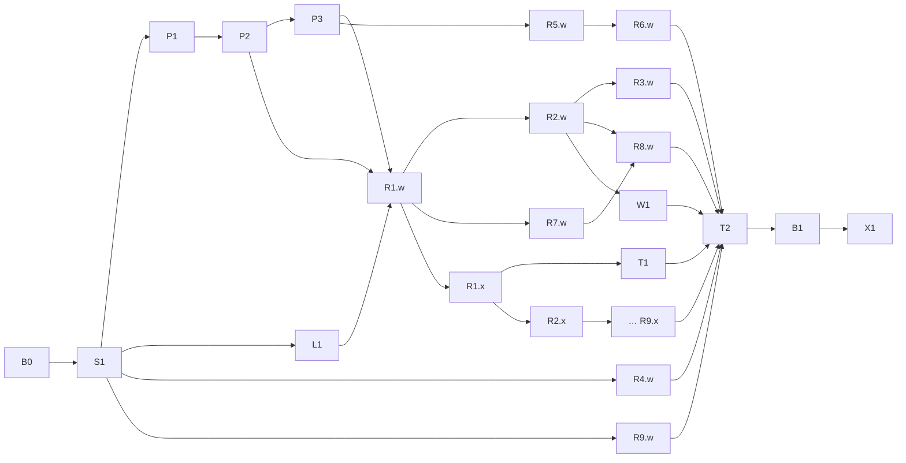

# PLAN-M2：应用骨架

[ROADMAP.md](ROADMAP.md) M2 的执行计划。目标：参考应用 `example/` 能在页面之间跳转（栈、Tab、模态、返回、深链冷启动），信息流能流畅滚动 10k 条；导航与惰性列表在 7 个平台上实现，协议版本 3 的共享样例在全部宿主通过。

本计划的[规范](#规范m2-的语言协议与平台-api)一节就是 D3（导航模型）、D4（虚拟列表的协议）的定稿。X1 把 ROADMAP 第 3 节这两行改为指向它。

范围对应 ROADMAP 的 M2.1–M2.10：

| ROADMAP | 本计划任务 |
| --- | --- |
| M2.1 页面与导航（D3） | L1、R1 |
| M2.2 Tab 导航 | R2 |
| M2.3 模态与浮层 | R3（模态页）、R4（`alert` 等逻辑层 API） |
| M2.4 返回行为 | R1（栈）、R3（模态） |
| M2.5 小程序多页面 | R1.w（每个页面一个小程序页面）、R2.w（`tabBar`）、W1（分包与体积检查） |
| M2.6 虚拟列表（D4） | R5（`List`、`Grid`）、R6（下拉刷新、加载更多、分组头） |
| M2.7 协议版本协商 | P1 |
| M2.8 应用生命周期 | P3（内核入口）、R7 |
| M2.9 深链 | R8 |
| M2.10 键盘避让 | R9 |
| 协议版本 3 | P1–P3 |
| 参考应用（退出标准） | T1、T2 |
| 质量预算（冷启动、滚动、内存、小程序主包） | W1、B1 |
| 过渡机制与收尾 | S1、X1 |

## 维护者的决定

- **平台范围**：M2 的全部能力在 7 个平台（web、wechat、ios、macos、android、windows、linux）实现，做法同 M1。平台上没有对应概念的，schema 标 `ignored`，或在规范里写明「无效果」：键盘避让在 macOS、Windows、Linux 无效果；`List.onRefresh` 与 `refreshing` 在 macOS、Windows、Linux 标 `ignored`；桌面没有侧滑返回，用返回按钮和快捷键代替。分阶段期间，尚未实现的平台临时标 `no`（规则 3）。
- **小程序标题栏的右侧按钮**：`BarButton` 在 wechat 标 `ignored`，小程序只显示标题和返回键，文档注明（uni-app、Taro 的做法相同）。参考应用把小程序上也必须能用的操作（如「发布」）同时放进页面内容。

以下是本计划推荐、维护者没有单独表态的方案。维护者有异议时在 B0 之前提出，改动写进本节。

1. **只在逻辑层导航**（D3 原文）：视图发出事件，逻辑层调用 `navigation.push(Page, params)`。M2 不加视图层的导航语法。
2. **单一导航栈**：Tab 容器在栈底，推入的页面盖住 Tab 栏；`switchTab` 清空栈上推入的页面。这是小程序 `navigateTo` 与 `switchTab` 的固有行为，其他平台照此统一。
3. **模态只有一层**：模态页里不能再 `push` 或 `present`。多步骤流程（如登录）在模态页内用 `if` 切换。
4. **Web 路由用 History API 的路径**，不用 hash。静态托管需要把未知路径回退到 `index.html`，写进文档。
5. **协议版本为 3**。M1 的 P1 已经把版本升到 2，ROADMAP D4 写的「协议 v2」指当时的下一个版本。
6. **小程序的惰性列表用分段渲染**（自研），不用官方 `recycle-view`：后者要求预先知道行高。
7. **生命周期 API 放在 `lifecycle` 模块**（ROADMAP M2.8 写作 `app.onForeground`、`app.onLaunch(options)`）：`app` 已是 `.weft` 的关键字和生成的应用类，避免混淆；冷启动参数改为只读的 `lifecycle.launch`，因为冷启动发生在任何处理器注册之前。M2.3 的 `fullScreenModal` 对应 `navigation.present(P, params, { style: "fullScreen" })`。
8. **原生导航容器**与 ROADMAP D3 原文有三处不同：Android 用 Navigation 3 的 `NavDisplay`，它的返回栈由应用持有，与「宿主状态由 JS 下发」的模型一致；Windows 不用 `Frame`，因为它要求每页一个 `Page` 类型，返回栈也归 `Frame` 所有，改为自建宿主面板；GTK 用 `GtkStack`，不引入 libadwaita。

## M1 遗留

按 ROADMAP 第 5 节「执行记录」的规则，M1 执行中发现、尚未关闭的问题如下：

| 来源 | 问题 | 本计划的处理 |
| --- | --- | --- |
| M1 T2 | 夜间截图工作流尚待维护者首次手动触发 | B0 查看状态并在进度表备注；不阻塞 |
| M1 R5.d | Android `TextArea`（填充样式）与 `Input`（描边样式）风格不一致，待维护者决定 | 不在范围；维护者决定后单独处理 |
| M1 R1.z | macOS 的 example UI 测试会在 `UserDefaults` 里留下状态 | 不在范围；T1 重写 UI 测试时，在测试启动参数里清空存储（只改测试，不改应用行为） |
| M1 R5.w | 小程序数字键盘与回车键文字待真机确认 | 不在范围 |
| M1 R7.w | 小程序主包 1.69 MiB（Inter 字体占 1630 KiB），超过 M2 预算 1.5 MB | W1 按可达性把字体放进分包；T2 把用到 Inter 的画廊页放进分包 |

## 执行规则

沿用 [PLAN.md 的执行规则](PLAN.md#执行规则) 1–10、[PLAN-M0.md](PLAN-M0.md#执行规则) 的规则 4（共享资源加锁）和规则 5（对外操作需维护者确认），以及 [PLAN-M1.md](PLAN-M1.md#执行规则) 的规则 2–7。以下几处不同或新增：

1. **基线**：产物比对的基线是 B0 记录的 `/tmp/weft-m2/`。C-apps 指 `/tmp/weft-m2/check-apps.sh`。锁脚本是 `/tmp/weft-m2/lock.sh`，内容同 M1 最终版：只在真正的 bash 进程里加锁，加锁的命令写成 `/bin/bash -c '…'`。
2. **预期变化写全**：M1 有 7 个任务漏写「预期变化」。本计划每个任务都写；执行中出现列表以外的变化时，先查原因，确属本任务的必然结果才提交，并记入[执行中发现](#执行中发现)。
3. **原生波次的共享改动**：四个原生子任务都会改 schema 的同一行 `support`、夹具的 `natives`、`pending.json` 与 `pages.json`（M1 的 L6、R1–R7 都遇到过）。因此各子任务只提交自己平台族的后端、壳、快照与测试；**启用改动由编排者在该波次的最后一个提交里统一提交**。并行的子任务在各自的 git worktree 里生成快照、运行检查。
4. **过渡机制**：S1 恢复 M1 X1 删除的三个过渡机制（`Fixture.natives`、`tests/conformance/native/pending.json`、`pages.json` 的 `pending`），R1.w 新增 schema 的 `features.navigation`。X1 删除它们。
5. **macOS UI 自动化**：每个原生波次只在最后由编排者运行一次 `/tmp/weft-m2/macos-ui.sh <页面>`（M1 维护者的要求）。
6. **协议先行**：先改 SPEC 与 `weft.protocol.json`，加共享样例，再改实现（ROADMAP 第 5 节）。SPEC 同时改中文版。
7. **真机与外部账号**：性能预算的真机数据、Universal Links 与 App Links 的域名验证、小程序真机预览，需要维护者的设备、域名或账号。执行者在模拟器和本机上完成能完成的部分，进度表标 `⏸` 并写明还缺什么。

## 环境

同 [PLAN.md](PLAN.md#环境)、[PLAN-M0.md](PLAN-M0.md#环境) 与 [PLAN-M1.md](PLAN-M1.md#环境) 的环境，含 M1 执行中加入的 macOS 稳定签名（`/tmp/weft-m1/signing.xcconfig`，B0 复制到 `/tmp/weft-m2/`）。另需：

- **Android**：R1.d 加入 `androidx.navigation3:navigation3-runtime` 与 `navigation3-ui`（unverified：R1.d 先确认稳定版本与 Compose 1.12 兼容；不兼容时改用 `AnimatedContent` 加 `PredictiveBackHandler` 自建，记入执行中发现）；R7.d 加入 `androidx.lifecycle:lifecycle-process`。
- **Linux**：R6.g 把 `native/linux/CMakeLists.txt` 的最低版本从 `gtk4>=4.10` 改为 `gtk4>=4.12`（`GtkSectionModel`）；容器是 Ubuntu 24.04，自带 GTK 4.14。R8.g 在镜像里加装 `xdg-utils`（`xdg-open` 测试深链）。
- **性能（B1）**：Android 模拟器（API 36，x86_64 或 arm64）与 iOS 模拟器 `iPhone 17` 上的发布构建；真机数据由维护者在基准设备上测量（规则 7）。

## 检查命令

沿用 [PLAN-M1.md 的检查命令](PLAN-M1.md#检查命令)，以下几项替换或新增。

| 代号 | 命令 | 通过条件 |
| --- | --- | --- |
| C-apps | `/tmp/weft-m2/check-apps.sh`（B0 写好，内容同 PLAN.md 的脚本，基线目录换成 `/tmp/weft-m2/apps`） | 无差异输出 |
| C-shot、C-shot-local | 同 M1 | 同 M1 |
| C-docs | `pnpm --filter docs build` | 成功 |
| C-wxsize | `WEFT_NATIVE=0 pnpm --filter example build:wechat`（W1 之后，构建本身执行小程序体积检查，规范 §8） | 构建成功；主包 ≤ 1536 KiB 时没有体积警告 |
| C-perf | `pnpm --filter example perf:android`、`perf:ios`（B1 写好，规范 §5.6） | 报告写入 `example/perf/<platform>.json`，各项不超过[质量预算](ROADMAP.md#6-质量预算) |

## 依赖图



- `x` 代表一个原生平台族（`.a` SwiftUI、`.d` Compose、`.n` WinUI、`.g` GTK）。原生子任务 `Rk.x` 依赖 `Rk.w` 与同一平台族的上一个子任务（`R(k-1).x`）；不同平台族之间互不依赖，可以并行。
- R4.w、R9.w 不依赖导航，B0 之后即可开始；R5.w 只依赖协议（P2、P3），与 L1、R1 并行。
- T1 依赖四个 R1.x；R2.w 及以后的 `.w` 不依赖 T1（规则见 [T1](#t1-example-改为页面导航)）。

---

## 规范：M2 的语言、协议与平台 API

本节是 M2 结束时的目标状态，各任务按它实现，并把相应内容写进 GRAMMAR.md（语言）、SPEC.md（协议与内核）、元素参考页（schema 生成）和指南。任务里写「按规范 §n」即指本节。

### §1 页面与应用（语言）

```text
Item      = Model | Event | Component | Page | App | TypeAlias | Style | Theme ;
Page      = "page" IDENT "(" ParamList? ")" ( "path" STRING )? "{" StateDecl* LetDecl* Node* "}" ;
App       = "app" IDENT "{" AppEntry "}" ;
AppEntry  = "start" "=" IDENT | "tabs" "{" TabItem+ "}" ;     (* tabs 在 R2.w 加入 *)
TabItem   = IDENT "(" ArgList? ")" ;
```

- 新增上下文关键字：`page`、`app`（顶层，后跟标识符）；`path`（只在页面参数表之后）；`start`、`tabs`（只在 `app` 内）。顶层错误恢复的同步点加入 `page`、`app`。
- **页面参数**：
  - 第一个参数的类型可以是 model，作为**页面模型**，可以省略；其余参数是**路由参数**，类型只能是 `Int`、`Float`、`Bool`、`String`、字面量联合或它们的 `T?`，可以有常量默认值。`T?` 或带默认值的参数可选，其余必填。
  - 报错：`` route parameter `x` must be Int, Float, Bool, String or a string literal union ``；model 参数不在第一位时 `` the model parameter of page `P` must come first ``；`Children` 与 `Event` 参数在页面上报同一条路由参数错误。
- **路径**：`path` 是字符串字面量，以 `/` 开头，由字面量段（`[a-z0-9._~-]+`）和参数段 `{name}` 组成；`{name}` 必须指向一个必填的 `String`、`Int` 或联合路由参数，每个参数最多出现一次；不在路径里的路由参数走查询字符串。省略 `path` 时为 `/<页面名的 kebab-case>`（`UserProfile` → `/user-profile`）。报错：`` invalid path segment `X` ``、`` `{x}` is not a required String, Int or union route parameter ``、`` paths of `A` and `B` overlap ``（两条路径段数相同，且每一对段要么是相同的字面量、要么至少一侧是参数）。
- **页面体**与组件体相同（`state`、`let`、节点），可以调用组件；页面不能作为节点调用：`` page `Detail` cannot be used as a component; open it with `navigation.push` ``。
- **页面方法**：页面类有 `onShow`、`onHide` 两个方法（§3）。页面模板树发出的事件（它注册到页面类上的 `on<Event>` 方法）不能叫 `Show` 或 `Hide`：`` event `Show` conflicts with the page method `onShow` ``。
- **应用**：
  - 一个程序（`compile_app` 的编译单元；Web 上为声明 `app` 的文件的导入闭包）最多一个 `app`：`duplicate app declaration`。
  - **应用的页面集合**是声明 `app` 的文件的导入闭包（传递）里的全部页面。程序里不在这个集合中的页面报错 `` page `X` is not in the import closure of app `Y` ``。
  - `start = P`：`P` 必须是页面，且没有必填的路由参数：`` start page `P` must not have required route parameters ``。
  - `tabs { P(title = "首页", icon = "asset:tab_home", activeIcon = "asset:tab_home_on") ... }`（R2.w）：2–5 项（`` an app has 2 to 5 tabs ``，小程序 `tabBar` 的限制，所有平台统一）；页面不重复，同样不能有必填路由参数；`title` 必填，`icon` 必填，`activeIcon` 可选（缺省为 `icon`），三者都是字符串字面量，图标必须是 `asset:<name>`。
  - 没有 `app` 的程序仍按 M1 的方式以组件为根（`run(new Root(model))`）。有 `app` 时根必须是应用（`run(new Example(pages))`）；页面类不能直接挂载，运行时报 `weft: pages are mounted by their app`。
- **生成的 TS 声明**（以 `page Detail(model: DetailModel, id: String, from: Source = "feed") path "/notes/{id}"` 为例）：

  ```ts
  export interface DetailParams { id: string; from?: Source }
  export declare class Detail extends Page<DetailParams> {
    constructor(model: DetailModel, params: DetailParams);
    readonly model: DetailModel;
    readonly params: Readonly<DetailParams>;
    onLike(handler: (model: DetailModel, event: Like) => void): () => void;
    onShow(handler: (model: DetailModel) => void): () => void;
    onHide(handler: (model: DetailModel) => void): () => void;
  }
  export declare class Example extends Application {
    constructor(pages: { Feed: (params: FeedParams) => Feed; Detail: (params: DetailParams) => Detail });
  }
  ```

  没有模型的页面构造函数为 `constructor(params)`；没有路由参数时 `Params` 是空接口，工厂为 `() => Page`。`Page<P>`、`Application` 是 `@weft-ui/runtime` 导出的基类（Web 与 remote 两套实现，类型相同）。**工厂**由应用在创建页面实例时调用：`navigation.push` 时、Tab 首次选中时、深链与小程序冷启动时。工厂返回新的页面实例，逻辑层在工厂里用 `page.onLike(...)` 注册该实例的事件处理器。

### §2 导航模型（D3）

导航状态由 JS 持有：

```text
NavState = { tab: Int, tabs: (Page | null)[], stack: Page[], modal: { page: Page, style: "sheet" | "fullScreen" } | null }
```

- 没有 Tab 的应用：`tabs` 只有一项（起始页），`tab` 为 0，不显示 Tab 栏。Tab 根页在首次选中时创建，之后一直保留。
- 栈底是 `tabs[tab]`，`stack` 是其上推入的页面（自下而上）。**当前页** = `modal?.page ?? stack.at(-1) ?? tabs[tab]`。

| 操作 | 语义 | 错误 |
| --- | --- | --- |
| `push(P, params)` | 调用 `P` 的工厂，把实例压入 `stack` | 有模态时抛 `weft: cannot push while a modal page is presented` |
| `replace(P, params)` | 用新实例替换栈顶并销毁旧页 | 当前页是栈底时抛 `weft: cannot replace the root page`；有模态时同 `push` |
| `pop(count = 1)` | 弹出 `count` 页（超过栈深度时退到栈底，不报错）；有模态时先关闭模态，且关闭模态计为一页 | `count < 1` 时抛 `RangeError` |
| `popToRoot()` | 关闭模态并清空 `stack` | — |
| `switchTab(P)` | 关闭模态、清空 `stack`，选中 `P` 所在的 Tab | `P` 不是 Tab 页时抛 `weft: X is not a tab` |
| `present(P, params, { style })` | 调用工厂，以 `sheet`（默认）或 `fullScreen` 呈现 | 已有模态时抛 `weft: a modal page is already presented` |
| `dismiss()` | 关闭模态 | 没有模态时无效果 |

- **页面生命周期**：页面实例在离开导航状态时销毁（作用域随之销毁）。`onShow`：页面成为当前页且应用在前台；`onHide`：页面不再是当前页，或应用进入后台。先调用旧页的 `onHide`，再调用新页的 `onShow`；两者都在导航状态改变之后、同一次 flush 之前同步调用，所以 `onShow` 里对模型的修改与页面一起首次渲染。首次挂载时起始页（或首个 Tab）收到 `onShow`。
- **用户造成的变化**：返回手势、返回键、点击 Tab、下滑关闭模态、浏览器后退、小程序返回，由宿主先完成，再通知 JS（信号 `navigation`，§4.5）。JS 采纳宿主上报的状态，调用生命周期、销毁离开的页面，不再回送 `nav`。宿主只能上报当前状态的「后退」：弹出若干页、关闭模态、切换 Tab（清空栈）。其他状态视为协议错误：JS 用 `console.error` 记录，并重新下发自己的 `nav` 让宿主纠正。
- **返回**：Android 返回键与预测性返回、iOS 侧滑、Web 后退、小程序返回，依次处理：有模态 → 关闭模态；`stack` 非空 → 弹出一页；否则交给系统（Android 退到后台，Web 离开应用，小程序退出）。桌面平台用标题栏的返回按钮、`Alt+←`（macOS `⌘[`）、鼠标后退键；`Esc` 关闭模态。
- **标题栏**：由页面根节点的 `NavBar` 描述（§9）。`stack` 中的页面显示返回按钮；模态页显示关闭按钮（`×`）；`NavBar(hidden = true)` 不显示标题栏，手势与返回键照常工作；没有 `NavBar` 的页面显示空标题的标题栏。转场动画用各平台默认的推入、弹出、模态动画；Web 的动画遵守 `prefers-reduced-motion`。
- **小程序差异**（文档注明）：页面栈最多 10 层，第 11 次 `push` 抛 `weft: the mini program page stack is limited to 10 pages`；冷启动直接打开非 Tab 页时栈中只有该页，平台在导航栏显示「返回首页」；模态页用 `page-container` 实现（§8）。

### §3 平台 API

`@weft-ui/platform` 新增以下导出；`index.d.ts`、`web.ts`、`wechat.ts`、`native.ts` 同步实现（`contract.ts` 的编译期检查自动覆盖）。

```ts
/** A page and its route parameters. */
export interface Route { readonly page: string; readonly params: Readonly<Record<string, string | number | boolean | null>> }
export type ModalStyle = "sheet" | "fullScreen";
type ParamsArg<P> = {} extends P ? [params?: P] : [params: P];

export const navigation: {
  readonly stack: readonly Route[];             // 栈底（当前 Tab 根页）到栈顶，不含模态
  readonly tab: string | null;                  // 当前 Tab 的页面名；没有 Tab 时为 null
  readonly modal: Route | null;
  push<P>(page: PageClass<P>, ...params: ParamsArg<P>): void;
  replace<P>(page: PageClass<P>, ...params: ParamsArg<P>): void;
  pop(count?: number): void;
  popToRoot(): void;
  switchTab(page: PageClass<{}>): void;
  /** `null` removes the badge, `""` shows a dot. */
  setBadge(tab: PageClass<{}>, text: string | null): void;
  present<P>(page: PageClass<P>, ...rest: [...ParamsArg<P>, options?: { style?: ModalStyle }]): void;
  dismiss(): void;
  /** Opens a route URL (§6); returns false when no page matches. */
  open(url: string): boolean;
  /** The URL of a route (§6), e.g. for sharing. */
  url<P>(page: PageClass<P>, ...params: ParamsArg<P>): string;
  /** Called before a link is opened; returning true marks it handled. */
  onOpen(handler: (route: Route, url: string) => boolean): () => void;
  onChange(listener: () => void): () => void;
};

export const ui: {
  alert(options: { title?: string; message?: string; confirmText?: string }): Promise<void>;
  confirm(options: { title?: string; message?: string; confirmText?: string; cancelText?: string; destructive?: boolean }): Promise<boolean>;
  actionSheet(options: { title?: string; options: readonly string[]; destructiveIndex?: number; cancelText?: string }): Promise<number | null>;
  toast(message: string, options?: { icon?: "none" | "success" | "error"; duration?: "short" | "long" }): void;
};

export const lifecycle: {
  readonly state: "foreground" | "background";
  readonly launch: { readonly url: string | null };
  onForeground(listener: () => void): () => void;
  onBackground(listener: () => void): () => void;
  onMemoryWarning(listener: () => void): () => void;
};
```

- `navigation` 在应用挂载前调用时抛 `weft: navigation is available after the app is mounted`；没有 `app` 的程序调用时抛 `weft: this program has no app declaration`。`PageClass<P>` 由 `@weft-ui/runtime` 导出。
- `ui`：同一时刻最多显示一个对话框或操作表，后续调用排队（先进先出）；toast 不排队，新的替换旧的。`confirmText`、`cancelText` 默认为 `OK`、`Cancel`（i18n 在 M5）。`actionSheet` 的选项为 1–6 项（小程序 `wx.showActionSheet` 的上限，所有平台统一），否则立即以 `RangeError` 拒绝。对话框被系统方式关闭时（返回键、`Esc`、点击遮罩）：`confirm` 得到 `false`，`actionSheet` 得到 `null`。`duration` 为 `short`（1.5 s，默认）或 `long`（3 s）。原生平台经平台调用模块 `ui` 实现（§4.6）。
- `lifecycle`：`state` 初值为 `foreground`。桌面上「后台」指窗口最小化或隐藏。`onMemoryWarning` 在系统发出内存告警时触发；没有这类通知的平台（Web）从不触发，文档注明。`launch.url` 是冷启动时打开应用的链接（§6），没有时为 `null`。

### §4 协议版本 3（D4 与导航）

#### §4.1 线路格式

`weft.protocol.json` 的 `version` 为 `3`；新增 opcode 与常量：

| opcode | op | 字段 |
| --- | --- | --- |
| 6 | `splice` | scope, point, index, remove, count, (item, template) × count |
| 7 | `bind` | scope, point, item, child \| 0 |
| 8 | `nav` | tab, n, scope × n, m, scope × m, modal, style |

- 全部字段是小端 u32。`splice` 的 `template` 是该 `lazy` 挂载点 `templates` 数组的下标。`nav` 的 `style` 取 `modalStyles`（新增常量表：`sheet` = 0，`fullScreen` = 1），`modal` 为 0 时 `style` 也为 0；`tabs` 里未创建的 Tab 根页写 0。
- 文本形式：`splice 2 0 0 0 [1/0 2/1 3/1]`、`bind 2 0 1 7`、`bind 2 0 3 0`、`nav 0 [4 0] [9 11] 13 sheet`、`nav 0 [4] [] 0`（`modal` 为 0 时省略 `style`）。
- 解码错误种类不变；计数超出剩余字节报 `truncated`。

#### §4.2 布局

- 模板 `kind` 新增 `page`（页面体）。挂载点 `kind` 新增 `lazy`：`{"node": n, "kind": "lazy", "templates": [row]}`，分组列表为 `[header, row]`（§5）。
- 顶层新增 `app`（只在程序有 `app` 时出现，参与哈希）：`{"start": <模板>}`，或 `{"tabs": [{"page": <模板>, "title": "首页", "icon": "asset:tab_home", "activeIcon": "asset:tab_home_on"}]}`。宿主用它画 Tab 栏；路由表只在 JS 里，宿主不解析 URL。

#### §4.3 作用域与保证

- **两种根**：组件根程序沿用 `attach 0 0 <id>`；应用程序不发 `attach`，页面根作用域由 `nav` 引用。同一个程序只用其中一种。
- 页面根作用域是 `page` 模板的实例。它的 `create` 与全部 `set` 在引用它的 `nav` 之前，且在同一批次里。最新的 `nav` 不再引用的页面作用域（及其后代）被销毁；宿主通过 `navigation` 信号上报的状态同样生效（§2），之后 JS 不为它发 op。
- 第一个批次包含 `nav`；之后只在导航状态变化时发送，内容是完整状态。宿主按「旧状态 → 新状态」的差异选择动画：在栈顶追加为推入，截短为弹出，其他为不带动画的替换。
- `splice` 与 `bind` 只用于 `lazy` 挂载点，详见 §5.3。

#### §4.4 宿主到 JS

| 入口 | 含义 |
| --- | --- |
| `Session.dispatch(scope, slot, payload)` | 不变 |
| `Session.window(scope, point, start, end)` | 宿主需要 `lazy` 挂载点的 `[start, end)` 项已物化（§5.3）。JS 同步处理并 flush，返回时宿主已收到相应的 `bind` |
| `Session.signal(name, json)` | 宿主事件（§4.5）；未知的 `name` 被忽略 |

内核 ABI（`native/core/include/weft/runtime.h`）：

- `weft_host` 的**第一个成员**改为 `uint32_t protocol`（壳所实现的协议版本）。放在第一个是为了以后的版本无论结构体怎么变，内核都能在同一个偏移读到它。最后新增 `const char *launch`（UTF-8 JSON，`NULL` 视为 `{}`，`weft_runtime_new` 期间复制）：`{"url": "weftexample://notes/1"}`。
- 新增 `void weft_runtime_window(weft_runtime *rt, uint32_t scope, uint32_t point, uint32_t start, uint32_t end)` 与 `void weft_runtime_signal(weft_runtime *rt, const char *name, const char *json, size_t len)`；两者都执行 JS 并在返回前清空微任务队列（加入「Event loop」的入口列表）。
- `__weft` 新增 `protocol`（内核的协议版本）、`launch`（JSON 字符串）、`on(name, callback)`（每个名字注册一个回调，再次注册替换前一个；回调收到 JSON 字符串）。`open(hash, dispatch)` 改为 `open(hash, dispatch, protocol, window)`。

#### §4.5 信号

| `name` | JSON | 发送时机 |
| --- | --- | --- |
| `navigation` | `{"tab": 0, "stack": [9], "modal": 0}`（页面作用域 ID） | 用户在宿主上造成导航变化之后（§2） |
| `lifecycle` | `{"state": "foreground"}` 或 `"background"` | 应用进入前台或后台；内容不变时不发 |
| `memory` | `{}` | 系统内存告警 |
| `link` | `{"url": "..."}` | 应用运行中收到链接（冷启动的链接走 `launch`） |

Web 与小程序没有内核，同样的事件由 `@weft-ui/platform` 的 `web.ts`、`wechat.ts` 直接交给运行时。

#### §4.6 平台调用

`platformModules` 新增 `"ui": ["alert", "confirm", "actionSheet", "toast"]`（R4.w）。参数是 UTF-8 JSON 对象，字段同 §3 的选项（`toast` 为 `{"message", "icon", "duration"}`）；结果：`alert`、`toast` 为空，`confirm` 为 `true` / `false`，`actionSheet` 为下标或 `null`（JSON）。`toast` 在显示后立即完成。

`platformModules` 另有 `"navigation": ["badge"]`（执行中补充，见「执行中发现」R2）：参数 `{"tab": <app.tabs 下标>, "text": "3" | "" | null}`，结果为空、立即完成；运行时在 `navigation.setBadge` 时同步调用（壳支持 `navigation` 时），不随 op 批次排序，壳按 Tab 下标保存角标。

#### §4.7 版本协商（M2.7）

- **内核与壳**：`weft_runtime_new` 先比较 `weft_host.protocol` 与内核的 `WEFT_PROTOCOL_VERSION`（生成的常量），不同时经 `weft_host.log` 报 `weft: protocol mismatch: kernel speaks 3, shell speaks 2`，返回 `NULL`。
- **bundle 与内核**：`__weft.open` 先比较 `protocol` 参数（`@weft-ui/runtime` 的 `VERSION`）与内核版本，不同时抛 `weft: protocol mismatch: bundle speaks 3, kernel speaks 2`，于是 `weft_runtime_new` 返回 `NULL`；这一检查在布局哈希检查之前。
- 壳在 `weft_runtime_new` 返回 `NULL` 时走现有的启动失败路径，并把内核日志原样写入平台日志。构建期检查（`@weft-ui/vite` 比对 native 包的 `weft.protocol`，M0 N.5）保留，运行时协商兜住构建期查不到的情况（例如残留的旧 `bundle.hbc`）。Web 与小程序的 bundle 与视图一起构建，不需要协商。

### §5 惰性列表（D4）

#### §5.1 元素

| 元素 | 组 | 自有成员 | 子元素 |
| --- | --- | --- | --- |
| `List` | layout、visibility、padding、decoration | `gap`（Int，0）；`stickyHeaders`（Bool，false，constant；windows、linux `ignored`）；`refreshing`（Bool，false；macos、windows、linux `ignored`）；`endThreshold`（Int，5，constant）；`indicators`（Bool，true）；事件 `onRefresh`（macos、windows、linux `ignored`）、`onEndReached`（`source: runtime`） | §5.2 |
| `Grid` | 同上 | `columns`（Int，必填，constant，≥ 1）；`gap`（Int，0，行列间距）；`refreshing`、`endThreshold`、`indicators`、`onRefresh`、`onEndReached` 同 `List` | §5.2，不支持分组 |

- 布局：与纵向 `Scroll` 相同（没有显式 `grow`、`fill` 时按 `grow = 1`、`fill = true`），只沿纵向滚动。`Grid` 的每列等宽：`(内容宽 − gap × (columns − 1)) / columns`；同一行的项按该行最高的项对齐顶部。
- 横向惰性列表不在 M2 范围。

#### §5.2 子节点规则

- `List` 与 `Grid` 的子节点：任意个静态节点，加**恰好一个直接的 `for`**。`for` 之前的节点是列表头，之后的节点是列表尾，二者总是渲染（不惰性），随列表一起滚动。
- 分组（只用于 `List`）：`for` 的块由一个或多个**分组头节点**加**恰好一个内层 `for`**组成，内层 `for` 必须是块中最后一个节点。外层 `for` 的每一项是一个分组：分组头渲染为一项，内层 `for` 的每一项各渲染为一项。`stickyHeaders = true` 时，分组头在它的分组滚动期间固定在列表顶部。
- 报错：`` `List` needs exactly one `for` among its children ``（`Grid` 同理）；`` a `List` section is header nodes followed by one `for` ``；`` `Grid` does not support sections ``。
- 布局：`lazy` 挂载点放在列表元素节点的子节点中 `for` 所在的位置；`templates` 为 `[row]` 或 `[header, row]`。

#### §5.3 物化语义

- **项**：列表的内容是一个扁平的项序列；分组列表的序列为「头、行、行、头、行……」。每项有一个 **item ID**（u32，在同一个挂载点实例里从 1 递增、不复用），同一个 key（分组为外层 key，或外层 key 加内层 key）始终对应同一个 ID，直到它离开列表。
- **`splice`**：列表数据变化时，JS 计算新旧序列的最长公共前缀与后缀，发**一个** `splice` 替换中间部分（重新排序等复杂变化退化为整体替换）。ID 保留下来的项，其已物化的作用域保留；被移除的项，其作用域随之销毁，不另发 `bind … 0`。
- **`window`**：宿主请求 `[start, end)` 时，JS 为区间内未物化的项创建作用域（`create` + `set`）并发 `bind scope point item child`；对区间外已物化的项发 `bind scope point item 0` 并销毁作用域。宿主请求的区间是**可见项向两侧各扩展一屏高度的估计范围**；宿主在滚动停止、或可见区间越过已请求区间的一半时重新请求。
- **首帧**：列表首次出现项时，JS 在同一批次里物化前 `min(count, 20)` 项，宿主不必等待 `window` 就能画出首帧。
- **更新**：已物化项的数据对象变化时，按 `for` 现有规则用 `set` 更新它的作用域；未物化项没有作用域，不产生 op。
- **高度估计**：未物化的项按同模板已测量项的平均高度占位，还没有测量值时取 44 逻辑像素。宿主在项物化后更新真实高度，并保持可见内容的位置不跳动（各平台列表控件的默认行为）。
- **`onEndReached`**：由 JS 运行时触发，没有事件槽（schema 的 `source: runtime`）。每次 `window` 或 `splice` 之后，若最近请求的 `end ≥ count − endThreshold` 且 `count > 0`，触发一次；同一个 `count` 值只触发一次，`count` 改变后可再次触发。
- **`onRefresh` 与 `refreshing`**：用户下拉时，宿主显示刷新指示并发送 `onRefresh`；事件处理返回后，指示是否继续显示由 `refreshing` 的值决定，之后 `refreshing` 变为 `false` 时宿主收起指示。逻辑层从不把 `refreshing` 设为 `true` 时，指示在事件返回后立即收起。

#### §5.4 平台映射

| | 容器 | 窗口来源 | 下拉刷新 | 分组头 |
| --- | --- | --- | --- | --- |
| Web | 运行时虚拟化：`overflow:auto` 容器，项用 `transform` 绝对定位，`ResizeObserver` 测量，总高度由占位元素撑开 | `scroll` 事件（`requestAnimationFrame` 合并） | 触摸下拉手势（只在 `pointer: coarse` 时启用） | `position: sticky` |
| 小程序 | `scroll-view`；每 20 项为一段，窗口外的段换成记录了高度的占位 `view`（§8.3） | `IntersectionObserver`（相对 `scroll-view`，上下各扩展一屏） | `refresher-enabled`、`bindrefresherrefresh` | `position: sticky`（unverified；`scroll-view` 内不生效时在 wechat 标 `ignored`） |
| SwiftUI | `List`（`.listStyle(.plain)`，去掉行内边距、分隔线与行背景），`ForEach` 以 item ID 为 `id`；`Grid` 为 `ScrollView` 内的 `LazyVGrid` | 行的 `onAppear` / `onDisappear`，下一个 run loop 合并请求 | iOS `.refreshable`（等待 `refreshing` 变为 `false`）；macOS `ignored` | `Section(header:)`，plain 样式下自动吸顶；`stickyHeaders = false` 时分组头作为普通行 |
| Compose | `LazyColumn` / `LazyVerticalGrid(GridCells.Fixed)`，`items(count, key, contentType = 模板)` | `snapshotFlow { layoutInfo.visibleItemsInfo }` | material3 `PullToRefreshBox` | `stickyHeader` |
| WinUI | `ScrollViewer` 内的 `StackPanel`（列表头、`ItemsRepeater`、列表尾）；`StackLayout` / `UniformGridLayout` | `ElementPrepared` / `ElementClearing` | `ignored` | 分组头作为普通行；`stickyHeaders` `ignored` |
| GTK | `GtkScrolledWindow` 内的 `GtkListView`，`GtkNoSelection` 包自定义 `GListModel`（列表头尾也是模型里的项）；`Grid` 也用 `GtkListView`，每项是一行 `columns` 个单元 | `GtkSignalListItemFactory` 的 `bind` / `unbind` | `ignored` | `GtkSectionModel` 的分组头（GTK 4.12）；`stickyHeaders` `ignored` |

#### §5.5 共享约定

- 头节点与行的宽度为列表内容宽度；`gap` 是相邻项之间的间距（列表头尾与项之间同样有 `gap`）。
- `indicators = false` 隐藏滚动条。
- `List` 不能嵌套在同方向的 `Scroll` 或另一个 `List` 里（会失去惰性）：编译期报 `` `List` cannot be inside a vertical `Scroll` or another `List` ``（只检查同一模板内静态可见的祖先；跨组件的嵌套写进文档）。

#### §5.6 性能测量（B1）

| 指标 | 场景 | Android | iOS |
| --- | --- | --- | --- |
| 冷启动到首帧 | 发布构建，`Feed` 为起始 Tab | `am start -W` 的 `TotalTime`，10 次取中位数 | XCTest `XCTApplicationLaunchMetric`，5 次 |
| 掉帧率 | `bench` 页 10 000 项，20 次快速滑动 | `dumpsys gfxinfo <pkg>` 的 janky frames 占比 | `XCTOSSignpostMetric.scrollingAndDecelerationMetric` 的 hitch count ÷ frame count |
| 内存增量 | `bench` 页 100 项与 10 000 项各滑到底部 | `dumpsys meminfo` 的 TOTAL PSS 之差 | `XCTMemoryMetric` 之差 |

### §6 路由与深链（M2.9）

- **路由 URL**：`path` 加查询字符串。路径参数用 `encodeURIComponent`；查询参数按声明顺序写 `name=value`，值等于默认值或为 `null` 时省略。值的格式：`Int` 为 `-?[0-9]+`（绝对值不超过 2^53 − 1），`Float` 为有限的 JS 数字字面量，`Bool` 为 `true` / `false`，`String` 原样（UTF-8 百分号编码），联合为成员名。解码任何一项失败即「不匹配」；多余的查询键忽略。实现在 `packages/runtime/src/route.ts`，Rust 不实现（编译器只校验 `path`）。
- **`navigation.open(url)`** 接受：相对 URL（`/notes/1?from=search`）；自定义 scheme（`weftexample://notes/1`，主机部分视为第一个路径段）；配置的 https 主机（`https://example.com/notes/1`）；小程序页面路径（`weft/pages/detail/index?id=1`，只在 wechat）。匹配后依次调用 `onOpen` 处理器，任何一个返回 `true` 即视为已处理；否则默认处理：Tab 页 → `switchTab`；其他页 → 先关闭模态，再 `push`。没有匹配时返回 `false` 并 `console.warn`。
- **冷启动**：`lifecycle.launch.url` 能匹配时，初始状态直接是「栈底 + 目标页」（目标是 Tab 页时选中该 Tab），不播放转场动画，起始页只收到一次 `onShow`（在目标页之后入栈时收到 `onHide`）。小程序上平台直接创建目标页，栈中只有该页（§2）。
- **`navigation.url(page, params)`**：Web 返回带 Vite `base` 的路径；小程序返回小程序页面路径加查询（用于 `onShareAppMessage`）；原生返回配置了 `scheme` 时的 `scheme://…`，否则返回相对 URL。
- **配置**：Vite 插件新选项 `links?: { scheme?: string; hosts?: string[] }`。`scheme` 只能是 `[a-z][a-z0-9+.-]*`。

| 平台 | 注册 | 冷启动 | 运行中 |
| --- | --- | --- | --- |
| iOS、macOS | 生成的 `weft/Info.plist`（`CFBundleURLTypes`；项目模板加 `INFOPLIST_FILE = weft/Info.plist`，与 `GENERATE_INFOPLIST_FILE` 生成的键合并）；`hosts` 非空时生成 `weft/App.entitlements`（`com.apple.developer.associated-domains`），模板加 `CODE_SIGN_ENTITLEMENTS` | 在创建会话前取得 URL 写入 `launch`（unverified：SwiftUI 场景可能在首帧之后才交付 `onOpenURL`；取不到时退化为首帧后无动画推入，记入执行中发现） | `onOpenURL`、`onContinueUserActivity(NSUserActivityTypeBrowsingWeb)` → `link` 信号 |
| Android | 生成的 `weft` 模块里的转发 Activity `WeftLinkActivity`（`Theme.NoDisplay`，`VIEW` + `BROWSABLE` 的 intent filter；`hosts` 为 `autoVerify` 的 https），把 URI 转给启动 Activity（`getLaunchIntentForPackage`，`FLAG_ACTIVITY_SINGLE_TOP`）；不需要改用户的 `AndroidManifest.xml` | `WeftRoot` 读取 Activity 的 `intent.data` | `addOnNewIntentListener` → `link` 信号 |
| Windows | 壳在启动时用 `ActivationRegistrationManager.RegisterForProtocolActivation` 注册（非打包应用）；`AppInstance.FindOrRegisterForKey` 保证单实例，后启动的实例把激活参数转给已运行的实例后退出 | `AppInstance.GetActivatedEventArgs()` | `AppInstance.Activated` → `link` 信号 |
| Linux | `weft_views` 生成 `.desktop` 文件（`MimeType=x-scheme-handler/<scheme>`），安装由 M6 处理；模板的 `GApplication` 加 `G_APPLICATION_HANDLES_OPEN` | 首次 `open` 信号 | 之后的 `open` 信号（`GApplication` 默认单实例） |
| Web | URL 就是路由 | 页面加载时的 `location` | 应用内的 `<a>` 不拦截；`navigation.open` |
| 小程序 | 每个页面就是可分享的路径 | `wx.getLaunchOptionsSync()` | `wx.onAppShow` 的 `path` 与 `query` |

### §7 键盘避让（M2.10）

- **语义**：软键盘弹出时，当前页的内容区域缩小到键盘上沿（因此根部末尾的输入栏贴着键盘）；获得焦点的 `Input` 或 `TextArea` 位于可滚动祖先（`Scroll`、`List`）里时，祖先滚动到它下沿距键盘上沿至少 16 逻辑像素。键盘收起后内容区域恢复，滚动位置不复原。
- **平台**：
  - iOS：SwiftUI 的键盘安全区（默认行为）；`safeArea = false` 的根改用 `.ignoresSafeArea(.container)`，不再忽略键盘区域；可滚动祖先在焦点变化时用 `ScrollViewReader.scrollTo` 滚到输入框。
  - Android：页面根加 `Modifier.imePadding()`（应用已 `enableEdgeToEdge()`，`adjustResize` 不再缩小窗口）；输入框获得焦点时用 `BringIntoViewRequester` 滚到可见。
  - Web：监听 `visualViewport` 的 `resize`，把键盘高度写入页面根的 `padding-bottom`；`focusin` 时 `scrollIntoView({ block: "nearest" })`，`scroll-margin-bottom: 16px`；`index.html` 的 viewport 加 `interactive-widget=resizes-content`。
  - 小程序：`input`、`textarea` 写 `adjust-position="{{false}}"`、`cursor-spacing="16"`，`bindkeyboardheightchange` 把键盘高度写入页面根的 `padding-bottom`，并让 `scroll-view` 滚到输入框（`scroll-into-view`）。
  - macOS、Windows、Linux：没有软键盘，无效果（Windows 触控键盘不处理），文档注明。

### §8 小程序多页面与分包（M2.5）

#### §8.1 文件

| 文件 | 内容 |
| --- | --- |
| `weft/view.{js,json,wxml,wxss}` | 同 M1：主包页面可达的全部模板 |
| `weft/pages/<kebab>/index.js` | `Page(getApp().weft.page("<Name>"))`：运行时返回 `onLoad(query)`、`onShow`、`onHide`、`onUnload`、`onReady`、`onShareAppMessage` 等处理函数 |
| `weft/pages/<kebab>/index.json` | `usingComponents`（`weft-view` 指向 `/weft/view` 或分包的 `view`）；静态 `NavBar.title` 写入 `navigationBarTitleText`；`NavBar(hidden = true)` 写 `"navigationStyle": "custom"` |
| `weft/pages/<kebab>/index.wxml` | `<weft-view id="weft" class="w-root…"/>`，加模态容器 `<page-container show="{{m}}" position="bottom" round="{{ms == 0}}" close-on-slide-down="{{ms == 0}}" custom-style="{{mc}}" bind:afterleave="$dismissed"><weft-view id="modal"/></page-container>` |
| `weft/pages/<kebab>/index.wxss` | `@import` 对应的 `view.wxss` 加页面规则 |

- 没有 `app` 的程序保持 M1 的单页面 `weft/index`，现有快照不变。
- 页面 `push` 时：运行时先调用工厂创建实例，用 `wx.navigateTo({ url: "/weft/pages/<kebab>/index?<query>&__w=<n>" })` 打开，新页面的 `onLoad` 按 `__w` 取回实例并挂载到它的 `weft-view`；冷启动或分享进入（没有 `__w`）时按查询参数解码并调用工厂。`onUnload` 视为用户返回（§2），实例销毁。
- 动态标题：`NavBar.title` 的值槽变化且该页面是当前页时调用 `wx.setNavigationBarTitle`；页面 `onShow` 时重新设置一次。

#### §8.2 `app.json` 与分包

- Vite 每次构建改写 `app.json` 中由 weft 管理的键，保留用户的其他键与 2 空格缩进：`pages`（主包页面，起始页或首个 Tab 在第一位）、`tabBar.list`（R2.w；`tabBar` 不存在时创建，颜色取 M1 主题的默认值，用户之后可以改，`list` 以外的键不覆盖）、`subPackages`（W1）。`weft/index` 从 `pages` 中删除（仅对有 `app` 的程序）。
- Tab 图标：`tabBar` 只接受本地 PNG、JPEG，`asset:` 指向 SVG 图标时构建报错 `` weft: tab icon `X` must be a PNG or JPEG image on wechat ``；图标复制到 `weft/assets/tab/`。
- 分包：Vite 选项 `wechat?: { subPackages?: Record<string, string[]> }`（分包根目录名 → 页面名）。规则：起始页与 Tab 页不能放进分包（平台要求）；页面不能出现在两个分包里；分包名只能是 `[a-z0-9_-]+`。分包的页面在 `<root>/weft/pages/<kebab>/`；分包的 `view.wxml` 用 `<import src="/weft/view.wxml"/>` 引用主包模板，只追加主包页面不可达的模板。
- 资源按可达性放置：只被某个分包页面的模板静态引用的 `asset:` 图片、图标和字体（`@font-face`）放进该分包；其余（含动态的 `src` 值可能引用的资源）留在主包。逻辑层 JS 全部在主包（分包异步化不在 M2 范围，文档注明）。

#### §8.3 惰性列表的数据布局

`l{N}`（M1 的行数组）对 `lazy` 挂载点改为段数组：`l{N} = [{k, h, r}]`，`k` 为段号（`wx:key`），`h` 为占位高度（px，未测量时按 §5.3 估计），`r` 为该段的项数组（段在窗口外时为 `null`）。每项含 `k`（item ID）与 `t`（模板下标）；已物化的项另含该作用域的数据。SPEC「Mini program data layout」同步。

#### §8.4 体积检查

构建结束时统计（不含 `project.config.json`、`project.private.config.json` 与 `packOptions.ignore` 排除的文件）：主包超过 2048 KiB、任一分包超过 2048 KiB、总量超过 20 MiB 时构建失败，报 `` weft: the mini program main package is <n> KiB, over the 2048 KiB limit ``（分包与总量同样措辞）；主包超过 1536 KiB（ROADMAP 质量预算）时警告 `` weft: the mini program main package is <n> KiB, over the 1536 KiB budget ``。M1 的字体警告（512 KiB）保留。

### §9 元素与 schema 增量

| 元素 | 组 | 成员 | 子元素与约束 | 支持 |
| --- | --- | --- | --- | --- |
| `NavBar` | — | `title`（String）；`hidden`（Bool，false，constant） | `["BarButton"]`；`pageRoot` | 全部 |
| `BarButton` | — | `icon`（String，`asset:` 资源）；**`label`**（String，必填，无障碍名称；没有 `icon` 时显示为文字）；`disabled`（Bool）；事件 `onTap` | none；`parents`：NavBar | wechat `ignored`（整个元素） |
| `List`、`Grid` | §5.1 | §5.1 | §5.2 | §5.1 |

schema 新字段：

- 元素 `"pageRoot": true`：只能作为页面体的根节点出现，不在 `if`、`for` 里，每个页面最多一个，且必须是第一个根节点。报错 `` `NavBar` must be the first top-level node of a page ``。
- 事件 `"source": "runtime"`：由 JS 运行时触发，不分配事件槽、不进入布局。
- 元素级 `Support` 允许 `ignored`：接受但不渲染（不分配值槽与事件槽），不报诊断。

`NavBar` 不在页面内容里渲染：宿主把它的值槽与 `BarButton` 交给标题栏（§2）。各平台映射见 R1 的原生子任务表。

---

## B0 基线（不提交）

- **步骤**：同 [PLAN-M1 B0](PLAN-M1.md)，目录换成 `/tmp/weft-m2/`：
  1. `pnpm install && pnpm build`；运行 C-rust、C-ts，记录 clippy 与 `pnpm typecheck` 的输出（`/tmp/weft-m2/tsc.txt`）。
  2. 7 个平台 `WEFT_NATIVE=0 pnpm --filter example build:<platform>`，复制产物到 `/tmp/weft-m2/apps/`；写好 `check-apps.sh` 并运行一次，应无差异。
  3. 复制 `/tmp/weft-m1/{lock.sh,macos-ui.sh,signing.xcconfig}` 到 `/tmp/weft-m2/`；`/tmp` 被清理过时按 PLAN-M1 的执行中发现重建。
  4. 运行 C-core、C-apple、C-android、C-windows、C-linux、C-ui（7 个平台）、C-shot、C-shot-local，确认 M1 的基线全部通过。
  5. 记录小程序主包大小（`example/apps/wechat` 中不属于 `project.config.json` 的文件总和），作为 W1、T2 的对照。
  6. `gh run list --workflow nightly.yml` 查看 M1 T2 的夜间工作流是否已由维护者触发，结果写进进度表备注。
- **验收**：全部通过。失败时记入执行中发现并停止，等维护者处理。

## S1 恢复过渡机制

- **改动**：
  - `crates/transformer/tests/snapshots.rs`：`Fixture` 加回 `natives: &'static [Platform]`（现有夹具写全部 5 个原生平台），原生快照只检查列出的平台；与 `diverges` 并存。
  - `tests/conformance/native/pending.json`（初始为 `[]`）：`tests/conformance/native/build.ts` 与 `native/core/tests/CMakeLists.txt` 跳过其中的夹具。实现同 M1 S3，可从 git 历史恢复（`git log -S pending.json`）。
  - `example/pages.json` 的可选字段 `pending`（平台名数组）：`scripts/catalog.ts` 生成目录时跳过这些平台，截图驱动不截它们（同 M1 T1）；`example/README.md` 与中文版同步。
- **预期变化**：无。
- **验收**：C-rust、C-ts 通过；C-apps 无差异；临时把 `todo` 加进 `pending.json`，`ctest --test-dir native/core/build -N` 少一项（改回）。
- **提交**：`test: restore the staging switches for M2`

## P 协议版本 3

### P1 协议版本 3 与启动时的版本协商（M2.7）

- **改动**：
  - `protocol/weft.protocol.json` 的 `version` 改为 `3`，运行 `pnpm gen:protocol`（更新各语言的协议常量与 4 个 native 包 `package.json` 的 `weft.protocol`）。C++ 生成文件提供内核用的版本常量；已有同义常量时沿用现有名字，并把规范 §4.7 的名字改成它。
  - SPEC.md 与中文版：「Binary encoding」标题的版本号；「Versioning」加运行时协商一段（§4.7）；「The `__weft` global」加 `protocol` 与 `open` 的新签名。
  - 共享样例：`protocol/corpus/ops.json`、`values.json` 中各用例的版本字节 `02` 改为 `03`；用例 `version-3` 改名 `version-4`（首字节 `04`，仍报 `version`）。
  - 内核（`native/core/include/weft/runtime.h`、`native/core/src/runtime.cpp`）：`weft_host` 的第一个成员 `uint32_t protocol`；`weft_runtime_new` 的比较与日志；`__weft.protocol`；`__weft.open(hash, dispatch, protocol)` 先比较版本再比较哈希（§4.7）。
  - 运行时 `packages/runtime/src/native.ts`：`Kernel` 类型与 `open` 调用传入 `VERSION`。
  - 四个壳填写 `protocol`：Apple `Session.swift`；Android 的 JNI 胶水与 `Session.kt`；Windows `WeftSession.cs` 的 P/Invoke 结构体；Linux `session.cpp`。结构体布局随之调整。
  - 内核测试 `native/core/tests/kernel_test.cpp` 新增 `core.protocol`：壳报 2 时返回 `NULL`，日志含两边的版本；bundle 以协议 2 调用 `open` 时返回 `NULL`，日志含两边的版本；一致时正常启动。
- **预期变化**：快照与黄金文件不变（文本形式不含版本字节）。C-apps：原生平台 `js/index.js` 中的版本常量与 `open` 调用；小程序 bundle 引用了版本常量时也会变。4 个 native 包的 `package.json`。
- **验收**：C-ts（`tests/protocol/corpus.test.ts`）、C-core（含 `core.protocol` 与样例测试）、C-apple、C-android、C-windows、C-linux 通过；iOS、Android 的 C-ui 通过；临时把 Apple 壳的 `protocol` 改成 2，在模拟器运行 example，日志出现 `weft: protocol mismatch: kernel speaks 3, shell speaks 2`（改回）。
- **提交**：`feat(protocol): protocol version 3 with version negotiation at startup`

### P2 列表与导航 op

- **改动**：
  - `weft.protocol.json`：opcode `splice` 6、`bind` 7、`nav` 8；常量表 `modalStyles`；`pnpm gen:protocol`。
  - SPEC.md 与中文版：§4.1 的 op 表、二进制表与文本形式；「Ops」的语义；「Scope」的页面根与项作用域规则（§4.3、§5.3）；「Layout」的 `page` 模板、`lazy` 挂载点与顶层 `app`（§4.2）。
  - 共享样例 `protocol/corpus/ops.json` 新增：`splice-rows`（`splice 2 0 0 0 [1/0 2/0 3/0]`）、`splice-sections`、`splice-remove`（`count` 为 0）、`splice-truncated`、`bind`、`bind-release`、`nav-start`、`nav-tabs-modal`（`nav 1 [4 6 0] [9] 13 fullScreen`）、`nav-truncated`。
  - 读写器：TS `packages/runtime/src/ops.ts`（`OpWriter` 的 `splice`、`bind`、`nav`，解码与文本形式）；C++ `ops.hpp`（`Splice` 带 `(item, template)` 对的视图、`Bind`、`Nav` 带作用域列表视图，二者都指向批次字节、可前向迭代，同 M1 的字符串列表视图）；Swift、Kotlin、C# 的 op 类型与读取器。
  - 应用：四个壳、headless 渲染器（`packages/runtime/src/testing.ts`）与 C++ conformance 宿主在应用前校验：`splice`、`bind` 的挂载点必须是 `lazy`，`nav` 要求布局有 `app`。此时还没有这样的布局，所以这些 op 按现有的批次校验失败路径处理；真正的应用在 R1、R5 的子任务里实现。
- **预期变化**：快照与黄金文件不变；C-apps 中原生平台的 `js/index.js`（`OpWriter` 的新方法）。
- **验收**：C-ts、C-core、C-apple、C-android、C-windows、C-linux 通过（各宿主的样例测试遍历全部用例）；headless 渲染器单测：对没有 `lazy` 挂载点的布局应用 `splice` 时整批拒绝。
- **提交**：`feat(protocol): splice, bind and nav ops`

### P3 内核入口：列表窗口、信号与启动参数

- **改动**：
  - 内核：§4.4 的 `weft_host.launch`、`weft_runtime_window`、`weft_runtime_signal`；`__weft.launch`、`__weft.on`；`open` 的第 4 个参数 `window`。
  - 运行时：`remote.ts` 的会话把 `window` 转给对应作用域的 `lazy` 挂载点（R5.w 之前没有，调用时 `console.error` 并忽略）；`native.ts` 把 `__weft.on` 包装成运行时内部的信号订阅，供 `@weft-ui/platform` 使用。
  - 四个壳：`launch` 先填 `{}`（R8 填入 URL）；会话类增加内部方法 `window(scope, point, start, end)` 与 `signal(name, json)`，供 R1、R5、R7、R8 的子任务调用。
  - SPEC.md 与中文版：「Native kernel」「The `__weft` global」「Event loop」各节。
  - 内核测试：`core.window`（bundle 记录收到的参数）、`core.signal`（已注册与未知名字）、`core.launch`（`NULL` 与 JSON）。
- **预期变化**：C-apps 中原生平台的 `js/index.js`；其他不变。
- **验收**：C-core（含三个新测试）、C-apple、C-android、C-windows、C-linux 通过。
- **提交**：`feat(core): list windows, host signals and launch options in the kernel ABI`

## L 语言

### L1 页面声明

- **改动**：
  - 语法与 AST：`page` 声明（§1），AST 新增 `Item::Page`，体的结构与 `Component` 共用；关键字、错误恢复同步点；格式化器；tree-sitter 语法与高亮查询；GRAMMAR.md 与中文版。
  - 语义：§1 的参数、路径、调用与事件名规则；IR 的 `Component` 加 `page: Option<PageInfo>`（模型参数、路由参数、路径段）；路径重叠在组装 `Program` 时检查。
  - 布局：页面体模板的 `kind` 为 `page`（`crates/transformer/src/view/json.rs`）。
  - JS：运行时新增 `Page` 基类（`remote.ts` 与 `index.ts` 各一个，继承各自的 `App`，多一个 `params`）；页面类按 §1 的构造函数生成，带静态字段 `$route`（名字、路径段、路由参数的类型、联合成员、是否可选、默认值），供 R1.w 的路由表使用。L1 阶段页面类可以像组件一样挂载为根，R1.w 起禁止。
  - TS 声明：§1 的 `XParams` 与页面类（`onShow`、`onHide` 在 R1.w 加入）。
  - LSP：页面符号的悬停与跳转；关键字补全。
  - 快照夹具 `Pages.weft`（7 个平台；页面可作为根编译）：`model NoteModel { title: String }`、`type Source = "feed" | "search"`、`page Detail(model: NoteModel, id: String, from: Source = "feed", draft: Bool?) path "/notes/{id}" { ... }`、`page About() { ... }`，两者调用同一个组件。
  - `crates/transformer/tests/analysis.rs`：路由参数类型、模型参数位置、4 条路径报错、页面被当作组件调用、`Show` 事件冲突。
- **预期变化**：新增 `Pages` 的全部平台快照；其他快照、黄金文件与 C-apps 不变。
- **验收**：C-rust、C-ts 通过；生成的声明中 `DetailParams` 为 `{ id: string; from?: "feed" | "search"; draft?: boolean | null }`；tree-sitter 与格式化器的新用例通过。
- **提交**：`feat(lang): page declarations with typed route parameters`

## R 应用骨架能力

每项能力先做 `.w`（编译器、运行时、headless 渲染器、Web、小程序、文档），再由四个原生子任务实现（`.a` SwiftUI：iOS 与 macOS；`.d` Compose；`.n` WinUI；`.g` GTK）。原生子任务的共同约定：

- 改自己平台族的后端（`crates/transformer/src/<swiftui|compose|winui|gtk>/`）、壳（`native/<apple|android|windows|linux>/`）与模板；加入该平台族的快照（夹具的 `natives`）与单测。
- schema 的 `support`、夹具的 `natives`、`pending.json`、`pages.json` 的 `pending` 由编排者在波次最后统一修改（规则 3）。
- `.g` 另外在 C++ conformance 宿主（`native/core/tests/conformance.cpp`）实现本能力用到的 op 与动作，并把相应夹具移出 `pending.json`。
- **验收**的共同部分：该平台单测、C-rust（该平台族的快照）、C-ui 通过；新增或改动的 example 页面截图与基线比对（web、ios、android、wechat）或人工查看（macos、windows、linux），新基线「截图待维护者确认」。
- **提交**的共同格式：`feat(<apple|android|windows|linux>): <能力>`。

### R1 应用、页面栈与标题栏（M2.1、M2.4、M2.5）

#### R1.w

- **改动**：
  - 语法与语义：`app` 声明的 `start` 形式（§1）；AST `Item::App`；IR `Program.app`；页面集合与相关报错。
  - schema：恢复 `features`（M1 X1 删除），新增 `features.navigation`（原生平台 `no`），生成器重新输出 `FEATURES`；`crates/transformer/src/support.rs` 在程序有 `app` 时检查，报 `` apps are not supported on {platform} ``，位置为 `app` 声明。新增 `NavBar`、`BarButton`（§9，原生 `no`）与 schema 字段 `pageRoot`、元素级 `ignored`；生成器校验新字段，元素参考页写出约束。
  - 布局：顶层 `app`（§4.2，本任务只有 `start`）。
  - 运行时 `packages/runtime/src/navigation.ts`（DOM 与 remote 共用）：§2 的状态机（本任务：栈、`push`、`replace`、`pop`、`popToRoot`、生命周期、宿主上报的处理）；`packages/runtime/src/route.ts`：§6 的编码、解码与匹配（Web 刷新恢复与小程序查询参数需要；`open`、`url` 的公开 API 在 R8.w）；`Application` 基类（remote 与 DOM 各一个）：构造时检查工厂表覆盖全部页面，挂载时创建起始页；页面类的 `onShow`、`onHide`；页面类直接挂载时抛错（§1）。
  - remote：应用的全部页面共用一个作用域表；下发 `nav`；处理 `navigation` 信号。
  - `@weft-ui/platform`：`navigation` 的栈相关成员（§3）。
  - headless 渲染器：应用 `nav`（校验引用的作用域是已创建的 `page` 模板实例，销毁不再引用的页面作用域）；`NavBar` 不进入内容树，渲染在页面节点的 `bar` 字段，便于断言；测试 API `back()`（模拟宿主返回：先改自己的状态，再发信号）。
  - conformance：harness 新增动作 `back()`，三个驱动实现（Web 驱动调用 `history.back()` 并等待 `popstate`；小程序驱动调用模拟器的 `navigateBack`）。新夹具 `tests/conformance/fixture/navigation/`（加入 `pending.json`）：起始页按钮推入 `Detail(id)`；`Detail` 有 `NavBar(title = "Note ${id}")` 与 `BarButton`，按钮执行 `replace`、`popToRoot`；`onShow`、`onHide` 写入宿主事件日志；脚本里 `back()` 一次。
  - Web：每个页面实例挂载在 `<section class="w-page">` 里，非当前页加 `inert` 并隐藏（保留滚动位置）；推入与弹出的滑动动画（`prefers-reduced-motion` 时不动画）；`NavBar` 渲染为页面顶部的 `<header class="w-navbar">`（返回按钮、标题、`BarButton`）；History：`push` 调 `pushState`（`state` 含栈深度与路由），`replace` 调 `replaceState`，`pop(n)` 调 `history.go(-n)` 并在 `popstate` 时应用；退到更浅的条目视为用户返回；刷新后按当前 URL 建立「起始页 + 当前页」，退回更早的条目时按条目保存的路由重新创建页面。`weft.css` 新增 `.w-page`、`.w-navbar` 等规则。
  - 小程序：§8.1 的页面文件；Vite 管理 `app.json` 的 `pages`（§8.2）；`push`、`replace`、`pop`、`popToRoot` 映射为 `navigateTo`、`redirectTo`、`navigateBack`、`navigateBack({ delta })`；每个页面一个 sink；动态标题。`tests/src/miniprogram.ts` 的模拟器支持多页面与页面栈。
  - Vite：`app.json` 的管理；`tests/vite/platforms.test.ts` 对一个有 `app` 的夹具断言小程序的文件清单与 `app.json` 的 `pages`。
  - 快照夹具 `Navigation.weft`（`natives: &[]`）：`app Notes { start = Home }`、`Home`、`Detail`（含 `NavBar` 与 `BarButton`）。
  - 文档：新指南 `docs/src/content/docs/guides/navigation.md` 与中文版（页面、`app`、栈操作、标题栏、生命周期、返回、各平台差异）；GRAMMAR.md、SPEC.md 与中文版。
- **预期变化**：新增 `Navigation` 的 web、wechat 快照与 `tests/conformance/golden/navigation.ops`；schema 生成的文件（`crates/transformer/src/elements/catalog.rs`、运行时的元素表、元素参考页与中文版、GRAMMAR 的元素摘要）；共享样式改动影响的小程序快照 `view.wxss` 与 Web 快照的 CSS；C-apps 中 web、wechat 的产物（运行时与共享样式）。原生快照与原生平台的产物不变。
- **验收**：C-rust、C-ts（`navigation` 在三个驱动上一致）、C-docs 通过；`analysis.rs` 覆盖 §1 的 `app` 报错与 §9 的 `pageRoot` 报错；`tests/vite` 新增 Playwright 测试：在 Chromium 里推入、浏览器后退、刷新后后退；微信开发者工具里推入、系统返回、动态标题（人工，记录结果）。
- **提交**：`feat(navigation): apps, page stacks and navigation bars on the web and mini programs`

#### R1.a / R1.d / R1.n / R1.g

- **改动**：宿主导航容器读取布局的 `app`，应用 `nav`（按 §4.3 的差异选择动画），用户返回后发 `navigation` 信号；组件根程序保持现有的根视图。生成代码为页面模板生成页面视图（不含 `NavBar`），把 `NavBar`、`BarButton` 的值槽与事件槽交给标题栏。`.g` 在 C++ conformance 宿主实现 `nav` 与 `back`。

  | | SwiftUI（`.a`） | Compose（`.d`） | WinUI（`.n`） | GTK（`.g`） |
  | --- | --- | --- | --- | --- |
  | 栈容器 | `NavigationStack(path:)`，`path` 为页面作用域 ID 数组，`navigationDestination(for: UInt32.self)`；`path` 被用户缩短时发信号 | Navigation 3 `NavDisplay(backStack)`，`backStack` 为作用域 ID 列表；`onBack` 发信号 | 自建 `WeftNavigationHost`：`Grid` 叠放页面，推入与弹出用 250 ms 平移动画 | `GtkStack`（`SLIDE_LEFT_RIGHT`），每页一个子页 |
  | 标题栏 | `.navigationTitle`；iOS `.navigationBarTitleDisplayMode(.inline)`；`hidden` 用 `.toolbar(.hidden, for: .navigationBar)`；`BarButton` 放 `ToolbarItem(placement: .primaryAction)` | material3 `TopAppBar`：`navigationIcon` 为返回箭头，`actions` 为 `IconButton` | 页面上方一行：返回按钮（`SymbolIcon(Symbol.Back)`）、标题 `TextBlock`、`AppBarButton` | 页面上方的 `GtkCenterBox`：返回按钮（`go-previous-symbolic`）、标题、`GtkButton` |
  | 返回 | iOS 系统侧滑；macOS 工具栏返回按钮与 `⌘[` | 系统返回与预测性返回（生成的 `weft` 模块清单在 `<application>` 上声明 `android:enableOnBackInvokedCallback="true"`，经清单合并生效） | 返回按钮、`Alt+←`、鼠标后退键 | 返回按钮、`Alt+←`、鼠标后退键（按钮 8） |

- **预期变化**：该平台族新增 `Navigation` 快照；其他快照与 C-apps 不变。
- **验收**：共同部分；单测覆盖 `nav` 差异（推入、弹出、替换各一例）与用户返回后发出的信号；把 example 临时改为一个两页面的 `app`（检查后改回），在模拟器或桌面上验证推入、平台的返回方式、`BarButton` 发出事件。`.g` 另需 C-core 的 `conformance.navigation` 通过。`.d` 先确认 Navigation 3 的依赖（环境一节）。
- **提交**：`feat(<…>): page stacks and navigation bars`

### R2 Tab（M2.2）

#### R2.w

- **改动**：
  - 语法：`tabs { ... }`（§1）与 `TabItem` 参数校验；布局 `app.tabs`。
  - 运行时：Tab 相关的导航状态（`switchTab`、`setBadge`、Tab 根页首次选中时创建、宿主上报的 Tab 切换）；`navigation.tab`。
  - headless：校验 `nav` 的 `tabs`；测试 API `selectTab(i)`；harness 动作 `tab(i)`。
  - Web：底部 `<nav class="w-tabbar" role="tablist">`（图标、文字、角标）；Tab 根页的 URL 为该页路径，切换 Tab 时先回到栈底条目，再 `replaceState`。
  - 小程序：`app.json` 的 `tabBar.list`（§8.2）、图标格式检查与复制；`switchTab`；角标用 `wx.setTabBarBadge`、`wx.removeTabBarBadge`、`wx.showTabBarRedDot`；Tab 页首次显示时在 `onLoad` 里调用工厂。
  - 夹具：`Navigation.weft` 改为两个 Tab（`Home`、`Settings`），`Detail` 仍由推入打开；conformance `navigation` 加入切换 Tab、推入后切换 Tab（栈被清空）、角标。
  - 文档：navigation 指南的 Tab 一节（中英文）。
- **预期变化**：`Navigation` 的 web、wechat 快照与 `navigation.ops`；C-apps 中 web、wechat 的产物。
- **验收**：C-rust、C-ts、C-docs 通过；`analysis.rs` 覆盖 Tab 数量、重复页面、缺少 `title`、`icon` 不是 `asset:` 的报错；`tests/vite` 断言 `tabBar.list` 与 SVG 图标的报错；Playwright：切换 Tab 后浏览器后退的行为。
- **提交**：`feat(navigation): tabs on the web and mini programs`

#### R2.a / R2.d / R2.n / R2.g

- **改动**：

  | | SwiftUI | Compose | WinUI | GTK |
  | --- | --- | --- | --- | --- |
  | Tab 容器 | `TabView(selection:)` 作为栈底视图；`.tabItem { Label(title, image:) }`，选中时换 `activeIcon` | `Scaffold(bottomBar = { NavigationBar { NavigationBarItem(...) } })` 作为栈底项的内容 | `NavigationView`（`PaneDisplayMode.Left`） | `GtkStack` 加窗口顶部的 `GtkStackSwitcher` |
  | 角标 | `.badge(text)`（unverified：`.badge` 对空文本不显示时，圆点显示为 `•`） | `BadgedBox`，空串为不带文字的 `Badge()` | `InfoBadge`（空串为圆点） | `GtkStackPage:needs-attention`（只能显示圆点，文字角标也显示为圆点，文档注明） |
  | 用户切换 | `selection` 绑定 → 信号 | 点击回调 → 信号 | `SelectionChanged` → 信号 | `notify::visible-child` → 信号 |

- **预期变化**：该平台族的 `Navigation` 快照；其他不变。
- **验收**：共同部分；单测覆盖 Tab 切换的差异与信号；临时 example 两个 Tab：切换、推入后切换（栈被清空）、角标显示。
- **提交**：`feat(<…>): tabs`

### R3 模态页（M2.3、M2.4）

#### R3.w

- **改动**：
  - 运行时：`present`、`dismiss`，§2 中模态相关的错误与返回规则；宿主上报的关闭。headless 与 harness：动作 `dismiss()`。
  - Web：`<div class="w-modal">` 覆盖层，`sheet` 自底部弹出、最大高度 90%、顶部圆角、点击遮罩关闭；`fullScreen` 铺满视口；`role="dialog"`、`aria-modal="true"`、焦点限制在模态内、`Esc` 关闭；打开时 `pushState`（URL 不变），浏览器后退关闭模态。
  - 小程序：§8.1 的 `page-container`（`sheet`：`round`，最大高度 90%；`fullScreen`：高度 100%）；`id="modal"` 的 `weft-view` 挂载模态页；`bind:afterleave` 上报关闭。模态页的 `NavBar` 渲染为容器顶部的标题行（标题与关闭按钮），因为小程序的原生导航栏属于宿主页面。
  - conformance `navigation` 加入 `present`、`dismiss`、模态中 `push` 的错误（错误消息写入宿主事件日志）。
  - 文档：navigation 指南的模态一节。
- **预期变化**：`Navigation` 的 web、wechat 快照与 `navigation.ops`；C-apps 中 web、wechat 的产物。
- **验收**：C-rust、C-ts、C-docs 通过；Playwright：`Esc` 关闭、浏览器后退关闭、焦点限制；微信开发者工具里呈现与下滑关闭（人工）。
- **提交**：`feat(navigation): modal pages on the web and mini programs`

#### R3.a / R3.d / R3.n / R3.g

- **改动**：

  | | SwiftUI | Compose | WinUI | GTK |
  | --- | --- | --- | --- | --- |
  | `sheet` | iOS `.sheet(item:)` 加 `.presentationDetents([.medium, .large])`；macOS `.sheet` | `ModalBottomSheet` | 窗口内覆盖层：遮罩加居中卡片 | `GtkOverlay` 覆盖层：遮罩加居中卡片 |
  | `fullScreen` | iOS `.fullScreenCover(item:)`；macOS `.sheet`（铺满窗口） | `Dialog`（`usePlatformDefaultWidth = false`），自下而上进入 | 覆盖层铺满窗口 | 覆盖层铺满窗口 |
  | 用户关闭 | 下滑（`sheet`）、关闭按钮；macOS `Esc` | 下滑、返回键、关闭按钮 | 关闭按钮、`Esc`、点击遮罩（`sheet`） | 同 WinUI |
  | 标题栏 | 模态内的标题栏，左侧关闭按钮 | `TopAppBar`，导航图标为关闭 | 卡片顶部的标题行 | 同 WinUI |

- **预期变化**：该平台族的 `Navigation` 快照；其他不变。
- **验收**：共同部分；临时 example：两种样式的呈现、平台的关闭方式、模态中 `push` 抛错。
- **提交**：`feat(<…>): modal pages`

### R4 浮层 API（M2.3）

#### R4.w

- **改动**：
  - `weft.protocol.json` 的 `platformModules.ui`（§4.6），`pnpm gen:protocol`；SPEC「Platform calls」与中文版。
  - `@weft-ui/platform`：`ui`（§3），共用的排队与参数校验放在新文件 `packages/platform/src/ui.ts`；`index.d.ts`、`web.ts`、`wechat.ts`、`native.ts` 实现。
  - Web：对话框用 `<dialog>`（`showModal()`），操作表为底部面板，toast 为底部居中的胶囊（`role="status"`）；样式注入一次，跟随 `prefers-color-scheme`。
  - 小程序：`wx.showModal`（`alert` 时 `showCancel: false`；`destructive` 时 `confirmColor` 为红色）、`wx.showActionSheet`（`title` 写入 `alertText`；`destructiveIndex` 无法单独着色，文档注明）、`wx.showToast`。
  - 原生：`native.ts` 经 `__weft.call("ui", method, json)` 调用；壳实现之前 `isSupported("ui")` 为 `false`，`ui` 的方法以 `PlatformError` 拒绝（`toast` 同步抛出）。
  - example：新页面 `overlays`（原生平台 `pending`）：四个按钮各发一个事件，`src/index.ts` 调用对应的 `ui` 方法，把结果写回模型并显示。
  - 测试：`packages/platform/test/ui.test.ts`：排队、选项校验（0 项与 7 项）、Web 实现的 DOM 结构与 `Esc` 关闭。
  - 文档：platform-api 指南的 `ui` 一节（中英文）。
- **预期变化**：协议生成的常量文件；新增 `overlays` 的 web、wechat 截图基线（截图不含打开的对话框）；C-apps 中全部平台的产物（example 新页面与 platform 代码）。快照不变。
- **验收**：C-ts、C-docs 通过；Chromium 与微信开发者工具里逐个操作四个按钮（人工，记录结果）。
- **提交**：`feat(platform): alert, confirm, action sheet and toast on the web and mini programs`

#### R4.a / R4.d / R4.n / R4.g

- **改动**：壳实现平台调用模块 `ui`，`supports("ui")` 返回 `true`，对话框关闭后 `weft_runtime_resolve`。

  | | SwiftUI | Compose | WinUI | GTK |
  | --- | --- | --- | --- | --- |
  | `alert`、`confirm` | 根视图上的 `.alert`（危险按钮 `role: .destructive`） | `AlertDialog` | `ContentDialog`（`XamlRoot` 为主窗口） | `GtkAlertDialog` |
  | `actionSheet` | `.confirmationDialog`（macOS 呈现为对话框） | `ModalBottomSheet` 内的选项列表 | `ContentDialog` 内的纵向按钮列表 | `GtkAlertDialog` 的按钮列表 |
  | `toast` | 根视图顶层的胶囊覆盖层 | 根视图顶层的胶囊覆盖层 | 根 `Grid` 顶层的胶囊 | `GtkOverlay` 顶层的 `GtkRevealer` 胶囊 |

- **预期变化**：无快照变化；C-apps 不变（壳代码不在产物中）。
- **验收**：共同部分；单测覆盖 JSON 参数解析、结果编码与排队；example `overlays` 页的 UI 测试逐个打开并关闭四种浮层（iOS XCTest、Android Compose 测试、Windows FlaUI、Linux 进程内测试；macOS 由编排者统一运行）。
- **提交**：`feat(<…>): alert, confirm, action sheet and toast`

### R5 惰性列表（M2.6）

#### R5.w

- **改动**：
  - schema：`List`、`Grid`（§5.1，先不含刷新、加载更多与吸顶，R6 加入；原生 `no`）。
  - 语义：§5.2 的子节点规则（先不含分组）与 §5.5 的嵌套检查；布局 `lazy` 挂载点（`view/build.rs`、`view/json.rs`）。
  - 运行时：新文件 `packages/runtime/src/lazy.ts`：key 到 item ID 的映射、`splice` 计算（公共前后缀）、窗口物化与首帧 20 项（§5.3）；remote 用它下发 `splice`、`bind` 并处理 `window`；DOM 用它配合新文件 `packages/runtime/src/virtual.ts` 的虚拟化（§5.4 的 Web 列）。
  - headless：应用 `splice` 与 `bind` 并校验（ID 唯一、`bind` 的项存在、子作用域的模板与项一致）；测试 API `window(node, start, end)`；harness 动作 `window(...)`（Web 驱动直接调用 DOM 列表的窗口入口，因为 happy-dom 没有布局；小程序驱动调用 sink 的窗口入口）。
  - 小程序：§8.3 的段数组与 `IntersectionObserver`；每个项模板一个 WXML 模板；`Grid` 按行渲染。`tests/src/miniprogram.ts` 的模拟器支持段数组。
  - conformance：新夹具 `list`（加入 `pending.json`）：带列表头尾的 `List`（50 项），脚本依次执行初始渲染、`window(10, 30)`、头部插入 2 项、尾部追加 5 项、删除 1 项、重排（整体替换）、修改窗口内与窗口外的项；`Grid(columns = 3)` 10 项。
  - 快照夹具 `Lists.weft`（`natives: &[]`）。
  - example：新页面 `list`（原生 `pending`）：1000 行、行高不一的列表，带列表头。
  - 文档：新指南 `guides/lists.md` 与中文版；SPEC 的 `lazy` 与列表语义（中英文）。
- **预期变化**：新增 `Lists` 的 web、wechat 快照与 `list.ops`；schema 生成的文件；新增 `list` 页的 web、wechat 截图基线；C-apps 中 web、wechat 的产物与原生平台的 `js/index.js`（运行时）。不在 `List` 里的 `for` 输出不变，现有快照不变。
- **验收**：C-rust、C-ts（`list` 在三个驱动上一致）、C-docs 通过；`analysis.rs` 覆盖 §5.2、§5.5 的报错；`tests/layout/lazy.test.ts` 覆盖 `splice` 计算（前缀、后缀、整体替换、重复 key 报错）与窗口物化；Playwright：10 000 项的列表滚动到底部，DOM 中项元素少于 200 个；微信开发者工具里滚动 `list` 页（人工）。
- **提交**：`feat(lists): lazy List and Grid on the web and mini programs`

#### R5.a / R5.d / R5.n / R5.g

- **改动**：按 §5.4 的「容器」「窗口来源」两列实现；壳应用 `splice` 与 `bind`，并按 §5.3 计算请求区间、调用 P3 的 `window`；未物化项按 §5.3 的估计高度占位。`.g` 在 C++ conformance 宿主实现 `splice`、`bind` 与 `window` 动作。
- **预期变化**：该平台族新增 `Lists` 快照；其他不变。
- **验收**：共同部分；单测覆盖 `splice` 应用到列表模型（前缀、后缀、整体替换）、`bind` 与释放、请求区间的计算；example `list` 页的 UI 测试滚动到底部；临时把 `list` 页的数据量改为 10 000（检查后改回），快速滑动时不出现持续的空白行（人工观察）。`.g` 另需 C-core 的 `conformance.list` 通过。
- **提交**：`feat(<…>): lazy List and Grid`

### R6 下拉刷新、加载更多与分组（M2.6）

#### R6.w

- **改动**：
  - schema：`refreshing`、`onRefresh`、`endThreshold`、`onEndReached`、`stickyHeaders`（§5.1）；事件字段 `source: runtime`（生成器不为它分配事件槽）。
  - 语义与布局：分组（§5.2），`lazy` 挂载点的 `templates` 为 `[header, row]`。
  - 运行时：分组的扁平化；`onEndReached` 的触发（§5.3）；`refreshing` 的语义；Web 的触摸下拉与 `position: sticky` 分组头；小程序的 `refresher-*` 与分组头。
  - headless 与 harness：动作 `refresh(...)`（经宿主发出 `onRefresh`）；断言 `refreshing` 的值。
  - conformance `list` 加入：分组、加载更多（窗口接近末尾 → 处理器追加 10 项 → 同一个 `count` 只触发一次）、刷新（处理器把 `refreshing` 设为 `true`，下一步再设回 `false`）。
  - example：新页面 `sections`（按首字母分组、`stickyHeaders = true`）；`list` 页加入加载更多与下拉刷新。
  - 文档：lists 指南的对应各节（中英文）。
- **预期变化**：`Lists` 的 web、wechat 快照与 `list.ops`；schema 生成的文件；新增 `sections` 的截图基线与 `list` 的基线（列表头的刷新说明文字若有变化）；C-apps 中 web、wechat 的产物与原生平台的 `js/index.js`。
- **验收**：C-rust、C-ts、C-docs 通过；Playwright：滚到底部只触发一次加载更多、分组头吸顶、触摸模拟的下拉刷新；微信开发者工具里检查 `scroll-view` 内的吸顶（人工；不生效时本任务把 wechat 的 `stickyHeaders` 改标 `ignored` 并写进文档）。
- **提交**：`feat(lists): pull to refresh, load more and sections on the web and mini programs`

#### R6.a / R6.d / R6.n / R6.g

- **改动**：按 §5.4 的「下拉刷新」「分组头」两列实现；`.g` 把 `native/linux/CMakeLists.txt` 的最低版本改为 `gtk4>=4.12`，并在 C++ conformance 宿主实现分组与 `refresh` 动作。
- **预期变化**：该平台族的 `Lists` 快照；其他不变。
- **验收**：共同部分；example `list` 页的 UI 测试触发加载更多（iOS、Android 另测下拉刷新）；`sections` 页的截图或人工查看吸顶效果。
- **提交**：`feat(<…>): pull to refresh, load more and sections`

### R7 应用生命周期（M2.8）

#### R7.w

- **改动**：
  - `@weft-ui/platform` 的 `lifecycle`（§3）；运行时在应用进入前后台时调用当前页的 `onShow`、`onHide`（§2）。
  - Web：`visibilitychange`；`launch.url` 为页面加载时的 `location.href`；`onMemoryWarning` 从不触发。
  - 小程序：`App` 的 `onShow`、`onHide`；`wx.onMemoryWarning`；`launch.url` 由 `wx.getLaunchOptionsSync()` 的路径与查询拼成。
  - 原生：`native.ts` 读取 `__weft.launch`，订阅 `lifecycle`、`memory` 信号。
  - example：新页面 `lifecycle`：显示进入前台、后台与内存告警的次数（模型由 `src/index.ts` 更新）。
  - 测试：platform 单测（伪造的 `__weft` 与 `wx`）；文档：platform-api 指南的 `lifecycle` 一节（中英文）。
- **预期变化**：新增 `lifecycle` 页的截图基线；C-apps 中全部平台的产物（platform 代码与新页面）。快照不变。
- **验收**：C-ts、C-docs 通过；Playwright 打开第二个标签页使 example 进入后台，再切回，计数正确；微信开发者工具「切后台」（人工）。
- **提交**：`feat(platform): app lifecycle on the web and mini programs`

#### R7.a / R7.d / R7.n / R7.g

- **改动**：壳发送 `lifecycle` 与 `memory` 信号（状态不变时不发）。

  | | Apple | Android | Windows | Linux |
  | --- | --- | --- | --- | --- |
  | 前后台 | `scenePhase`：`.active` 为前台，`.background` 为后台，`.inactive` 不改变状态 | `ProcessLifecycleOwner` 的 `ON_START`、`ON_STOP` | 主窗口最小化与隐藏（`AppWindow` 的 `OverlappedPresenter.State`、`Changed` 事件） | 顶层窗口 `GdkToplevel:state` 的 `MINIMIZED` 与 `SUSPENDED` |
  | 内存告警 | iOS `didReceiveMemoryWarningNotification`；macOS `DispatchSource.makeMemoryPressureSource(eventMask: .warning)` | `onTrimMemory`（级别 ≥ `TRIM_MEMORY_BACKGROUND`）与 `onLowMemory` | `MemoryManager.AppMemoryUsageIncreased`，级别为 `High` 或 `OverLimit`（unverified：非打包应用能否使用；不能时文档注明 Windows 不触发） | `GMemoryMonitor::low-memory-warning` |

- **预期变化**：无快照变化；C-apps 不变。
- **验收**：共同部分；单测覆盖状态去重；example `lifecycle` 页：iOS 模拟器回到主屏再打开、「Simulate Memory Warning」菜单；Android `adb shell am send-trim-memory net.mioyi.weftui.app RUNNING_LOW`；macOS、Windows、Linux 最小化再恢复。
- **提交**：`feat(<…>): app lifecycle`

### R8 深链（M2.9）

#### R8.w

- **改动**：
  - `navigation.open`、`url`、`onOpen`（§3、§6）；冷启动的初始状态（§6）；`lifecycle.launch.url` 与 `link` 信号接入 `open`。
  - Vite 选项 `links`（§6）与校验；Web 的 `url` 带 `base`；`example/apps/web` 的开发与预览服务器回退到 `index.html`。
  - 小程序：没有 `__w` 的页面加载（分享、热启动打开另一个页面）时，以 `getCurrentPages()` 为准重建导航状态，运行时不认识的页面按查询参数调用工厂。
  - 测试：`tests/layout/route.test.ts`（编码与解码表、默认值省略、Unicode、非法值、重叠检查之外的匹配优先级）；导航状态机的 `open` 与冷启动测试；conformance `navigation` 加入 `open`（链接到 Tab 页与 `Detail`）。
  - 文档：navigation 指南的深链一节；platforms 指南的 `links` 选项（中英文）。
- **预期变化**：`navigation.ops`；C-apps 中 web、wechat 的产物与原生平台的 `js/index.js`。快照不变。
- **验收**：C-ts、C-docs 通过；Playwright：冷启动打开 `/notes/3` 得到「起始页 + `Detail`」，后退回到起始页；微信开发者工具以启动页面 `weft/pages/detail/index?id=3` 编译（人工）。
- **提交**：`feat(navigation): deep links on the web and mini programs`

#### R8.a / R8.d / R8.n / R8.g

- **改动**：按 §6 的平台表实现注册、冷启动与运行中的链接；模板与 example 的原生项目随之修改：iOS、macOS 加 `INFOPLIST_FILE` 与 `CODE_SIGN_ENTITLEMENTS`（`weft/App.entitlements` 总是生成，没有 `hosts` 时为空字典，避免 Xcode 找不到文件）；Windows 模板改为自定义 `Main`（`DISABLE_XAML_GENERATED_MAIN`），在创建 `App` 之前处理单实例转发；Linux 模板加 `G_APPLICATION_HANDLES_OPEN`。Vite 生成 `.desktop` 文件与 Android 的转发 Activity。
- **预期变化**：C-apps 中该平台的 `weft/` 生成文件（`Info.plist`、entitlements、Android 清单与转发 Activity、`.desktop`）；快照不变。
- **验收**：共同部分；`tests/vite` 断言生成的注册文件；冷启动与运行中各一次：iOS `xcrun simctl openurl booted weftexample://notes/1`；Android `adb shell am start -W -a android.intent.action.VIEW -d weftexample://notes/1`；macOS `open weftexample://notes/1`；Windows 虚拟机里 `start weftexample://notes/1`（含第二个实例的转发）；Linux 容器里注册 `.desktop` 后 `gio open weftexample://notes/1`。Universal Links 与 App Links 的域名验证需要维护者的域名（规则 7，进度表标 `⏸`）。
- **提交**：`feat(<…>): deep links`

### R9 键盘避让（M2.10）

R9 只有 `.w`、`.a`、`.d`：macOS、Windows、Linux 没有软键盘（§7）。

#### R9.w

- **改动**：
  - Web 与小程序按 §7 实现；`example/apps/web/index.html` 的 viewport 加 `interactive-widget=resizes-content`。
  - example：新页面 `keyboard`：根为 `Column`，上部 `Scroll` 里 12 个输入框，底部固定一行输入栏。
  - 文档：views 指南的键盘一节（中英文）。
- **预期变化**：含 `Input`、`TextArea` 的小程序快照（`adjust-position`、`cursor-spacing` 与键盘事件）；新增 `keyboard` 页的截图基线；C-apps 中 web、wechat 的产物。
- **验收**：C-rust、C-ts、C-docs 通过；单测：模拟 `visualViewport` 的 `resize` 后页面根的 `padding-bottom` 正确；小程序真机预览需要维护者（规则 7，进度表标 `⏸`）。
- **提交**：`feat(keyboard): keep focused inputs above the keyboard on the web and mini programs`

#### R9.a / R9.d

- **改动**：按 §7 的 iOS、Android 两项实现。
- **预期变化**：`safeArea = false` 相关的 SwiftUI 快照（`.ignoresSafeArea` 的参数）、Compose 快照的页面根修饰符；C-apps 不变。
- **验收**：共同部分；example `keyboard` 页的 UI 测试：聚焦最后一个输入框，它的下沿与底部输入栏都在键盘上沿之上（iOS 模拟器打开软键盘；Android 模拟器用 `WindowInsets.ime` 判断键盘高度）。
- **提交**：`feat(<apple|android>): keyboard avoidance`

## W1 小程序分包与体积检查（M2.5）

- **改动**：
  - Vite 选项 `wechat.subPackages`（§8.2）与校验（起始页或 Tab 页在分包、页面不存在、页面重复、分包名非法）；`app.json` 的 `subPackages`。
  - 编译器：`AppOptions` 增加小程序分包表，小程序后端按分包输出页面与 `view.*`（分包的 `view.wxml` 引用主包模板）；编译结果报告每个分包的模板静态引用的资源。
  - Vite 资源：按 §8.2 放置图片、图标与字体。
  - 体积检查（§8.4），新文件 `packages/vite/src/wechat.ts`（与 `android.ts`、`apple.ts` 等平台文件并列）。
  - 测试：`tests/vite` 中两个分包的夹具：文件布局、`app.json`、`view.wxml` 的引用、资源位置、四种校验错误、超限资源的报错与预算警告。
  - 文档：platforms 指南的小程序一节（中英文）。
- **预期变化**：选项默认为空，现有快照与 C-apps 不变（体积警告除外：example 主包当前超过 1536 KiB，构建会打印警告，T2 解决）。
- **验收**：C-rust、C-ts、C-docs 通过；微信开发者工具编译分包夹具，「详情 → 基本信息」的包大小与检查结果一致（人工）；C-wxsize 在 example 上打印预算警告（记录数值）。
- **提交**：`feat(wechat): sub-packages and package size limits`

## T 参考应用

### T1 example 改为页面导航

依赖四个 R1.x。R2.w 及以后的 `.w` 新增的 example 页面仍是 `pages.json` 里的组件，与 T1 无关；T1 之后它们自动成为页面。

- **改动**：
  - `example/scripts/catalog.ts` 生成 `app Example { start = Catalog }`、`page Catalog`（现有的入口列表，点击发出 `Open(id)`，逻辑层 `push`），并为每个条目生成包装页 `page <Component>Page(model: ...) path "/showcase/<id>" { NavBar(title = "<title>") <Component>(...) }`；工厂表写入生成的 `src/catalog.ts`。`src/index.ts` 的事件处理器移到各页面的工厂里。
  - UI 测试（7 个平台）：进入每个页面后再返回目录；测试启动时清空存储（M1 遗留）。
  - 截图驱动：点击入口后等待推入动画结束。
- **预期变化**：C-apps 中全部平台的 example 产物；全部截图基线（多了标题栏），新基线「截图待维护者确认」。
- **验收**：重新记录 C-apps 的基线并运行；C-ui（7 个平台）、C-shot、C-shot-local 通过。
- **提交**：`feat(example): open showcase pages through the navigation stack`

### T2 参考应用的导航骨架（M2 退出标准）

依赖全部 R 子任务与 W1。

- **改动**：
  - `app Example { tabs { Feed(...) Discover(...) Inbox(...) Me(...) } }`，Tab 名「首页」「发现」「消息」「我的」，图标为 PNG（`example/assets/images/tab_*.png`，每个 ≤ 40 KiB）。
  - `Feed`：`List`，确定性生成的本地数据（`src/data.ts`，图片轮流使用 M1 的打包图片），首屏 200 条，加载更多每次 50 条，上限 10 000；下拉刷新在 600 ms 后于顶部插入 5 条；`BarButton`「发布」与列表头的发布按钮（小程序上只有后者可见）；点击卡片推入 `Detail(id)`。
  - `Detail`（`path "/notes/{id}"`）：M1 的 `detail` 页改造，评论用 `List`（正文为列表头），底部评论输入栏（键盘避让）；`BarButton`「分享」→ `ui.actionSheet`。
  - `Discover`：`Grid(columns = 2)` 的分类；入口「组件画廊」推入 `Catalog`。
  - `Inbox`：按日期分组的 `List(stickyHeaders = true)`；Tab 角标显示未读数，进入后清除。
  - `Me`：M1 的 `profile`；推入 `Settings`：语言（`ui.actionSheet`）、清除缓存（`ui.confirm` → `ui.toast`）、关于（`present(About)`）；登录（`present(Login)`，`sheet`，提交后 `dismiss` 并 `ui.toast`）。
  - `Publish`：`present(Publish, { style: "fullScreen" })`，M1 的 `form` 页改造。
  - `Bench(count: Int = 10000)`（`path "/bench/feed"`），与 `Feed` 共用列表组件（B1）。
  - `vite.config.ts`：`links: { scheme: "weftexample" }`；`wechat.subPackages` 把画廊页（含 Inter 字体的页面）放进分包 `showcase`。
  - 截图驱动改为冷启动深链：`pages.json` 的条目可写 `link`（默认 `/showcase/<id>`）；Web `page.goto`，iOS `simctl openurl`，Android `am start -d`，小程序 `miniProgram.reLaunch`，macOS `open`，Windows `start`，Linux 命令行参数。新增 `feed`、`detail`、`discover`、`inbox`、`me`、`settings`、`publish`、`login` 的截图条目。
  - UI 测试（C-ui）：切换 4 个 Tab；`Feed` 推入 `Detail` 后用平台的方式返回；呈现并关闭 `Publish`、`Login`；设置页清除缓存的确认与 toast；深链冷启动到 `Detail` 后返回到 `Feed`；`Feed` 滚动到第 500 条（触发加载更多）。Web 用 Playwright，小程序用 automator（深链冷启动改为 `reLaunch`）。
  - 夜间工作流：`android-ui`、`ios-ui` 运行的 C-ui 已包含新流程；如需调整工作流文件，运行 C-ci。
- **预期变化**：C-apps 中全部平台的 example 产物；新增与变化的截图基线（「截图待维护者确认」）。
- **验收**：C-ui（7 个平台）、C-shot、C-shot-local 通过；C-wxsize 无预算警告（主包 ≤ 1536 KiB）；ROADMAP M2 的退出标准逐条记录证据：Tab、栈、模态、返回、深链冷启动在 iOS、Android、小程序、Web 上可用，协议版本 3 的共享样例与 conformance 夹具在全部宿主通过。
- **提交**：`feat(example): Fieldnotes navigation skeleton`

## B1 性能预算

- **改动**：
  - Android：`example/apps/android` 新增构建类型 `benchmark`（继承 `release`，用 debug 签名，不可调试）；插桩测试用 UiAutomator 快速滑动 `bench` 页，测试内执行 `dumpsys gfxinfo`、`dumpsys meminfo`；冷启动用 `am start -W`。脚本 `example/scripts/perf/android.ts`。
  - iOS：UI 测试 `PerformanceTests`（§5.6 的三个指标），Release 配置；脚本 `example/scripts/perf/ios.ts`。
  - `example/package.json` 新增 `perf:android`、`perf:ios`；报告写入 `example/perf/<platform>.json`（`coldStartMs`、`jankRatio`、`memoryDeltaMiB`），超过 ROADMAP 质量预算时脚本以非零状态退出。
  - 超预算项：原因在列表物化或协议路径上的，本任务优化；其他原因记入执行中发现，留给 M5.6。
- **预期变化**：C-apps 中 Android 与 iOS 项目文件（新构建类型与测试目标）；其他不变。
- **验收**：C-perf 在模拟器上运行，数值写进进度表；模拟器数值只作参考，真机数值由维护者在基准设备上测量（规则 7，标 `⏸`）。
- **提交**：`perf(example): measure startup, scrolling and memory against the M2 budget`

## X1 收尾

- **改动**：
  - 删除过渡机制：`Fixture.natives`、`tests/conformance/native/pending.json` 与相关逻辑、`pages.json` 的 `pending`、`features.navigation` 与 `support.rs` 的特性检查（只用于分阶段的部分）。`protocol/weft.elements.json` 中不再有 `"no"`；`ignored` 只剩维护者的决定、§5.1 与 §9 列出的项。
  - ROADMAP：M2 状态改为「已完成」并链接本计划；第 3 节 D3、D4 改为「已定稿，见 PLAN-M2 规范 §2、§4、§5」，D4 的「协议 v2」改为「协议版本 3」；第 2 节现状表更新语言（`page`、`app`）、应用结构、列表、平台 API（`navigation`、`ui`、`lifecycle`）、CI 各行。
  - README 与文档首页的能力描述（中英文）。
- **预期变化**：快照（删除 `natives` 不改变输出）、C-apps 不变。
- **验收**：C-rust、C-ts、C-docs、C-core、C-apple、C-android、C-windows、C-linux、C-ui、C-shot、C-shot-local 全部通过。
- **提交**：`chore: close out M2`

## 进度表

| 任务 | 状态 | 提交 | 备注 |
| --- | --- | --- | --- |
| B0 | ☑ | — | C-rust、C-ts（`pnpm typecheck` 0 错误）、C-core 22、C-apple 31、C-android、C-windows（内核 13、WinUI 42、FlaUI）、C-linux 9 与 Linux、iOS、Android C-ui 通过；macOS C-ui 见执行中发现；C-shot web 通过、wechat ≤0.018%；小程序 `apps/wechat` 共 1989.4 KiB（不含 `project*.json`）；夜间工作流 11-22 已手动触发并成功，之后每日定时运行成功 |
| S1 | ☑ | 0e6ed2e | |
| P1 | ☑ | 40345fa | 模拟器日志 `weft: protocol mismatch: kernel speaks 3, shell speaks 2` 已确认 |
| P2 | ☑ | ef5f8e0 | |
| P3 | ☑ | 4c861c8 | |
| L1 | ☑ | e28e65a、9211773 | 后者把 DOM 测试用的 `Pages.weft` 移出 conformance 夹具目录 |
| R1.w | ☑ | 4403a24 | 微信开发者工具里的推入、系统返回与动态标题已用 automator 验证 |
| R1.a | ☑ | 614924d | macOS 临时两页应用（推入、工具栏返回、⌘[、BarButton）由编排者运行通过；⌘[ 的修正在 b682267 |
| R1.d | ☑ | b682267 | 含本波次的启用改动与修正 |
| R1.n | ☑ | 667ec77 | |
| R1.g | ☑ | 0422523 | |
| T1 | ☐ | | |
| R2.w | ☑ | 1d8e701 | 修正 4e9f9df（去掉 Tab 后残留的 `tabBar`）；开发者工具里切换 Tab、`switchTab` 清空栈、角标由编排者用 automator 验证 |
| R2.a | ☑ | 28a6abc | 修正 1b547b6（Tab 根页标题、Tab 栏被裁切）、48f4b6b（macOS 角标）；macOS 临时两 Tab 应用由编排者运行通过 |
| R2.d | ☑ | 8798267 | |
| R2.n | ☑ | 4256345 | |
| R2.g | ☑ | cb019ae | |
| R3.w | ☑ | 3f9b7fb | 修正 533d7cd（sheet 下滑关闭）；开发者工具里 sheet 与 fullScreen 呈现、关闭按钮、模态内推入报错、下滑关闭（automator 合成触摸，sheet 关闭、fullScreen 不关闭）由编排者验证 |
| R3.a | ☑ | 16a40d3 | 修正 d367946（macOS 模态标题栏）、20f71ad（浮层显示在模态上、macOS 模态内容布局）、89f38cb（rustfmt）；macOS 临时应用（sheet、fullScreen、Esc、关闭按钮、模态内推入报错）由编排者运行通过 |
| R3.d | ☑ | ce89778 | 顺带修正只有文字的 BarButton 被裁切 |
| R3.n | ☑ | e201d90 | |
| R3.g | ☑ | 09dfa29 | |
| R4.w | ☑ | 4081f7f | 修正 bbdf0b7（小程序 `ui.confirm` 总是失败）；开发者工具里四个按钮由编排者用 automator 验证（截图与 `mockWxMethod` 结果）；web、wechat `overlays` 基线由编排者确认（维护者授权） |
| R4.a | ☑ | 03f1196 | iOS `overlays` 基线由编排者确认（维护者授权）；macOS C-ui 与 `overlays` 浮层操作由编排者运行通过 |
| R4.d | ☑ | 6418daa | Android `overlays` 基线由编排者确认（维护者授权） |
| R4.n | ☑ | 4638a69 | |
| R4.g | ☑ | a6bd73a | 含本波次的启用改动（`overlays` 不再 `pending`、platform-api 指南） |
| R5.w | ☐ | | |
| R5.a | ☐ | | |
| R5.d | ☐ | | |
| R5.n | ☐ | | |
| R5.g | ☐ | | |
| R6.w | ☐ | | |
| R6.a | ☐ | | |
| R6.d | ☐ | | |
| R6.n | ☐ | | |
| R6.g | ☐ | | |
| R7.w | ☐ | | |
| R7.a | ☐ | | |
| R7.d | ☐ | | |
| R7.n | ☐ | | |
| R7.g | ☐ | | |
| R8.w | ☐ | | |
| R8.a | ☐ | | |
| R8.d | ☐ | | |
| R8.n | ☐ | | |
| R8.g | ☐ | | |
| R9.w | ☐ | | |
| R9.a | ☐ | | |
| R9.d | ☐ | | |
| W1 | ☑ | c5faf61 | C-wxsize：example 主包 2005 KiB（预算 1536 KiB，打印警告，T2 解决），字体 1630 KiB；开发者工具里推入分包页面（`notes/weft/pages/detail/index`）由编排者验证；`cli preview --info-output`（维护者授权）报主包 1982387 B、分包 `/notes/` 1691 B，按 §8.3 规则统计的源文件为 1959064 B 与 1729 B |
| T2 | ☐ | | |
| B1 | ☐ | | |
| X1 | ☐ | | |

状态取值同 PLAN.md：`☐` 未开始，`◐` 进行中，`☑` 完成，`⏸` 已提交但等待验证（写明缺哪项）。

## 执行中发现

执行者把计划没有预料到的情况记在这里：现象、原因、处理方式、是否需要维护者决定。

- [B0] `/tmp/weft-m1` 已被清理，按会话记录重建了 `/tmp/weft-m2` 的脚本；最初漏了 `signing.xcconfig` 的 `ENABLE_HARDENED_RUNTIME = NO`，macOS C-ui 启动的 App 因库验证（Team ID 不同）在启动时崩溃，已补上并中止该次运行。`wasm-bindgen` 所在的 `~/.local/share/cargo/bin` 不在工具的 PATH 里，检查脚本改为先 `source /tmp/weft-m2/env.sh`。结论：本机环境问题，仓库无改动；macOS C-ui 在第一个原生波次结束时补跑
- [B0] `showcase` 改名为 `example` 后，`example/apps/{linux,android}/build` 里残留的 CMake 缓存与 Gradle 中间产物仍指向旧路径，Linux UI 测试找不到可执行文件、Android 构建在 dex 合并失败；删除这两个被忽略的构建目录后通过。`WeftCore.xcframework` 只有 macOS 切片，重新运行 `native/apple/build-core.sh` 后 iOS 通过。Windows 镜像残留的 `node_modules` 让 `pnpm install` 失败，按附录清理后通过。Android 模拟器无窗口运行时 Vulkan 初始化失败，改加 `-gpu swiftshader_indirect`。结论：本机环境问题
- [B0] `tests/vite/assets.test.ts` 的「dev server reloads after a variant is added」在并行负载下失败一次，单独重跑 3 次均通过。结论：计时敏感的测试，记录在案
- [B0] 本地 `shot:android` 的深色截图在 `theme`、`settings` 页 `performScrollTo()` 失败；本机只有 `Pixel_10_API_37.2`，没有 CONTRIBUTING 要求的 ATD 镜像 `Weft_Shots`，iOS、Android 截图以夜间 CI 为准。结论：不处理（环境差异）
- [P1] Windows 检查第一次因 Parallels 报错失败，重试通过。结论：偶发
- [P3] 小程序 `js/index.js` 也变化（计划只写了原生平台）：远程会话新增的 `window` 回调同样打进小程序 bundle。结论：接受，已重新录制 C-apps 基线
- [L1] 执行者用旧版 tree-sitter CLI 生成 `parser.c`，`tree_sitter/array.h` 被降级；改用 CI 使用的 tree-sitter 0.27.2 重新生成后提交（`array.h` 仍与此前略有差异，来自 0.27.2 本身）。DOM 测试用的 `Pages.weft` 原先放在 `tests/fixtures/`，原生 conformance 构建把它当作夹具目录而失败（`conformance.build`），另提交 9211773 移到 `tests/layout/`。结论：已修复
- [L1、R4.w] 两个任务在独立 worktree 中执行：iOS、macOS 生成的 `Package.swift` 含检出目录的绝对路径，在 worktree 里比对 C-apps 时只有这一行不同；合并回主工作区后重新运行检查并录制了基线。结论：接受
- [R4.a–R4.g] R4 的原生波次先于 R1–R3 的原生波次执行：它只改各平台壳的平台调用模块，与导航无关，不依赖 R3.x 的改动；同一平台族仍然串行。结论：接受（依赖图的同族串行只为避免同一批文件的冲突）
- [R4.g] `GtkAlertDialog` 不能单独设置某个按钮的危险样式，`destructive` 与 `destructiveIndex` 在 Linux 上以普通按钮显示，已写入 platform-api 指南。结论：接受（平台限制）
- [R1.w] 预期变化写「原生快照与原生平台的产物不变」，实际：五个原生平台的 `js/index.js` 变化（导航状态机与 `nav`、`navigation` 信号在共用的 remote 运行时里，原生 bundle 也包含它）；L1 的 `Pages` 原生快照中 `Pages.d.ts` 加入 `onShow`、`onHide` 声明（规范 §1，R1.w 加入）。原生生成视图与布局不变。结论：接受（运行时与声明的必然结果），已重新录制 C-apps 基线
- [R1.w] 在独立 worktree 里与 R4 原生波次并行；原生波次推进了 C-apps 基线，R1.w 改用其基础提交 91b7e4c 的基线比对，合并后在主工作区重新检查并录制。结论：接受
- [R1.a] macOS 的 ⌘[ 不生效：自定义的返回按钮放在栈根的工具栏里，推入的页面只显示系统的返回按钮，快捷键随根页面的工具栏一起消失。修正：⌘[ 改由导航栈背景上一个透明按钮承担，标题栏隐藏时同样有效（b682267）。结论：已修正
- [R1.a] 提交缺少 changeset，补在 b682267（`.changeset/navigation-apple.md`）。结论：已修正
- [R1.d] `android:enableOnBackInvokedCallback` 写在原生壳的清单（`native/android/src/main/AndroidManifest.xml`）而不是生成的 `weft` 模块清单：两者都会合并进应用，写在壳里不改动 `@weft-ui/vite`。结论：接受
- [R1.d、R1.g] 预期变化写「其他不变」，实际：现有 `Pages` 快照变化——Android 的 `Generated.kt` 为两个页面作用域加 `isPage` 覆写，Linux 的 `Generated.cpp` 在页面作用域构造时调用 `init_page()`。原因：宿主据此区分页面根与组件根。结论：接受
- [R1.a–R1.g] 原生代理只运行了与自身相关的检查，编排者在波次末尾跑全量 C-rust 时发现 Compose 与 WinUI 生成器未格式化、`analysis.rs` 仍断言 iOS 报 `apps are not supported`（启用后应能编译出含 `app` 的布局），GTK 单测直接读 `Navigation.weft` 夹具（R2.w 改夹具后会失败，改为内联源码）。均在 b682267 修正。结论：已修正
- [R2.w] R1 的原生波次先于 R2.w 合并，`Navigation` 的 natives 已启用；R2.w 把夹具改为两个 Tab 后，五个原生平台的 `Navigation` 快照随之变化（新增 `Settings` 页与 `app.tabs`，原生壳此时忽略 Tab），C++ conformance 宿主不认识 Tab，`navigation` 重新放回 `pending.json`，由 R2.g 移出。结论：接受（过渡机制的正常用法）
- [R2.w] 冷启动直接进入非 Tab 页时，运行时也会创建第一个 Tab 的根页；冷启动的 Tab 根页工厂在 `onReady`（视图 sink 可用时）调用，之后首次选中的 Tab 在 `onLoad` 调用。结论：接受（规范 §8.1 未规定时机）
- [B0 起] `tests/vite/assets.test.ts` 的「dev server reloads after a variant is added」在全量 `pnpm test` 中多次失败、单独运行通过（文件监听在高负载下的时序）。结论：记录，不在 M2 范围内修正
- [R2.a–R2.g] 规范的协议版本 3 没有把 `navigation.setBadge` 送到原生宿主的途径（`nav` op 不含角标，remote 运行时只调用可选的 `sink.badge`）。补充：平台调用模块 `navigation` 的方法 `badge`，参数 `{"tab", "text"}`，立即完成；`NativeSink` 在壳支持时调用；`isSupported("navigation")`（762a53d，SPEC 与 platform-api 指南中英文）。调用不随 op 批次排序，壳按 Tab 下标保存角标。结论：已补充规范
- [R2.a] iOS 上 Tab 根页不显示标题、Tab 栏底部被裁切，由代理自查截图发现并修正（1b547b6）；macOS 的 `TabView` 呈现为工具栏里的分段控件，不显示图标与根页标题，`.badge` 不显示——角标改为写进 Tab 标题（`Home 3`、空串为 `Home •`），指南注明（48f4b6b）。结论：已修正
- [R2.g] GTK 的 `GtkStackPage:needs-attention` 只能显示圆点，文字角标在 Linux 上也显示为圆点，指南注明。结论：接受（计划已预见）
- [R2.n] Windows 虚拟机重启后 `prlctl exec` 需要等控制台用户登录；`weft-interactive` 计划任务曾经由 ssh（提升权限）注册，之后控制台会话无法覆盖它（Access denied），删除后恢复。交互式 UI 步骤只经 `prlctl exec --current-user` 运行。结论：环境问题，已处理
- [R2.w、R3.w、W1] 代理在私有 worktree 里用 miniprogram-automator 打开开发者工具均超时，三项的开发者工具检查先标 ⏸。R3 原生波次结束后，编排者关闭残留的开发者工具实例，在主工作区用临时应用（两个 Tab、角标、推入分包页面、两种模态、模态内推入、在模态标题行上合成下滑触摸）以 automator 运行通过。包大小经维护者授权用 `cli preview --info-output` 取得（会把临时应用上传到微信服务器生成预览二维码，不是发布）。结论：已验证
- [W1、R3.w] 预期变化写 C-apps 只有 web、wechat 变化，实际五个原生平台的 `js/index.js` 也变化：W1 的分包路由与 R3.w 的模态都改了共用的运行时。结论：接受，已重新录制 C-apps 基线
- [R3.w] 代理顺带在 C++ conformance 宿主实现了 `dismiss` 动作（原属 R3.g），因此合并后 `navigation` 不必再放回 `pending.json`。结论：接受
- [R2.w、W1] 开发者工具检查后把 example 改回组件根重新构建，`app.json` 残留只有颜色、没有 `list` 的 `tabBar`（开发者工具会拒绝）；组件根构建也不会删除旧的 `subPackages`。原因：去掉 Tab 时只删除 `list`，而默认颜色是 Weft 写入的。修正：程序不声明 Tab 时删除整个 `tabBar`，组件根构建同时删除 `subPackages`（4e9f9df，含测试）。结论：已修正
- [R3.a] macOS 的模态沿用 iOS 的 `NavigationStack` 与工具栏：sheet 的关闭按钮落在底部，fullScreen 超出窗口、关闭按钮不可见，内容垂直居中。修正：macOS 上模态顶部显示一行标题栏（左侧关闭按钮、标题、BarButton），内容靠上（d367946，20f71ad）。编排者在同一检查里发现浮层（alert、actionSheet、toast）挂在窗口根上，模态呈现时被遮住；SwiftUI 也不能从被 sheet 覆盖的视图弹出 alert。修正：模态呈现时由模态页承载浮层（20f71ad，iOS 同样适用）。结论：已修正
- [R3.d] 只有文字的 BarButton 在 Android 顶栏被裁切，代理顺带修正（ce89778）。结论：已修正
- [R3.g] GTK 在模态覆盖层测量时打印零宽高的警告，渲染与交互正常。结论：记录
- [R3.a–R3.g] 预期的原生 `Navigation` 快照变化只出现在 Apple（d367946 新增 macOS 模态标题栏的生成代码）；其他平台族的模态完全在宿主里实现，快照不变。结论：接受
- [R4] example 的 `overlays` 页已在所有平台启用，`index.ts` 里按事件名注册的过渡写法改为生成的 `onOverlay*` 方法（5bb3e39）。结论：已清理
- [R3.w] 小程序 sheet 不能下滑关闭：`page-container` 的 `close-on-slide-down` 默认 `false`，§8.1 的模板没有设置，指南却写了可以下滑关闭。修正：`close-on-slide-down="{{ms == 0}}"`（只对 sheet），同时去掉关闭按钮的默认边框（533d7cd）。对照：不加该属性时，同样的合成下滑不关闭模态。结论：已修正，§8.1 模板已更新
- [R4.w] 小程序 `ui.confirm` 总是失败：非危险确认传 `confirmColor: undefined`，`wx.showModal` 报 `parameter.confirmColor should be String instead of Undefined`；没有 `title` 或 `message` 的 `alert`、没有 `title` 的 `actionSheet` 同理。单测的 `wx` 桩不校验参数，所以没有发现。修正：去掉值为 `undefined` 的可选参数，单测的桩改为像微信一样拒绝 `undefined`（bbdf0b7）。结论：已修正
- [W1] 开发者工具报告的主包比 Weft 按源文件统计的大约 1.2%（23 KB，编译产物与源文件的差异），分包小 38 B。Weft 的检查在 2048 KiB 上限附近可能放行开发者工具会拒绝的包，但 1536 KiB 的预算警告留有足够余量。结论：记录，不调整
