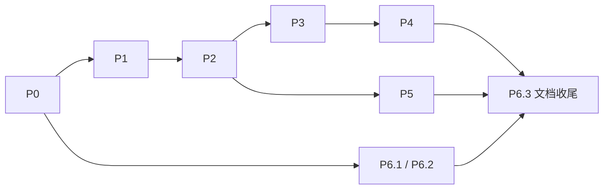

# PLAN：架构收敛、代码复用与解耦

本文的来源是一次全仓架构评审，目标是消除三类问题：

1. **跨语言契约靠手工同步。** 二进制 ops、事件值、WeChat 表、平台名、平台模块名分别在 TS、Rust、C++、Swift、Kotlin、C# 里硬编码，宿主之间对非法 UTF-8 的处理已经不一致。
2. **同类代码重复。** 包括 4 个原生视图后端的缩进 writer 和 Template 查询、DOM 与 remote 两套 JS 控制流生成、Web 与 WeChat 两份 CSS 属性映射、Vite 里 4 份原生构建编排。
3. **模块依赖方向不对。** sema 依赖 IDE 的 recorder，view 依赖 sema 的私有 builtins，content-mapper 直接调用后端内部函数，transformer 把所有后端 `pub mod` 暴露在外。

计划按阶段推进：先补齐跨语言共享测试样例，再让协议常量由单一来源生成，然后去重、理顺边界。整个过程不改变语言语义和生成产物，唯一的例外在 P1，写明见 P1 一节。

## 执行规则

以下规则都必须遵守。

1. **顺序**：按任务编号执行。只有[依赖图](#依赖图)里没有边相连的任务可以并行。
2. **提交**：一个任务对应一个提交，提交信息用任务里给出的标题，正文列出改动要点。提交前，该任务的全部「验收」必须通过。
3. **产物不变**：除非任务的「预期变化」里列出，否则以下产物必须与基线逐字节一致：
   - Rust 快照（`crates/transformer/tests/snapshots/`）
   - conformance 黄金文件（`tests/conformance/golden/`）
   - [C-apps](#检查命令) 比对的 example 产物

   只有任务明确允许时才能设置 `WEFT_UPDATE_SNAPSHOTS`。
4. **测试**：不许为了通过测试去改已有测试的断言。只有任务写明「替换」的测试才能删除或改写，且必须由共享样例完整覆盖其原有断言。
5. **范围**：只做任务里写明的改动。执行中发现的其他问题记入文末[执行中发现](#执行中发现)，不顺手修。
6. **宿主**：如果某项检查暂时跑不了（比如 Linux 容器或 Windows 虚拟机起不来），任务可以提交，但在[进度表](#进度表)里标 `⏸`，并写明缺哪项检查。只要还有 `⏸`，所在阶段就不算完成。
7. **生成文件**：带「Generated from protocol/weft.protocol.json」文件头的文件禁止手改。要改先改 schema，再运行 `pnpm gen:protocol`。
8. **Rust**：遵循 `AGENTS.md`，即 `rust-best-practices`。
9. **清理**：迁移时更新所有调用方，删除旧实现。不留别名、兼容层或转发导出，任务明确保留的公开路径除外。
10. **进度**：每完成一个任务，更新[进度表](#进度表)。

## 环境

- 主力开发机是 macOS（arm64）。Rust、TS、Apple、Android 的检查都直接在这台机器上运行。
- Linux 检查在 `native/linux/docker/compose.yaml` 的容器里跑。
- Windows 检查在 Parallels 虚拟机 `Windows 11`（arm64）里跑，全程由 Mac 端通过 `prlctl exec` 驱动，不需要手动操作虚拟机。虚拟机里已经准备好：
  - VS 2026 Build Tools（含 ARM64 C++ 工具链和自带的 CMake、Ninja）、.NET SDK 11、Python 3.13、PowerShell 7；
  - `C:\weft\node`：Node 24 和 pnpm 11，已加入用户 PATH；
  - `C:\weft\repo`：Mac 工作区的镜像，**包含未提交的改动**，由 robocopy 从 `\\Mac\Home\Documents\Code\Projects\weft-ui` 同步，所以提交前就能验证；
  - `C:\weft\hermes-src`：Hermes 源码，内核构建通过 `-HermesSource` 复用，不需要 git；
  - `C:\weft\core-test`：带测试和 conformance 的内核构建目录（`WEFT_CORE_SHARED=ON`）；
  - `C:\weft\interactive.ps1`：通过计划任务 `weft-interactive`，在控制台用户的交互式桌面里运行命令，FlaUI 的 UI 测试需要它。

  使用的脚本见[附录](#附录windows-虚拟机脚本)。虚拟机里没有 cargo，编译器 WASM 由 Mac 端 `pnpm build:wasm` 生成后随同步一起带过去。
- 一次性准备：

```sh
pnpm install
pnpm build
native/apple/build-core.sh       # WeftCore.xcframework，供 swift test 和 Apple UI 测试使用
native/android/build-core.sh     # libweft.so，Android 单元测试的 preBuild 需要
```

## 检查命令

各任务的「验收」用下面这些代号引用检查。

| 代号 | 命令 | 通过条件 |
| --- | --- | --- |
| C-rust | `cargo fmt --all --check && cargo test --workspace && cargo clippy --workspace --all-targets 2>&1 \| grep -c '^warning'` | 前两条通过；clippy 警告数不超过基线 |
| C-ts | `pnpm build && pnpm test`，再在 `packages/runtime`、`packages/platform`、`packages/vite`、`packages/content-mapper`、`tests` 下各运行 `pnpm exec tsc -p .` | 测试全部通过；tsc 错误数不超过基线 |
| C-apps | 运行 `/tmp/weft-check-apps.sh`，脚本见下 | 无差异输出，退出码 0 |
| C-core | `cmake -S native/core -B native/core/build -G Ninja -DCMAKE_BUILD_TYPE=Release && cmake --build native/core/build && ctest --test-dir native/core/build --output-on-failure` | 全部通过 |
| C-apple | `swift test --package-path native/apple` | 全部通过 |
| C-android | `WEFT_NATIVE=0 pnpm --filter example build:android && example/apps/android/gradlew -p example/apps/android :weft-android:testDebugUnitTest` | 全部通过 |
| C-windows | `pnpm build:wasm && /tmp/weft-win.sh /tmp/win-sync.ps1 && /tmp/weft-win.sh /tmp/win-check.ps1`：同步工作区 → 构建 `weft_core.dll` → 内核测试与 conformance（Windows 共享库形态）→ `dotnet test native\windows\Weft.WinUI.Tests` | 退出码 0 |
| C-linux | 在容器内运行，命令见下 | 全部通过 |
| C-ui | 按 README 跑各平台点击流程：`pnpm --filter example test:macos`、`test:ios`、`test:android`；Windows 先跑 C-windows，再运行 `/tmp/weft-win.sh /tmp/win-ui.ps1`；`test:linux`（容器内，流程见 compose.yaml 注释） | 全部通过 |
| C-gen | `node protocol/generate.ts --check`（P2.1 之后，已包含在 C-ts 里） | 退出码 0 |

`/tmp/weft-check-apps.sh`：这个脚本不提交，用来比对 7 个平台在 `WEFT_NATIVE=0` 下的产物。Hermes 字节码不参与比对，因为它的输入 `js/index.js` 已经比对过了。

```sh
#!/usr/bin/env bash
set -euo pipefail
cd "$(git rev-parse --show-toplevel)"
for p in web wechat ios macos android windows linux; do
  WEFT_NATIVE=0 pnpm --filter example "build:$p" >/dev/null
done
diff -r -x '*.hbc' /tmp/weft-baseline/apps/web example/apps/web
for p in wechat ios macos android windows linux; do
  diff -r -x '*.hbc' "/tmp/weft-baseline/apps/$p" "example/apps/$p/weft"
done
```

C-linux 的命令：

```sh
docker compose -f native/linux/docker/compose.yaml up -d --build
docker compose -f native/linux/docker/compose.yaml exec linux bash -lc '
  pnpm install && native/linux/build-core.sh &&
  cmake -S native/linux -B /tmp/weft-linux-tests -G Ninja -DWEFT_LINUX_TESTS=ON &&
  cmake --build /tmp/weft-linux-tests &&
  ctest --test-dir /tmp/weft-linux-tests --output-on-failure'
```

在 P1.8 之前还没有 `WEFT_LINUX_TESTS`，此时 C-linux 只运行 `native/linux/build-core.sh`。

## 依赖图



阶段内部按编号顺序执行，下列情况除外：

- P1.5、P1.6、P1.7、P1.8 都只依赖 P1.2，彼此可以并行。
- P2.4、P2.5 都只依赖 P2.1，彼此可以并行。
- P3.1、P3.2 可以并行。
- P5.1、P5.2 可以并行。

---

## P0 基线与清理

### P0.1 记录基线（不提交）

- **步骤**：
  1. 准备环境（见[环境](#环境)）。
  2. 运行 C-rust 和 C-ts，确认全部通过，然后记下两个数：
     - clippy 警告数，写入 `/tmp/weft-baseline/clippy.txt`；
     - 每个包的 tsc 错误数，写入 `/tmp/weft-baseline/tsc.txt`。
  3. 依次运行 `WEFT_NATIVE=0 pnpm --filter example build:<p>`，`<p>` 取 7 个平台。
  4. 把 `example/apps/web/` 复制到 `/tmp/weft-baseline/apps/web/`。
  5. 把其余 6 个平台的 `example/apps/<p>/weft/` 复制到 `/tmp/weft-baseline/apps/<p>/`。
  6. 写好 `/tmp/weft-check-apps.sh`，运行一次，确认无差异。
  7. 运行 C-core、C-apple、C-android、C-windows、C-linux，确认都通过。
- **验收**：步骤 2 到 7 的检查全部通过。如果基线本身就有失败，停止执行本计划，把失败记入[执行中发现](#执行中发现)。

### P0.2 修正失效的文档引用

- **改动**：
  - 有 26 处注释仍在引用已删除的 `docs/PROTOCOL.md`、`docs/GRAMMAR.md`，或中文小节名「平台调用」。把它们统一改成：
    - `protocol/SPEC.md` 加英文小节名，例如 `("Binary encoding")`、`("Platform calls")`；
    - 语法相关的改成 `crates/parser/GRAMMAR.md`。
  - 涉及的文件：`crates/parser/src/parser.rs`、`crates/transformer/src/view.rs`、`native/**`、`packages/**`。用下面验收里的 `rg` 命令可以列全。
- **验收**：
  - `rg -n 'docs/(PROTOCOL|GRAMMAR)\.md|平台调用|PLAN(-v2)?\.md' --glob '!node_modules' --glob '!target' --glob '!docs/**' --glob '!PLAN.md' .` 没有输出。
  - C-rust 通过，C-ts 通过。
- **提交**：`docs: point code comments at the protocol and grammar pages`

---

## P1 协议共享样例与解码语义

**预期变化（本计划唯一的行为变化）**：

- Swift、Kotlin、C# 三个宿主读取器遇到非法 UTF-8 时，改为拒绝整个批次。目前它们用替换字符解码。
- 所有读取器的错误归为同一组种类。

正常应用不受影响：写入端是 TS 的 `TextEncoder`，只会产出合法 UTF-8。

### P1.1 规范：解码错误

- **改动**：在 `protocol/SPEC.md` 的「Binary encoding」之后新增小节「Decoding errors」，中文版 `protocol/SPEC.zh-CN.md` 同步。内容如下：
  - 批次解码失败只有 5 种错误，种类名必须一致：
    - `truncated`：空批次，或任何长度、数量超出剩余字节；
    - `version`；
    - `opcode`；
    - `tag`；
    - `utf8`：字符串值不是格式良好的 UTF-8，包括 overlong、代理项、超过 U+10FFFF、截断的多字节序列、孤立的续字节。
  - 解码失败的批次按各宿主现有方式处理，整批不应用。
  - 读取器必须先判断 opcode，再读取该 op 的字段。
  - 事件 payload 解码失败时，内核记录错误并返回 `true`。这是现有行为，这里只是写进规范。
  - 指明共享样例的位置：`protocol/corpus/`。
- **验收**：用 `pnpm --filter docs build` 构建文档成功。
- **提交**：`docs(protocol): specify decoding errors and the shared corpus`

### P1.2 共享样例

- **改动**：新建 `protocol/corpus/`，包含 3 个文件。格式固定如下：
  - `ops.json`：`{"cases": [Case…]}`。每个 Case 有这些字段：
    - `name`；
    - `hex`：小写十六进制，字节之间可以有空格；
    - 二选一：`ops` 或 `error`。
      - `ops` 是结构化 op 的数组，形如 `{"op":"set","scope":3,"slot":0,"value":{"string":"…"}}`。值写成 `{"bool":b}`、`{"number":n}` 或 `{"string":s}`。
      - `error` 是 P1.1 定义的种类名之一。
  - `values.json`：`{"cases": [{"name","value","hex"}…]}`，`value` 的写法同上。
  - `frames.json`：`{"requests": […], "responses": […], "malformed": […]}`。
    - request 和 response 各有 `name`、`head`（JSON 对象）、`body`（UTF-8 文本）、`hex`。
    - malformed 只有 `name` 和 `hex`。
- **最少用例**（必须全部包含）：
  - ops 正常用例：
    - `all-ops`：create；set 字符串 `"mïlk 🥛"`；set 数字 `-2.5`、`12`、`0.1`；set `true`、`false`；rows `[3,4]`；rows `[]`；branch 子节点为 0；attach。
    - `empty-string`：set 空字符串 `""`。
  - ops 错误用例：

    | name | error |
    | --- | --- |
    | `empty-batch` | `truncated` |
    | `version-2` | `version` |
    | `unknown-opcode-9`（hex 为 `01 09`，后面没有字段） | `opcode` |
    | `truncated-u32` | `truncated` |
    | `rows-count-overflow` | `truncated` |
    | `string-length-overflow` | `truncated` |
    | `unknown-tag-7` | `tag` |
    | `utf8-overlong`（`c0 af`） | `utf8` |
    | `utf8-surrogate`（`ed a0 80`） | `utf8` |
    | `utf8-above-max`（`f4 90 80 80`） | `utf8` |
    | `utf8-truncated-sequence`（`e2 82`） | `utf8` |
    | `utf8-lone-continuation`（`80`） | `utf8` |

  - values：`true`、`false`、`-2.5`、`0`、`12`、`0.1`、`""`、`"mïlk 🥛"`、`"a\"\\\n"`。
  - frames：
    - request：一个 POST，带 `content-type` 请求头，body 为 `{"a":1}`；一个 GET，body 为空。两者的 `head` 和 `hex` 都要与 `packages/platform` 的 `frame()` 输出一致。
    - response：一个 `{"status":201}`，body 为 `ok`。
    - malformed：`01 00`，即帧长度不足 4 字节。
- **不做**：不覆盖 storage 的 JSON 数组参数，它是普通 JSON，不属于二进制约定。数字不使用 `-0`、`NaN`、`Infinity`，因为 JSON 表达不了。
- **验收**：3 个文件都能通过 `jq . protocol/corpus/*.json` 解析。
- **提交**：`test(protocol): add the shared ops, value and frame corpus`

### P1.3 TS：错误种类与样例测试

- **改动**：
  - `packages/runtime/src/ops.ts`：新增导出 `class OpsError extends Error { readonly kind: "truncated" | "version" | "opcode" | "tag" | "utf8" }`。`decode` 的所有抛错都改成 `OpsError`，消息文本不变。UTF-8 解码失败时抛 `utf8`：现在的 `fatal` decoder 会抛 `TypeError`，需要捕获后转换。
  - 把 `packages/platform/src/native.ts` 里的 `frame` 和响应帧解析提取到新文件 `packages/platform/src/frame.ts`，导出 `frame(head, body)` 和 `unframe(bytes)`。`native.ts` 改为导入它们。
  - 新建 `tests/protocol/corpus.test.ts`，覆盖 3 项：
    1. 每个 ops 用例：`decode(hex)` 得到 `ops`，或抛出种类正确的 `OpsError`。
    2. 每个正常用例：把解码结果依次写回 `OpWriter`，`take()` 得到的字节等于 `hex`。
    3. values：用 `OpWriter.set(0, 0, v)` 写入，输出去掉前 10 个字节（版本 1、opcode 1、两个 u32 共 8）后等于 `hex`。
  - 新建 `packages/platform/test/frame.test.ts`：每个 request 用例 `frame(head, body)` 等于 `hex`；每个 response 用例 `unframe(hex)` 得到 `head` 和 `body`；malformed 用例 `unframe` 抛错。
  - `tests/tsconfig.json` 的 `include` 加上 `"protocol"`。
- **验收**：C-ts 通过，C-apps 无差异。
- **提交**：`test(runtime): decode the shared corpus and classify decoding errors`

### P1.4 C++ 内核：错误种类、值编码与样例测试

- **改动**：
  - `native/core/include/weft/ops.hpp` 和 `src/ops.cpp`：
    - 给 `ops::Error` 加上 `enum class Kind { Truncated, Version, Opcode, Tag, Utf8 }`，并新增 `Kind kind() const`。
    - 空批次改报 `Truncated`。
    - 新增 `void encode_value(const Value &value, std::string &out)`。
  - `native/linux/src/scope.cpp`：3 个 `Scope::dispatch` 重载改为调用 `ops::encode_value`，删除手写的 tag 和长度编码。
  - `native/core/tests/kernel_test.cpp`：
    - 新增用例 `corpus`。它用 `json.hpp` 读取 `WEFT_CORPUS_DIR` 下的 `ops.json` 和 `values.json`，对每个 ops 用例校验 `Reader` 的结果或错误种类，对每个 values 用例校验 `read_value` 和 `encode_value` 两个方向。
    - **替换**：删除 `ops()` 里的 `rejects(...)` 断言（已由样例覆盖），保留文本格式断言。
  - `native/core/tests/CMakeLists.txt`：给测试目标加上 `WEFT_CORPUS_DIR="${repo}/protocol/corpus"`，并把 `corpus` 加入用例列表。`${repo}` 要在 `if(WEFT_CONFORMANCE)` 之外定义。
- **验收**：C-core 通过且包含 `core.corpus`；C-windows 通过（MSVC 编译，且 Windows 上的内核测试同样包含 `core.corpus`）；C-linux 通过。
- **提交**：`test(core): run the shared corpus and share value encoding with the GTK shell`

### P1.5 Swift：严格 UTF-8 与样例测试

- **改动**：
  - `native/apple/Sources/WeftKit/Ops.swift`：
    - `OpError` 新增 `.utf8`，并新增计算属性 `kind: String`，返回 P1.1 的种类名。
    - 字符串改为严格解码：用 `transcode(_:from:to:stoppingOnError: true, into:)`，或其他在 macOS 14 / iOS 17 上可用、遇错即失败的方式。
  - 把 `Platform.swift` 里的 `unframe` 和 `frame` 从 `private` 改为 `internal`。
  - `native/apple/Tests/WeftKitTests/`：
    - 新增 `CorpusTests.swift`，用 `#filePath` 定位仓库根目录下的 `protocol/corpus/`，覆盖 3 项：
      - ops 解码或错误种类；
      - `WeftValue.encode` 与 values 用例一致；
      - frames：request 解出的 head 按 JSON 语义相等、body 字节相等；response 由 `frame` 编码后再按 u32 长度、JSON 头、body 解析，结果与用例一致；malformed 抛错。
    - **替换**：删除 `OpReaderTests.swift` 里已由样例覆盖的 `decodesEveryOpAndValue` 和 `rejectsMalformedBatches`。
- **验收**：C-apple 通过；C-ui 中 macOS 和 iOS 两项通过。
- **提交**：`fix(apple): reject invalid UTF-8 in ops and test against the shared corpus`

### P1.6 Kotlin：严格 UTF-8 与样例测试

- **改动**：
  - `Ops.kt`：
    - `OpException` 新增 `val kind: String`。
    - 字符串改用 `StandardCharsets.UTF_8.newDecoder()` 解码，`onMalformedInput` 和 `onUnmappableCharacter` 都设为 `CodingErrorAction.REPORT`，捕获 `CharacterCodingException` 后转成 `utf8`。
  - `Platform.kt`：`unframe` 和 `frame` 改为 `internal`。
  - `native/android/build.gradle.kts`：
    - 在 `android.testOptions.unitTests.all` 里设置 `systemProperty("weft.corpus", file("../../protocol/corpus").absolutePath)`。
    - 新增 `testImplementation("org.json:json:<Maven Central 最新版>")`。原因是 `android.jar` 里的 `JSONObject` 是桩实现，在 JVM 单测里会抛异常。具体版本写进提交正文。
  - 新增 `src/test/kotlin/net/mioyi/weftui/CorpusTest.kt`，覆盖内容同 P1.5。**替换**：删除 `OpReaderTest.kt` 里已由样例覆盖的用例。
- **验收**：C-android 通过；C-ui 中 Android 一项通过。
- **提交**：`fix(android): reject invalid UTF-8 in ops and test against the shared corpus`

### P1.7 C#：严格 UTF-8、opcode 优先与样例测试

- **改动**：
  - `OpReader.cs`：
    - `OpException` 新增 `Kind`。
    - 字符串改用 `new UTF8Encoding(false, true)` 解码，捕获 `DecoderFallbackException` 后转成 `utf8`。
    - **先判断 opcode，再读 scope**。现在的实现先读 scope，导致 `01 09` 报成 truncated。
  - `Platform.cs`：`Unframe` 和 `Frame` 改为 `internal`。
  - `Weft.WinUI.Tests.csproj`：`<None Include="..\..\..\protocol\corpus\*.json" LinkBase="corpus" CopyToOutputDirectory="PreserveNewest" />`。
  - 新增 `CorpusTests.cs`，覆盖内容同 P1.5。**替换**：删除 `OpReaderTests.cs` 里已由样例覆盖的用例。
- **验收**：C-windows 通过；C-ui 中 Windows 一项通过。
- **提交**：`fix(windows): reject invalid UTF-8, check opcodes first and test against the shared corpus`

### P1.8 Linux：帧编解码可测与样例测试

- **改动**：
  - 把 `native/linux/src/platform.cpp` 匿名命名空间里的 `frame` 和 `unframe` 移到新文件 `src/frame.hpp` 和 `src/frame.cpp`，放在命名空间 `weft::frame`，作为内部头文件。`platform.cpp` 改为调用它们。`native/linux/CMakeLists.txt` 的 `weft_linux` 加入 `src/frame.cpp`。
  - `native/linux/CMakeLists.txt`：新增 `option(WEFT_LINUX_TESTS "Build the shell's unit tests" OFF)`；开启时执行 `enable_testing()` 和 `add_subdirectory(tests)`。
  - 新增 `native/linux/tests/CMakeLists.txt` 和 `frame_test.cpp`。可执行文件 `weft_linux_tests` 链接 `weft_linux`，通过 `WEFT_CORPUS_DIR` 读取 `frames.json`（用 json-glib 解析），覆盖内容同 P1.5 的 frames 部分。用 `add_test(NAME linux.frames …)` 注册。
- **验收**：C-linux 通过且包含 `linux.frames`；C-ui 中 Linux 一项通过。
- **提交**：`test(linux): unit-test platform frames against the shared corpus`

---

## P2 单一来源与代码生成

### P2.1 Schema、生成器与漂移检查

- **改动**：
  - 新增 `protocol/weft.protocol.json`，内容固定为：

    ```json
    {
      "version": 1,
      "opcodes": { "create": 1, "set": 2, "branch": 3, "rows": 4, "attach": 5 },
      "valueTags": { "false": 0, "true": 1, "number": 2, "string": 3 },
      "errorKinds": ["truncated", "version", "opcode", "tag", "utf8"],
      "wechatUnits": { "px": 1, "bold": 2, "color": 3 },
      "platforms": [
        { "name": "web" },
        { "name": "wechat" },
        { "name": "ios", "native": true, "apple": true },
        { "name": "macos", "native": true, "apple": true },
        { "name": "android", "native": true },
        { "name": "windows", "native": true },
        { "name": "linux", "native": true }
      ],
      "platformModules": { "fetch": ["request"], "storage": ["get", "set", "remove"] }
    }
    ```

  - 新增 `protocol/generate.ts`：
    - 用 Node 直接运行，依赖 Node 内置的类型剥离，不引入第三方依赖。
    - 不带参数时写出下表中的文件；带 `--check` 时只比对，有差异就列出文件名并以退出码 1 结束。
    - 生成文件第一行固定为 `Generated from protocol/weft.protocol.json by protocol/generate.ts; do not edit.`，注释语法按各语言。
    - 各语言的常量命名按该语言惯例，名称映射写在 `generate.ts` 文件顶部的注释里。

    | 输出文件 | 内容 |
    | --- | --- |
    | `packages/runtime/src/protocol.ts` | `VERSION`、`Opcode`、`ValueTag`、`OpErrorKind`、`WechatUnit`、`PLATFORMS`、`NATIVE_PLATFORMS`、`APPLE_PLATFORMS`，类型 `Platform`、`NativePlatform`、`PlatformModule`，`PLATFORM_MODULES` |
    | `crates/transformer/src/protocol.rs` | `pub enum Platform`，带现有 derive 和文档；`impl Platform { ALL, as_str, is_native, is_apple }`；`pub(crate) mod wechat_unit` |
    | `native/core/include/weft/protocol.hpp` | 命名空间 `weft::protocol`：`kVersion`、`enum class Code`、`enum class Tag`、模块名和方法名的 `constexpr std::string_view` |
    | `native/apple/Sources/WeftKit/Protocol.swift` | 版本、`OpCode`、`ValueTag`、`OpErrorKind`、模块名常量 |
    | `native/android/src/main/kotlin/net/mioyi/weftui/Protocol.kt` | 同上，`internal` |
    | `native/windows/Weft.WinUI/Protocol.cs` | 同上，`internal` |

  - 根目录 `package.json` 新增脚本 `"gen:protocol": "node protocol/generate.ts"`。
  - `packages/runtime/package.json` 的 `exports` 新增 `"./protocol": "./src/protocol.ts"`。
  - 新增 `tests/protocol/generated.test.ts`，以 `--check` 方式运行生成器，断言退出码为 0。
  - 生成的 Rust 代码必须直接通过 `cargo fmt --check`，生成器不调用外部格式化工具。
- **不做**：本任务不修改任何消费方，生成的文件暂时只是新增。
- **验收**：
  - `pnpm gen:protocol` 连续运行两次，第二次之后 `git status` 不变。
  - 手动改动一个生成文件后，C-gen 失败；恢复后通过。这一步只做验证，不提交改动。
  - C-rust 通过，C-ts 通过。
- **提交**：`feat(protocol): single schema and generator for cross-language constants`

### P2.2 TS 消费方

- **改动**：
  - `packages/runtime/src/ops.ts`：删除本地的 `VERSION` 和 opcode、tag 常量，改为从 `./protocol.ts` 引入。`OpsError.kind` 的类型改用 `OpErrorKind`。
  - `packages/runtime/src/wechat.ts`：删除 `PX`、`BOLD`、`COLOR`，改用 `WechatUnit`。`TemplateKeys.v` 的注释补上 unit `3`（颜色）。
  - `packages/compiler/src/index.ts`：`Platform` 改为从 `@weft-ui/runtime/protocol` 以 `export type` 导出，并给 compiler 加上依赖 `"@weft-ui/runtime": "workspace:*"`。
  - `packages/platform/src/index.d.ts`：`Platform` 改为从 `@weft-ui/runtime/protocol` 引入；`Api` 改为 `PlatformModule`。
  - `packages/vite`：
    - 删除 `index.ts` 的 `PLATFORMS`、`native.ts` 的 `NATIVE`、`apple.ts` 的 `APPLE`，改用 `PLATFORMS`、`NATIVE_PLATFORMS`、`APPLE_PLATFORMS`。
    - `@weft-ui/runtime` 从 `devDependencies` 移到 `dependencies`。
    - `PLATFORMS` 原先是 `@weft-ui/vite` 的公开导出。如果仓库内有引用，一并迁移到 `@weft-ui/runtime/protocol`，不保留转发导出。
  - `example/vite.config.ts`：删除 `platforms` 那一行，默认值就是全部平台。
- **验收**：
  - `rg -n '"web", ?"wechat"|"ios", ?"macos", ?"android"' packages example tests --glob '!**/protocol.ts' --glob '!**/node_modules/**'` 没有输出。
  - `rg -n 'const (CREATE|SET|BRANCH|ROWS|ATTACH|FALSE|TRUE|NUMBER|STRING|PX|BOLD|COLOR) =' packages/runtime/src` 没有输出。
  - C-ts 通过，C-apps 无差异。
- **提交**：`refactor(ts): take protocol constants and platform names from the generated module`

### P2.3 Rust 消费方

- **改动**：
  - `crates/transformer/src/transform.rs`：删除手写的 `Platform` 枚举、`ALL`、`as_str`，改成 `pub use crate::protocol::Platform;`（`transform::Platform` 是现有的公开路径，予以保留）。`Display`、`FromStr`、`ParsePlatformError` 保留在原处。
  - `crates/transformer/src/lib.rs`：`transform_program` 的分派改为只有一层 `match`，去掉内层 `match` 和 `unreachable!("{platform} is not native")`。原生平台的共同部分（`layout.json` 加 remote 逻辑）提取成一个私有函数，各平台的分支只传入自己的视图生成函数。
  - `crates/transformer/src/wechat/elements.rs`：`Unit::code` 改用 `protocol::wechat_unit`。
- **验收**：
  - `rg -n 'is not native|Unit::Color => 3' crates` 没有输出。
  - C-rust 通过，快照不变，C-apps 无差异。
- **提交**：`refactor(transformer): generated Platform and a single-level platform dispatch`

### P2.4 C++ 与 Linux 消费方

- **改动**：
  - `ops.hpp` 和 `ops.cpp`：删除 `kVersion`、`enum class Code` 和 tag 常量，改用 `weft/protocol.hpp`。所有使用 `ops::Code` 的地方（`native/linux/src/session.cpp`、`native/core/tests/*`）迁移到 `protocol::Code`，不保留别名。
  - `native/linux/src/platform.cpp`：`supported` 和 `call` 改用生成的模块名、方法名常量。
- **验收**：
  - `rg -n 'constexpr uint8_t k(False|True|Number|String|Version)|enum class Code' native/core/src native/core/include/weft/ops.hpp` 没有输出。
  - C-core、C-windows、C-linux 通过。
- **提交**：`refactor(native): take protocol constants from the generated header`

### P2.5 Swift、Kotlin、C# 消费方

- **改动**：
  - 3 个读取器改用生成的版本号、`OpCode` 和 `ValueTag`。C# 删除手写的 `enum OpCode`。
  - 3 个 `WeftValue` 编码器改用 `ValueTag`。
  - 3 个 `Platform` 的支持集合与分派改用生成的模块名、方法名常量。
- **验收**：
  - `rg -n 'case [0-5]:' native/apple/Sources/WeftKit/Ops.swift` 没有输出。
  - `rg -n 'bytes\.append\([0-3]\)' native/apple/Sources/WeftKit/Value.swift` 没有输出。
  - `rg -n '^\s+[0-5] ->' native/android/src/main/kotlin/net/mioyi/weftui/Ops.kt` 没有输出。
  - `rg -n '\b[0-3] =>|enum OpCode' native/windows/Weft.WinUI/OpReader.cs` 没有输出。
  - `rg -n '"(fetch|storage|request|get|set|remove)"' native/apple/Sources native/android/src/main native/windows/Weft.WinUI` 只在生成文件中出现。
  - C-apple、C-android、C-windows 通过；C-ui 全部通过。
- **提交**：`refactor(shells): take protocol constants from the generated sources`

### P2.6 平台 API 实现的编译期契约

- **改动**：新增 `packages/platform/src/contract.ts`，它只包含类型，不产出运行时代码。用一个泛型约束，要求 `typeof import("./web.ts")`、`./wechat.ts`、`./native.ts` 三者都满足 `typeof import("./index.d.ts")` 的全部导出，包括 `PlatformError`、`run`、`fetch`、`storage`、`platform`、`isSupported`。
- **不做**：不改 `App.mount(target: never)`。
- **验收**：
  - 在 `packages/platform` 下运行 `pnpm exec tsc -p .`，错误数不超过基线。
  - 临时删掉 `wechat.ts` 的 `isSupported` 导出后，tsc 报错；恢复后通过。这一步只做验证，不提交改动。
  - C-ts 通过。
- **提交**：`test(platform): type-check every implementation against the public contract`

---

## P3 transformer 去重

### P3.1 共用缩进 writer

- **改动**：
  - 新增 `crates/transformer/src/code.rs`，定义 `pub(crate) struct Indented { text: String, depth: usize, unit: &'static str }`，提供以下方法：
    - `new(unit)`
    - `line(&mut self, impl Display)`
    - `start_line(&mut self) -> &mut String`
    - `end_line(&mut self, impl Display)`
    - `indent()`、`dedent()`（`dedent` 在 depth 为 0 时 panic，消息与现在相同）
    - `blank()`
    - `finish()`（depth 不为 0 时 panic）
  - `swiftui/swift.rs`、`compose/kotlin.rs`、`winui/csharp.rs`、`gtk/cpp.rs` 里的 `Code` 改为包装 `Indented`，各自只保留本语言的括号风格方法：
    - Swift：`open`、`close`、`reopen`；
    - Kotlin：`open`、`close`、`open_after`；
    - C#：Allman 风格的 `open`、`close`；
    - C++：`open`、`close`、`access`，缩进单位为 2 个空格。
  - 调用方的参数从 `impl AsRef<str>` 统一为 `impl Display`。
- **不做**：`bridge/js.rs` 的 `Code` 带源码映射，不合并。各语言的字符串转义函数不合并。
- **验收**：
  - `rg -n 'depth: usize' crates/transformer/src/{swiftui,compose,winui,gtk}` 没有输出。
  - C-rust 通过，快照不变，C-apps 无差异。
- **提交**：`refactor(transformer): one indented writer for the native view backends`

### P3.2 Template 的共享查询

- **改动**：在 `crates/transformer/src/view.rs` 新增：
  - `pub enum PropSource<'t> { Slot(usize), Constant(&'t Constant) }`
  - `Template::prop(&self, node: u32, props: &'t [StaticProp], name: &str) -> Option<PropSource<'t>>`
  - `Template::event(&self, node: u32) -> Option<(usize, Option<u32>)>`
  - `Template::controlled(&self, node: u32) -> (usize, u32)`：元素没有受控事件时 panic，消息沿用现有文字。

  删除以下重复实现，调用方改用上面的方法：
  - SwiftUI、Compose 两个 `Body` 里的 `prop`、`event`、`controlled`；
  - WinUI 的 `event`；
  - GTK 的 `event`、`controlled`。

  各后端可以保留把 `PropSource` 转成本语言代码的函数，但不能命名为 `prop`。
- **验收**：
  - `rg -n 'fn (prop|event|controlled)\b' crates/transformer/src/{swiftui,compose,winui,gtk}` 没有输出。
  - C-rust 通过，快照不变，C-apps 无差异。
- **提交**：`refactor(transformer): shared slot, constant and event queries on Template`

### P3.3 Web 与 WeChat 共用 CSS 元数据

依赖 P2.3。

- **改动**：
  - 新增 `crates/transformer/src/style.rs`，包含：
    - `pub(crate) enum CssUnit { Px, Color, Bold }`，其中 `code()` 返回 `protocol::wechat_unit` 的值；
    - `pub(crate) fn css(prop: &str) -> Option<(&'static str, CssUnit)>`，覆盖 padding、gap、width、height、size、background、color、bold；
    - `pub(crate) const COLUMN_STYLE` 和 `ROW_STYLE`，即两个 flex 基础样式字符串。
  - `web/dom.rs::target` 中样式相关的分支改为查 `css()`；`tag()` 改用 `COLUMN_STYLE` 和 `ROW_STYLE`。
  - `wechat/elements.rs::target` 同样改为查 `css()`，删除 `Unit` 和 `Unit::code`。`wechat/wxml.rs::tag` 改用两个常量。
- **不做**：Web 的受控值、DOM 属性，以及 WeChat 的 `Flag` 和内联安全策略，都保留在各自后端。
- **验收**：
  - `rg -n '"font-size"|"font-weight"|flex-direction:column' crates/transformer/src` 只在 `style.rs` 中出现。
  - C-rust 通过，快照不变，C-ts 通过（含 conformance），C-apps 无差异。
- **提交**：`refactor(transformer): share CSS property metadata between the Web and WeChat backends`

### P3.4 DOM 与 remote 共用控制流生成

- **改动**：
  - 新增 `crates/transformer/src/bridge/flow.rs`，把 `web/dom.rs` 和 `bridge/remote.rs` 中重复的以下部分移进来：
    - `block`（组装 create、`u`、`x`）；
    - `node` 分派；
    - `if_node`、`for_node`、`component_node`；
    - `Slot` 节点的处理；
    - 元素子节点递归和 lifecycle。

    两种模式的差别收敛到一个 trait，由 `dom::Gen` 和 `remote::Gen` 各自实现。建议提供以下钩子，名称可以调整，但职责边界不能变：

    | 钩子 | DOM | remote |
    | --- | --- | --- |
    | `element(..) -> 子节点的父变量` | 属性、事件、受控输入 | 值槽、事件槽 |
    | `anchor(id, parent) -> String`：`$.Branches` 和 `$.List` 在工厂参数前的实参 | `n{id}` | `{parent}, {point}` |
    | `block_scope(id, index, roots, ctx, out)`：分支 case 和 slot 工厂体 | `new $.Block()` | `new $.Block(c.app, template)` |
    | `row_args(id) -> String`：`new $.Row(` 之后的前导实参 | 空 | `c.app, {template}, ` |
    | `mount(id, parent, child) -> String` | `{child}.mount(n.parentNode, n);` | `{parent}.attach({point}, {child});` |
    | `slot_destroy() -> &str` | `destroy(false)` | `destroy()` |

  - DOM 模板 HTML、`refs`、remote 的 handler 和 controls 计算继续留在各自文件。
- **验收**：
  - `rg -n 'fn (if_node|for_node|component_node|block)\b' crates/transformer/src` 只在 `bridge/flow.rs` 中出现。
  - `rg -n 'new \$\.(Branches|List|Slot|Row)' crates/transformer/src` 只在 `bridge/flow.rs` 中出现。
  - C-rust 通过，快照不变，C-ts 通过（含 conformance、miniprogram、vite 测试），C-apps 无差异。
- **提交**：`refactor(transformer): one control-flow generator for DOM and remote modes`

---

## P4 transformer 边界

### P4.1 元素目录移出 sema

- **改动**：
  - 新增 `crates/transformer/src/elements.rs`。从 `sema/builtins.rs` 原样移入 `PropType`、`PropKind`、`PropSpec`、`ElementSpec`、`ELEMENTS`、`LIFECYCLE`、`element()`、`prop_type()`，以及它们依赖的私有 `const fn`。
  - `sema/builtins.rs` 只保留成员签名：`MemberKind`、`MemberSig`、`member` 等。
  - `view.rs`、`ide.rs` 和 `sema/*` 改为从 `crate::elements` 引入。
- **验收**：
  - `rg -n 'crate::sema' crates/transformer/src/view.rs` 没有输出。
  - `rg -n 'ELEMENTS|LIFECYCLE|struct ElementSpec' crates/transformer/src/sema` 只能是 `use` 语句。
  - C-rust 通过，快照不变。
- **提交**：`refactor(transformer): move the element catalog out of sema`

### P4.2 语义记录归属 sema

- **改动**：
  - 把 `Recorder`、`Target`、`RawCall`、`RawProbe`、`ProbeContext` 从 `ide.rs` 移到新文件 `sema/record.rs`。
  - `Target` 改为引用语义实体，不再携带已渲染好的 `Symbol`。例如：
    - `Target::Element(&'static ElementSpec)`
    - `Target::Prop { owner: Option<&'static ElementSpec>, prop: &'static PropSpec }`
    - `Target::Member { recv: Type, name: String }`
    - `Target::Type(String)`

    凡是需要模型名的变体，都携带 `ModelId`，由 `ide.rs` 在生成查询结果时用记录中的 `Program` 解析成名称。
  - `ide.rs` 负责把 `Target` 转成 `Symbol`、生成展示字符串、实现 `display_type`。
  - `ProbeContext` 仍然从 `weft_ui_transformer::ide` 公开，因为 language-server 在用。这是有意保留的公开路径，用 `pub use crate::sema::record::ProbeContext;` 实现。
- **验收**：
  - `rg -n 'crate::ide' crates/transformer/src/sema` 没有输出。
  - 本提交不修改 `crates/transformer/tests/` 和 `crates/language-server/tests/`：`git diff --stat HEAD~1 -- crates/transformer/tests crates/language-server/tests` 输出为空。
  - C-rust 通过。
- **提交**：`refactor(transformer): sema records semantic targets; ide renders symbols`

### P4.3 拆分 `sema/lower.rs`

- **改动**：只移动代码，不改逻辑。把 `sema/lower.rs` 改为目录 `sema/lower/`，拆成：
  - `mod.rs`：`Lowerer`、入口、共享上下文；
  - `scope.rs`：作用域和声明；
  - `nodes.rs`：节点、参数匹配、调用；
  - `handlers.rs`：处理器；
  - `expr.rs`：表达式和类型。

  每个文件都是 `impl Lowerer` 的一部分。
- **验收**：
  - `wc -l crates/transformer/src/sema/lower/*.rs`，每个文件不超过 600 行。
  - 用 `git diff -M --stat HEAD~1` 检查，确认改动以移动为主，没有逻辑改写。
  - C-rust 通过，快照不变。
- **提交**：`refactor(sema): split lowering into scope, nodes, handlers and expr modules`

### P4.4 拆分 `view.rs`

依赖 P3.2。

- **改动**：只移动代码。把 `view.rs` 改为目录 `view/`：
  - `mod.rs`：数据模型和查询，包括 P3.2 新增的方法；
  - `build.rs`：布局构建和常量归一化；
  - `json.rs`：`to_json` 和 hash。

  公开路径 `weft_ui_transformer::view::*` 保持不变。
- **验收**：layout 快照不变、hash 不变；C-rust 通过；C-apps 无差异。
- **提交**：`refactor(transformer): split the view layout into model, builder and JSON`

### P4.5 收窄 transformer 公开 API

- **改动**：
  - 把 `JsModule`、`Declarations`、`Mapping`、`MappingKind` 移到 `transform.rs`。
  - crate 根新增 `pub fn declarations(program: &Program, file: FileId) -> Declarations`，内容即现在的 `web::declarations`；再新增 `pub fn import_declarations(..)`。
  - `bridge`、`web`、`wechat`、`swiftui`、`compose`、`winui`、`gtk` 改为私有 `mod`。
  - `crates/content-mapper` 改用新的入口和 `transform::MappingKind`。
- **验收**：
  - `rg -n '^pub mod' crates/transformer/src/lib.rs` 恰好输出 `color`、`ide`、`ir`、`transform`、`view` 这 5 行。
  - `rg -n 'weft_ui_transformer::(bridge|web|wechat|swiftui|compose|winui|gtk)' crates` 没有输出。
  - C-rust 通过，C-ts 通过（含 content-mapper 测试）。
- **提交**：`refactor(transformer): narrow the public API to checking, compiling and declarations`

---

## P5 Vite 插件

### P5.1 原生平台适配器

- **改动**：
  - 在 `packages/vite/src/native.ts` 新增：

    ```ts
    export interface NativeAdapter {
      /** Bytecode path relative to the generated directory. */
      readonly bytecode: string;
      /** Host able to run the native build; undefined for any host. */
      readonly host?: NodeJS.Platform;
      /** Warning when the host cannot build, e.g. "xcodebuild needs macOS". */
      readonly hostWarning?: string;
      /** Writes the shell glue (Package.swift, settings.gradle.kts, Weft.targets, CMakeLists.txt). */
      writeGlue(generated: string, project: string): void;
      build(project: string, platform: NativePlatform, release: boolean): Promise<void>;
    }
    export const ADAPTERS: Record<NativePlatform, NativeAdapter>;
    ```

  - 新增 `runTool(command, args, options, messages: { missing: string; failed: string })`。它在 ENOENT 时抛出 `missing`，其他错误时抛出 `failed`、换行、加上输出的最后 60 行。用它替换 `apple.ts`、`android.ts`、`linux.ts`、`windows.ts` 中重复的 try/catch。所有错误和警告文本必须与现在逐字一致。
  - `index.ts` 的 `writeBundle` 改为一段通用流程：编译字节码 → 写 glue → 检查 `WEFT_NATIVE` → 检查宿主 → `build`。
- **验收**：
  - `rg -n 'process\.env\.WEFT_NATIVE' packages/vite/src` 恰好 1 处。
  - `rg -n 'execFile' packages/vite/src` 只在 `native.ts` 中出现。
  - C-ts 通过，C-apps 无差异。
- **提交**：`refactor(vite): native platform adapters and one process runner`

### P5.2 集中解析原生壳路径

- **改动**：
  - 新增 `packages/vite/src/shells.ts`，导出 `nativeShell(name: "apple" | "android" | "windows" | "linux", root?: string): string`。默认根目录是 `fileURLToPath(new URL("../../../native/", import.meta.url))`。
  - `WeftOptions` 新增 `native?: string`：原生壳所在目录，可以是绝对路径，或相对 Vite root 的路径。
  - 删除 4 个平台文件里的 `WEFT_KIT`、`WEFT_ANDROID`、`WEFT_WINUI`、`WEFT_LINUX` 常量，路径改为通过 adapter 和 `nativeShell` 取得。
  - README 的 Vite plugin 一节补充 `native` 选项的说明。
- **验收**：
  - `rg -n '\.\./\.\./\.\./native' packages/vite/src` 恰好 1 处。
  - C-ts 通过，C-apps 无差异（默认路径不变）。
- **提交**：`refactor(vite): resolve native shells in one place, overridable with the native option`

---

## P6 其余项

### P6.1 共享主机端 hermesc 引导脚本

- **改动**：新增 `native/core/host-hermesc.sh`，供其他脚本 source。它定义函数 `weft_host_hermesc <core> <host>`：先保证 `$host/bin/hermesc` 存在，再根据 `CMakeCache.txt` 设置数组 `fetch`。`native/apple/build-core.sh` 和 `native/android/build-core.sh` 删除各自的那段重复代码，改为 source 这个脚本。
- **验收**：
  - 删除 `native/core/build` 后运行 `WEFT_APPLE_SDKS=macosx native/apple/build-core.sh`，成功。
  - 运行 `WEFT_ANDROID_ABIS=arm64-v8a native/android/build-core.sh`，成功。
  - C-apple 通过。
- **提交**：`build(native): share the host hermesc bootstrap of the cross builds`

### P6.2 两套语法共用 fixture 检查

- **改动**：
  - 新增 `crates/parser/tests/fixtures.rs`：通过 `git ls-files '*.weft'` 列出所有被跟踪的 `.weft` 文件，排除文件名以 `Broken` 开头的，逐个 `parse`，断言没有诊断。
  - 新增 `packages/tree-sitter/test/fixtures.sh`：对同一组文件运行 `tree-sitter parse --quiet`，退出码非 0 即失败。
  - `packages/tree-sitter/README.md` 加上这条命令。
- **验收**：`cargo test -p weft-ui-parser --test fixtures` 通过；装有 tree-sitter CLI 时，`packages/tree-sitter/test/fixtures.sh` 通过。
- **提交**：`test(grammar): parse every repository fixture with both grammars`

### P6.3 文档收尾

- **改动**：
  - `README.md`：在命令块里加上 `pnpm gen:protocol`；说明 `protocol/` 存放 schema、生成器和共享样例。
  - `protocol/SPEC.md` 和中文版：说明常量由 `protocol/weft.protocol.json` 生成。
  - 本文件：进度表全部标为完成；[执行中发现](#执行中发现)里每一项都有结论，要么已转成新的计划项，要么注明不处理。
- **验收**：`pnpm --filter docs build` 成功；C-rust、C-ts、C-apps 全部通过。
- **提交**：`docs: protocol schema, generator and corpus`

---

## 附录：Windows 虚拟机脚本

这些脚本不提交，放在 Mac 的 `/tmp/` 下。2026-11-18 已在 `Windows 11` 虚拟机里逐个实测通过：

- 同步与 `pnpm install`；
- `weft_core.dll` 构建、内核测试与 conformance 共 12 项；
- `Weft.WinUI.Tests` 3 项；
- FlaUI 点击流程 1 项。

`/tmp/weft-win.sh`：在虚拟机里以控制台用户身份运行一个 PowerShell 脚本，并返回该脚本的退出码。它在必要时会先恢复或启动虚拟机。

```sh
#!/usr/bin/env bash
# Usage: weft-win.sh <script.ps1>
set -euo pipefail
vm=${WEFT_VM:-"Windows 11"}
status=$(prlctl list -a -o status,name --no-header | awk -v vm="$vm" '{s=$1; $1=""; sub(/^ /,""); if ($0==vm) print s}')
case $status in
  running) ;;
  suspended|paused) prlctl resume "$vm" >/dev/null ;;
  *) prlctl start "$vm" >/dev/null; sleep 30 ;;
esac
# The first exec after idle time may fail with "PrlJob_GetResult: Invalid argument"; absorb it with a probe.
for _ in 1 2 3; do prlctl exec "$vm" --current-user cmd /c exit 0 >/dev/null 2>&1 && break; sleep 2; done
script=$(printf '%s\n' '$ProgressPreference = "SilentlyContinue"' '[Console]::OutputEncoding = [Text.Encoding]::UTF8' "$(cat "$1")")
encoded=$(printf '%s' "$script" | iconv -f UTF-8 -t UTF-16LE | base64 | tr -d '\n')
prlctl exec "$vm" --current-user powershell -NoProfile -ExecutionPolicy Bypass -EncodedCommand "$encoded"
```

`/tmp/win-sync.ps1`：把 Mac 工作区镜像到 `C:\weft\repo`，然后安装依赖。以下目录不同步，只保留虚拟机本地的版本：

- 所有名为 `node_modules`、`target`、`.git`、`build`、`bin`、`obj`、`.gradle` 的目录（仓库里没有被跟踪的同名目录，内核 DLL 在 `native\windows\build` 下）；
- `example\apps\windows\weft`，因为 Mac 上生成的这份带有 Mac 的绝对路径。

```powershell
$src = '\\Mac\Home\Documents\Code\Projects\weft-ui'
robocopy $src C:\weft\repo /MIR /XD node_modules target .git build bin obj .gradle "$src\example\apps\windows\weft" /NFL /NDL /NJH /NJS /NP /R:1 /W:1 | Out-Null
if ($LASTEXITCODE -ge 8) { "robocopy failed: $LASTEXITCODE"; exit $LASTEXITCODE }
Set-Location C:\weft\repo
pnpm install --frozen-lockfile 2>&1 | Select-Object -Last 3
exit $LASTEXITCODE
```

`/tmp/win-check.ps1`：构建内核 DLL，运行内核测试与 conformance，再运行 `Weft.WinUI.Tests`。

```powershell
Set-Location C:\weft\repo
$env:DOTNET_CLI_UI_LANGUAGE = 'en'
pwsh -NoProfile -File native\windows\build-core.ps1 -HermesSource C:\weft\hermes-src 2>&1 | Select-Object -Last 3
if ($LASTEXITCODE) { exit $LASTEXITCODE }
$vs = & "${env:ProgramFiles(x86)}\Microsoft Visual Studio\Installer\vswhere.exe" -latest -products * -requires Microsoft.VisualStudio.Component.VC.Tools.x86.x64 -property installationPath
Import-Module "$vs\Common7\Tools\Microsoft.VisualStudio.DevShell.dll"
Enter-VsDevShell -VsInstallPath $vs -SkipAutomaticLocation -DevCmdArguments '-arch=arm64 -host_arch=arm64' | Out-Null
$tools = "$vs\Common7\IDE\CommonExtensions\Microsoft\CMake"
$env:PATH = "$tools\CMake\bin;$tools\Ninja;$env:PATH"
cmake -S native/core -B C:\weft\core-test -G Ninja -DCMAKE_BUILD_TYPE=Release -DWEFT_CORE_SHARED=ON -DFETCHCONTENT_SOURCE_DIR_HERMES=C:/weft/hermes-src 2>&1 | Select-Object -Last 2
if ($LASTEXITCODE) { exit $LASTEXITCODE }
cmake --build C:\weft\core-test 2>&1 | Select-Object -Last 2
if ($LASTEXITCODE) { exit $LASTEXITCODE }
ctest --test-dir C:\weft\core-test --output-on-failure 2>&1 | Select-Object -Last 8
if ($LASTEXITCODE) { exit $LASTEXITCODE }
dotnet test native\windows\Weft.WinUI.Tests -nologo 2>&1 | Select-Object -Last 4
exit $LASTEXITCODE
```

`/tmp/win-ui.ps1`：构建 example 的 Windows 版，然后在交互式桌面里运行 FlaUI 点击流程。

```powershell
Set-Location C:\weft\repo
$env:DOTNET_CLI_UI_LANGUAGE = 'en'
pnpm --filter example build:windows 2>&1 | Select-Object -Last 4
if ($LASTEXITCODE) { exit $LASTEXITCODE }
& C:\weft\interactive.ps1 -Command 'cd C:\weft\repo\example; dotnet test apps/windows/UITests -nologo' -Timeout 900 | Select-Object -Last 4
if ((Get-Content C:\weft\interactive.log -Tail 1) -ne 'exit 0') { exit 1 }
```

已知问题：

- **不要设 `$ErrorActionPreference = 'Stop'`。** 脚本跑在 Windows PowerShell 5.1 下，`2>&1` 会让原生命令的 stderr 输出（例如 Hermes 打印的 `Using Windows 10 built-in ICU`）变成终止错误。一律用 `$LASTEXITCODE` 判断成败。
- **空闲一段时间后的第一次 `prlctl exec` 常报 `PrlJob_GetResult: Invalid argument`**，此时脚本根本没有运行。`weft-win.sh` 会先用一条空命令探测最多 3 次，把这个错误吸收掉；如果仍然出现，直接重跑即可。
- **锁文件或包结构变化后 `pnpm install` 可能报 ENOENT**，原因是镜像里残留的旧虚拟仓库。删掉镜像里所有 `node_modules` 后重装：`Get-ChildItem C:\weft\repo -Directory -Recurse -Depth 2 -Filter node_modules -Force | ForEach-Object { cmd /c rmdir /s /q $_.FullName }`。
- **`win-ui.ps1` 会输出 `Register-ScheduledTask : Access is denied`**，可以忽略。计划任务 `weft-interactive` 已经存在，它执行的是每次都会被重写的 `C:\weft\interactive-task.ps1`，结果以 `C:\weft\interactive.log` 最后一行的 `exit 0` 为准；脚本会检查这一行。
- **命令行长度**：`-EncodedCommand` 的长度大约是脚本的 2.7 倍，而 Windows 命令行上限是 32767 个字符，所以单个脚本要控制在 12 KB 以内。

## 不在本计划范围

| 项 | 不做的原因 | 重新评估的条件 |
| --- | --- | --- |
| LSP 增量分析 | 现在是有意选择的全量方案，没有性能数据 | 实测单次编辑到诊断发布超过 200 ms |
| 4 个宿主 session 的 scope 树管理下沉到内核 | 声明式宿主的 scope 绑定在 Observable 对象上，下沉需要新增跨语言对象映射和 ABI | 新增第 5 个原生宿主，或 scope 树语义发生变化 |
| WinUI/GTK 行挂载计划下沉到内核 | 节省的代码少，却要新增 C ABI 和 P/Invoke 封送 | 出现必须两边同时修的行挂载缺陷 |
| WinUI/GTK 共用 walker | 剩下的差异都在生成的字符串本身，共享递归只省约 10 行 | 新增第 3 个命令式后端 |
| Linux 壳重复编译 `ops.cpp` | 有意为之：共享内核只导出 C ABI | 内核改为导出 C++ 读取器 |
| formatter 只做一次 lex | 没有可测的成本 | 格式化大文件的耗时成为问题 |
| 统一源码位置索引 | 三处语义不同（字符列、UTF-16 行列、UTF-16 绝对偏移），重复代码约 10 行 | 出现第 4 个消费方 |
| 共享 overlay loader | 两处约 15 行，读取优先级不同 | LSP 需要纯内存测试 |
| Apple 模板 overlay | iOS 和 macOS 模板的每个文件都不同，按文件 overlay 没有收益 | 改用参数化模板 |
| compiler 包拆分 Node 与浏览器 | 目前只有 Node 消费方 | 出现浏览器或其他宿主的需求 |
| C ABI 版本协商 | 内核和壳总是一起构建 | 内核开始单独分发 |
| 把原生壳发布成独立包 | 所有包都是 `private` | 任一包去掉 `private` |
| `App.mount(target: never)` 的类型 | 有意阻止用户代码调用 `mount` | 平台需要公开 mount |
| WeChat 与原生共用遍历 | layout 缺少 WXML 需要的分支、循环信息 | layout 补齐这些信息 |
| `Backend` trait | 穷尽 `match` 已经能发现遗漏 | 需要外部动态注册后端 |
| UI 层面的跨宿主 conformance | P1 已覆盖真实宿主的读取器、编码器和帧；UI 层面由各平台的点击流程覆盖 | 出现 UI 层面的跨平台不一致缺陷 |
| storage 参数样例 | 格式是普通 JSON 数组 | storage 改用二进制格式 |

## 后续计划项

由[执行中发现](#执行中发现)转出，不属于本计划，留给下一份计划排期。

| 编号 | 内容 | 来源 |
| --- | --- | --- |
| N1 | Linux 容器适配 pnpm 11：`compose.yaml` 把 `npm_config_store_dir` 改为 `pnpm_config_store_dir`，并为容器里非交互的 `pnpm install` 设置 `CI=true`；同步更新 C-linux 命令 | [P0.1]、[P1.8] |
| N2 | Android `Session.kt` 和 Windows `WeftSession.Commit` 改为先解码整批、成功后再应用，符合 P1.1「整批不应用」；用共享样例里批次后部出错的用例覆盖 | [P1.6]、[P1.7] |
| N3 | 消除 `native/android/src/test/kotlin/net/mioyi/weftui/CorpusTest.kt:15` 中 `System.getProperty` 返回 `String?` 引起的 Kotlin 类型警告 | [P2.5] |

## 进度表

状态取值：`☐` 未开始，`◐` 进行中，`☑` 完成，`⏸` 已提交但等待在其他宿主上验证（要写明缺哪项检查）。

| 任务 | 状态 | 备注 |
| --- | --- | --- |
| P0.1 记录基线 | ☑ | clippy 0；tsc：vite 16、tests 59，其余 0 |
| P0.2 修正失效文档引用 | ☑ | |
| P1.1 规范：解码错误 | ☑ | |
| P1.2 共享样例 | ☑ | |
| P1.3 TS 错误种类与样例测试 | ☑ | C-apps 有一处预期外差异，见执行中发现 |
| P1.4 C++ 内核样例与值编码 | ☑ | |
| P1.5 Swift 严格 UTF-8 与样例 | ☑ | |
| P1.6 Kotlin 严格 UTF-8 与样例 | ☑ | |
| P1.7 C# 严格 UTF-8、opcode 优先与样例 | ☑ | |
| P1.8 Linux 帧测试 | ☑ | |
| P2.1 Schema、生成器与漂移检查 | ☑ | |
| P2.2 TS 消费方 | ☑ | C-apps 的 WeChat 和原生 JS 常量表示有差异，见执行中发现 |
| P2.3 Rust 消费方 | ☑ | clippy 0；快照与 C-apps 无差异 |
| P2.4 C++ 与 Linux 消费方 | ☑ | rg、C-core、C-windows、C-linux（含 `linux.frames`）通过 |
| P2.5 Swift、Kotlin、C# 消费方 | ☑ | rg、C-apple、C-android、C-windows、五平台 C-ui 通过 |
| P2.6 平台 API 编译期契约 | ☑ | platform tsc 0；移除 WeChat `isSupported` 导出触发 TS2741，恢复后通过 |
| P3.1 共用缩进 writer | ☑ | clippy 0；快照与 C-apps 无差异 |
| P3.2 Template 共享查询 | ☑ | clippy 0；快照与 C-apps 无差异 |
| P3.3 共用 CSS 元数据 | ☑ | `rg` 仅命中 `style.rs`；clippy 0；快照与 C-apps 无差异，C-ts 通过 |
| P3.4 DOM 与 remote 共用控制流 | ☑ | JS 控制流 `rg` 仅命中 `bridge/flow.rs`（全树另有 sema 同名函数，见下）；clippy 0；快照与 C-apps 无差异，C-ts 通过 |
| P4.1 元素目录移出 sema | ☑ | `rg` 通过；clippy 0；快照不变 |
| P4.2 语义记录归属 sema | ☑ | sema 不引用 ide；clippy 0；测试目录无改动 |
| P4.3 拆分 lower.rs | ☑ | 5 个文件，最长 542 行；clippy 0；快照不变 |
| P4.4 拆分 view.rs | ☑ | layout 快照、hash 与 C-apps 无差异；clippy 0 |
| P4.5 收窄公开 API | ☑ | 仅 5 个公开模块；C-rust（clippy 0）与 C-ts 通过，含 content-mapper 测试 |
| P5.1 原生平台适配器 | ☑ | C-ts 通过（vite 16），C-apps 无差异 |
| P5.2 集中解析原生壳路径 | ☑ | C-ts 通过（vite 16），C-apps 无差异 |
| P6.1 共享 hermesc 引导 | ☑ | 干净构建、C-apple 通过；Apple 全 SDK 和 Android 全 ABI 产物已重建 |
| P6.2 两套语法共用 fixture 检查 | ☑ | Rust fixture、fmt、clippy 通过；提交时未装 tree-sitter CLI，之后用 tree-sitter 0.27.2 补跑 `fixtures.sh` 通过 |
| P6.3 文档收尾 | ☑ | docs 构建、C-rust、C-ts、C-apps 通过 |
| N1 Linux 容器适配 pnpm 11 | ☑ | 重建容器后按原命令跑 C-linux 通过（含 `linux.frames`），工作区没有生成 `.pnpm-store/`；无 TTY 的 `pnpm install` 在换 store 后可重建 node_modules |
| N2 Android、Windows 整批解码后再应用 | ☑ | 共享样例新增 `unknown-opcode-after-create`；C-ts、C-core、C-apple、C-android、C-windows 通过，Android、Windows 点击流程通过 |
| N3 Kotlin 测试的类型警告 | ☑ | C-android 通过，`compileDebugUnitTestKotlin` 无警告 |

## 执行中发现

（执行时追加。格式：`- [任务号] 发现内容；结论：转为新计划项 / 不处理（原因）`）

- [P0.1] `native/linux/build/linux-arm64` 的 CMake 缓存指向容器内的 `/hermes-src`，新建的容器里没有这个目录，`build-core.sh` 配置失败；把 Mac 的 Hermes 源码 `docker compose cp` 到 `/hermes-src` 后可用。随后 ninja 1.13.2 在 `weft_core` 的 dyndep 上触发断言 `edge && !edge->outputs_ready()`，删除 `CMakeFiles/weft_core.dir` 后恢复。结论：不处理（本地构建目录状态问题，与代码无关）
- [P0.1] 容器里的 `pnpm install`（pnpm 11）没有采用 compose 里的 `npm_config_store_dir`，在挂载的工作区根目录建了未被忽略的 `.pnpm-store/`。已删除；之后的 C-linux 额外传 `pnpm_config_store_dir`。结论：转为新计划项（[N1](#后续计划项)）
- [P1.3] 把 `frame`/`unframe` 移到 `frame.ts` 后，5 个原生平台的 `js/index.js` 只有一处差异：基线里 `native.ts` 已不再使用的模块级 `new TextEncoder` 原本排在 `X="<platform>"` 之后，现在 `frame.ts` 的模块级 `new TextEncoder,new TextDecoder` 排在它之前（`}},X=…;new TextEncoder;var ie=new TextDecoder;` → `}};new TextEncoder,new TextDecoder;var X=…,ie=new TextDecoder;`）。example 没有用 `fetch`，两个函数被摇掉，只剩下构造表达式。web、wechat 不变。要逐字节一致，只能在 `native.ts` 里保留一个无用的 encoder，所以没有这样做。另外 TS 7 的 `types` 默认为空，`packages/platform/tsconfig.json` 补上了 `"types": ["node"]`（与 `packages/vite` 一致），否则 `frame.test.ts` 找不到 `node:fs`。结论：接受（运行时行为不变）
- [P1.6] Android `Session.kt` 逐个应用 `OpReader.next()` 的结果，批次后部出现非法 op 时，前面合法的 op 已经应用，不符合 P1.1「整批不应用」。结论：转为新计划项（[N2](#后续计划项)）
- [P1.7] Windows `WeftSession.Commit` 同样边解码边应用，批次后部的非法 op 会留下已应用的前缀，不符合 P1.1「整批不应用」。结论：转为新计划项（[N2](#后续计划项)）
- [P1.8] 换用 `pnpm_config_store_dir` 后，容器里非交互的 `pnpm install` 需要重建已有的 node_modules，必须设 `CI=true` 才不会中止。C-linux 的命令需要同时传这两个环境变量。结论：转为新计划项（[N1](#后续计划项)）
- [P2.5] C-android 通过，但编译未改动的 `CorpusTest.kt:15` 时，Kotlin 报告 Java 互操作的 `String?` 与 `String` 类型不匹配警告。结论：转为新计划项（[N3](#后续计划项)）
- [P2.5] macOS 的拼音输入法会拦截 XCUITest 模拟的英文输入，导致文本框断言失败；临时切到 ABC 输入源后通过，测试结束后已恢复原输入源。结论：不处理（运行 macOS 点击测试时使用 ABC 输入源）
- [P2.2] C-apps 仅 `js/index.js` 有差异：wechat 增加 23 字节，ios、macos、android、windows、linux 各增加 94 字节。Rolldown 保留了生成的 `WechatUnit`、`Opcode` 和 `ValueTag` 对象；对比语法树，在替换等值常量引用并忽略压缩后的标识符重命名后，其余结构、字面量和属性不变。已更新这六个文件的基线；结论：接受（运行时行为不变）
- [P3.4] 对整个 transformer 按函数名搜索时，`sema/lower.rs` 中负责 AST 到 IR 转换的 `if_node`、`for_node` 也会命中；限定 `bridge` 和 `web` 后，JS 控制流生成函数只在 `bridge/flow.rs` 命中。结论：不处理（验收 rg 的范围过宽，sema 的同名函数与 JS 生成无关）
- [P4.3] P4.3 和 P4.4 都将一个文件拆成多个文件，默认 `git diff -M --stat` 未识别重命名。`-M30%` 分别识别了 `lower.rs → lower/nodes.rs` 和 `view.rs → view/mod.rs`，函数体对比也确认无改动。结论：不处理（默认相似度阈值不适合一拆多）
