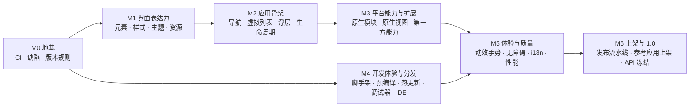

# ROADMAP：从示例到 C 端应用

本文是 Weft UI 的产品与工程路线图，目标是让 Weft UI **能支撑一个上架发布、面向普通用户的 C 端应用**。[PLAN.md](PLAN.md) 已经完成了架构收敛，本文在它的基础上排期。每个里程碑开工前，按 PLAN.md 的格式（任务编号、改动、验收、提交）另写一份执行计划；检查命令沿用 PLAN.md 的代号（C-rust、C-ts、C-apps、C-core、C-apple、C-android、C-windows、C-linux、C-ui）。

## 1. 目标的定义

「能支撑 C 端应用」用一个**参考应用**来验收，不靠功能清单打勾。

### 参考应用 `example/`

在仓库里新建一个内容社区类应用，用它驱动需求、验收每个里程碑。它必须具备以下页面和能力：

| 页面 / 能力 | 覆盖的框架能力 |
| --- | --- |
| 底部 Tab：首页、发现、消息、我的 | Tab 导航、页面生命周期 |
| 首页信息流：图文卡片，下拉刷新、上拉加载，10k 条 | 虚拟列表、图片缓存、网络 |
| 详情页：大图、富文本、点赞动画、评论列表 | 栈导航、动画、长文本排版 |
| 发布页：多行输入、选图、上传进度 | 相册/相机、权限、上传、键盘避让 |
| 登录：手机号 + 微信 / Apple 登录 | 扩展模块、安全存储、深链回调 |
| 设置：深色模式、语言、清缓存、关于 | 主题、i18n、文件系统 |
| 推送：点击通知打开详情 | 推送、深链、冷启动路由 |
| 弹窗：Toast、确认框、底部操作表 | 浮层 |

### 完成标准（1.0）

- **功能**：参考应用在第一梯队平台（见下）功能完整，并通过 App Store、Google Play、微信小程序的审核（可以用测试账号或内测通道）。
- **体验**：满足[第 6 节](#6-质量预算)的性能、无障碍和稳定性预算。
- **工程**：每个 PR 跑 CI；可以一条命令创建新项目，不需要克隆本仓库，也不需要从源码构建 Hermes 或 Rust；版本、协议兼容和发布流程都有明文规则。

### 平台分级（假设，需要确认）

C 端流量集中在手机和小程序上。7 个平台同步推进的成本是 7 倍，所以分级：

| 梯队 | 平台 | 要求 |
| --- | --- | --- |
| 一 | iOS、Android、微信小程序、Web（H5） | 新能力必须同时上线，进入截图回归和 CI |
| 二 | macOS、Windows | 落后一个里程碑以内；暂不支持的能力在编译期报错 |
| 三 | Linux | 尽力而为：保证能编译、示例能跑通 |

「暂不支持的能力在编译期报错」由 M1 的元素定义单一来源实现：每个元素和属性标注各平台的支持情况，编译到不支持的平台时报诊断，不会静默降级。

## 2. 现状评估

依据：[PLAN.md](PLAN.md)、[PLAN-M0.md](PLAN-M0.md)、[PLAN-M1.md](PLAN-M1.md) 和 [PLAN-M2.md](PLAN-M2.md) 的执行记录。

| 领域 | 现状 | 对 C 端的差距 | 严重度 |
| --- | --- | --- | --- |
| 元素 | 22 个，含惰性列表与网格、导航栏、滚动、富文本和输入控件；支持打包图片与自定义字体 | 缺 WebView、视频 | 高 |
| 样式 | 支持伸缩与对齐、四边内外间距、尺寸约束、圆角、边框、阴影、透明度、字重和截断；可复用样式，主题跟随系统深浅模式 | 缺动画与过渡 | 中 |
| 交互 | 按钮、容器和部分内容元素支持点击；受控输入支持输入类型、提交和焦点控制；支持键盘避让 | 缺长按、滑动等手势 | 高 |
| 应用结构 | 类型化页面、栈与 Tab 导航、模态、返回、深链和前后台生命周期；小程序支持多页面与分包 | Universal Links、App Links 的域名验证和部分小程序行为待真机确认 | 中 |
| 列表 | `List`、`Grid` 按可见窗口惰性物化，支持分组头、加载更多及下拉刷新（桌面原生平台无效果） | 10k 条性能预算待真机测量，超预算项留待 M5.6 复核 | 中 |
| 平台 API | `run`、`fetch`（无响应头、超时、取消、上传）、字符串 `storage`、`platform`，以及 `navigation`、`ui`、`lifecycle` | 缺扩展机制（自定义原生模块 / 原生视图），以及相册、相机、权限、推送、分享、剪贴板、安全存储、文件、WebSocket、登录、支付 | 高 |
| 语言 | 类型化 model、event、component、page、app、state、if/for、字面量联合、组件回调、具名插槽和局部 `let` | 缺原生视图扩展声明 | 中 |
| 无障碍 | 没有 label、role 等 API；Android `Image` 的 `contentDescription = null` | 上架合规和可用性要求 | 中 |
| 国际化 | Hermes 构建时关闭了 Intl（`native/core/hermes.cmake`）；Android 区域设置有 TODO | 缺日期和数字格式、RTL、语言切换 | 中 |
| 开发循环 | Web 有 Vite 开发服务器；原生和小程序只能整包构建；Hermes 调试器被关闭；生成的 JS 没有 source map | 改一行要重编原生工程；原生上无法断点调试 | 高 |
| 分发 | TS 包 0.1.0 已发布；原生壳与预编译内核拆成 `@weft-ui/native-<target>`，`@weft-ui/vite` 按包解析壳和 hermesc（M0.4），已在仓库外用 tarball 验证 Android、iOS；Release 工作流在各平台构建全部内核，打包后通过可信发布暂存到 npm，维护者批准后上线；0.2.0 等待首次暂存（[PLAN-M0](PLAN-M0.md) R1）；没有脚手架 | native 包发布前，外部项目仍只能用 Web 和小程序 | 高 |
| CI | PR 流水线（`ci.yml`）跑 C-rust、C-ts、C-core、C-linux、C-apple、C-android、C-windows；夜间流水线（`nightly.yml`）运行 Android、iOS 点击流程及 Web、iOS、Android 截图回归 | 桌面点击流程与小程序截图在本地运行；性能基准尚未纳入 CI，真机数据待测 | 低 |
| 编辑器 | `weft lsp` 支持诊断、补全、悬停、跳转、格式化；Zed 扩展；TS content mapper | 缺 VS Code 扩展、重命名、查找引用、代码操作 | 中 |
| 测试 | 协议版本 3 的共享样例覆盖所有宿主；编译产物快照与跨平台一致性测试覆盖 M1、M2 能力，example 在七个平台可截图；已有模拟器性能基准 | 缺 CI 性能基准和真机覆盖 | 中 |

### 已确认的缺陷（M0 修）

全部已在 [PLAN-M0.md](PLAN-M0.md) 中修复，编号见最后一列。

| 缺陷 | 位置 | 修复 |
| --- | --- | --- |
| `setInterval(fn, 0)` 只触发一次：delay 为 0 时 period 为 0，`tick` 把它当成一次性定时器 | `native/core/src/runtime.cpp` 的 `arm` 和 `weft_runtime_tick` | F1 |
| Apple 和 Linux 宿主边解码边应用，批次后部出错时已应用前缀，违反 SPEC 的「整批不应用」（N2 只修了 Android 和 Windows） | `native/apple/Sources/WeftKit/Session.swift` 的 `commit`、`native/linux/src/session.cpp` 的 `Session::commit` | F2 |
| npm 用户无法构建原生平台（见上表「分发」）；只做 Web 的用户也要下载 49 MB 的 `hermes-compiler` | `packages/vite/src/shells.ts`、`packages/vite/package.json` | N.1–N.6 |
| 格式化器遇到二元运算数之间的注释报内部错误 | `crates/formatter/tests/format.rs:388-406` | F3 |
| Linux 图片纹理缓存没有淘汰策略 | `native/linux/src/elements.cpp` | F4 |
| 中文文档侧边栏的语法和协议链接指向英文版 | `docs/astro.config.mjs` | F5 |
| compiler 包注释仍说原生视图后端不存在 | `packages/compiler/src/index.ts:100-103` | F6 |

## 3. 关键架构决策

下列决策决定了后续几十个任务的形态，必须在所属里程碑开工前定稿。每条都给出了推荐方案；定稿后写进对应的规范（GRAMMAR.md 或 SPEC.md）。

| 编号 | 问题 | 推荐 | 理由 / 代价 | 截止 |
| --- | --- | --- | --- | --- |
| D1 | 元素定义如何扩展到几十个元素、7 个后端 | 仿照 `protocol/weft.protocol.json` 建 `elements` schema：属性、类型、事件 payload、子节点规则、各平台支持情况、各后端映射。由它生成 `elements.rs` 的目录、文档表格、TS 类型和各后端的桩代码 | 现在每加一个元素要手改 7 个生成器和 5 个壳。单一来源是 PLAN.md 已经验证过的路线 | M1 开工 |
| D2 | 样式模型 | 保持**封闭、有类型的属性集合**，不引入通用 CSS。新增 `style Name { ... }` 声明和 `style = Name` 引用，用来复用；颜色和尺寸支持主题 token（`color = theme.primary`），按浅色/深色解析 | 通用 CSS 在 SwiftUI、Compose、WinUI、GTK 上无法如实实现。封闭集合能做编译期检查，也能为每个平台生成原生修饰符 | M1 开工 |
| D3 | 导航模型 | 已定稿，见 [PLAN-M2 规范 §2](PLAN-M2.md#2-导航模型d3)：类型化 `page`，逻辑层持有单一导航栈与 Tab，支持一层模态；小程序每页生成独立页面，Android 使用 Navigation 3，Windows 使用自建宿主面板，GTK 使用 `GtkStack` | 页面集合编译期已知，类型化参数用于深链解析与校验；宿主导航变化由 JS 采纳 | M2 已定稿 |
| D4 | 虚拟列表的协议 | 已定稿，见 [PLAN-M2 规范 §4](PLAN-M2.md#4-协议版本-3d4-与导航)、[§5](PLAN-M2.md#5-惰性列表d4)：协议版本 3 用 `splice`、`bind` 和宿主窗口请求按需物化与回收，并协商协议版本 | 原生列表按需创建可见项，避免一次性实例化全部行 | M2 已定稿 |
| D5 | 扩展机制 | 两种扩展：① **原生模块**：在 schema 里声明方法签名，生成 TS 声明和 Swift、Kotlin、C#、C++ 的协议桩，复用现有的平台调用帧（`frame`/`unframe`）；② **原生视图**：在 `.weft` 里用 `extern component Map(lat: Float, ...)` 声明，宿主注册视图工厂。第一方能力（相册、推送等）也走这套机制，以此验证它 | 框架不可能内置全部 SDK（支付、地图、统计）。第一方能力自己用扩展机制实现，是对机制最好的验证 | M3 开工 |
| D6 | 原生开发循环 | 分两层：① 逻辑热更新：调试构建里内核从开发服务器加载 JS（WebSocket），保存后重载并保留 model；② 视图变更：原生视图是生成的源码（SwiftUI、Compose、C#、C++），结构变化必须重新编译。短期做增量重编加自动重启；长期评估调试态的通用渲染器（直接解释 `layout.json`）是否值得做 | 视图编译成原生代码是性能和原生度的来源，不能为热重载放弃。先把逻辑热更新做到秒级，就能覆盖大部分改动 | M4 开工 |
| D7 | Hermes 构建开关 | 调试构建打开 Hermes 调试器（CDP，可以用 Chrome DevTools 连接）；Intl 按平台打开或用 polyfill，在 M5 用包体积数据定 | 调试器只进调试构建，不影响发布体积；Intl 会增加体积，要实测 | 调试器 M4，Intl M5 |
| D8 | 原生壳与内核的分发 | **npm 自包含，按目标平台拆包**：`native/{apple,android,windows,linux}` 各自成为 workspace 包 `@weft-ui/native-<target>`，包内是壳源码加预编译内核（见[附：npm 自包含方案](#附npm-自包含方案)）。`hermes-compiler` 从 `@weft-ui/vite` 移到各 native 包，跟内核锁定在同一版本。`@weft-ui/vite` 把它们声明为可选 peer 依赖，用模块解析找到壳；`native` 选项保留，用于覆盖 | 安装即可构建，不需要 Rust、CMake 或 Hermes 源码，也不需要另外下载；本仓库开发与 npm 用户走同一条解析路径；只做 Web 的用户不再下载 49 MB 的 hermesc | M0 |
| D9 | OTA 更新 | 1.0 之后再做。到时只更新 JS 和 Hermes 字节码，并且要求签名、可回滚；视图结构变化不能 OTA，必须把它写成显式约束 | 视图是原生代码，天然不能 OTA。App Store 对下载代码有政策限制，小程序不需要 OTA | 1.0 后 |

## 4. 里程碑

两条主线并行推进：**A 线（产品能力）** 决定应用能做出什么，**B 线（工程与开发体验）** 决定做得多快、多稳。

M4 和 M1–M3 并行。M4 越早完成，A 线的迭代越快，所以 M4 里的「逻辑热更新」和「调试器」应该排在 M4 最前面。

---

### M0 地基

**目标**：让后续每个改动都有自动回归，并修掉已知缺陷。

| 编号 | 内容 |
| --- | --- |
| M0.1 | GitHub Actions PR 流水线：Ubuntu 跑 C-rust、C-ts（含 C-gen）、C-core、C-linux（容器）；macOS 跑 C-apple 和 Android 单测（C-android）；Windows 跑 C-windows。缓存 Hermes 构建目录和 cargo、pnpm |
| M0.2 | 夜间流水线：Android 模拟器和 iOS 模拟器上的 C-ui 点击流程（Windows 和 Linux 的 UI 测试先留在本地，标注在流水线说明里） |
| M0.3 | 修复[已确认缺陷](#已确认的缺陷m0-修)。每个缺陷先写一个失败的测试：在共享样例里加批次后部出错的用例，覆盖 Apple 和 Linux；内核计时器测试加 `setInterval(fn, 0)` |
| M0.4 | npm 自包含分发（D8）：按[附：npm 自包含方案](#附npm-自包含方案)的 N.1–N.6 执行。完成后，在仓库外新建的项目只要 `pnpm add -D @weft-ui/vite @weft-ui/native-android`，就能构建 Android |
| M0.5 | 版本与兼容规则：引入 changesets；1.0 之前 minor 版本可以有破坏性变更；协议版本与包版本的对应关系写进 SPEC；每个包都有 CHANGELOG |
| M0.6 | 仓库卫生：CONTRIBUTING（含各平台环境准备）、SECURITY、issue 和 PR 模板 |
| M0.7 | 测试夹具补齐：快照和 conformance 加入覆盖 Checkbox、Image、自定义组件、插槽和全部样式属性的夹具 |

**退出标准**：PR 流水线是必过检查；M0.3 的回归测试在 CI 里通过。

---

### M1 界面表达力

**目标**：参考应用的每一个静态页面都能用 `.weft` 精确写出来，并在第一梯队平台上一致地渲染。

**状态**：功能已完成，见 [PLAN-M1.md](PLAN-M1.md)。夜间截图工作流已触发并定时运行，见 [PLAN-M2.md](PLAN-M2.md)。

| 编号 | 状态 | 内容 |
| --- | --- | --- |
| M1.1 | 完成 | 元素定义单一来源（D1）：把现有 7 个元素迁移到 schema，产物逐字节不变（沿用 PLAN.md 的 C-apps 规则），然后再加新元素 |
| M1.2 | 完成 | 平台支持矩阵：schema 标注各平台的支持情况；编译到不支持的平台时报诊断；文档里的元素表格从 schema 生成 |
| M1.3 | 完成 | 跨平台截图回归：同一组「元素画廊」页面在 iOS 模拟器、Android 模拟器和 Web（Playwright）上截图并在夜间 CI 比较基线；小程序在本地比对，macOS、Windows、Linux 截图供人工检查 |
| M1.4 | 完成 | 布局：`grow`（权重）、主轴和交叉轴对齐（`align`、`justify`）、`Spacer`、`Stack`（叠放，配合 `alignment`）、`margin`、四边分别设置的 padding（`paddingX`、`paddingTop` 等）、`minWidth`/`maxWidth` 等尺寸约束、`fill` 撑满父容器、`aspectRatio` |
| M1.5 | 完成 | 外观：`radius`、`border`、`shadow`、`opacity`、`clip`、`hidden`；渐变背景暂不做 |
| M1.6 | 完成 | 文本：`weight`、`align`、`maxLines` 加省略号、`lineHeight`、`italic`、`decoration`；`Text` 的直接子元素 `Span` 实现富文本 |
| M1.7 | 完成 | 新元素：`Scroll`（纵向或横向）、`Switch`、`TextArea`、`Spinner`、`Progress`、`Divider`、`Slider`、`Picker` |
| M1.8 | 完成 | 输入增强：`Input` 的 `type`（text、password、number、email、phone）、`returnKey`、`onSubmit`、`maxLength`；焦点控制（`focused` 绑定 state） |
| M1.9 | 完成 | 任意元素可点击：容器支持 `onTap`；按压态反馈遵循各平台习惯 |
| M1.10 | 完成 | 样式复用与主题（D2）：`style` 声明、主题 token、浅色/深色自动切换、跟随系统；`platform.colorScheme` 可以在逻辑层读取 |
| M1.11 | 完成 | 资源管线：本地图片（多倍图，`@2x`、`@3x`）、矢量图标（SVG 转各平台格式）、自定义字体；Vite 插件把资源分发到 xcassets、Android `res/`、小程序包和 Web 的 `public`。`Image` 增加 `fit`（cover、contain、fill）和 `placeholder` |
| M1.12 | 完成 | 安全区与屏幕信息：安全区内边距可选、`platform.screen`（尺寸、像素密度），横竖屏变化通知逻辑层 |
| M1.13 | 完成 | 语言补强：枚举或字符串字面量联合（用于 `type`、`align` 等属性，也给用户 model 用）、组件回调参数（`onSelect: Event<Int>` 一类，让可复用组件把事件交给调用方决定）、具名多插槽、组件内局部 `let` |

**退出标准**：参考应用全部页面的静态版本（不含导航和真实数据）在第一梯队平台上与设计稿一致，截图回归通过；第二梯队要么正确渲染，要么在编译期报出不支持。

---

### M2 应用骨架

**目标**：参考应用能在页面之间跳转，信息流能流畅滚动 10k 条。

**状态**：功能已完成，见 [PLAN-M2.md](PLAN-M2.md)；D3、D4 已定稿，协议为版本 3。退出标准中的性能预算尚未在真机上确认（模拟器参考值见 PLAN-M2 的 B1，Android 掉帧 5.01% 略超预算），真机测量和 Universal Links、App Links 的域名验证需要维护者完成。

**前置**：D3、D4 定稿；M1.1、M1.3 完成。

| 编号 | 内容 |
| --- | --- |
| M2.1 | 页面与导航（D3）：`page` 声明、类型化参数、`navigation.push/pop/replace/popToRoot`；页面级生命周期 `onShow`/`onHide`；标题栏配置（标题、返回按钮、右侧按钮） |
| M2.2 | Tab 导航：`tabs` 声明（图标、文字、角标）；小程序映射到 `tabBar` |
| M2.3 | 模态与浮层：`sheet`、`fullScreen`；`alert`、`confirm`、`actionSheet`、`toast` 作为逻辑层 API |
| M2.4 | 返回行为：Android 返回键和预测性返回手势、iOS 侧滑返回、Web 的 history 与刷新后恢复、小程序的 `navigateBack` |
| M2.5 | 小程序多页面：每个 page 生成一个独立页面、`app.json` 的 `pages`、分包（`subPackages`）、主包体积检查（2 MB 上限，超出报错） |
| M2.6 | 虚拟列表（D4）：`List` 和 `Grid` 使用协议版本 3 的惰性行；`onEndReached`（加载更多）、`refreshing` 加 `onRefresh`（下拉刷新，桌面原生平台无效果）、分组头；原生平台使用惰性列表，小程序使用分段渲染 |
| M2.7 | 协议版本协商：内核和壳上报所支持的协议版本，不匹配时启动报错，错误信息里给出两边的版本 |
| M2.8 | 应用生命周期：`lifecycle.onForeground`、`lifecycle.onBackground`、`lifecycle.launch`（冷启动参数）、系统内存告警 |
| M2.9 | 深链：URL 映射到 page 和参数（来自 `page` 声明的类型化参数），iOS 的 Universal Links、Android App Links、Web 路由、小程序的页面路径与 query 统一 |
| M2.10 | 键盘避让：输入框获得焦点时内容不被键盘遮挡；macOS、Windows、Linux 无效果 |

**退出标准**：参考应用的导航骨架在第一梯队平台跑通，包括 Tab、栈、模态、返回、深链冷启动；10k 条信息流满足[性能预算](#6-质量预算)；协议版本 3 的样例进入 `protocol/corpus/` 并在全部宿主通过。

---

### M3 平台能力与扩展

**目标**：参考应用能登录、发图、收推送；第三方能通过扩展接入任意原生 SDK。

**前置**：D5 定稿。

| 编号 | 内容 |
| --- | --- |
| M3.1 | 原生模块机制（D5 ①）：模块 schema 生成 TS 声明和 4 种宿主语言的桩代码；支持异步调用、事件订阅（宿主主动推送）、二进制参数；`isSupported` 扩展到任意模块 |
| M3.2 | 原生视图机制（D5 ②）：`extern component` 声明、各平台视图工厂注册、属性更新和事件回传；用一个地图或视频组件作为示例 |
| M3.3 | 模块的打包与发现：模块作为 npm 包分发，包内带各平台原生代码；Vite 插件把它们接入生成的工程（SwiftPM 依赖、Gradle 模块、NuGet 引用、CMake 子目录） |
| M3.4 | 网络增强：`fetch` 支持响应头、`timeout`、`AbortSignal`、`FormData` 和文件上传（带进度）、下载到文件；`WebSocket` |
| M3.5 | 存储：`secureStorage`（Keychain、Android Keystore、Windows Credential Locker、libsecret；小程序降级为普通存储并在文档注明）；文件系统（缓存目录、文档目录、读写、删除、大小统计） |
| M3.6 | 媒体与权限：`permissions.query/request`；相册和相机选图或拍照（含压缩）；图片预览 |
| M3.7 | 系统集成：剪贴板、分享、打开外部 URL 和应用、震动反馈、设备信息（区域、时区、网络状态及变化） |
| M3.8 | 推送：APNs、FCM（国内厂商通道做成可插拔模块，不内置）、小程序订阅消息；点击通知时经 M2.9 深链打开对应页面 |
| M3.9 | 登录与支付做成第一方扩展模块：Sign in with Apple、微信登录（App 与小程序）、Google；Apple IAP、Google Play Billing、微信支付。每个都是独立 npm 包，作为 M3.3 的示范 |
| M3.10 | `WebView` 元素（作为原生视图实现）：用于协议页、活动页，支持与 JS 双向通信 |

**退出标准**：参考应用的登录、发布（选图加上传）、推送打开详情三条流程在 iOS、Android 真机上跑通，小程序上跑通对应的降级流程；至少一个第三方模块（不在本仓库）能按文档接入并通过构建。

---

### M4 开发体验与分发（与 M1–M3 并行）

**目标**：外部开发者 5 分钟内建好新项目并在手机上跑起来；改逻辑代码秒级生效；原生上可以断点调试。

**前置**：D6、D7（调试器部分）定稿；M0.4 完成。

| 编号 | 内容 |
| --- | --- |
| M4.1 | 逻辑热更新（D6 ①）：调试构建里内核连接 Vite 开发服务器，JS 变更后重载 bundle，并序列化和恢复 model；小程序侧用监听构建加开发者工具自动刷新 |
| M4.2 | Hermes 调试器（D7）：调试构建开启 CDP，Chrome DevTools 或 VS Code 可以连接，支持断点、单步、console；生成 source map，映射回 TS 源码和 `.weft` |
| M4.3 | 开发态错误浮层：JS 异常、协议错误、编译错误在应用内显示红屏（含调用栈和源码位置），可以关闭；发布构建不包含 |
| M4.4 | 视图变更的快速路径（D6 ②）：只重新生成变化的视图文件，并触发增量原生编译和应用重启；评估通用渲染器的可行性，出一份带数据的结论 |
| M4.5 | CLI 与编辑器分发：`weft` CLI 发布各平台二进制（npm 按宿主拆包，做法同 esbuild 的 `@esbuild/<os>-<arch>`），Zed 和 VS Code 扩展直接使用这些二进制。原生壳与内核的分发已在 M0.4 完成 |
| M4.6 | 脚手架：`pnpm create weft-app`，提供模板（空白、Tab 应用）、平台选择、自动检查各平台工具链（类似 `flutter doctor`，命令为 `weft doctor`） |
| M4.7 | VS Code 扩展：语法高亮（TextMate 或 tree-sitter）、`weft lsp`、TS content mapper 的集成说明；发布到 Marketplace 和 Open VSX |
| M4.8 | LSP 补全：查找引用、重命名（跨文件）、文档符号与工作区符号、语义高亮、签名帮助、代码操作（补 import、创建缺失的 event 声明） |
| M4.9 | CLI：`weft check`（类型检查，用于 CI）、`weft build <platform>`（包装 Vite）、`weft doctor` |
| M4.10 | 组件测试工具：在 `@weft-ui/runtime/testing` 的基础上提供无头渲染、模拟事件、断言 ops 或视图树的 API，并写进文档 |

**退出标准**：在一台干净的 macOS 上，`pnpm create weft-app`、安装 Xcode 和 Android SDK 之后，10 分钟内在 iOS 模拟器和 Android 模拟器上跑起应用，全程不需要 Rust、CMake 或 Hermes 源码；改 TS 后 2 秒内在模拟器上生效；能在 Chrome DevTools 里对原生应用的 TS 源码下断点。

---

### M5 体验与质量

**目标**：参考应用的手感和质量达到上架标准。

**前置**：M2 完成；D7 的 Intl 部分定稿。

| 编号 | 内容 |
| --- | --- |
| M5.1 | 动画：属性变化的隐式动画（`animate = spring` 一类）、元素进出场过渡（`transition = fade/slide`）、页面转场使用各平台的默认动画；小程序用 `animation` 或 CSS transition |
| M5.2 | 手势：`onLongPress`、`onSwipe`、拖动（`onDrag`，带位移 payload）、列表项侧滑操作 |
| M5.3 | 无障碍：通用属性 `label`、`hint`、`role`、`hidden`，以及焦点顺序；动态字体（系统字号缩放）；检查清单与自动化检查（iOS 的 Accessibility Inspector 审计、Android 的 Accessibility Test Framework） |
| M5.4 | 国际化：区域设置 API 与变化通知；日期、数字、货币格式化（Intl 或 polyfill，按 D7 的结论）；RTL 布局（`leading`/`trailing` 语义，镜像图标）；文案资源方案与复数规则的推荐做法，写进文档 |
| M5.5 | 性能基准：在 CI 上跑冷启动、首帧、列表滚动掉帧率、内存、包体积，结果按提交记录，超过预算即失败 |
| M5.6 | 性能优化：按 M5.5 的数据处理热点。已知候选：内核计时器每次扫描全部计时器（`runtime.cpp`）；平台调用结果的拷贝；大批次 ops 的分片提交；图片解码与降采样 |
| M5.7 | 稳定性：全局 JS 错误钩子（`app.onError`）、组件级错误边界（子树渲染失败时显示兜底内容）；崩溃上报的接入点（Sentry 一类做成扩展模块）；Android ANR 和 iOS 主线程卡顿检测 |
| M5.8 | 隐私与合规：iOS 隐私清单（`PrivacyInfo.xcprivacy`）、Android 数据安全声明所需的信息清单、小程序隐私协议接口 |

**退出标准**：满足[第 6 节](#6-质量预算)的全部预算；参考应用在 VoiceOver 和 TalkBack 下能完成主要流程；切换到阿拉伯语时布局正确镜像。

---

### M6 上架与 1.0

**目标**：参考应用真实上架；Weft UI 发布 1.0。

| 编号 | 内容 |
| --- | --- |
| M6.1 | 应用配置：`weft.config` 或 Vite 插件选项统一配置图标、启动屏、版本号、权限声明、URL scheme，生成到各平台工程；改配置后可以重新生成，不必只在首次复制模板时生效 |
| M6.2 | 发布构建：iOS 签名 IPA、Android AAB（签名、R8）、Windows MSIX、macOS 公证；Linux 先做 Flatpak 或 AppImage 中的一种 |
| M6.3 | 发布流水线模板：脚手架生成的 CI 配置，覆盖 TestFlight、Play 内测轨道、`miniprogram-ci` 上传体验版 |
| M6.4 | 参考应用上架：iOS、Android、小程序提交审核；把遇到的问题记录下来，回填到文档和框架 |
| M6.5 | 文档：完整的 API 参考（元素、样式、平台 API，从 schema 生成）、Cookbook（列表、表单、登录、推送、主题）、从 0.x 升级的迁移指南、各平台的发布指南 |
| M6.6 | 1.0 冻结：公开 API 和语法冻结，遵循 semver；协议版本兼容承诺写进 SPEC（同一主版本内的内核、壳和编译器可以混用的范围）；废弃流程（先警告一个 minor，再删除） |

**退出标准**：[第 1 节](#完成标准10)的全部条件满足。

## 5. 横向工作

这些工作在每个里程碑里都要做，不单独排期。

- **每个新能力必须同时交付**：schema 定义 → 7 个后端（第二、三梯队可以是编译期「不支持」） → 截图回归或 conformance 用例 → 中英文文档 → 参考应用里的用法。缺任何一项都不算完成。
- **协议变更**：先改 SPEC 和 `weft.protocol.json`，加共享样例，再改实现。
- **文档**：英文和中文同步。新指南按里程碑增加：样式与主题（M1）、导航（M2）、扩展开发（M3）、调试（M4）、无障碍与国际化（M5）、发布（M6）。
- **执行记录**：每个里程碑的执行计划都有「执行中发现」一节，发现的问题转入下一份计划，沿用 PLAN.md 的做法。

## 6. 质量预算

基准设备：Android 用中端机（骁龙 7 系或相当），iOS 用 iPhone 12 或更新的机型；均为发布构建。

| 指标 | 预算 | 首次纳入 |
| --- | --- | --- |
| 冷启动到首帧（参考应用） | Android ≤ 1.2 s，iOS ≤ 0.8 s | M2 |
| 信息流 10k 条持续快速滚动 | 掉帧（超过 16.7 ms 的帧）≤ 5% | M2 |
| 10k 条列表的内存增量 | 与 100 条相比 ≤ 30 MB | M2 |
| 点击到视图更新 | ≤ 1 帧（JS 处理 ≤ 8 ms） | M1 |
| 框架带来的包体积增量 | Android（arm64）≤ 6 MB，iOS ≤ 5 MB，Web 运行时 ≤ 15 KB（gzip） | M4 |
| 小程序主包 | 参考应用 ≤ 1.5 MB（平台上限 2 MB） | M2 |
| 崩溃率 | 参考应用内测期间无崩溃用户比例 ≥ 99.8% | M6 |
| 无障碍 | 所有可交互元素都有可读的 label，自动化审计零错误 | M5 |

这些数字是初始目标。M5.5 的基准跑出第一批真实数据后，再校准一次，之后就固定下来。

## 7. 不做或延后

| 项 | 原因 | 重新评估的条件 |
| --- | --- | --- |
| OTA 热更新 | 见 D9；需要签名、回滚和审核合规方面的工作 | 1.0 发布后 |
| Web 的 SSR 和 SEO | C 端 H5 主要是分享落地页，可以先用静态预渲染替代 | 有明确的 SEO 需求时 |
| 支付宝、抖音等其他小程序 | 先把微信做透；`wechat` 后端的结构可以复用 | 1.0 后，按业务需求 |
| 鸿蒙 NEXT（ArkUI） | 新增一个后端和一个壳，成本相当于一个里程碑 | 1.0 后；国内上架如果有硬性要求，提前到 M6 之后立即排期 |
| 通用 CSS 或自绘渲染 | 与「原生视图」的定位冲突（D2） | 不重新评估 |
| 调试态通用渲染器 | 先看 M4.4 的评估结论 | M4.4 结论为可行时 |
| LSP 增量分析 | 沿用 PLAN.md 的判断：没有性能数据 | 编辑到诊断的耗时超过 200 ms |

## 8. 风险

| 风险 | 影响 | 应对 |
| --- | --- | --- |
| 7 个平台的乘数成本 | 每个能力都要做 7 遍，进度被拖慢 | 平台分级；D1 用 schema 生成桩代码；第二、三梯队允许编译期「不支持」 |
| 视图编译成原生代码，迭代慢 | 开发体验不如 RN 或 Flutter | D6：先做逻辑热更新，再评估通用渲染器 |
| 虚拟列表需要破坏性的协议升级 | 涉及所有宿主，风险集中 | 放在 M2 开头做；先写共享样例；借机建立版本协商 |
| 小程序限制（`setData` 性能、包体积、无法动态创建组件） | 小程序上的能力上限低于原生 | 在支持矩阵里明确标注小程序差异；包体积检查进 CI |
| Hermes 升级 | 字节码与内核版本必须一致，升级时所有平台的制品都要重建 | D8 的预编译制品按版本锁定；升级作为独立任务，跑全部检查 |
| TS 7.1 content mapper 还在 beta | 类型体验依赖一个未稳定的 TS 特性 | 保留 `dts: true` 作为后备方案，并在 CI 里测这条路径 |
| 维护人力 | 范围远大于目前的团队规模 | 严格按里程碑推进；M3 的扩展机制让社区可以分担第一方能力 |

## 附：npm 自包含方案

M0.4 的具体方案。

### 现状

- `@weft-ui/vite` 的 `files` 只有 `dist` 和 `templates`，却从 `../../../native/` 找原生壳（`packages/vite/src/shells.ts`）。npm 安装后，这个目录不存在。
- 壳通过 `build/` 下的相对路径引用内核。这些路径都要求先在本地运行 `build-core` 脚本：Apple 是 `build/WeftCore.xcframework`（`native/apple/Package.swift`），Android 是 `build/jniLibs`，Windows 是 `build\<RID>\weft_core.dll`，Linux 是 `build/linux-<arch>/libweft_core.so`；Linux 还引用了 `../core/include` 和 `../core/src/ops.cpp`。
- `hermes-compiler`（49 MB，含全部宿主的 hermesc）是 `@weft-ui/vite` 的硬依赖，只做 Web 的用户也会下载。Linux arm64 宿主没有官方 hermesc，只能用 `build-core.sh` 构建出来的那个。

### 拆包

每个包就是原来的 `native/<target>/` 目录，加上一个 `package.json`。目录结构不变，壳里的相对路径（`build/...`）也不变，只是 `files` 白名单把预编译内核放进了包里。

| 包 | 内容 | 体积（压缩后，实测或估算） |
| --- | --- | --- |
| `@weft-ui/native-apple` | `Package.swift`、`Sources/WeftKit`、`build/WeftCore.xcframework`（macOS、iOS 真机、iOS 模拟器） | 约 10 MB（实测） |
| `@weft-ui/native-android` | Gradle 模块源码、`build/jniLibs`（4 个 ABI） | 约 4 MB（实测） |
| `@weft-ui/native-windows` | `Weft.WinUI`、`Weft.WinUI.targets`、`build/win-x64`、`build/win-arm64` | 约 3 MB（估算） |
| `@weft-ui/native-linux` | 壳源码、内核头文件和 `ops.cpp` 的副本、`build/linux-x64`、`build/linux-arm64`（含 arm64 的 hermesc） | 约 5 MB（估算） |

每个 native 包都依赖 `hermes-compiler`，版本与内核锁定，hermesc 从 native 包解析。用户只装自己要构建的目标；只做 Web 和小程序的用户不装任何 native 包。

### 任务

| 编号 | 内容 | 验收 |
| --- | --- | --- |
| N.1 | 给 `native/{apple,android,windows,linux}` 加 `package.json`（版本与其他 `@weft-ui/*` 包同步），加入 `pnpm-workspace.yaml`；用 `files` 白名单列出源码和预编译内核，排除 `build/` 下的其他中间产物、测试和 `docker/` | 4 个包的 `pnpm pack --dry-run` 文件清单符合上表，不含中间产物 |
| N.2 | Linux 壳去掉对 `../core` 的引用：`prepack` 把 `core/include` 和 `core/src/ops.cpp` 复制进包，CMake 优先使用包内副本，找不到时回退到 `../core`（仓库内开发） | 从 tarball 解压出来的目录能独立完成 CMake 配置和构建（C-linux） |
| N.3 | `shells.ts` 改为用 `createRequire(import.meta.url).resolve("@weft-ui/native-<target>/package.json")` 定位壳，`native` 选项仍可覆盖；找不到时报错，并给出 `pnpm add -D @weft-ui/native-<target>` | 仓库内 C-apps 无差异；缺包时的错误信息包含安装命令 |
| N.4 | `hermes-compiler` 从 `@weft-ui/vite` 的 `dependencies` 移到各 native 包；`native.ts` 的 hermesc 解析改为从 native 包出发（Linux arm64 用包内的 hermesc）；`@weft-ui/vite` 把 4 个 native 包声明为可选 `peerDependencies` | 只装 `@weft-ui/vite` 时 `node_modules` 里没有 `hermes-compiler`；C-apps 无差异 |
| N.5 | 版本一致性检查：native 包的 `package.json` 记录协议版本（取自 `weft.protocol.json`），`@weft-ui/vite` 构建前对比，不一致时直接报错，不等运行时才失败 | 人为改错版本号后，构建报错并给出两边的版本 |
| N.6 | 发布：每个 native 包的 `prepublishOnly` 检查全部预编译内核都存在（缺任何一个 ABI 或架构都失败）。第一版由维护者在本机汇总 Mac（Apple、Android）、Windows 虚拟机（x64、arm64）、Linux 容器（x64、arm64）的产物后发布；之后由 Release 工作流按矩阵构建（macOS、Windows、`ubuntu-24.04`、`ubuntu-24.04-arm`），汇总后一次发布。二进制包附带 Hermes 的 MIT 许可证 | 在仓库外新建的 Vite 项目里，`pnpm add -D @weft-ui/vite @weft-ui/native-android` 后能 `WEFT_PLATFORM=android vite build`；macOS 上的 iOS 同理；全程不需要 Rust、CMake 或 Hermes 源码 |

### 没有采用的方案

| 方案 | 不采用的原因 |
| --- | --- |
| 所有平台放进一个 `@weft-ui/native` 包 | 压缩后约 20 MB，只做 Android 的用户也要下载 Apple 的 10 MB |
| 安装时或首次构建时从 GitHub Releases 下载内核 | 国内网络经常访问不了 GitHub；还要做缓存、校验和代理配置；离线和 CI 环境不友好。npm 有镜像，自包含更可靠 |
| 按宿主拆包（类似 esbuild 的 `os`/`cpu` 过滤） | 内核按**目标**平台区分，不按宿主：在 macOS 上构建 Android，需要的是 Android 内核 |
| Apple 发 SwiftPM 远程包、Android 发 Maven、Windows 发 NuGet | 需要维护 4 套发布渠道和凭据；生成的工程还要额外配置仓库源。可以在 1.0 之后作为补充渠道 |
